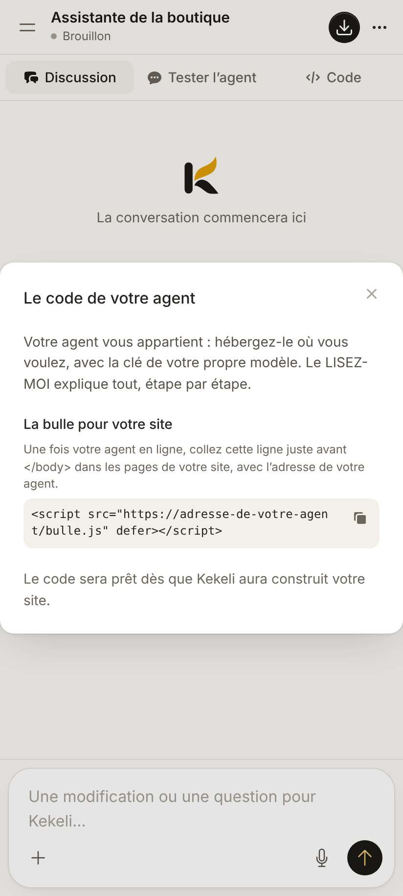
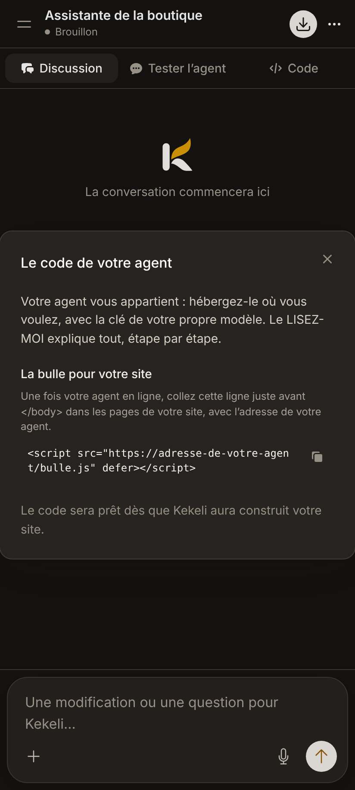
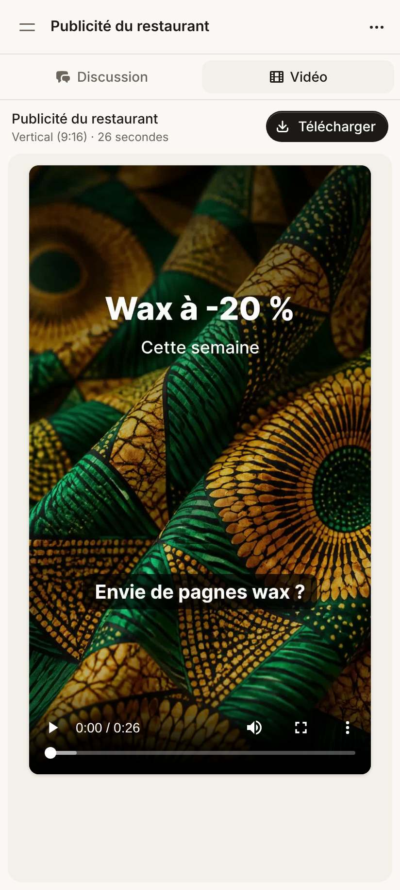

# Audit unslop : les passes, une à une

Décisions du porteur du projet (14 novembre 2026) : **1B** (lueur adoucie), **2A** (onglets des réglages sur une seule ligne qui défile), **3 oui** (moins de gras dans les réponses, annulé si la mesure sur 33 phrases est moins bonne), **4 oui** (nouveaux reçus plus sobres). Plan : [`docs/audit-unslop.md`](../audit-unslop.md). Captures prises sur un téléphone simulé (Pixel 6) et sur un ordinateur, en clair et en sombre, avec des données inventées (`scripts/captures-audit-unslop.js`).

Poids de départ de l'interface : CSS 350,4 ko (41,2 ko compressé), JavaScript 4,8 ko (1,9 ko compressé).

## Passe 0 : défauts

- **Bouton « Copier » de la bulle d'un agent** : il donnait `:aria-label="__('Copy')"` à Alpine, qui l'exécutait comme du JavaScript (« __ is not defined ») ; le bouton n'avait pas de nom pour les lecteurs d'écran. Il a maintenant `aria-label` et `title` « Copier », puis « Copié » après la copie. Nouveau test : aucune balise HTML simple ne donne une traduction à Alpine (`tests/Feature/DesignTest.php`) ; le test des agents vérifie le nom du bouton.
- **Durée de la vidéo d'exemple** des captures : « 26 secondes » au lieu de « 1 seconde » (seulement le script `scripts/preparer-captures-design.php` ; une vraie vidéo envoie déjà sa durée).
- Console du navigateur : plus aucune erreur sur la page d'un agent. Poids du CSS et du JavaScript inchangés (aucun style touché).

| Fenêtre « Le code de votre agent », téléphone clair | Téléphone sombre | Ordinateur clair | Vidéo, téléphone clair |
|---|---|---|---|
|  |  |  |  |
