# Audit unslop : les passes, une à une

Décisions du porteur du projet (14 novembre 2026) : **1B** (lueur adoucie), **2A** (onglets des réglages sur une seule ligne qui défile), **3 oui** (moins de gras dans les réponses, annulé si la mesure sur 33 phrases est moins bonne), **4 oui** (nouveaux reçus plus sobres). Plan : [`docs/audit-unslop.md`](../audit-unslop.md). Captures prises sur un téléphone simulé (Pixel 6) et sur un ordinateur, en clair et en sombre, avec des données inventées (`scripts/captures-audit-unslop.js`).

Poids de départ de l'interface : CSS 350,4 ko (41,2 ko compressé), JavaScript 4,8 ko (1,9 ko compressé).

## Passe 0 : défauts

- **Bouton « Copier » de la bulle d'un agent** : il donnait `:aria-label="__('Copy')"` à Alpine, qui l'exécutait comme du JavaScript (« __ is not defined ») ; le bouton n'avait pas de nom pour les lecteurs d'écran. Il a maintenant `aria-label` et `title` « Copier », puis « Copié » après la copie. Nouveau test : aucune balise HTML simple ne donne une traduction à Alpine (`tests/Feature/DesignTest.php`) ; le test des agents vérifie le nom du bouton.
- **Durée de la vidéo d'exemple** des captures : « 26 secondes » au lieu de « 1 seconde » (seulement le script `scripts/preparer-captures-design.php` ; une vraie vidéo envoie déjà sa durée).
- Console du navigateur : plus aucune erreur sur la page d'un agent. Poids du CSS et du JavaScript inchangés (aucun style touché).

| Fenêtre « Le code de votre agent », téléphone clair | Téléphone sombre | Ordinateur clair | Vidéo, téléphone clair |
|---|---|---|---|
|  |  | 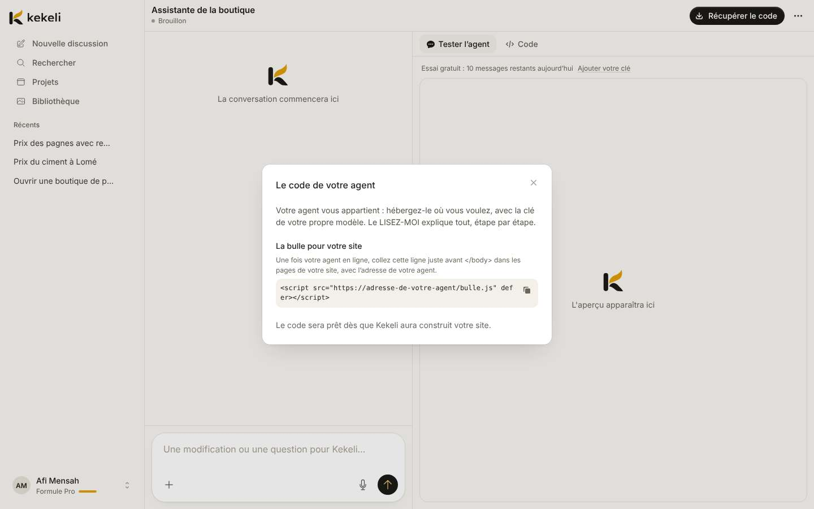 |  |

## Passe 1 : espacements

- **Une seule marge intérieure par genre de carte** : 16 pixels sur téléphone et 20 sur ordinateur pour une carte seule (Formules, Réglages → Formule, Paiement, Administration → Modèles), 16 pixels pour les cartes d'une liste (tuiles de Consommation, Projets, Paiements et Réglages de l'administration, Variables secrètes). Avant : 12, 16 et 20 pixels mélangés. La carte « Votre formule » prend la classe commune `kekeli-carte` (elle avait son propre coin et son propre fond).
- **« Récents » mieux séparé** dans la barre latérale : 12 pixels au-dessus, 8 en dessous (avant : collé au groupe du dessus).
- Nouveau test : `test_cards_share_one_padding` (`tests/Feature/DesignTest.php`).
- Poids : CSS 350,4 → 351,8 ko (41,2 → 41,4 ko compressé), à cause des classes de marge pour l'ordinateur ; JavaScript inchangé.

| Consommation, avant | Après | Formules, avant | Après | Menu, avant | Après |
|---|---|---|---|---|---|
| 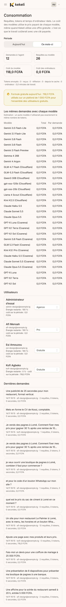 | 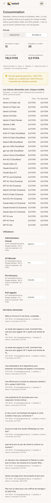 | 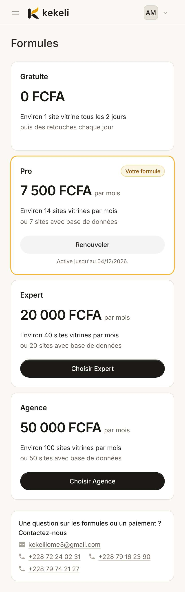 | 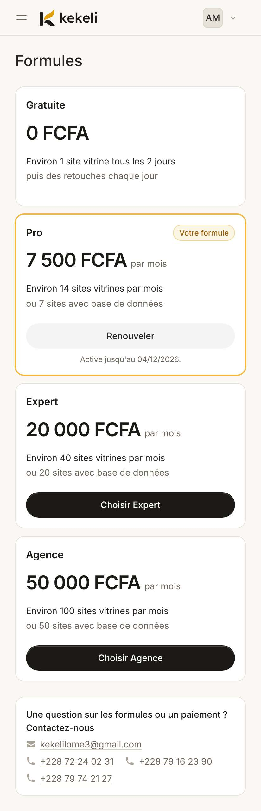 | 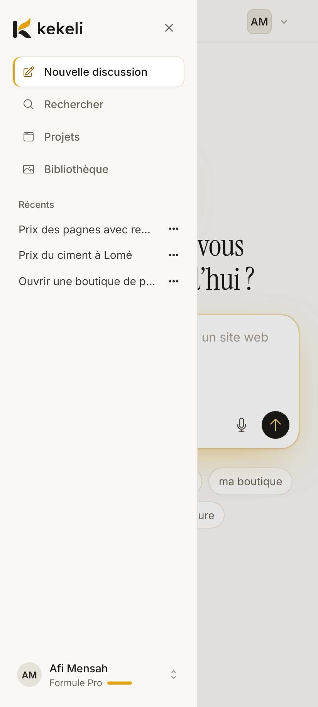 |  |

Toutes les captures de la passe (téléphone et ordinateur, clair et sombre) : `docs/captures/audit-unslop/passes/passe-1/`.

## Passe 2 : couleurs

- **L'ambre est réservé à l'énergie** : la flamme du logo, la barre d'énergie (barre latérale, menu du compte, Réglages → Formule, carte des crédits gratuits) et la flèche du bouton d'envoi. Un test le garantit (`test_amber_is_kept_for_the_energy_and_the_send_button`).
- **Lueur de l'accueil adoucie (décision 1B)** : plus d'ombre colorée large autour de la zone de saisie ni sous le symbole ; une ombre neutre et, quand on écrit, un filet ambré net d'un pixel ; l'aube est deux fois plus discrète.
- **Barre latérale** : l'élément actif est une simple surface plus foncée, sans cadre, sans trait ni icône ambrés (comme Claude et ChatGPT).
- **États lisibles sans ambre** : « En ligne », « Valide » et « Retenu » en vert sauge (nouvelle pastille `kekeli-pastille-succes`) ; avis (rappel de formule, idée gardée, permission, pays, suggestion de base de données, bientôt disponible, avis de la confidentialité) sur une surface douce à l'encre (`kekeli-avis`) ; paiement refusé en terre cuite ; formule actuelle entourée d'encre ; « Dans l'aperçu » et le bandeau d'une ancienne version en gris ; fichier modifié en bleu ardoise dans l'onglet Code ; e-mail reporté en bleu ardoise ; chargements en gris ; « Kekeli réfléchit… » scintille en encre ; sélection du texte en gris. La dictée qui écoute : bouton en encre, point d'enregistrement terre cuite.
- **« Refuser »** (Administration → Paiements) : bouton secondaire au texte terre cuite, au lieu d'un gros bouton rempli à côté d'une carte ambrée.
- Poids : CSS 351,8 → 351,0 ko (41,4 → 41,3 ko compressé) ; JavaScript inchangé.
- Lighthouse téléphone (médiane de 3, départ → après la passe 2) : Accueil 59 → 60, Connexion 59 → 59, Nouvelle discussion 58 → 58, Discussion 58 → 73 (écart probablement dû à la mesure : rien n'a changé dans le poids de cette page), Site 55 → 55, Projets 54 → 54, Bibliothèque 56 → 57, Formules 56 → 56, Réglages 54 → 58 ; accessibilité et bonnes pratiques 100 partout. Rien à annuler.

| Nouvelle discussion sombre, avant | Après | Menu | Projets (« En ligne ») | Formules | Paiements de l'administration |
|---|---|---|---|---|---|
| 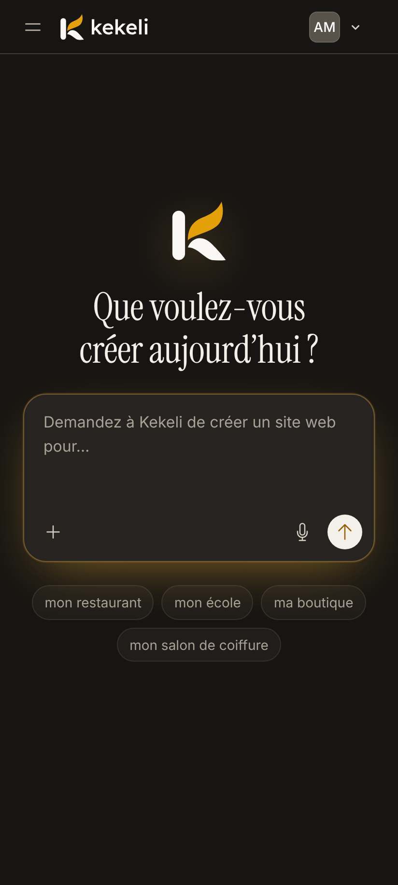 | 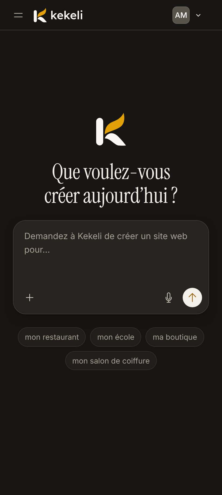 | 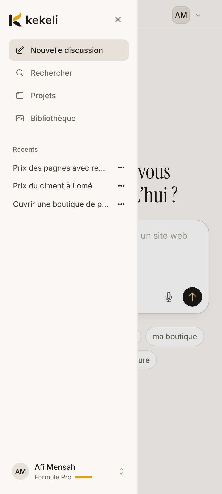 | 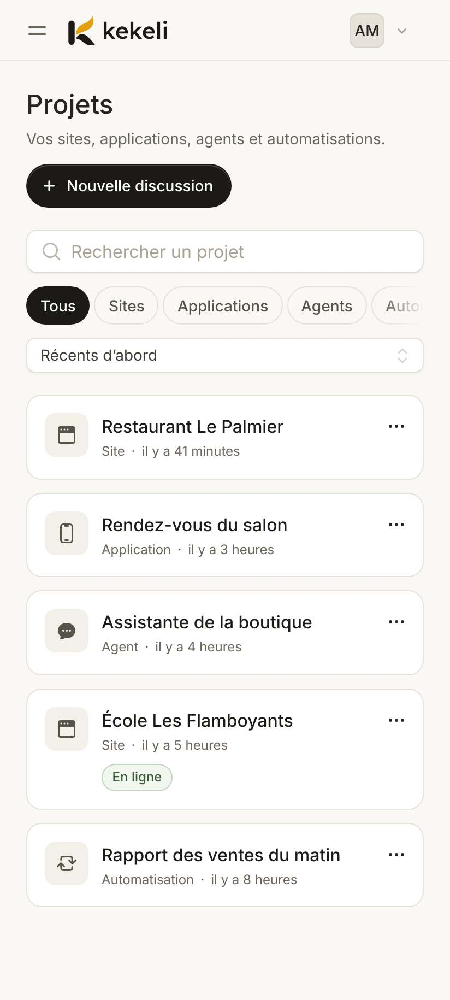 | 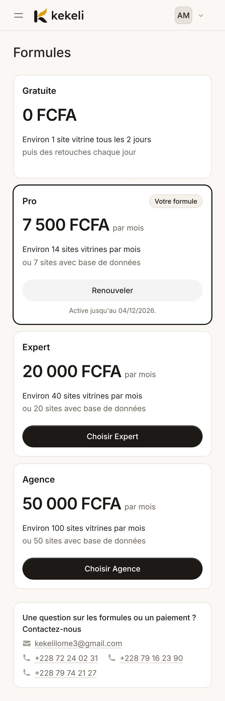 | 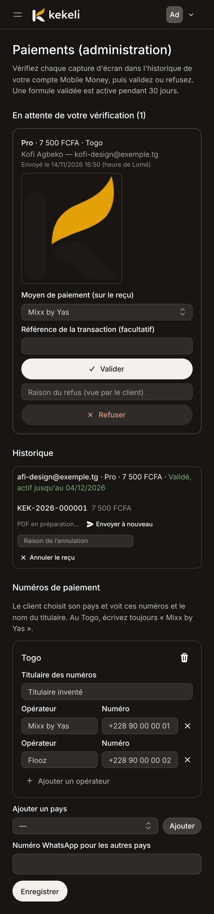 |

Toutes les captures de la passe, tous les écrans (téléphone et ordinateur, clair et sombre) : `docs/captures/audit-unslop/passes/passe-2/`.

## Passe 3 : icônes

- **Plus de fusée** sur « Mettre en ligne » (en-tête d'un site et fenêtre de publication) : un globe, de la même bibliothèque et à la même taille. Lovable et Bolt.new n'ont pas de fusée.
- **Onglets des réglages sans icône** : comme Claude et ChatGPT ; le mot suffit.
- Les coches vertes « fait » (copie réussie, étape terminée) restent : elles portent un sens. Aucun émoji, une seule bibliothèque d'icônes, déjà vérifié par l'audit.
- Nouveau test : `test_no_rocket_and_no_useless_icons_in_the_settings_tabs`. Poids : CSS 351,0 → 350,9 ko (41,3 ko compressé) ; JavaScript inchangé.

| Site, téléphone | Réglages, téléphone sombre | Site, ordinateur |
|---|---|---|
| 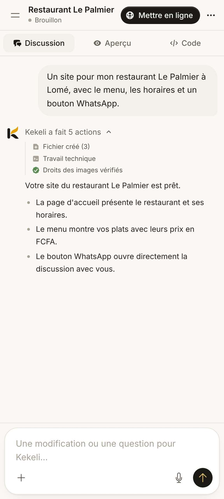 | 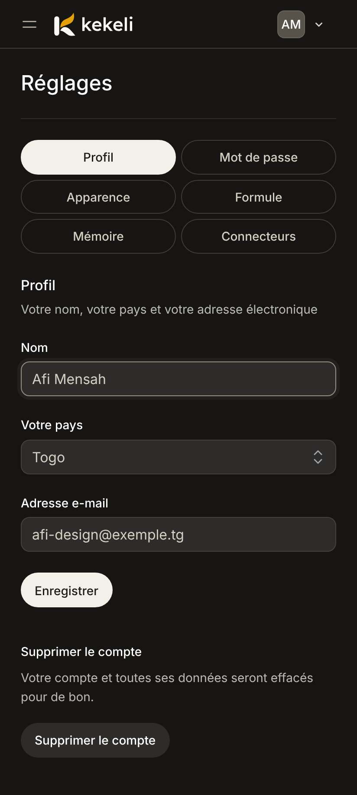 | 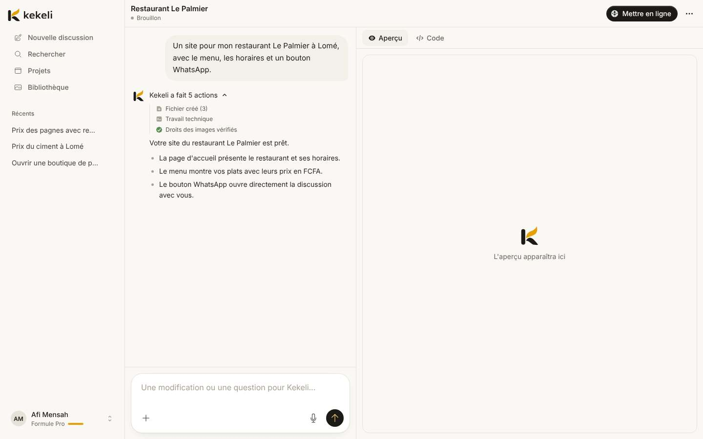 |

Toutes les captures de la passe : `docs/captures/audit-unslop/passes/passe-3/`.
