# Base de connaissances (Kekeli Knowledge) — essai réel du 18 novembre 2026

Essai fait comme un client sur son téléphone (Pixel 7 simulé, navigateur en français), avec le vrai site, la vraie file
d'attente et le vrai Runner, de **vrais documents inventés** (un PDF de 4 pages, un Word, un PowerPoint, dans
[`base-de-connaissances/documents/`](base-de-connaissances/documents/)), la lecture dans un **vrai ordinateur E2B isolé**,
les **vrais vecteurs gratuits** de Gemini et le **vrai modèle gratuit** (Gemini 3.1 Flash-Lite). Script :
`scripts/essai-base-connaissances.js` ; résultats bruts : `runner/mesures/base-connaissances-essai.json`.

## Résultats mesurés

| Vérification | Résultat |
|---|---|
| Importation des 3 documents (lecture isolée, découpage, vecteurs) | 3 sur 3 prêts, en 6 à 12 secondes |
| Lien YouTube public (vidéo de 19 minutes, en anglais) et lien Google Sheets public (exemple officiel de Google) | 2 sur 2 prêts en 29 secondes ; vidéo transcrite dans sa langue avec les minutes |
| « Selon la vidéo, quelle est la taille en pixels des images… combien de neurones ? » | Juste : 28 par 28 pixels, 784 neurones ; sources « à 3 min 10 s », « à 4 min 28 s » avec « Regarder à partir de… » |
| « Dans la feuille des étudiants, quelle est la matière principale d’Alexandra… ? » | Juste : anglais, Californie ; source la feuille Google Drive |
| « Combien coûte la livraison vers Kara, et comment je peux payer ? » | Juste : 3 000 FCFA, 3 jours, Mixx by Yas, Flooz ou espèces ; source « catalogue-ama-pagnes.pdf, page 3 » |
| Question de suivi « Et pour Lomé ? » | Juste : 1 500 FCFA en 24 heures, même source |
| « Combien de jours de congé… et à qui demander ? » (Word et PowerPoint) | Juste : 24 jours, deux semaines avant, auprès de Madame Ama ; deux sources |
| « Quel est le numéro de compte bancaire de la boutique ? » (absent des documents) | « Je ne trouve pas cette information dans vos documents. », rien d'inventé |
| Temps de réponse (du toucher à la réponse complète) | 2,8 à 3,9 secondes |
| Un autre client ouvre l'espace ou la conversation d'Ama | Page introuvable (404) dans les deux cas ; sa propre base reste vide |
| Suppression d'un document | Fichier, 3 passages et leurs vecteurs effacés (0 restant) |

## Captures

| | |
|---|---|
|  | 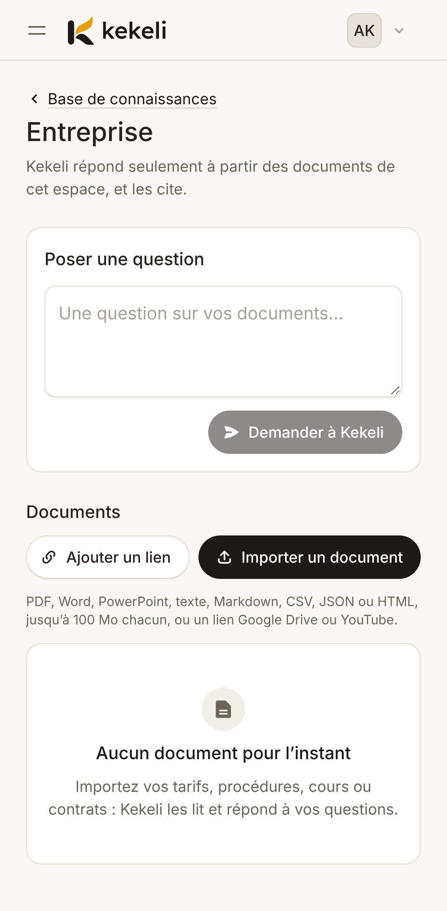 |
| 1. Base de connaissances, avant le premier espace (suggestions Entreprise, Formation, Comptabilité, Juridique, Documentation personnelle) | 2. Un espace créé d'un toucher |
| 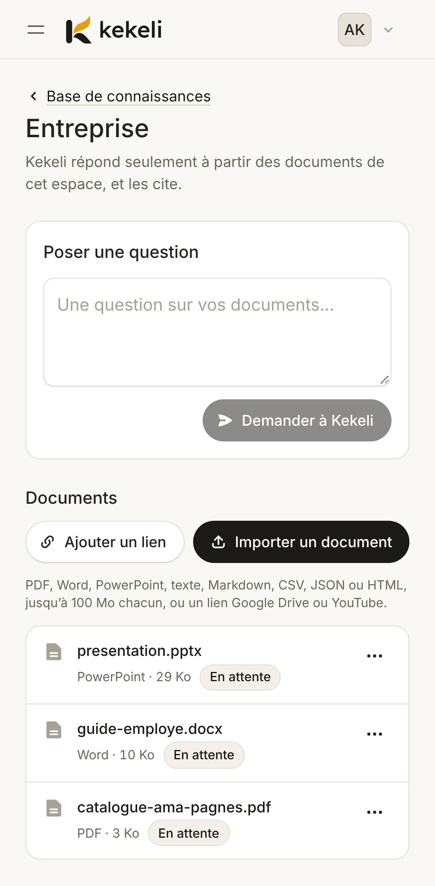 | 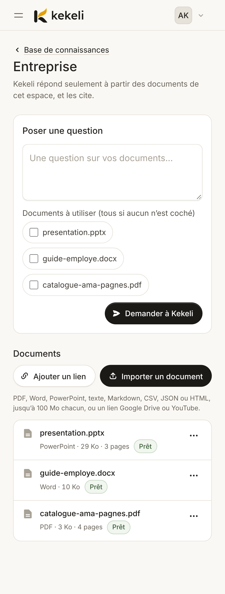 |
| 3. Les documents en cours de traitement | 4. Les documents prêts, avec le choix des documents à utiliser |
| 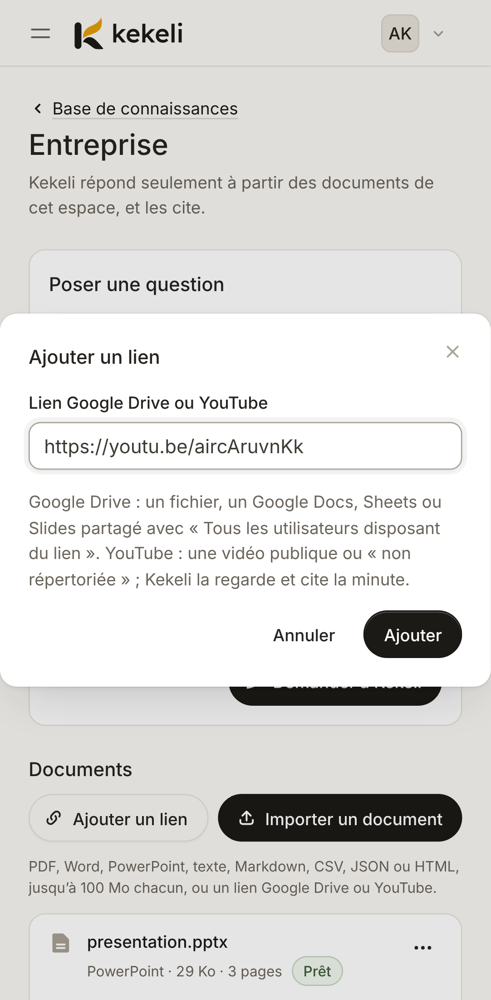 | 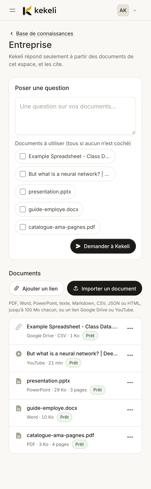 |
| 4 bis. « Ajouter un lien » : Google Drive ou YouTube | 4 ter. La vidéo YouTube et la feuille Google Drive, prêtes |
| 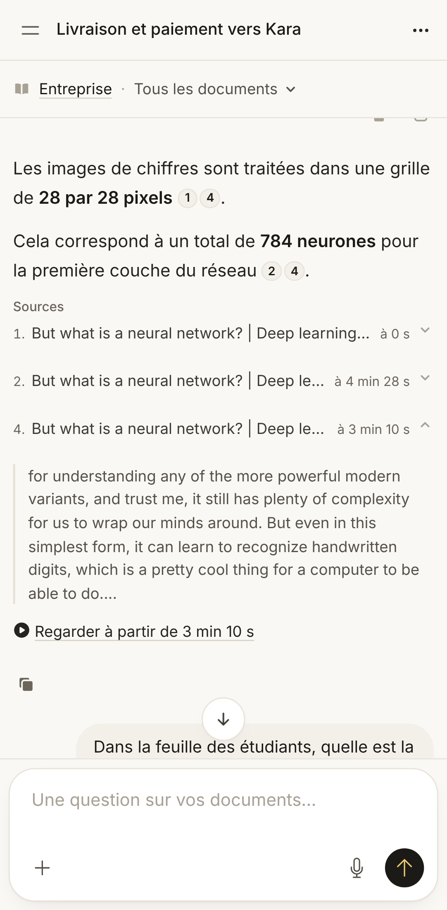 | 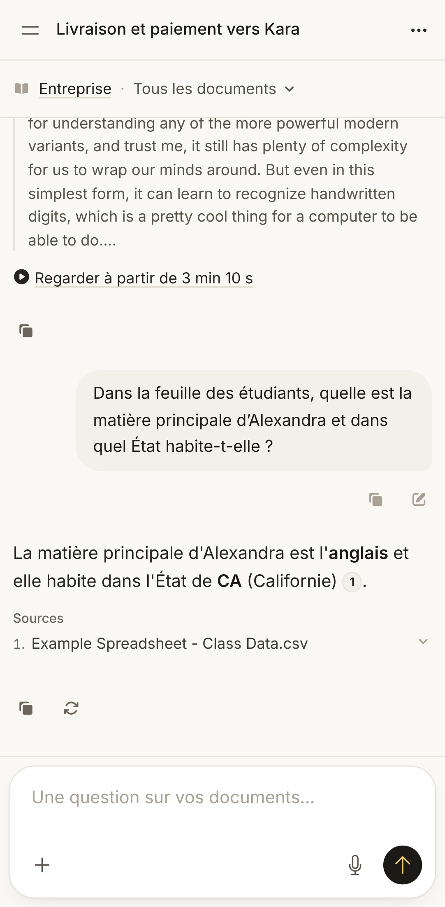 |
| Source d'une vidéo : la minute et « Regarder à partir de… » | Réponse tirée de la feuille Google Drive |
| 3. Les documents en cours de traitement | 4. Les documents prêts, avec le choix des documents à utiliser |
| 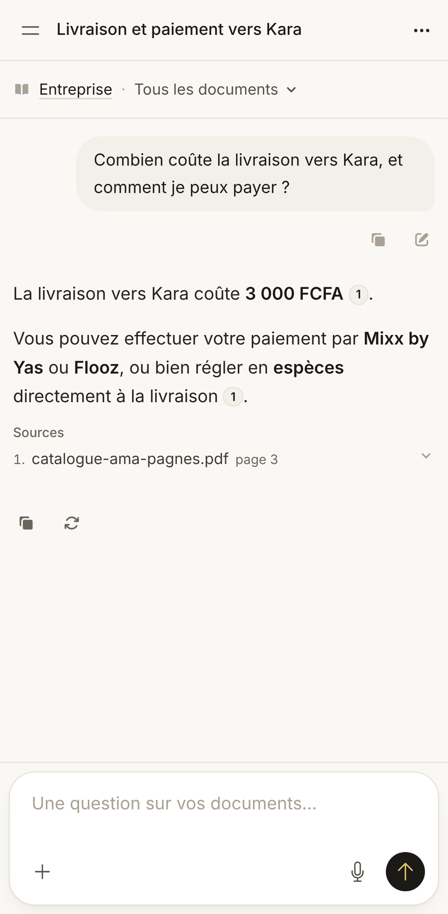 | 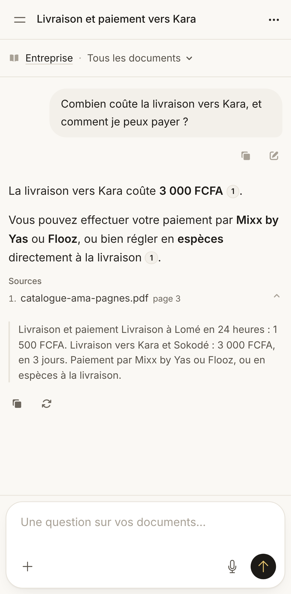 |
| 5. Réponse avec renvois et sources (document et page) | 6. Une source dépliée : le passage utilisé |
| 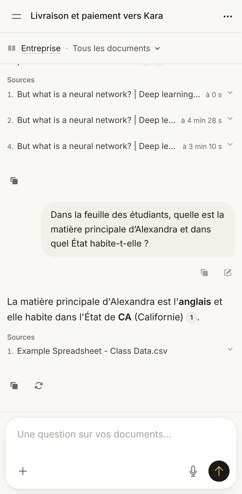 |  |
| 7. Questions de suivi dans la même conversation | 8. Information absente : Kekeli le dit clairement |
| 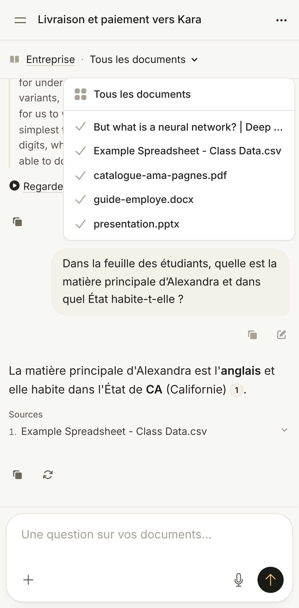 | 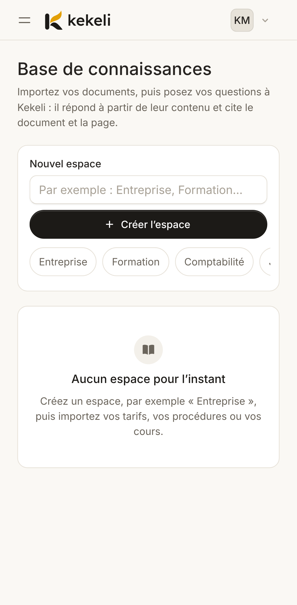 |
| 9. Choisir les documents de la conversation | 10. Un autre client : sa base est vide, il n'atteint pas celle d'Ama |
| 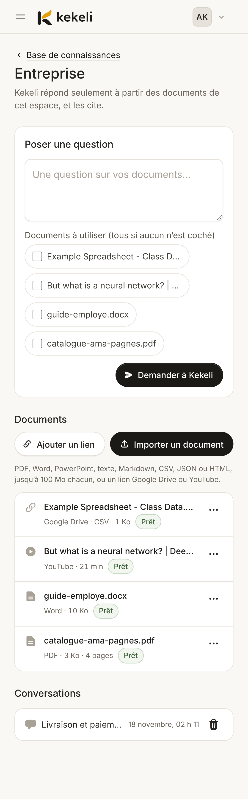 | 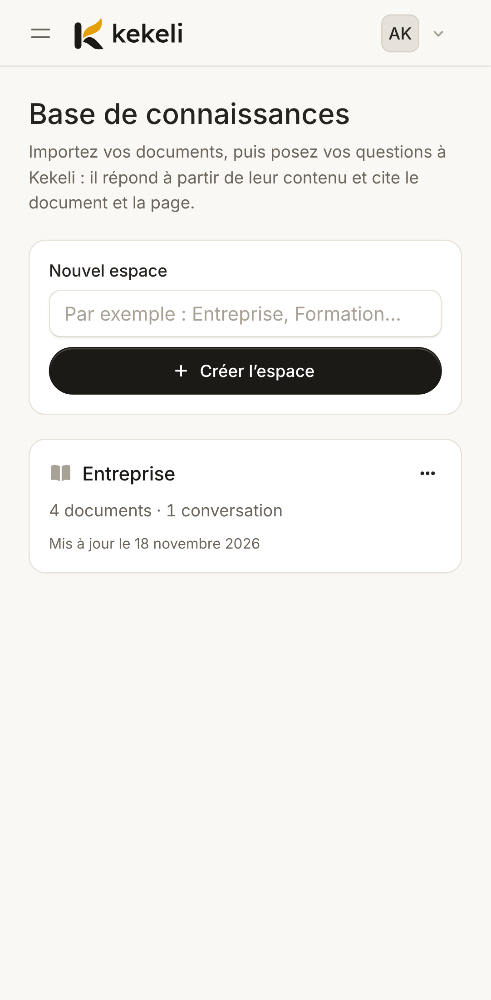 |
| 11. Après la suppression d'un document | 12. La liste des espaces |
