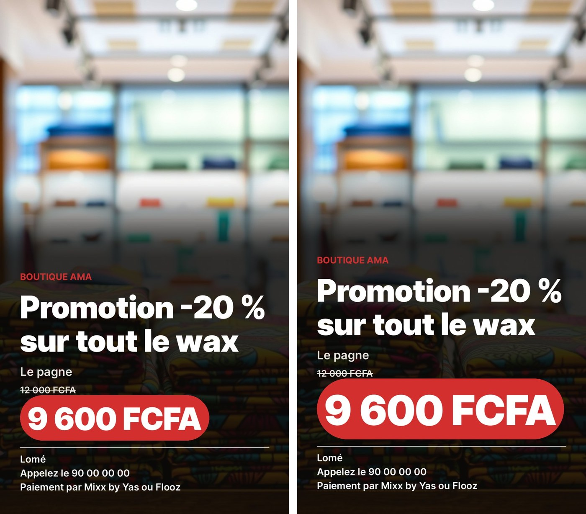

# Connecteurs (MCP) — captures

Pull request « Connecteurs (MCP) », 13 novembre 2026. Détails : `docs/plan.md`, partie 26.16.

## 1. Finition : le texte d'une affiche reposé par Kekeli

Demande du client après la création : « Mets le prix en plus gros et en rouge ». Kekeli garde l'image de la version précédente et repose lui-même le texte, au lieu de redemander le dessin. Le changement est net et visible. Essai réel du 13 novembre 2026 (`runner/scripts/essai-reposer-texte.mjs`, atelier E2B).

### Formule Gratuite (fond Cloudflare, texte posé par le code)

Version 1 en 26 secondes ; version 2 en 8 secondes, **sans aucun nouveau dessin** (même fond, texte reposé).

### Formule Pro (affiche dessinée par le générateur)

Version 1 : affiche dessinée puis relue (59 secondes). Version 2 (30 secondes) : le texte de l'affiche dessinée est **effacé une seule fois** (la photo est gardée), relu pour vérifier qu'il ne reste aucun texte, puis Kekeli repose le texte avec le prix 1,5 fois plus grand, sur une étiquette rouge. Les versions suivantes réutilisent cette image propre, sans aucun appel au générateur.

Coût réel de l'essai Pro (estimation, prix officiels) : environ 0,09 $ (deux images et quatre petites requêtes).
