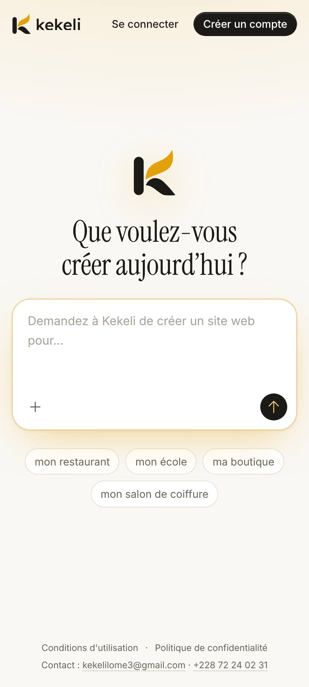
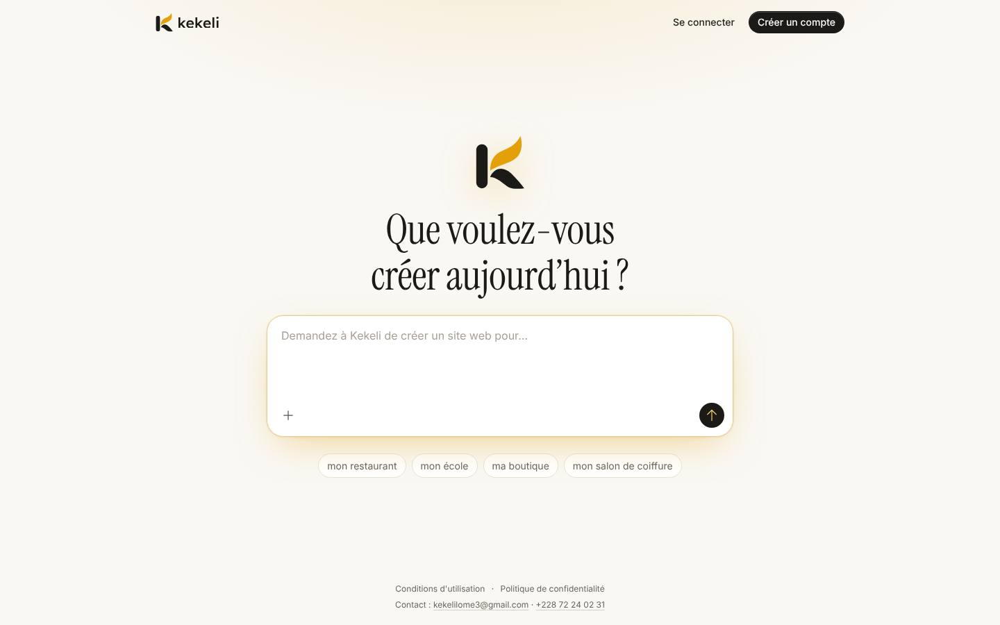
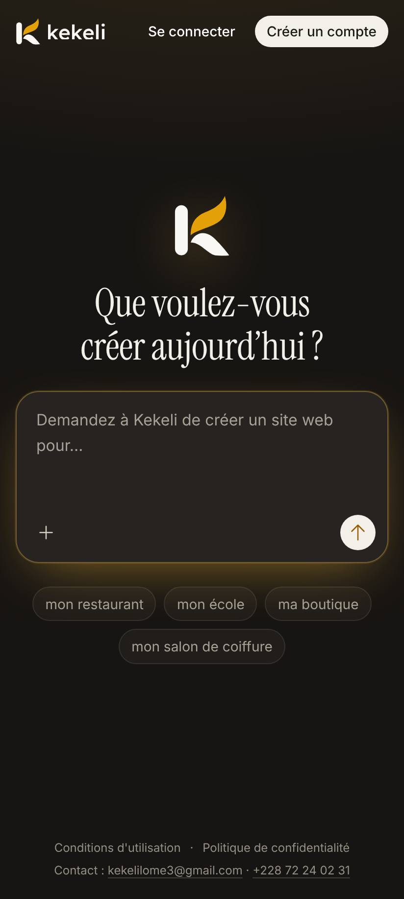
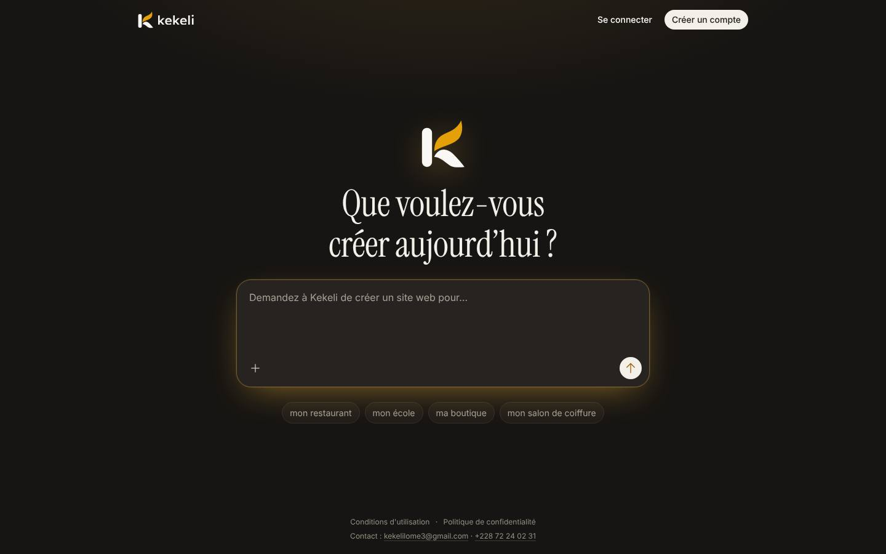
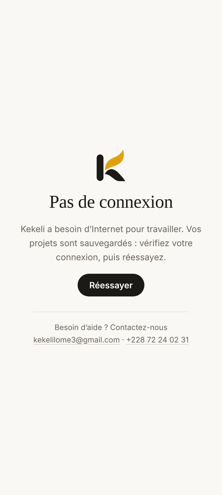
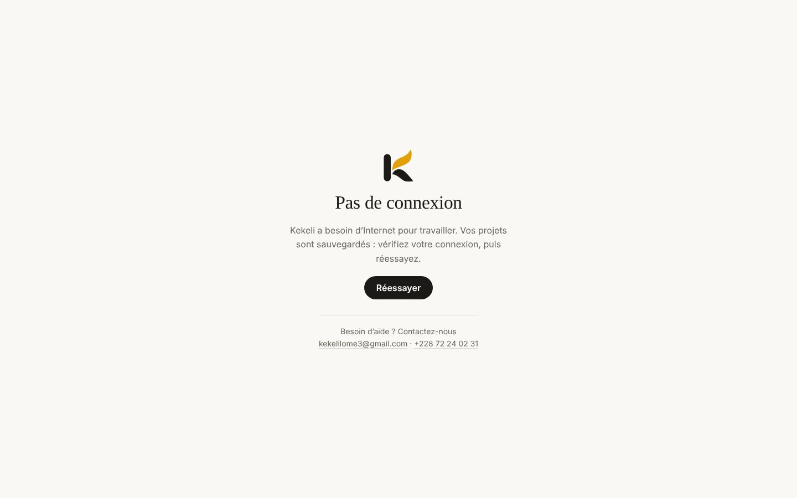
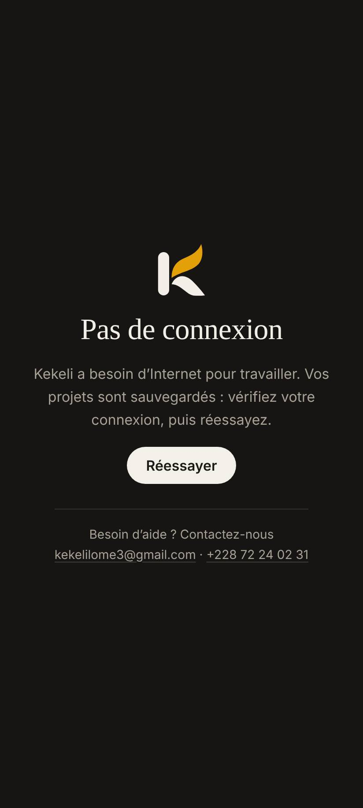
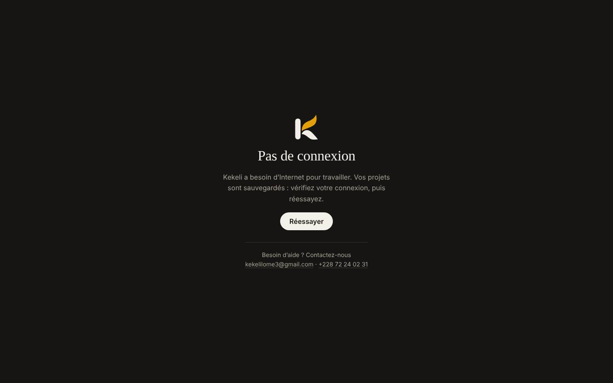

# Contact sobre, connexion comme Claude et finitions

Captures du 14 novembre 2026 sur un téléphone simulé (Pixel 6, Chrome, 412 × 915) et sur un ordinateur (1 440 × 900), en clair et en sombre, navigateur en français. Comptes et données inventés (`scripts/preparer-captures-design.php`) ; site lancé avec un identifiant Google **simulé** (jamais un vrai). Script : `scripts/captures-contact-connexion.js`.

## Partie 1 : un seul numéro sur l'accueil

Sur l'accueil, les pages d'erreur et la page hors connexion, le contact montre seulement l'e-mail et le numéro principal (champ « Téléphone » de l'émetteur). Les trois numéros restent sur les reçus, les e-mails, le paiement, les pages légales et « Nous contacter ».

| | Téléphone | Ordinateur |
|---|---|---|
| Accueil, clair |  |  |
| Accueil, sombre |  |  |
| Hors connexion, clair |  |  |
| Hors connexion, sombre |  |  |
