# Nouveau design : AVANT et APRÈS

Captures du 12 novembre 2026 sur un téléphone simulé (Pixel 7, navigateur en français) et sur un ordinateur (1 440 × 900). Comptes et projets inventés. Script : `scripts/captures-organisation.js` (mode clair) ; mode sombre pris avec les mêmes comptes. Identité choisie : `docs/plan.md`, partie 26.3.

Ce qui change partout : fond clair et chaud comme du papier (au lieu du blanc), texte couleur encre, **une seule touche d'ambre doré** (le soleil, l'énergie, la formule choisie), boutons noirs en forme de pilule (au lieu de l'orange), police Inter pour l'interface et Instrument Serif pour la grande question, soleil simplifié et nom « kekeli » en minuscules, zone de saisie plus douce, messages du client dans une bulle claire au lieu d'une bulle orange, mode sombre brun très foncé au lieu du gris froid.

## Sur le téléphone

### Accueil

| Avant | Après |
|---|---|
|  |  |

### Inscription

| Avant | Après |
|---|---|
| 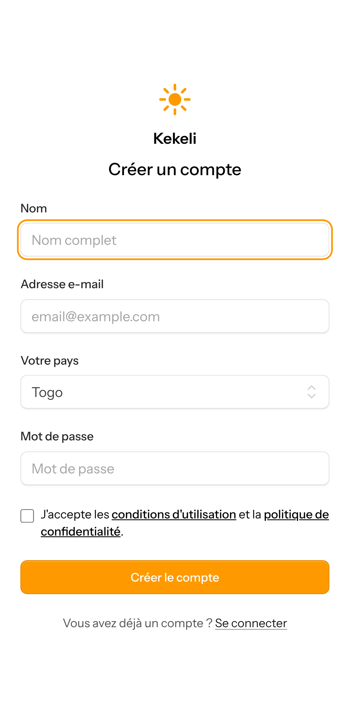 |  |

### Connexion

| Avant | Après |
|---|---|
| 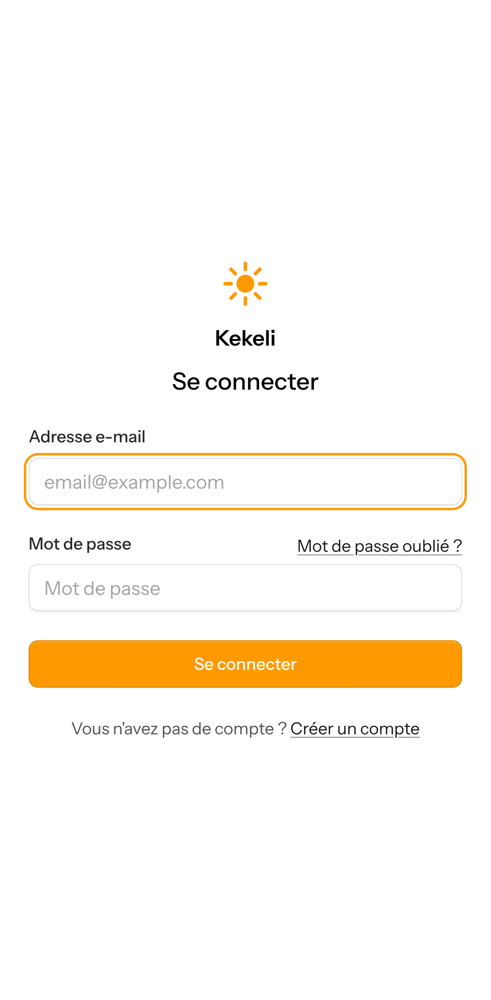 |  |

### Connexion refusée

| Avant | Après |
|---|---|
|  |  |

### Mes projets

| Avant | Après |
|---|---|
|  |  |

### Projet : discussion

| Avant | Après |
|---|---|
|  |  |

### Projet : discussion complète

| Avant | Après |
|---|---|
|  |  |

### Projet : fin de la discussion

| Avant | Après |
|---|---|
|  |  |

### Projet : aperçu

| Avant | Après |
|---|---|
|  |  |

### Projet : code

| Avant | Après |
|---|---|
|  |  |

### Fenêtre « Mettre en ligne »

| Avant | Après |
|---|---|
|  |  |

### Menu « ⋯ » du projet

| Avant | Après |
|---|---|
|  |  |

### Ancienne adresse des comptes rendus

| Avant | Après |
|---|---|
|  |  |

### Formules

| Avant | Après |
|---|---|
|  |  |

### Paiement

| Avant | Après |
|---|---|
|  |  |

### Compte

| Avant | Après |
|---|---|
|  |  |

### Menu du compte

| Avant | Après |
|---|---|
|  |  |

### Site avec base de données

| Avant | Après |
|---|---|
|  |  |

### Récupérer le code

| Avant | Après |
|---|---|
|  |  |

### Demande en attente

| Avant | Après |
|---|---|
|  |  |

### Site publié

| Avant | Après |
|---|---|
|  |  |

## Sur l'ordinateur

### Accueil

| Avant | Après |
|---|---|
|  |  |

### Mes projets

| Avant | Après |
|---|---|
|  |  |

### Projet : discussion

| Avant | Après |
|---|---|
|  |  |

### Projet : fin de la discussion

| Avant | Après |
|---|---|
|  |  |

### Projet : aperçu

| Avant | Après |
|---|---|
|  |  |

### Projet : code

| Avant | Après |
|---|---|
|  |  |

### Fenêtre « Mettre en ligne »

| Avant | Après |
|---|---|
|  |  |

### Menu « ⋯ » du projet

| Avant | Après |
|---|---|
|  |  |

### Site avec base de données

| Avant | Après |
|---|---|
|  |  |

### Récupérer le code

| Avant | Après |
|---|---|
|  |  |

### Demande en attente

| Avant | Après |
|---|---|
|  |  |

### Site publié

| Avant | Après |
|---|---|
|  |  |

## Mode sombre

| Téléphone | Ordinateur |
|---|---|
|  |  |
|  |  |
|  |  |
|  |  |

## Finitions du design (après la validation du 12 novembre 2026)

Deux corrections demandées après la validation du design. Script : `scripts/captures-finitions.js`. Le mot de passe d'essai n'est jamais affiché sur les captures.

### 1. Le message final de Kekeli

- Avant : le message écrit par Kekeli s'affichait en un seul bloc ; ses retours à la ligne et ses listes étaient perdus.
- Après : paragraphes, retours à la ligne et listes à puces apparaissent comme Kekeli les a écrits. Chaque texte est échappé : aucun HTML venu du modèle n'est jamais affiché tel quel.
- Les consignes du message final ont aussi changé (deux à quatre phrases courtes ou une courte liste, pour un commerçant ; plus de noms de licences, de bibliothèques ni de mots comme « sticky », « responsive », « emojis » ou « tests »). Le message ci-dessous date d'avant ce changement : il garde donc ses mots techniques, mais il est maintenant lisible. Les prochains messages suivront les nouvelles consignes.

#### Téléphone

| Avant | Après |
|---|---|
|  | 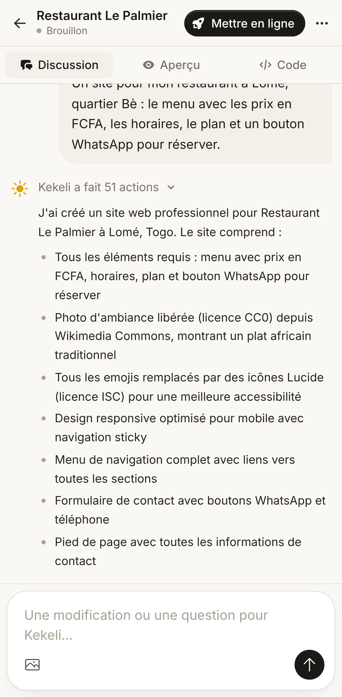 |

#### Ordinateur

| Avant | Après |
|---|---|
|  | 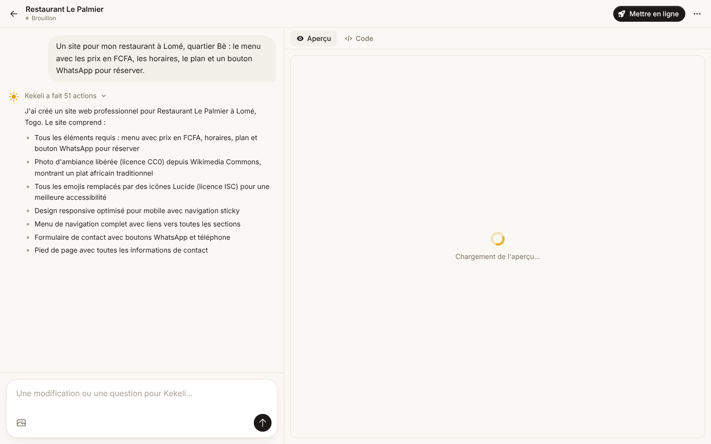 |

#### Téléphone, mode sombre

| Avant | Après |
|---|---|
|  | 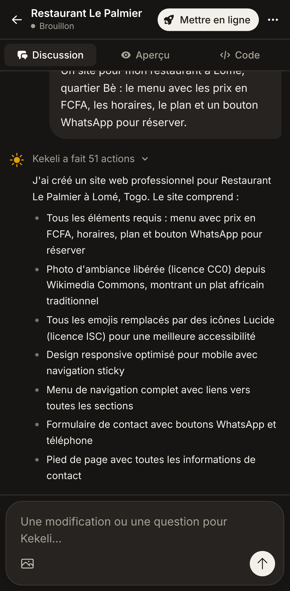 |

#### Ordinateur, mode sombre

| Avant | Après |
|---|---|
| 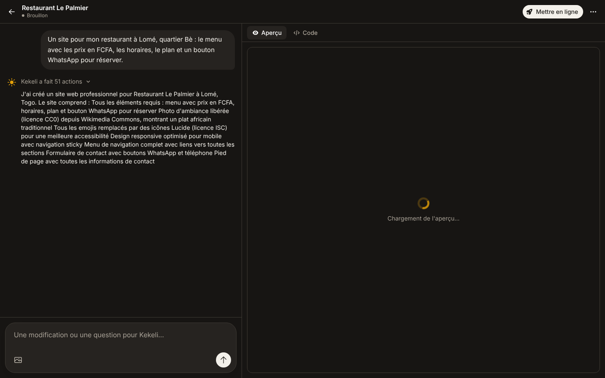 | 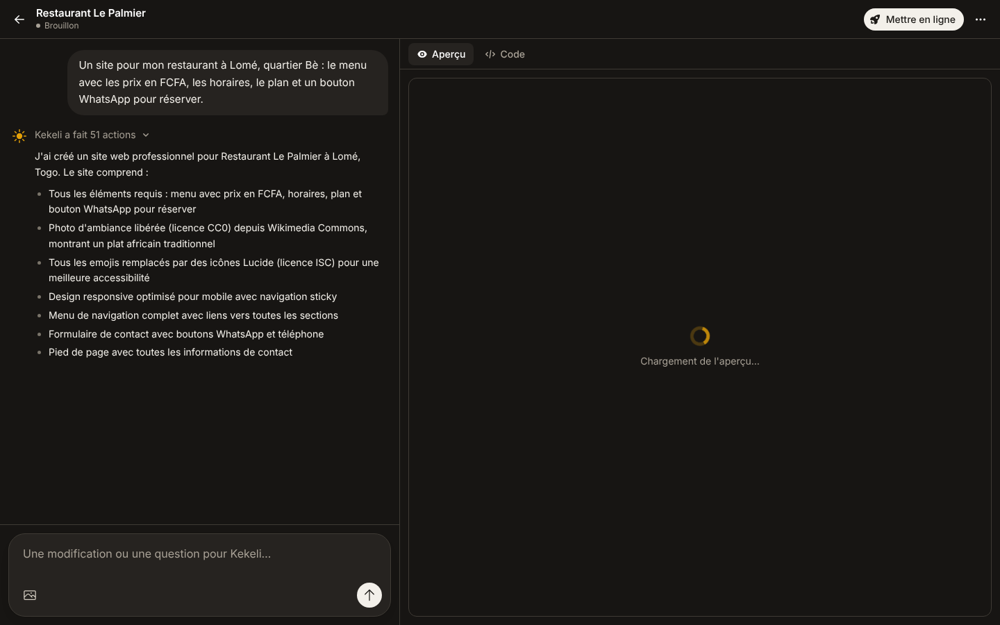 |

### 2. « Compte administrateur d'essai » au-dessus de l'aperçu

- Avant : un triangle de dépliage brut et une police de code.
- Après : un bloc bordé avec une petite clé à gauche et une flèche qui tourne à droite, la même police que le reste ; une fois ouvert, l'adresse et le mot de passe (caché par défaut, bouton « Afficher »).

#### Téléphone

| Avant | Après |
|---|---|
| 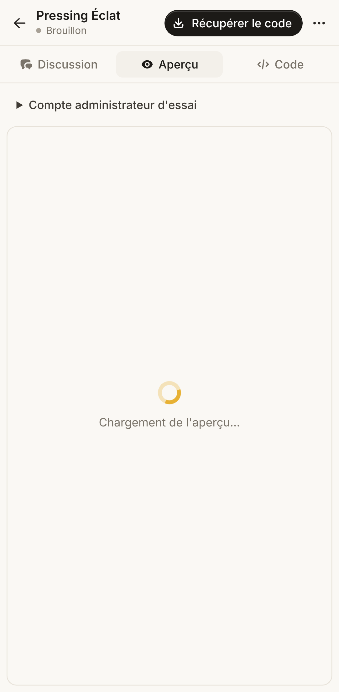 | 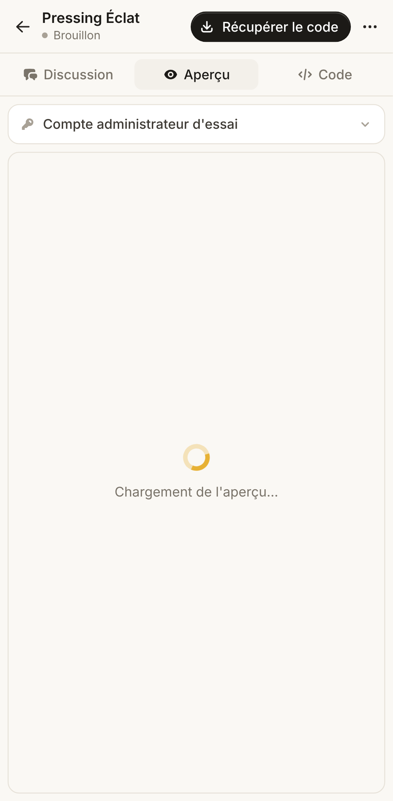 |
| 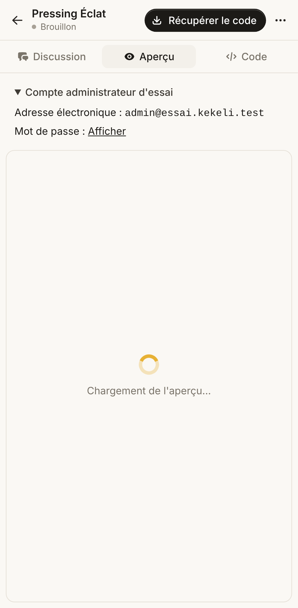 | 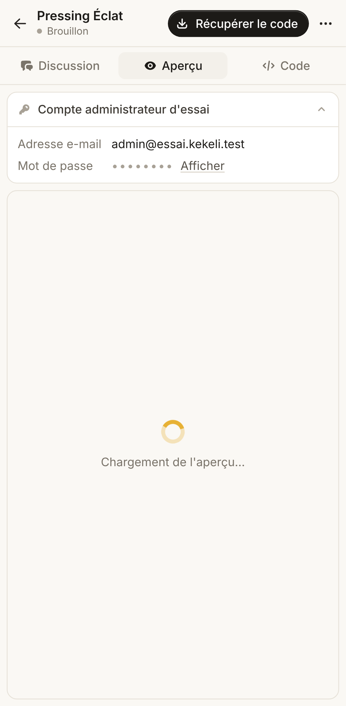 |

#### Ordinateur

| Avant | Après |
|---|---|
| 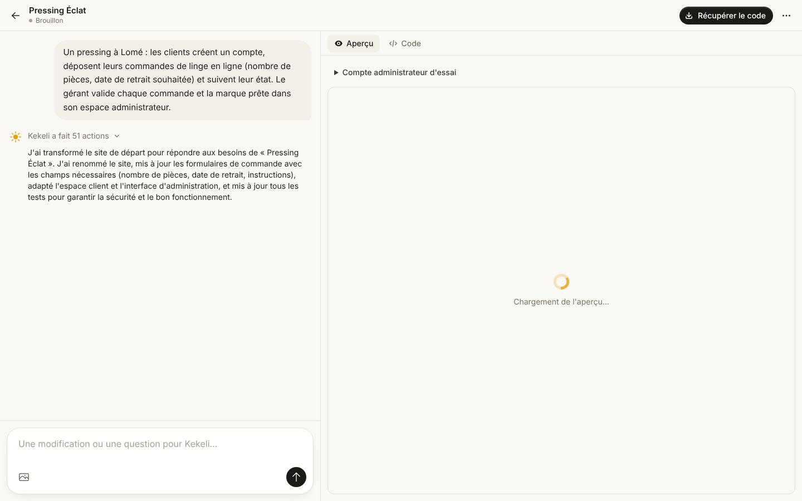 | 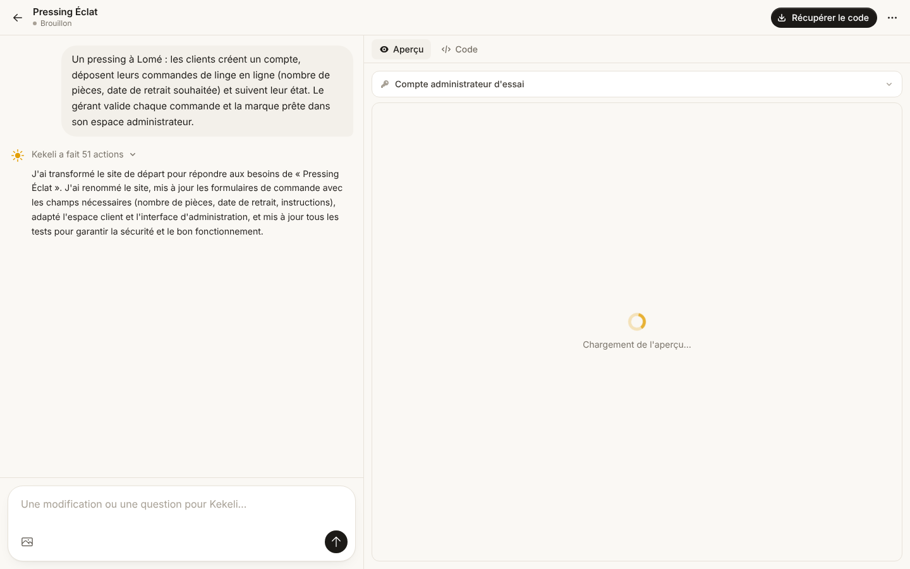 |
| 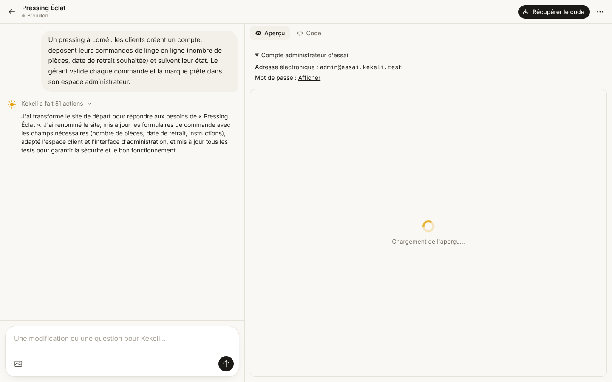 | 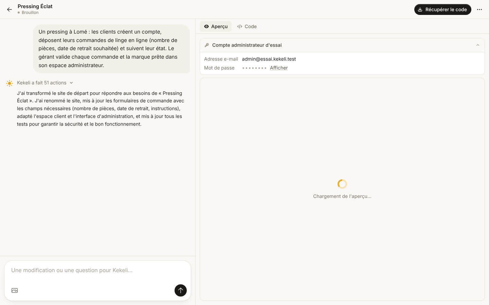 |

#### Téléphone, mode sombre

| Avant | Après |
|---|---|
|  | 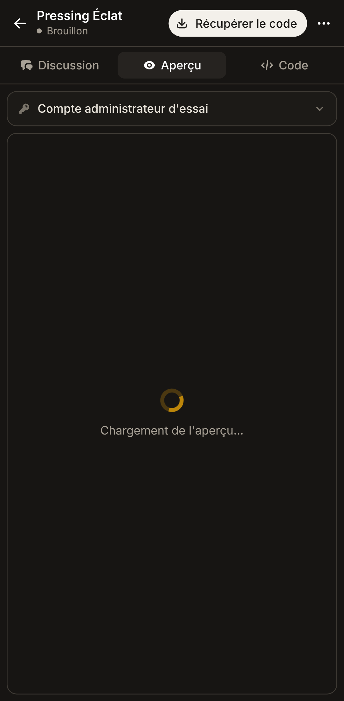 |
| 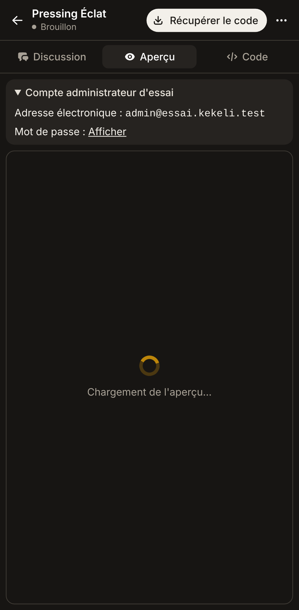 | 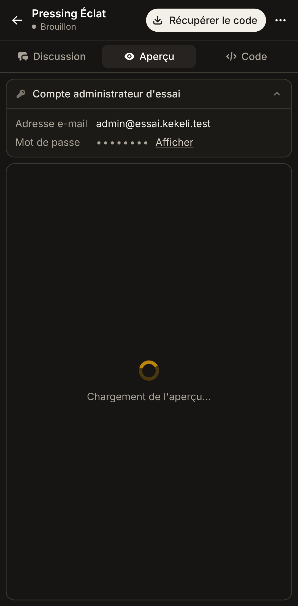 |

#### Ordinateur, mode sombre

| Avant | Après |
|---|---|
| 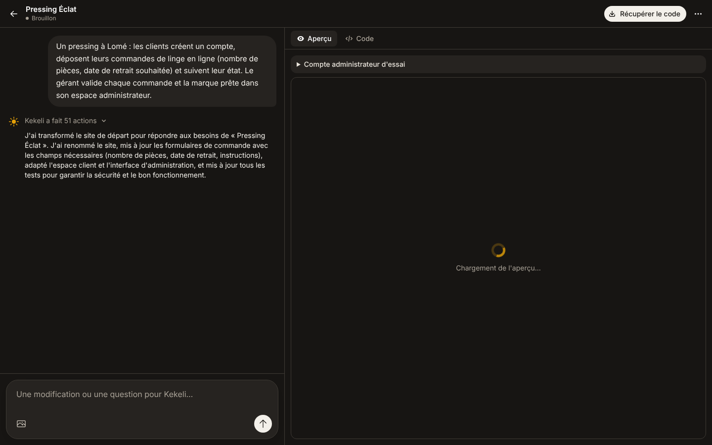 |  |
| 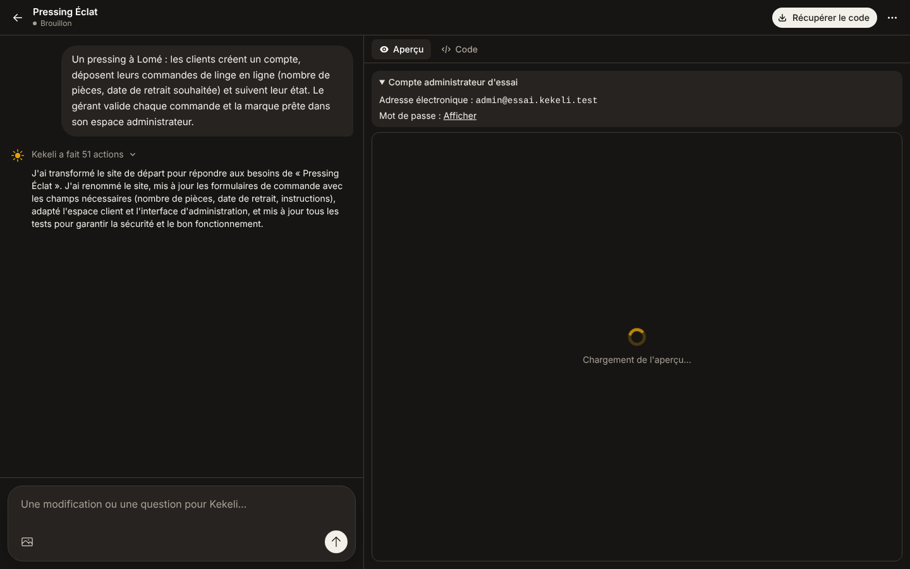 |  |

### À propos de « Chargement de l'aperçu… »

Sur ces captures, l'aperçu reste sur « Chargement de l'aperçu… » parce que le serveur de capture n'a ni Runner, ni ordinateur E2B, ni travailleur de file d'attente : la demande de rallumage (`WakePreview`) attend sans jamais partir. Ce n'est pas un défaut de l'affichage sur ordinateur. Rien n'a été modifié de ce côté.
