# Étape 1 — captures sur un écran de téléphone simulé

Captures prises le 1er novembre 2026 sur un téléphone simulé (Pixel 7, navigateur en français), en parcourant le site comme un nouvel utilisateur.

## 1. Page d'accueil
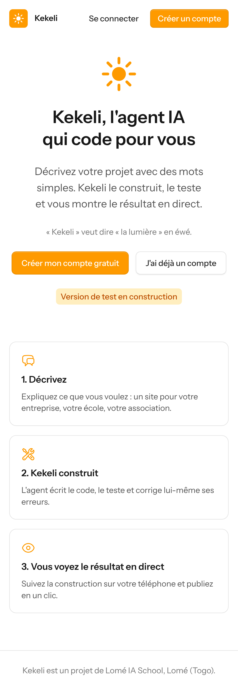

## 2. Création du compte
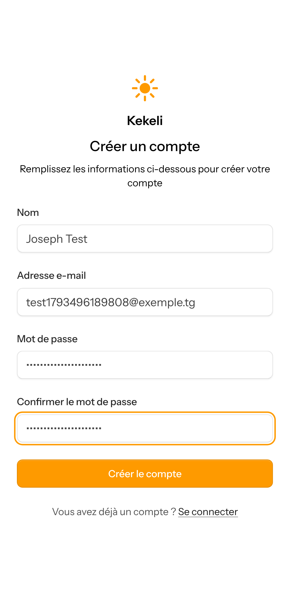

## 3. « Mes projets » pour un nouvel utilisateur

## 4. Fenêtre « Nouveau projet »
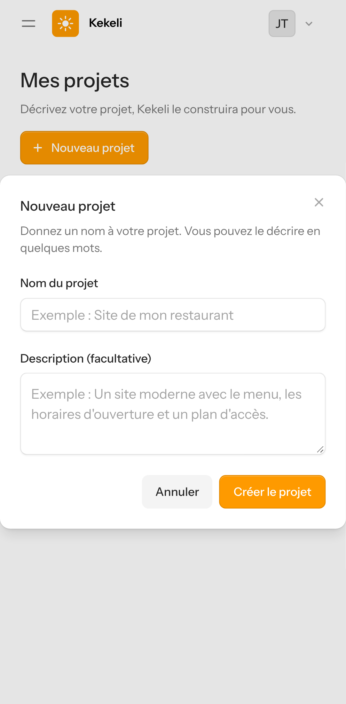

## 5. Nom oublié : message d'erreur en français
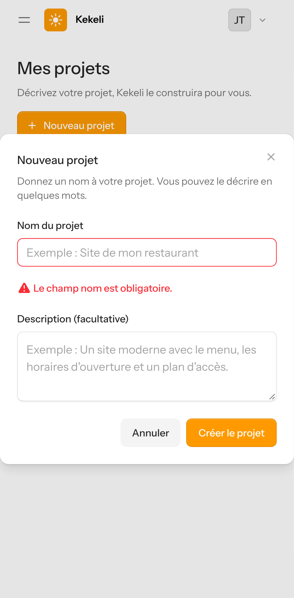

## 6. Page du projet, en attente de l'agent (étape 2)
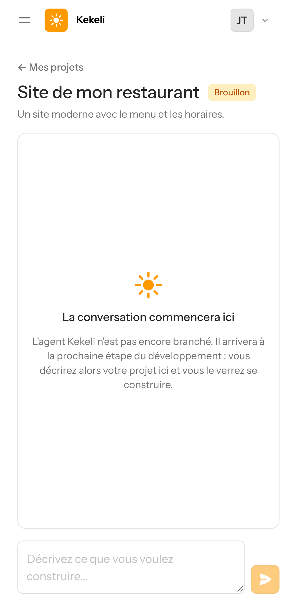

## 7. Menu d'un projet (les trois points)
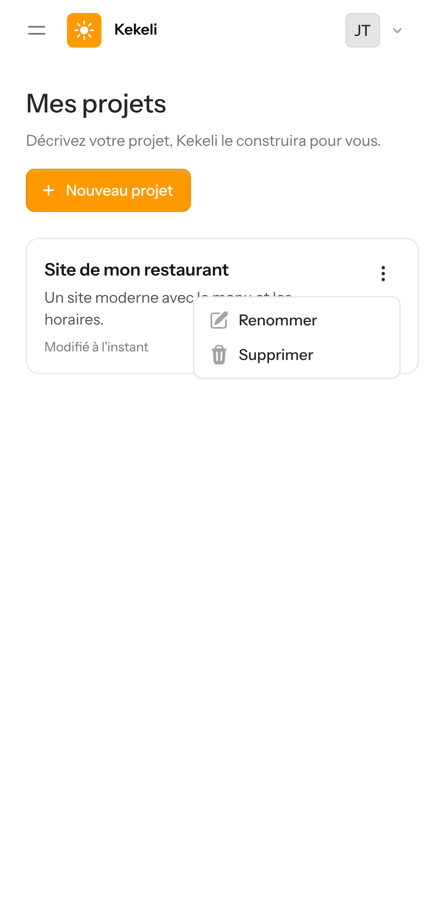

## 8. Renommer le projet
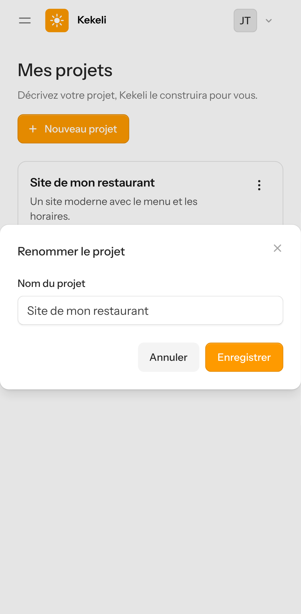

## 9. Projet renommé
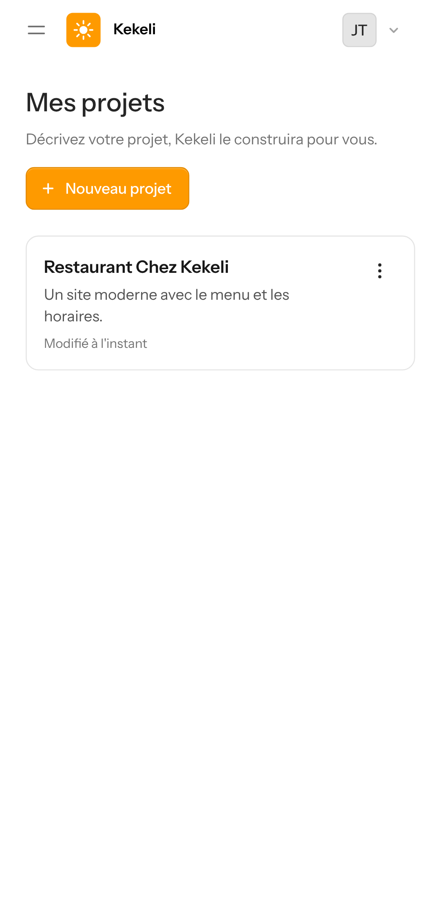

## 10. Confirmation avant suppression
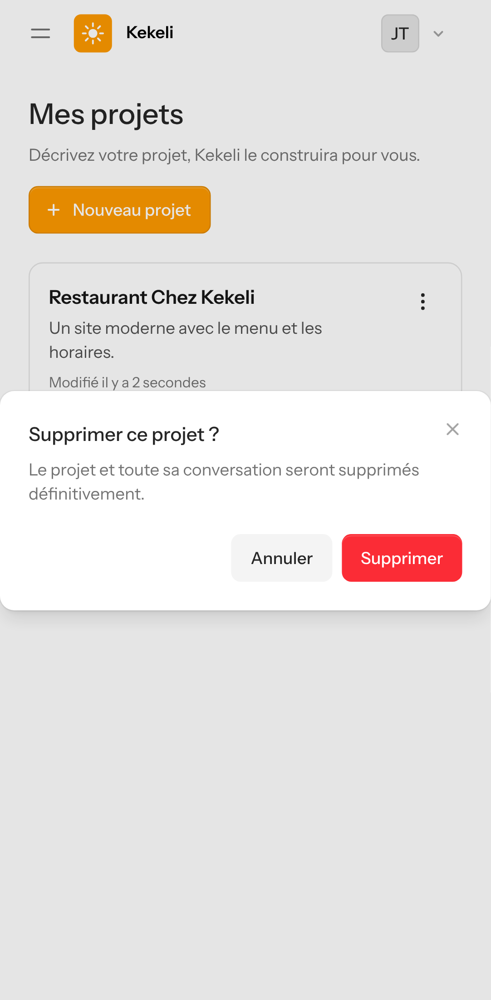

## 11. Après la suppression
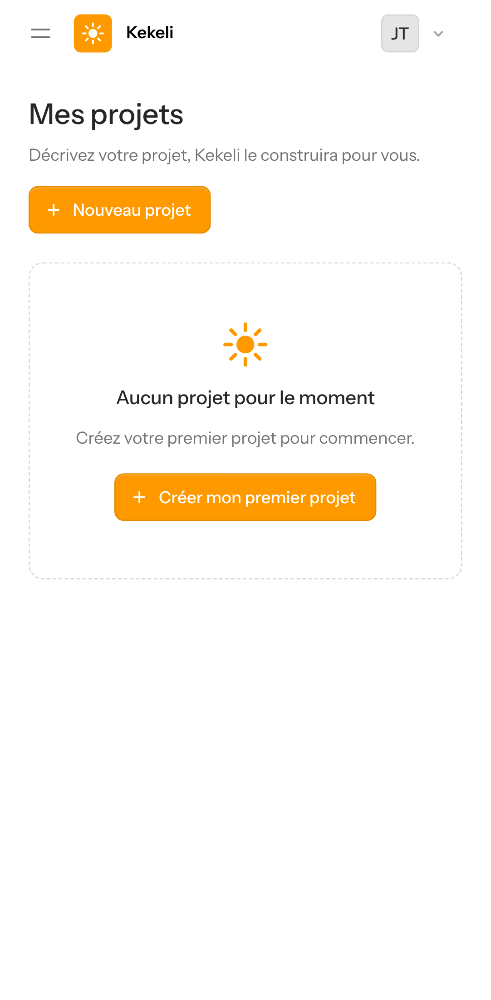

## 12. Réglages du compte
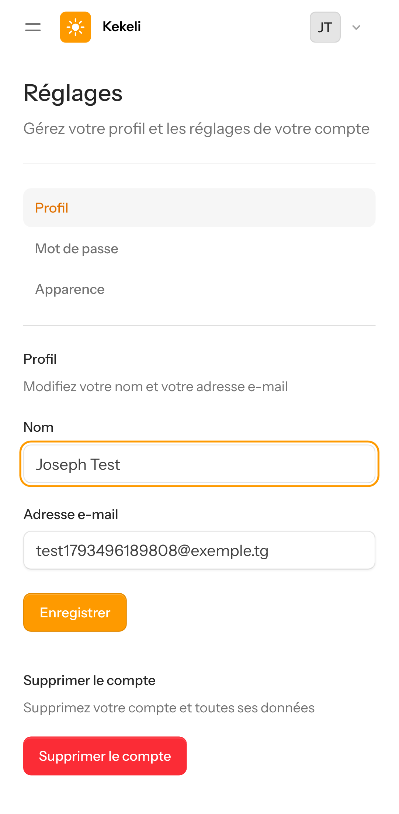
