# Étape 2 — captures sur un écran de téléphone simulé

Captures prises le 1er novembre 2026 sur un téléphone simulé (Pixel 7, navigateur en français). **Tout est réel** : l'agent OpenCode a vraiment travaillé dans un ordinateur virtuel E2B, avec Gemini 3.5 Flash-Lite (offre gratuite de Google AI Studio) comme cerveau. La clé Gemini n'a jamais été placée dans l'ordinateur virtuel : c'est E2B qui l'ajoute aux requêtes en sortie.

## Partie 1 — Demander « crée un fichier bonjour.txt » et voir l'agent travailler

### 1. Un projet vide, prêt à recevoir une demande
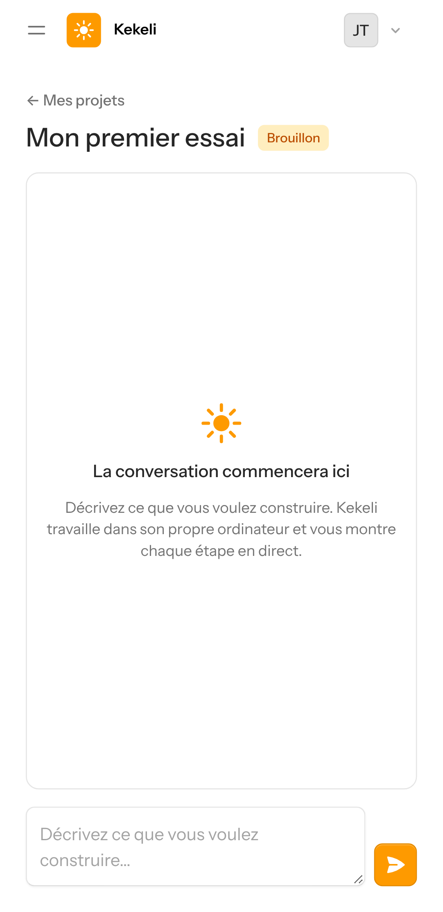

### 2. La demande est écrite
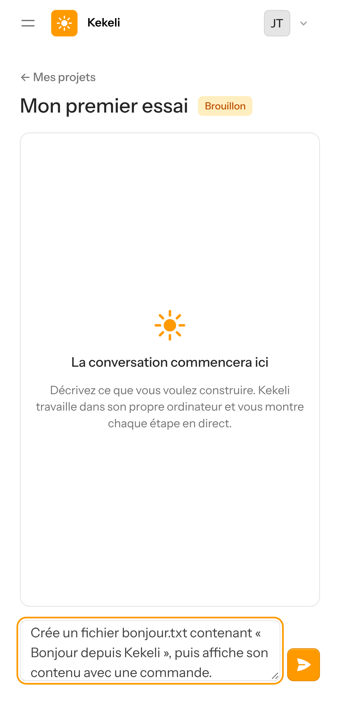

### 3. Kekeli se prépare (création de l'ordinateur virtuel, environ 7 secondes)
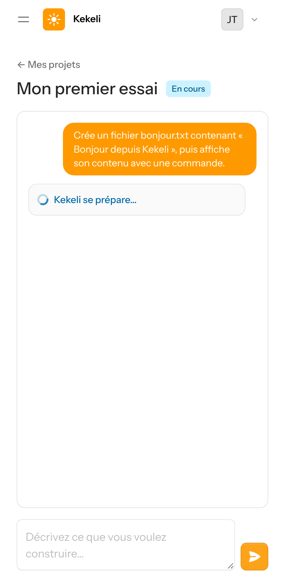

### 4. Kekeli travaille : chaque action apparaît en direct
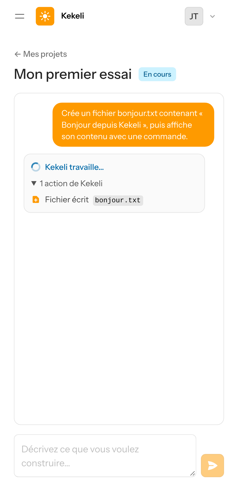

### 5. Résultat : la réponse de l'agent, en français
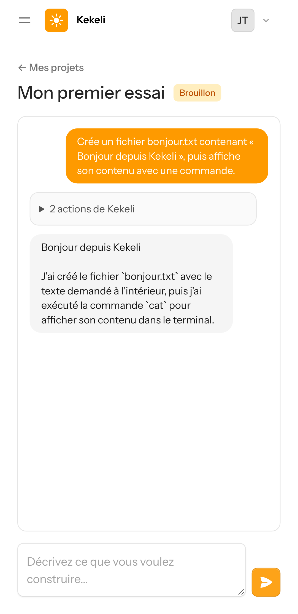

### 6. Le détail des actions de Kekeli (fichier écrit, commande lancée)
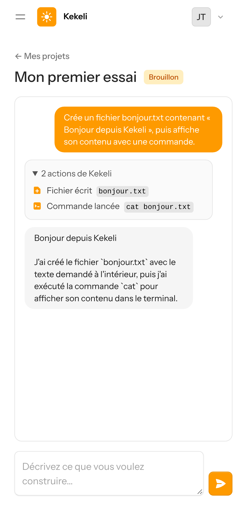

## Partie 2 — Administration des fournisseurs (réservée à l'administrateur)

### 7. Page « Fournisseurs d'IA » : ordre de la liste, requêtes du jour, tokens, remise à zéro (heure de Lomé)
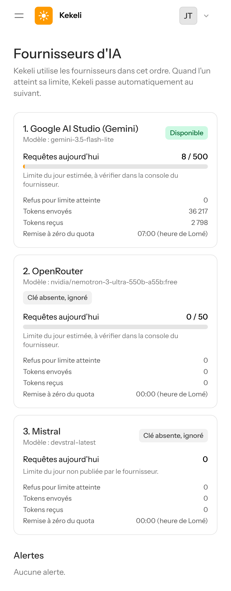

### 8. Le lien « Fournisseurs d'IA » dans le menu, visible seulement pour l'administrateur
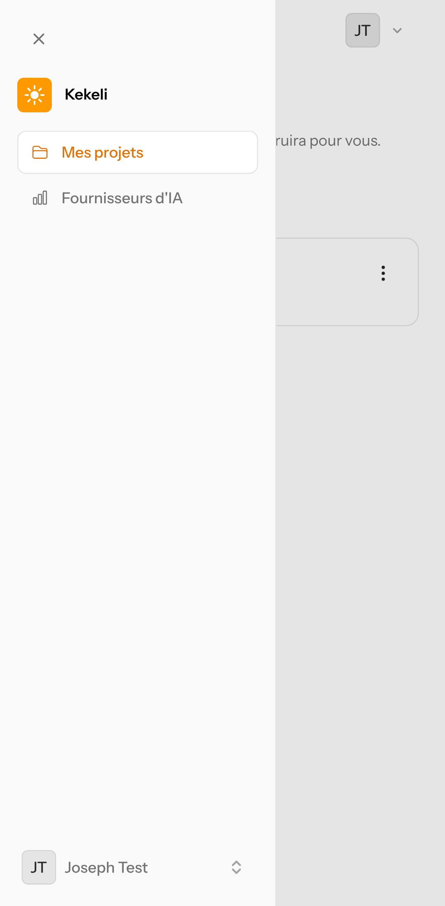

## Partie 3 — Basculement automatique, avec un vrai refus de Google

Pour cet essai, la liste commençait par un modèle Gemini que l'offre gratuite refuse (« limite atteinte », code 429), suivi de Gemini 3.5 Flash-Lite.

### 9. L'utilisateur ne voit rien : sa demande est faite normalement
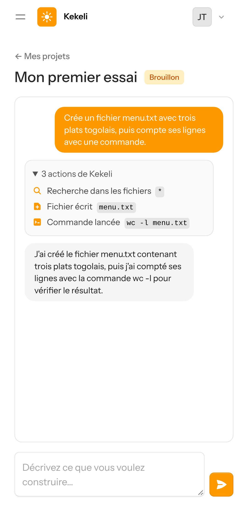

### 10. Dans l'administration : le premier modèle est mis de côté jusqu'à sa remise à zéro (07:00, heure de Lomé), le second a fait le travail
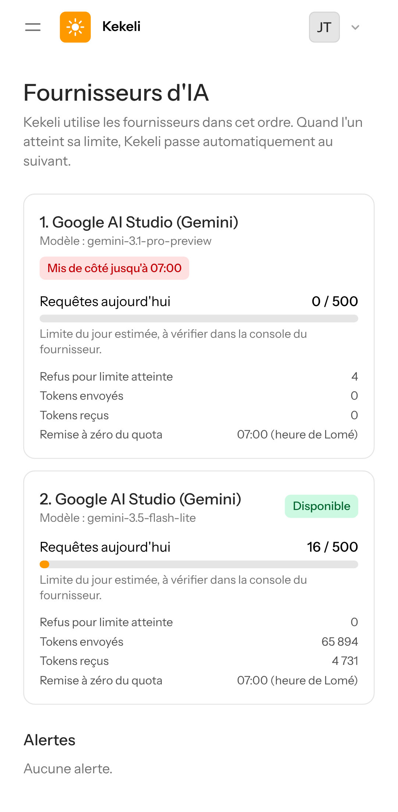

## Partie 4 — Tous les fournisseurs épuisés

Pour cet essai, la liste ne contenait que le modèle refusé.

### 11. L'utilisateur voit seulement « Kekeli est très sollicité », sans savoir qu'il s'agit d'offres gratuites ; sa demande reprendra toute seule
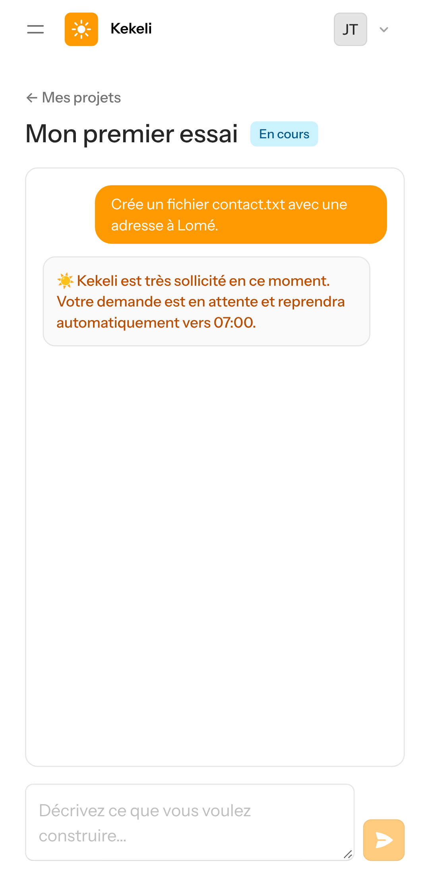

### 12. L'administrateur reçoit une alerte
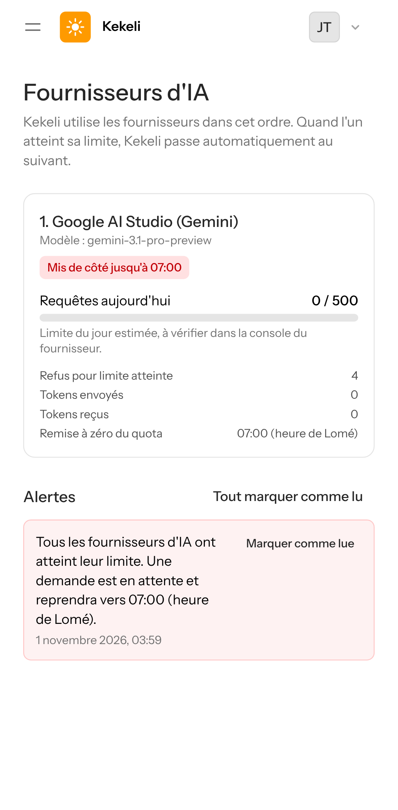

## Partie 5 — Alerte à partir de 80 % de la limite du jour

Le compteur a été porté artificiellement à 421 requêtes sur la base de test, pour montrer l'alerte.

### 13. Alerte rouge : il sera bientôt temps de passer à une clé payante
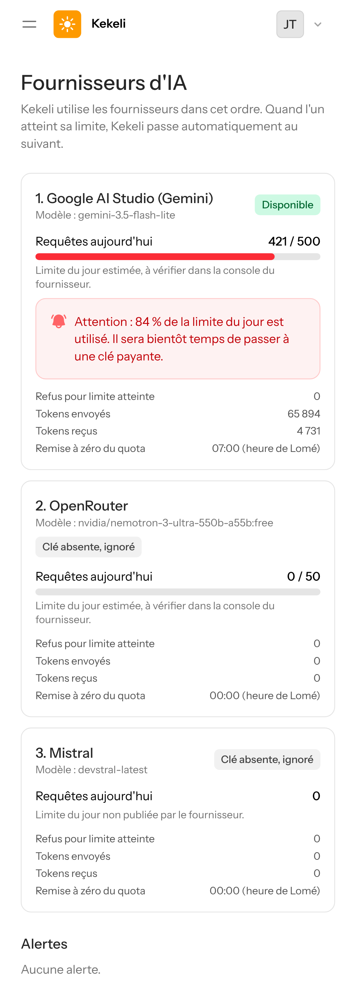
