# Étape 3 — captures sur un écran de téléphone simulé

Captures prises le 8 novembre 2026 sur un téléphone simulé (Pixel 7, navigateur en français). **Tout est réel** : un vrai ordinateur virtuel E2B, l'agent OpenCode et Gemini 3.5 Flash-Lite (offre gratuite de Google AI Studio) comme cerveau. Le site montré dans l'aperçu a été écrit par l'agent lui-même.

Demande envoyée : « Crée une page d'accueil pour un restaurant à Lomé, avec le menu et les horaires. »

**Chiffres de cet essai** (une seule mesure, pas encore une moyenne) :
- ordinateur virtuel prêt en 10 secondes, aperçu affiché après 14 secondes ;
- demande terminée en 33 secondes ;
- **5 requêtes à Gemini**, aucun refus, environ 22 300 tokens envoyés et 3 800 tokens reçus ;
- l'aperçu s'est rechargé tout seul 3 fois pendant la construction.

## Partie 1 — Les deux onglets

### 1. Un nouveau projet s'ouvre sur l'onglet « Discussion »
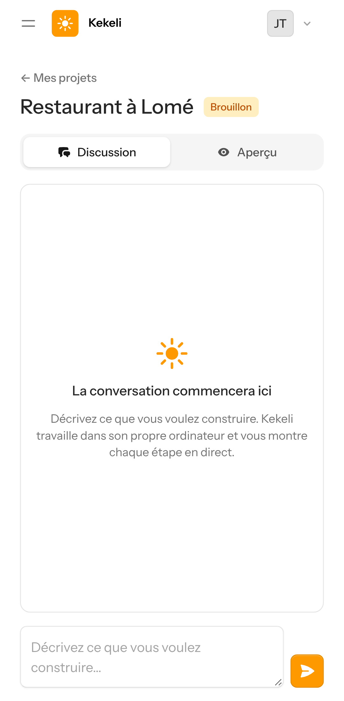

### 2. L'onglet « Aperçu », avant toute demande
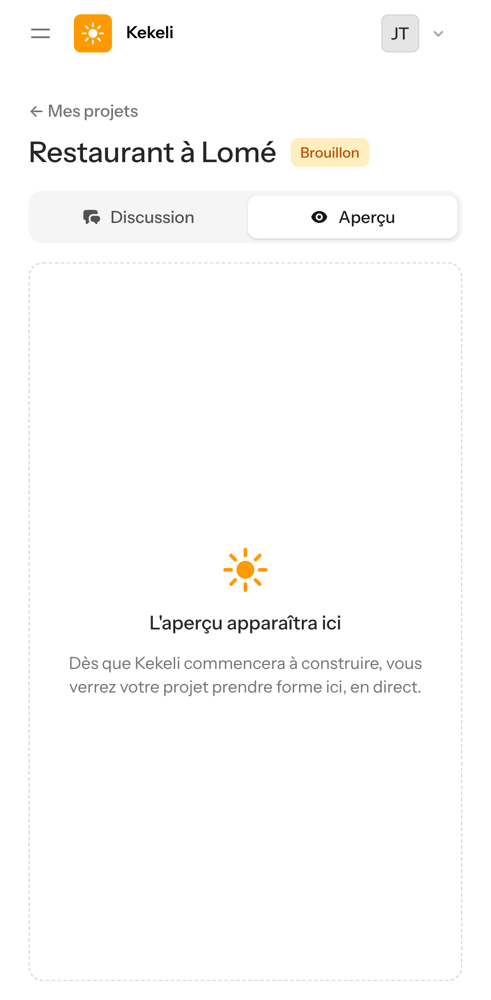

## Partie 2 — Voir le site apparaître pendant sa construction

### 3. La demande est envoyée
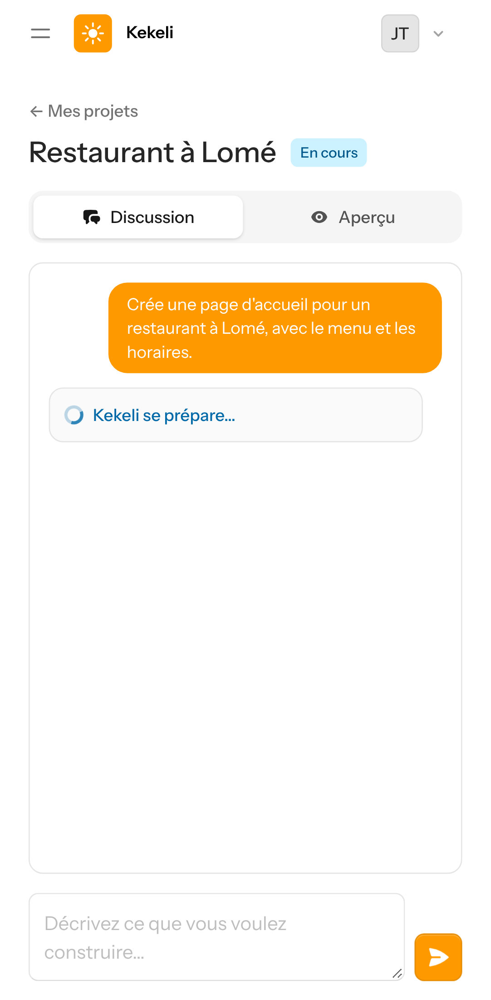

### 4. Kekeli allume son ordinateur et prépare l'aperçu
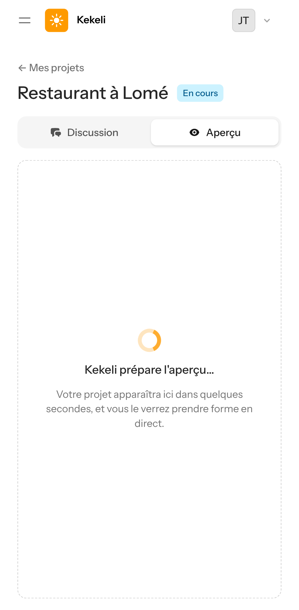

### 5. L'aperçu est en ligne : il attend la première page
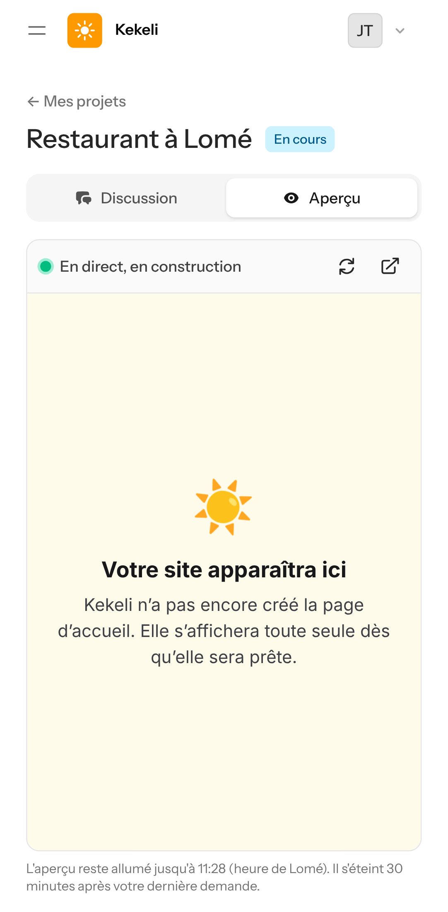

### 6. L'agent écrit la page : elle apparaît toute seule, sans rien toucher
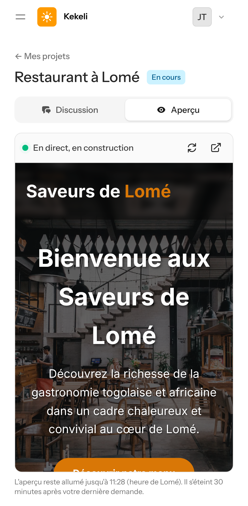

### 7. Le site terminé, en haut de la page
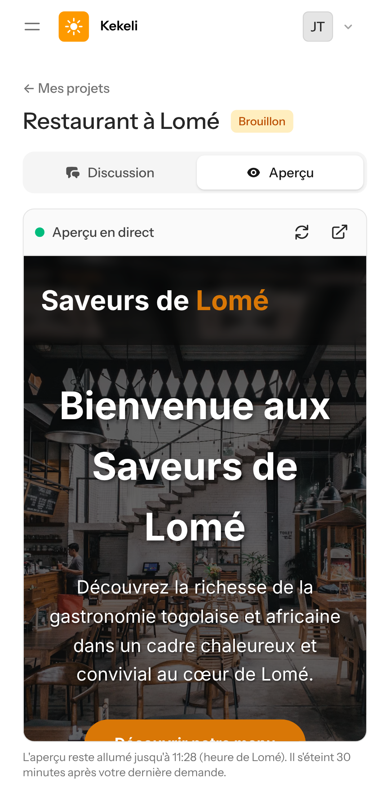

### 8. Le même site, plus bas : le menu avec les prix
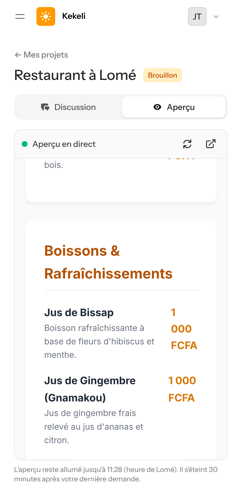

## Partie 3 — Le résultat dans la discussion

### 9. La réponse de Kekeli et le bouton « Voir l'aperçu »
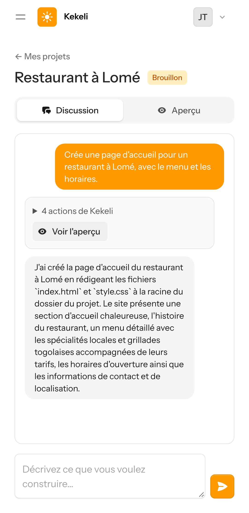

### 10. Le détail des actions de Kekeli (fichiers écrits)
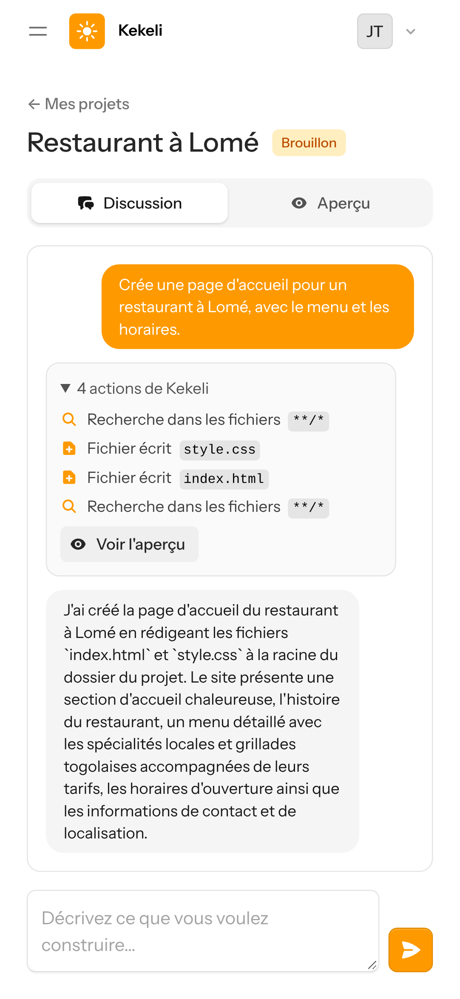

### 11. Le bouton « Voir l'aperçu » ouvre directement le site
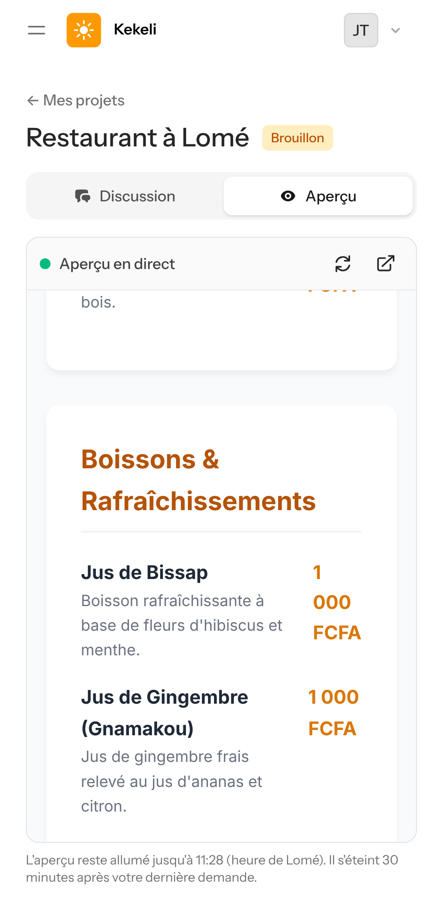

### 12. Sur un ordinateur, la discussion et l'aperçu sont côte à côte
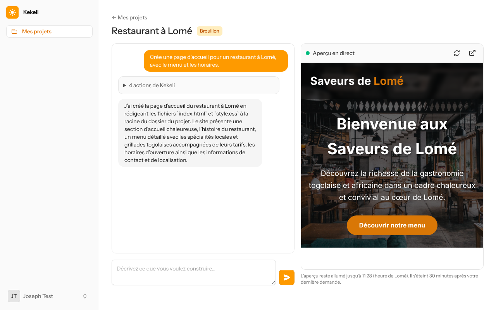

## Partie 4 — Mise en veille

### 13. Trente minutes après la fin de la demande, l'ordinateur s'éteint : la page, restée ouverte, passe toute seule « en pause »
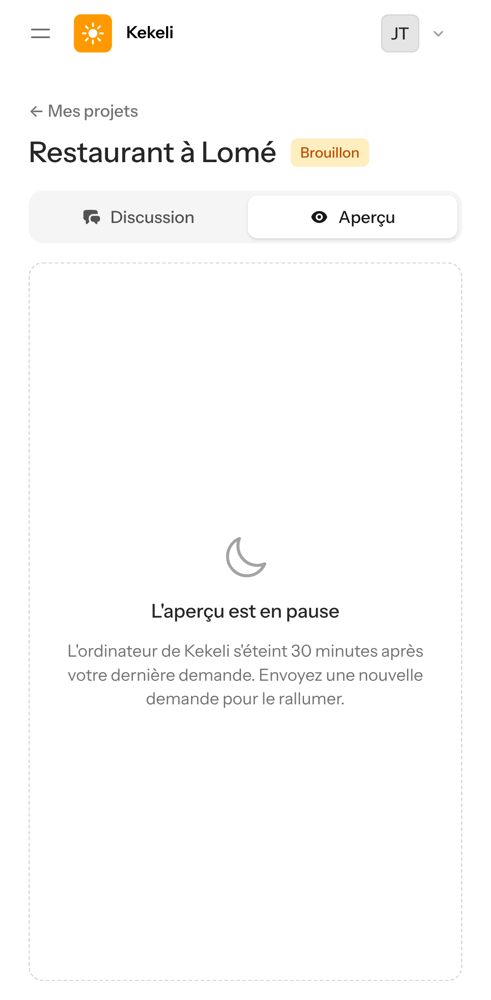
