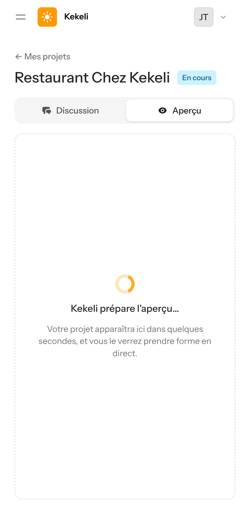
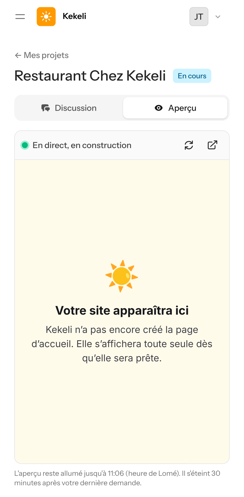
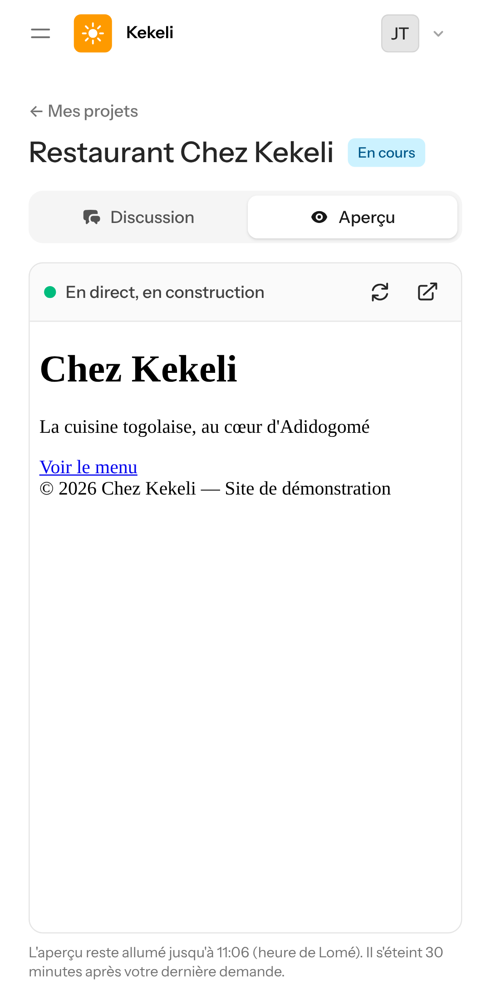
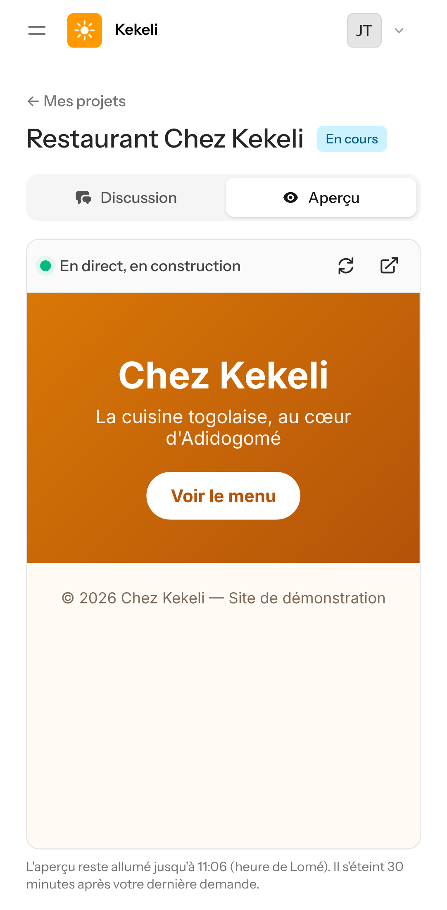
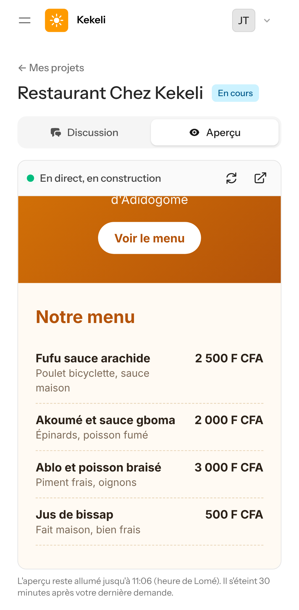
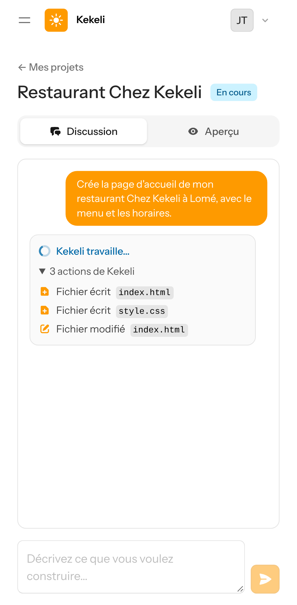
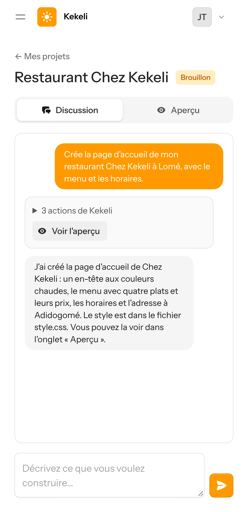

# Étape 3 — captures sur un écran de téléphone simulé

Captures prises le 8 novembre 2026 sur un téléphone simulé (Pixel 7, navigateur en français).

**Ce qui est réel** : le site Kekeli, la page du projet avec ses onglets « Discussion » et « Aperçu », la réception des événements signés, et le **vrai serveur d'aperçu** du Runner (`runner/src/apercu/serveur.mjs`), qui recharge la page tout seul à chaque fichier modifié.

**Ce qui est simulé** : l'agent. Les clés `GEMINI_API_KEY` et `E2B_API_KEY` ont bien été placées dans l'environnement, mais pas encore lisibles dans la séance de travail qui a construit cette étape (elles le seront dans la prochaine). Le script `scripts/captures-etape-3.js` a donc joué le rôle du Runner et d'un agent qui écrit les fichiers d'un site pas à pas. L'essai réel avec E2B et Gemini sera fait dès que les clés seront lisibles, avec de nouvelles captures.

## Partie 1 — Les deux onglets

### 1. Un nouveau projet s'ouvre sur l'onglet « Discussion »

### 2. L'onglet « Aperçu », avant toute demande

## Partie 2 — Voir le site apparaître pendant sa construction

Demande envoyée : « Crée la page d'accueil de mon restaurant Chez Kekeli à Lomé, avec le menu et les horaires. »

### 3. Kekeli allume son ordinateur et prépare l'aperçu

### 4. L'aperçu est en ligne et attend la première page

### 5. Le fichier index.html est écrit : la page apparaît toute seule, encore sans couleurs

### 6. Le fichier style.css est écrit : les couleurs arrivent, sans rien toucher

### 7. Le menu et les horaires sont ajoutés

### 8. Pendant ce temps, l'onglet « Discussion » montre chaque action de Kekeli

## Partie 3 — Le résultat

### 9. Kekeli a terminé : sa réponse et un bouton « Voir l'aperçu »

### 10. Le bouton « Voir l'aperçu » ouvre directement le site

### 11. Sur un ordinateur, la discussion et l'aperçu sont côte à côte

## Partie 4 — Mise en veille

### 12. Trente minutes après la dernière demande, l'ordinateur de Kekeli s'éteint : l'aperçu passe en pause

