# Étape 4 — captures sur un écran de téléphone simulé

Captures prises le 8 novembre 2026 sur un téléphone simulé (Pixel 7, navigateur en français). **Tout est réel** : un vrai ordinateur virtuel E2B, l'agent OpenCode et Gemini 3.5 Flash-Lite (offre gratuite de Google AI Studio).

**Ce qui a été simulé, et pourquoi** :
- la mise en pause de la capture 14 a été provoquée à la main, avec la même fonction d'E2B que celle utilisée à la fin des 30 minutes, pour ne pas attendre une deuxième demi-heure ;
- la disparition de l'ordinateur (captures 15 et 16) a été provoquée volontairement, pour vérifier la remise en place depuis la sauvegarde.

La première mise en pause (captures 10 et 11), elle, s'est produite toute seule après 30 minutes.

**Requêtes à Gemini pour l'essai complet** : 21 requêtes, aucun refus pour limite atteinte, environ 99 300 tokens envoyés et 6 700 reçus, pour 5 demandes (une seule mesure, pas encore une moyenne). Environ 15 requêtes de plus ont servi à trouver et corriger deux problèmes pendant les essais (voir `docs/plan.md`).

## Partie 1 — Licences et sauvegarde

Demande : « Crée une page d'accueil pour un restaurant à Lomé, avec une belle photo, le menu et les horaires. »

### 1. Kekeli vérifie les sources et les licences (fichier LICENCES.md), puis sauvegarde le projet
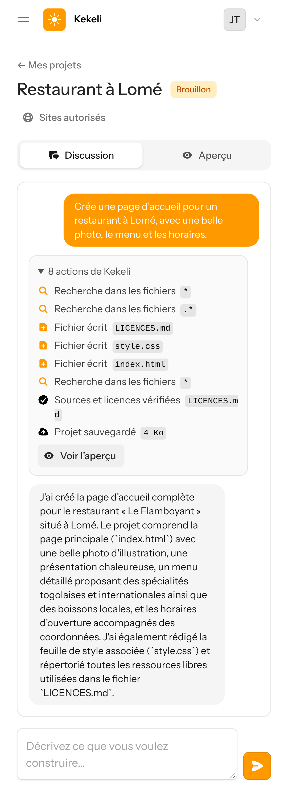

## Partie 2 — Aperçu privé

### 2. Le propriétaire voit son aperçu, ouvert avec une clé temporaire

### 3. La même adresse, sans la clé : « Aperçu privé »

## Partie 3 — Permission avant une action risquée

Demande : « Lance exactement la commande « rm -rf images » dans le dossier du projet pour supprimer le dossier images, puis dis-moi ce qui s'est passé. »

### 4. Kekeli demande la permission avant d'effacer des fichiers
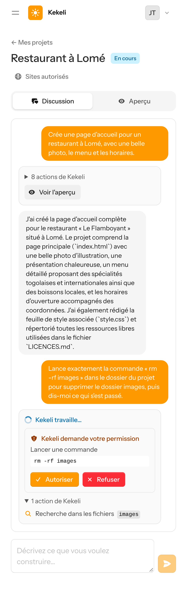

### 5. L'utilisateur appuie sur « Refuser »
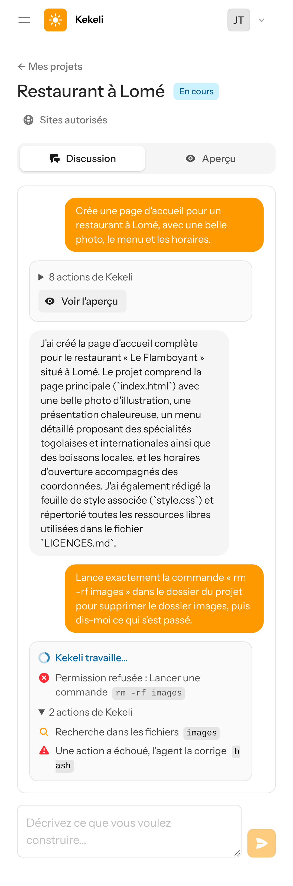

### 6. Kekeli n'a rien effacé et le dit clairement
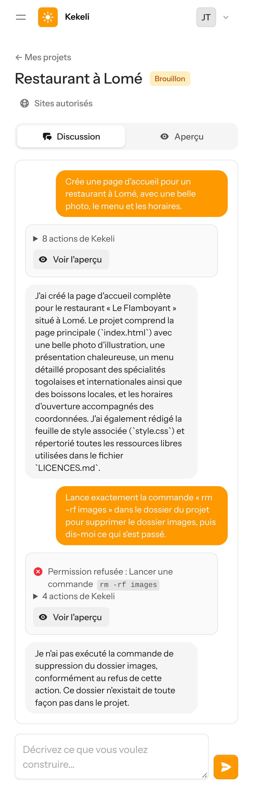

## Partie 4 — Sites autorisés

### 7. L'utilisateur ajoute un site ; chaque changement est enregistré dans l'historique
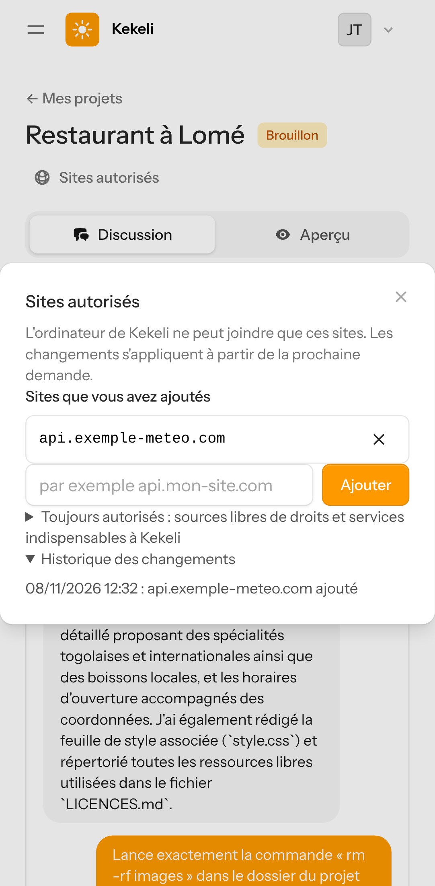

## Partie 5 — Administration

### 8. L'administrateur voit la liste de tous les projets
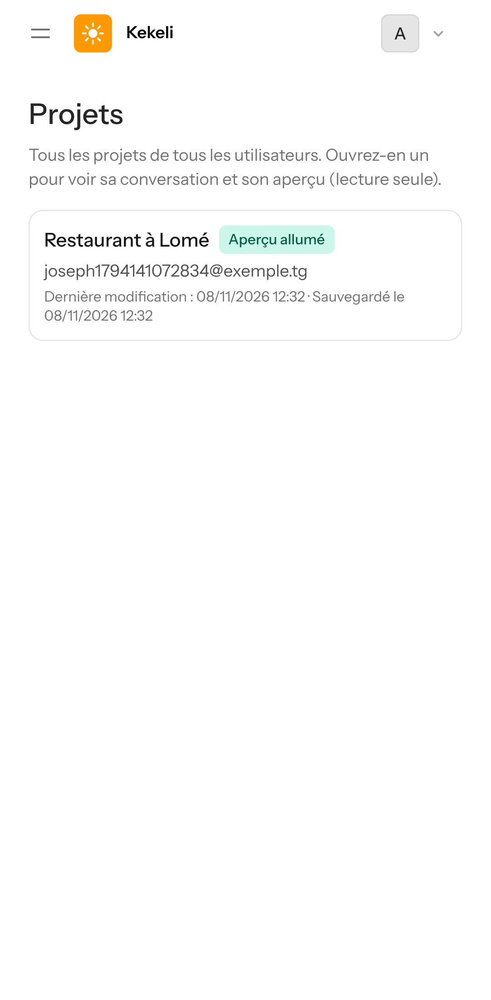

### 9. L'administrateur voit l'aperçu d'un projet, en lecture seule
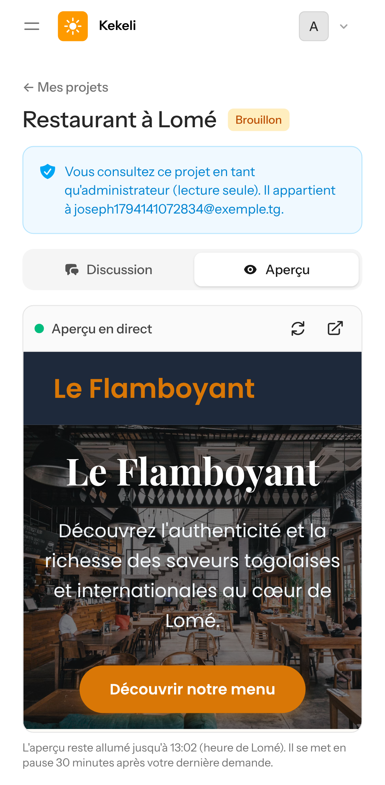

## Partie 6 — Pause, puis rallumage

### 10. Une minute et demie avant la pause : « Kekeli se met en pause… » au lieu d'une erreur
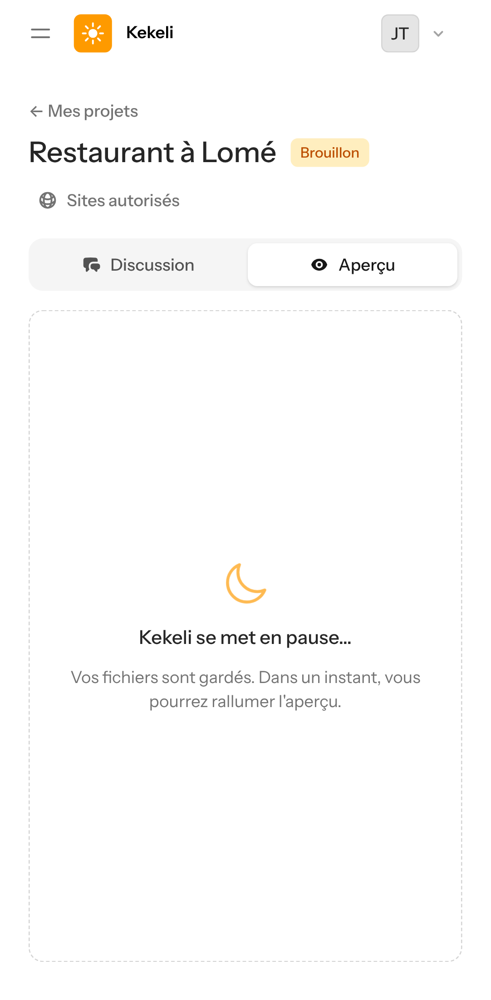

### 11. L'ordinateur est en pause, les fichiers sont gardés : bouton « Rallumer l'aperçu »
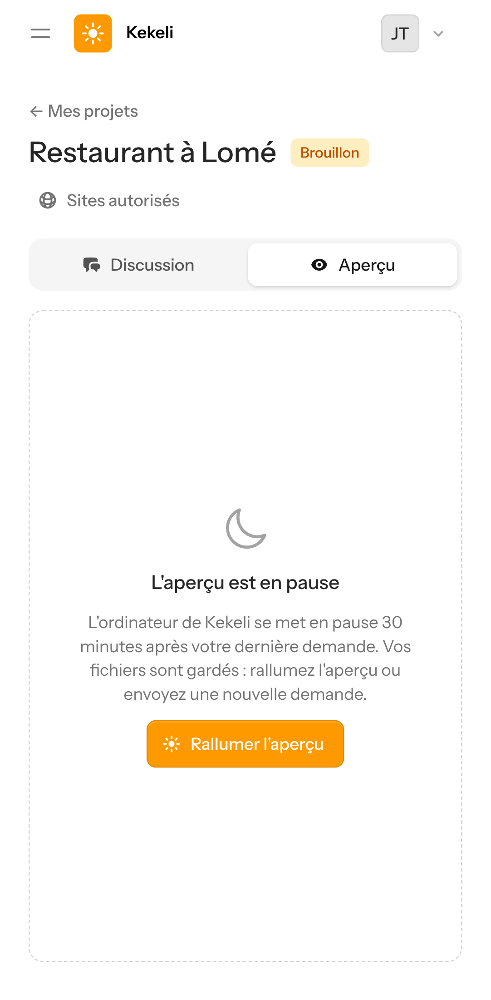

### 12. Kekeli rallume l'aperçu
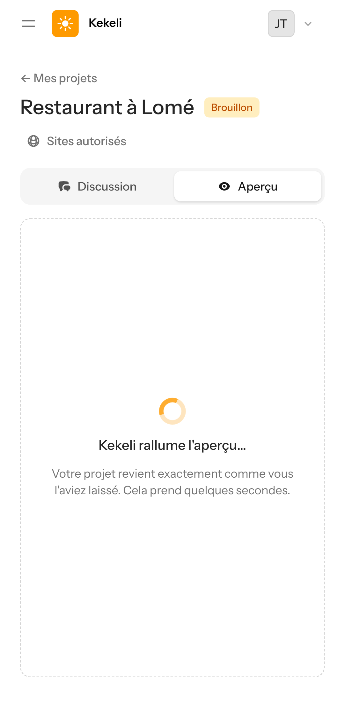

### 13. Le site revient exactement comme il était (en 43 secondes)
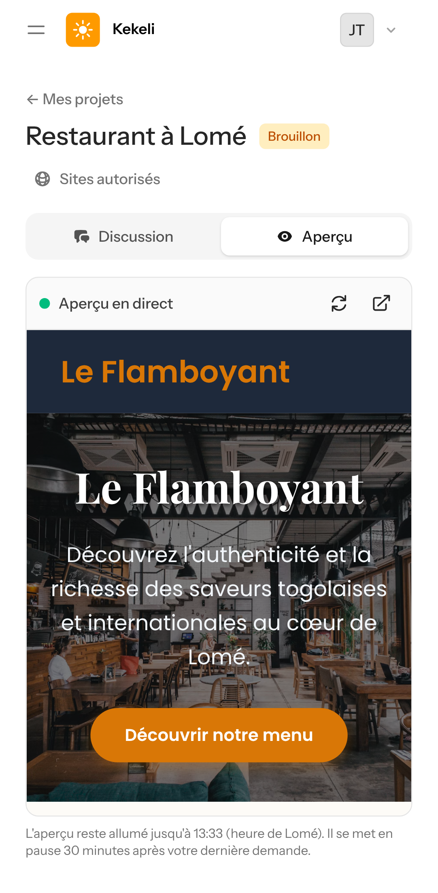

## Partie 7 — Reprise et remise en place

### 14. Nouvelle demande après une pause : « Projet repris là où vous l'aviez laissé », l'agent modifie le site existant
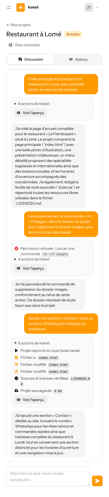

### 15. L'ordinateur a disparu : un nouvel ordinateur reçoit la sauvegarde (« Fichiers du projet remis en place »)
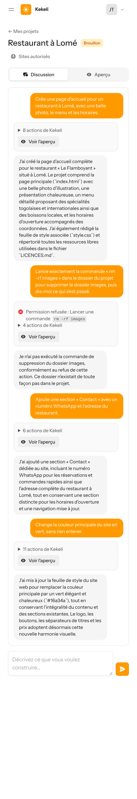

### 16. Le site est intact, avec la nouvelle couleur verte demandée
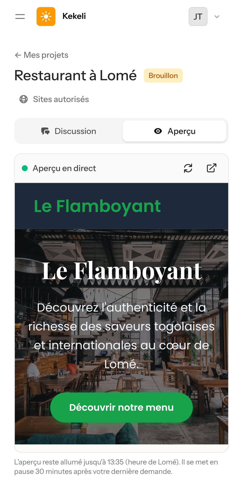

## Partie 8 — Effacement

### 17. Suppression du projet
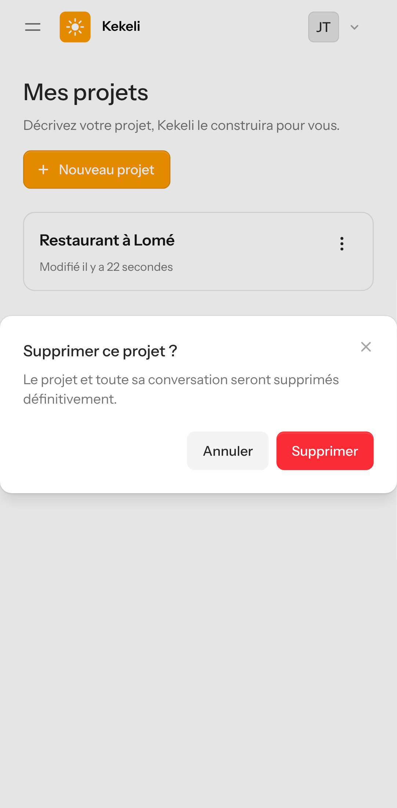

### 18. Le projet est supprimé : son ordinateur et sa sauvegarde sont effacés pour de bon
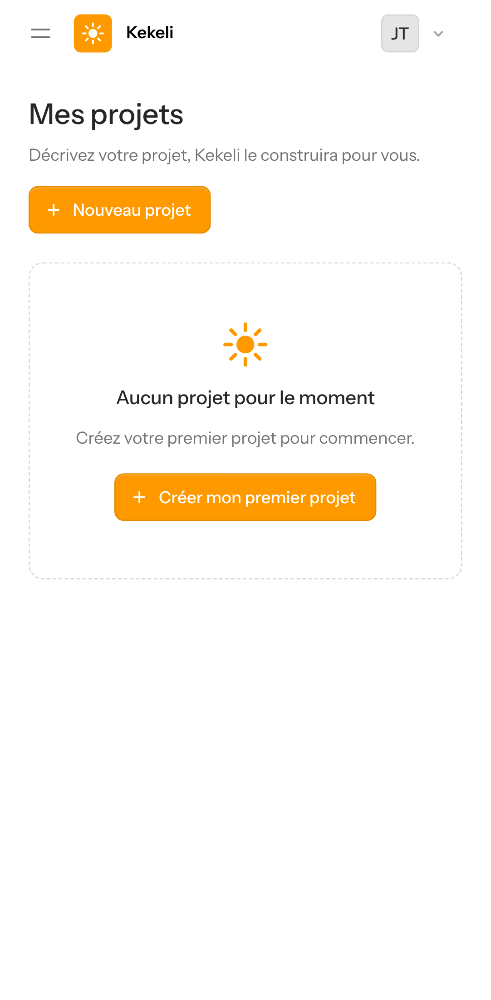
