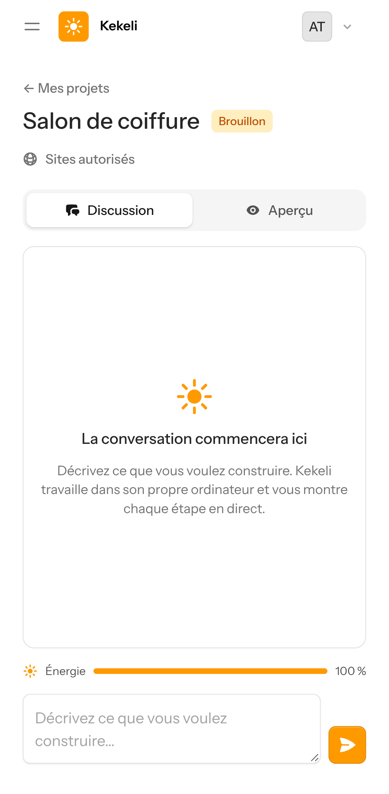
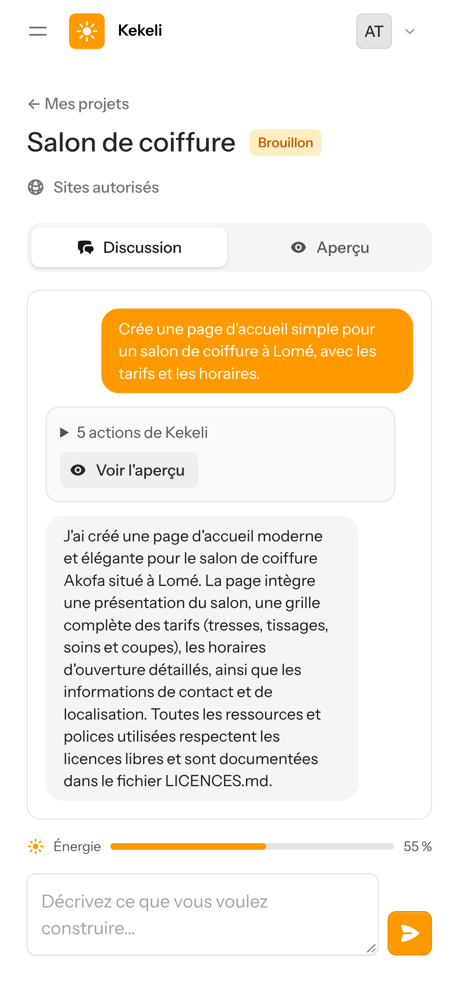
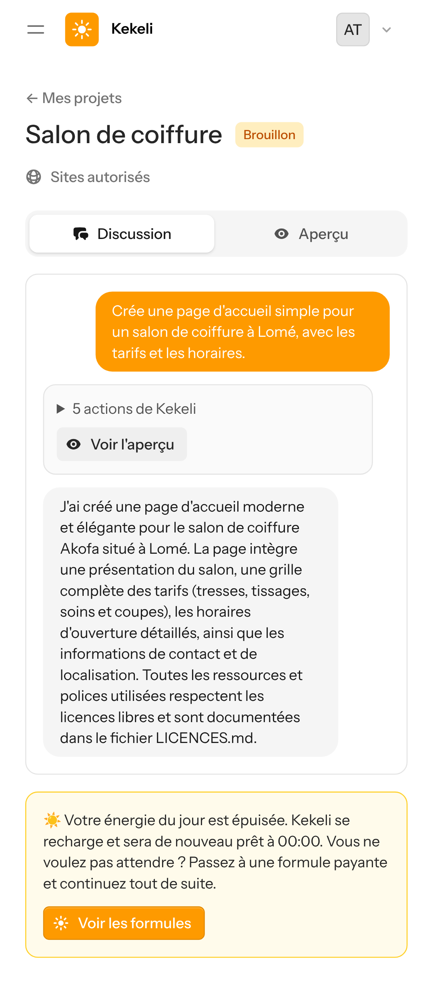
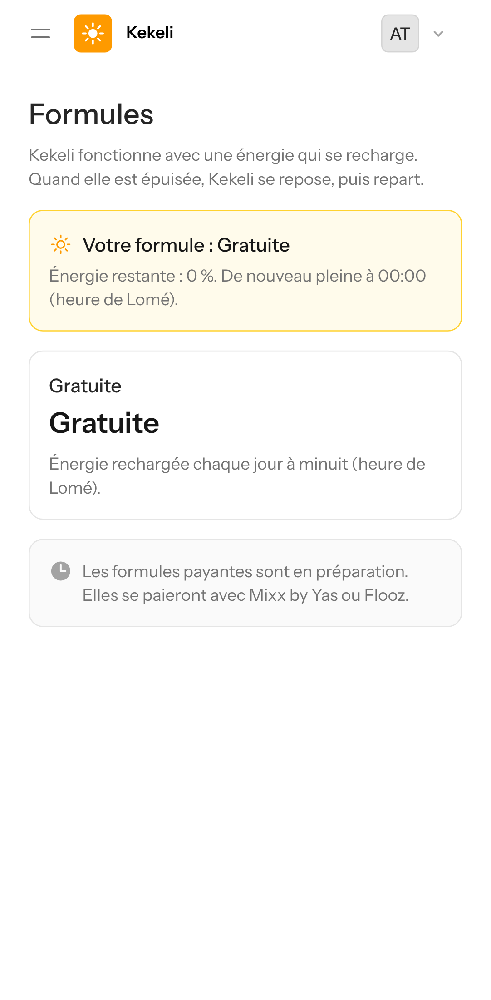
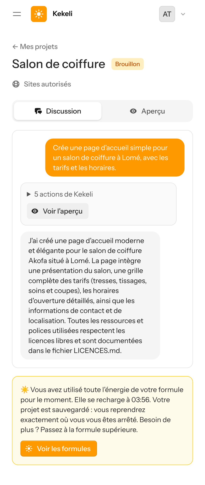
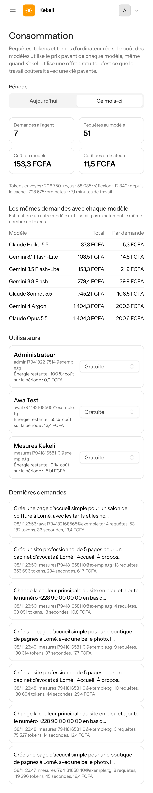
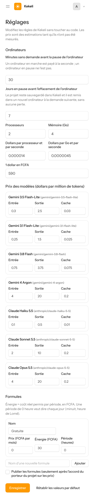
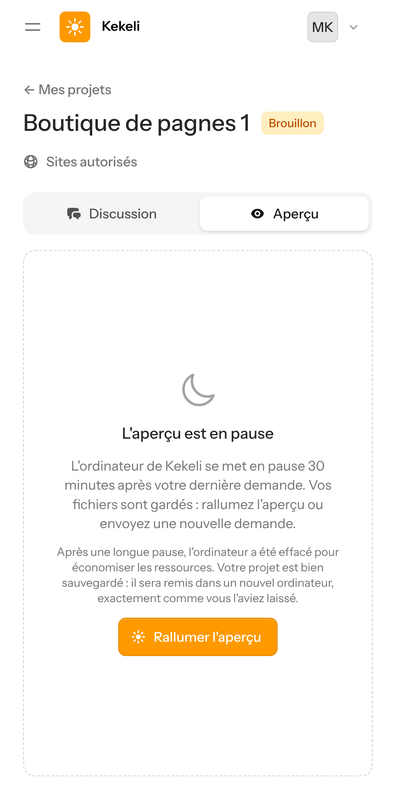

# Étape 5 — captures sur un écran de téléphone simulé

Captures prises le 8 novembre 2026 sur un téléphone simulé (Pixel 7, navigateur en français), avec un vrai ordinateur E2B, l'agent OpenCode et Gemini 3.5 Flash-Lite (offre gratuite).

Les mesures de coûts et la proposition de formules sont dans [`docs/couts.md`](../couts.md).

**Ce qui a été simulé, et pourquoi** :
- pour montrer les messages de limite, l'énergie de la formule a été abaissée dans les réglages (captures 3 et 5), puis remise à sa valeur ;
- la capture 5 utilise une formule payante d'essai, « Démonstration », jamais publiée ;
- pour l'effacement automatique (captures 8 et 9), la date de pause du projet a été reculée de 8 jours ; la commande d'effacement, l'effacement chez E2B et la remise en place sont réels.

## Partie 1 — L'énergie qui se recharge

### 1. Un nouveau projet : l'énergie est pleine

### 2. Après une vraie demande, l'énergie a baissé (55 %)

### 3. Formule gratuite : l'énergie du jour est épuisée

### 4. Le bouton « Voir les formules » : seule la formule gratuite est publiée, les formules payantes sont « en préparation »

### 5. Formule payante : toute l'énergie de la formule est utilisée pour le moment

## Partie 2 — Administration

### 6. Consommation : demandes, requêtes, coût du modèle et des ordinateurs, comparaison des modèles, formule de chaque utilisateur, dernières demandes

### 7. Réglages : minutes avant la pause, jours avant l'effacement, prix des ordinateurs et des modèles, formules

## Partie 3 — Effacement automatique d'un ordinateur en pause

### 8. L'ordinateur a été effacé après une longue pause ; le projet est sauvegardé

### 9. « Rallumer l'aperçu » : le projet revient dans un nouvel ordinateur (en 14 secondes), avec la modification en bleu

La photo ne s'affiche pas : l'agent a écrit une adresse d'image Unsplash qui n'existe pas. C'est un défaut de qualité à corriger à l'étape 6 (vérification automatique des adresses d'images).
