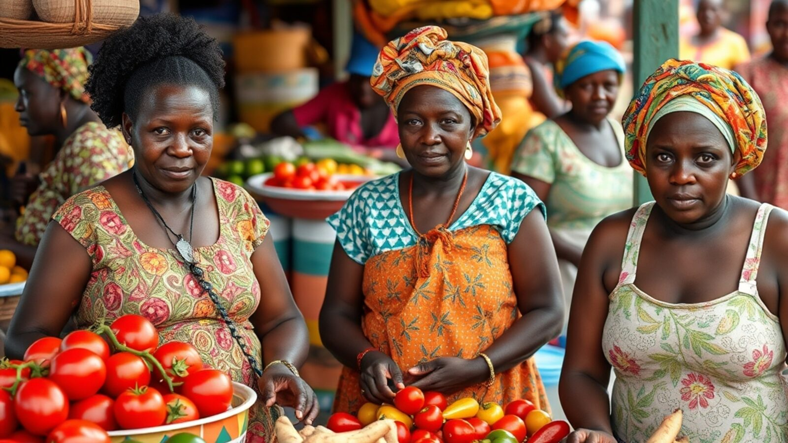
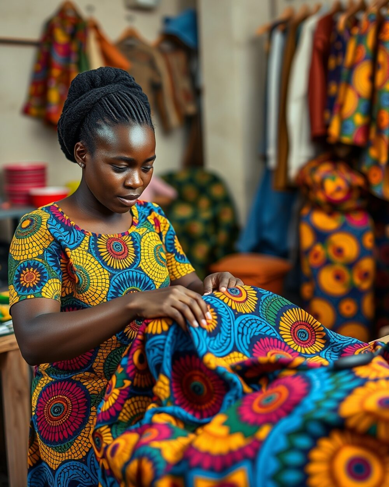
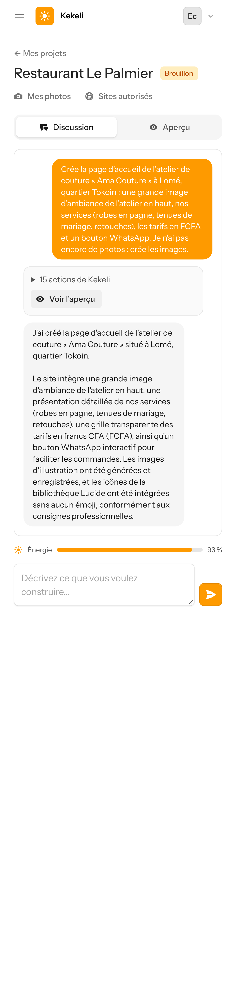
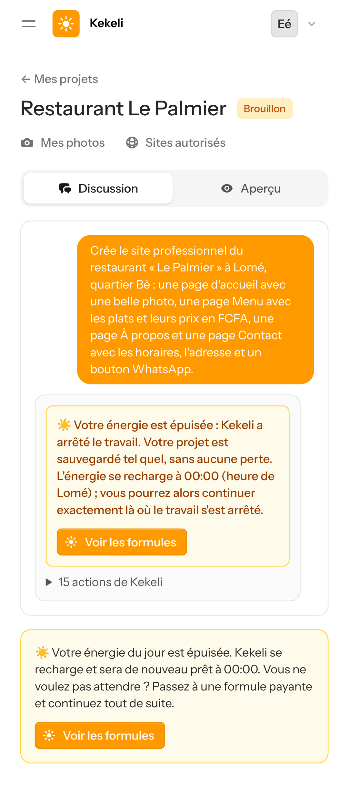
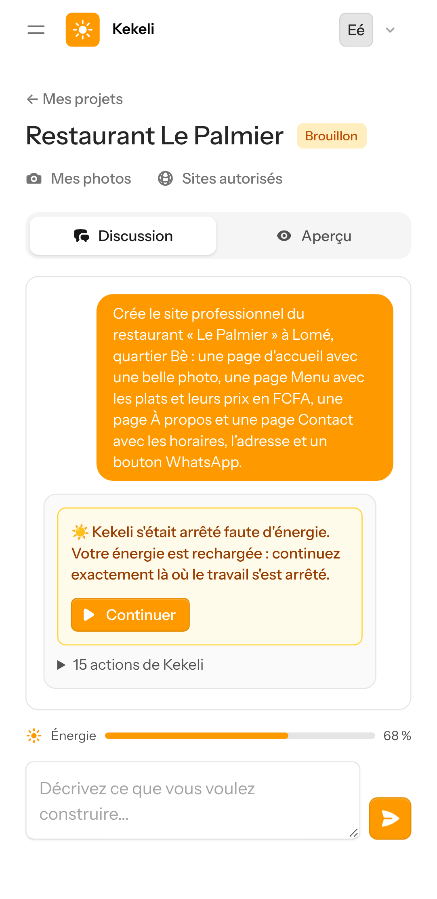
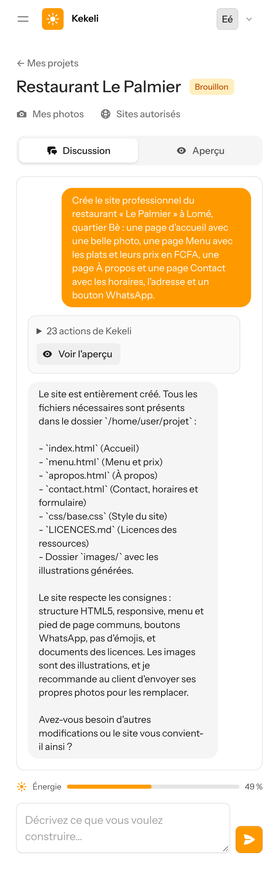
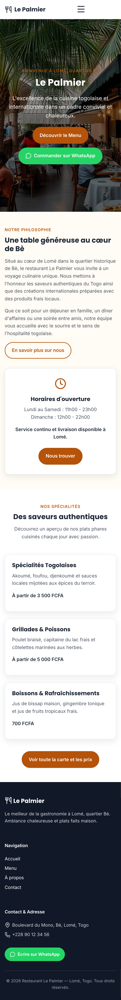

# Ajouts à l'étape 6 — captures sur un écran de téléphone simulé

Captures prises le 9 novembre 2026 sur un téléphone simulé (Pixel 7, navigateur en français), avec de vrais ordinateurs E2B, l'agent OpenCode, Gemini 3.5 Flash-Lite (offre gratuite) et Cloudflare Workers AI (offre gratuite, compte réservé à Kekeli). Rien n'a été payé.

## Partie 1 — Les images créées par Kekeli pour des sites togolais

Quatre images créées par l'outil de Kekeli (modèle FLUX.1 schnell sur Cloudflare Workers AI), en 2 à 4 secondes chacune. Ce sont des personnes créées, pas de vraies personnes.

### 1. Terrasse d'un restaurant : des amis partagent du poisson braisé

### 2. Un marché : vendeuses de tomates, piments et ignames

### 3. Une couturière et ses tissus wax

### 4. Un salon de coiffure : tresses

## Partie 2 — L'agent crée les images d'un site

Demande : « Crée la page d'accueil de l'atelier de couture « Ama Couture » à Lomé, quartier Tokoin… Je n'ai pas encore de photos : crée les images. »

Résultat : page terminée en 1 minute 16 et 13 requêtes, avec **4 images créées** (atelier, robes en pagne, tenues de mariage, retouches), notées dans `LICENCES.md` comme illustrations, et comptées dans l'énergie.

### 5. La discussion

### 6. La page d'accueil avec les images créées

**Ce qui a été corrigé grâce à cet essai** : au premier essai, l'agent avait pris une photo libre d'un atelier de tailleur de Hong Kong, avec une enseigne en chinois. Maintenant :
- le regard de Kekeli refuse les photos avec des enseignes ou une écriture étrangères au pays du client ;
- quand aucune photo libre ne convient, l'image est créée à la place ;
- quand le client demande des images créées, l'agent les crée directement.

**Limite connue** : le service de création écrit parfois de faux mots (par exemple une marque inventée sur une machine à coudre). Pour les vrais produits du client, ses propres photos restent la meilleure solution.

## Partie 3 — L'énergie s'épuise au milieu du travail

Un utilisateur de la formule gratuite (30 FCFA d'énergie par jour) demande le site complet du restaurant « Le Palmier » (environ 75 FCFA d'énergie, estimation).

### 7. Le travail s'arrête aussitôt : message clair, heure de la recharge (Lomé) et bouton « Voir les formules »
Kekeli s'est arrêté après 15 requêtes ; les pages déjà écrites (accueil, menu) et les 2 images créées sont sauvegardées.

### 8. Après le paiement d'une formule (validé par l'administrateur), le bouton « Continuer » apparaît

### 9. « Continuer » : la même demande reprend là où elle s'était arrêtée et se termine
L'agent a regardé les fichiers déjà faits, puis a écrit seulement les pages manquantes (À propos, Contact). Total : 21 requêtes, 137 secondes d'ordinateur (101 avant l'arrêt, 36 après).

### 10. Le site terminé, avec une image d'accueil créée par Kekeli

## Réglages ajoutés dans Administration → Réglages

- **Nombre maximum d'images créées par jour (tous les utilisateurs)** : 150 au départ, sous la limite gratuite de Cloudflare (environ 170 images par jour, estimation). Au-delà, l'agent utilise une photo libre ou une illustration.
- **Prix d'une image créée** : 0,001 $ (environ 0,59 FCFA), compté dans l'énergie du client.
