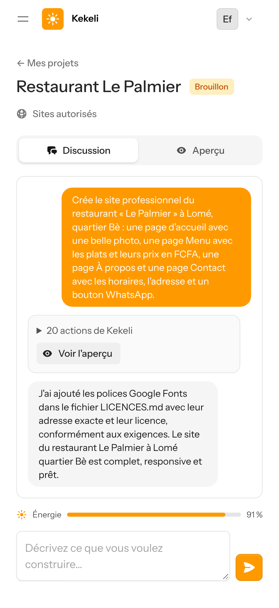
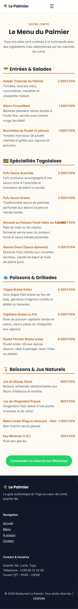
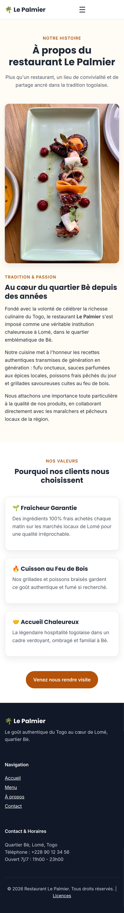
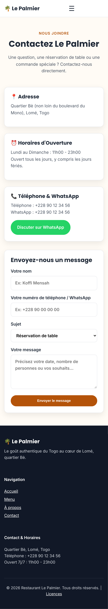
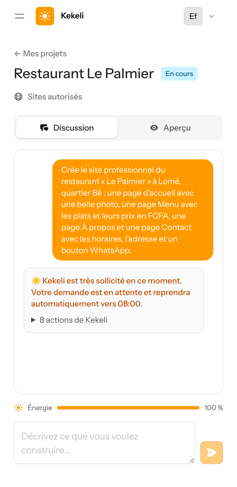

# Étape 6 — captures sur un écran de téléphone simulé

Captures prises le 9 novembre 2026 sur un téléphone simulé (Pixel 7, navigateur en français), avec un vrai ordinateur E2B, l'agent OpenCode et Gemini (offre gratuite de Google AI Studio).

**La demande envoyée à Kekeli, la même pour chaque modèle** :

> Crée le site professionnel du restaurant « Le Palmier » à Lomé, quartier Bè : une page d'accueil avec une belle photo, une page Menu avec les plats et leurs prix en FCFA, une page À propos et une page Contact avec les horaires, l'adresse et un bouton WhatsApp.

Rien n'a été simulé : chaque capture montre ce que l'agent a réellement construit.

## Résultat par modèle

| | Gemini 3.5 Flash-Lite (gratuit) | Gemini 3.8 Flash et 3.6 Flash (gratuits, plus forts) |
|---|---|---|
| Résultat | Site complet de 4 pages | Pas terminé : limite gratuite du jour atteinte |
| Durée | 3 minutes 40 | — |
| Requêtes | 17 | 8 (3.6 Flash), puis limite atteinte sur les deux modèles |
| Vérifications de Kekeli | 4 défauts trouvés, corrigés par l'agent lui-même, puis tout est bon | — |
| Photos | 6 photos libres de Wikimedia, toutes vérifiées, aucune cassée | 3 recherches de photos faites avant l'arrêt |
| Dépassement de l'écran du téléphone | Aucun, sur les 4 pages | — |
| Coût estimé au prix payant équivalent | environ 41 FCFA (modèle 35 FCFA, ordinateur 6 FCFA) | — |

Le coût est une **estimation** : l'essai a utilisé l'offre gratuite, et le calcul applique le prix de l'offre payante de Gemini 3.5 Flash-Lite et le prix de l'ordinateur E2B.

## Partie 1 — Gemini 3.5 Flash-Lite : le site du restaurant

### 1. La discussion : recherche de photos libres, écriture des pages, vérifications et corrections automatiques

### 2. La page d'accueil : grande photo, boutons « Découvrir notre menu » et « Réserver sur WhatsApp », spécialités avec leurs prix

### 3. La page Menu : plats et prix en FCFA, bouton WhatsApp pour commander

### 4. La page À propos

### 5. La page Contact : horaires, adresse, bouton WhatsApp

## Partie 2 — Gemini Flash (modèles plus forts, gratuits)

### 6. Limite gratuite atteinte : la demande est mise en attente, sans erreur pour l'utilisateur

Les modèles Flash gratuits n'ont qu'environ 20 requêtes par jour, déjà en partie utilisées par les essais du matin. Gemini 3.6 Flash s'est d'abord arrêté en silence au milieu du travail ; Kekeli l'a relancé automatiquement (nouvelle règle de cette étape), puis les deux modèles Flash ont atteint leur limite. Kekeli a mis la demande en attente et affiche le message prévu : « Kekeli est très sollicité en ce moment… ». **Pour comparer vraiment des modèles plus forts, il faut le petit budget payant prévu à cette étape.**

## Ce qui a été corrigé grâce à ces essais

- **Photos inventées** : l'agent ne choisit plus une adresse d'image au hasard. Il utilise l'outil de photos de Kekeli, qui cherche de vraies photos sous licence libre sur Wikimedia Commons, vérifie chaque adresse et donne la ligne à copier dans `LICENCES.md`. Après chaque demande, Kekeli vérifie que chaque image du site répond vraiment.
- **Photos refusées par Wikimedia** : Wikimedia refuse d'afficher ses images en taille d'origine sur d'autres sites. L'outil ne donne plus que des miniatures de 1 280 pixels, acceptées par Wikimedia.
- **Page plus large que l'écran du téléphone** : une grille pouvait élargir la page Menu. Le modèle de mise en page de Kekeli l'empêche maintenant.
- **Titres illisibles dans le pied de page** : texte foncé sur fond foncé, corrigé.
- **Agent arrêté en silence** : un tour qui se termine sans aucun message est relancé automatiquement, deux fois au plus.

## Limite connue

Les photos libres de Wikimedia ne correspondent pas toujours aux plats annoncés : il y a peu de photos de plats togolais, et l'agent a illustré le « Fufu sauce arachide » avec une assiette européenne. Le client pourra envoyer ses propres photos : c'est la meilleure solution pour un restaurant.
