# Étape 6 — captures sur un écran de téléphone simulé

Captures prises le 9 novembre 2026 sur un téléphone simulé (Pixel 7, navigateur en français), avec de vrais ordinateurs E2B, l'agent OpenCode et uniquement des **modèles gratuits** de Google AI Studio. Rien n'a été payé.

**La demande envoyée à Kekeli, la même pour chaque modèle** :

> Crée le site professionnel du restaurant « Le Palmier » à Lomé, quartier Bè : une page d'accueil avec une belle photo, une page Menu avec les plats et leurs prix en FCFA, une page À propos et une page Contact avec les horaires, l'adresse et un bouton WhatsApp.

## Comparaison des modèles gratuits

| Modèle gratuit | Résultat | Durée | Requêtes | Coût estimé au prix payant équivalent |
|---|---|---|---|---|
| **Gemini 3.5 Flash-Lite** | **Site complet de 4 pages, le plus riche et le plus soigné** | 2 minutes 27 | 22 | environ 75 FCFA |
| Gemini 3.1 Flash-Lite | Site complet de 4 pages, mais pages courtes et presque vides | 2 minutes 25 | 22 | environ 32 FCFA |
| Gemini 3 Flash Preview | Beau style, mais **pas terminé** : limite gratuite du jour atteinte après 23 requêtes | — | 23 | environ 66 FCFA (partiel) |
| Gemma 4 31B | Rien de construit en 30 minutes : 17 refus pour limite | — | 11 | gratuit seulement |
| Gemma 4 26B | Rien de construit en 30 minutes : 17 refus pour limite | — | 3 | gratuit seulement |
| Gemini 3.8 Flash et 3.6 Flash (essai du matin) | Pas terminé : environ 20 requêtes gratuites par jour | — | 8 à 15 | — |

Dans les deux sites terminés : **aucune image cassée, aucun émoji (seulement des icônes Lucide), rien ne dépasse de l'écran du téléphone**, et les vérifications de Kekeli ont trouvé 4 défauts, corrigés par l'agent lui-même.

Les coûts sont des **estimations** : les essais ont utilisé l'offre gratuite ; le calcul applique le prix de l'offre payante de chaque modèle et le prix de l'ordinateur E2B.

## Partie 1 — Gemini 3.5 Flash-Lite (le meilleur modèle gratuit)

### 1. La discussion : photos libres, icônes, pages, vérifications et corrections
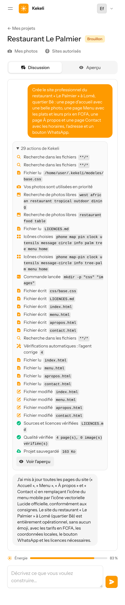

### 2. Accueil : photo de fond, boutons « Découvrir le Menu » et WhatsApp, horaires et adresse avec icônes
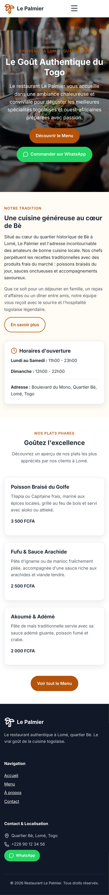

### 3. Menu : plats et prix en FCFA

### 4. À propos
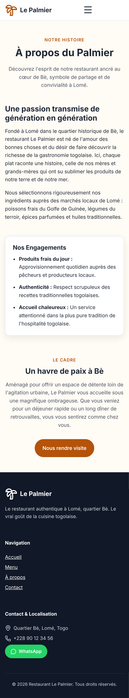

### 5. Contact : horaires, adresse, numéro au format du Togo, bouton WhatsApp
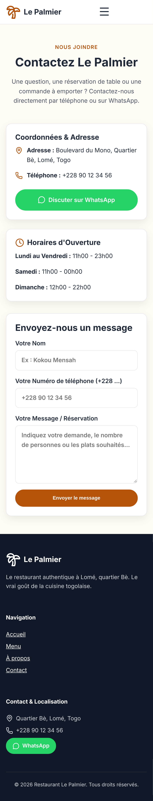

## Partie 2 — Gemini 3.1 Flash-Lite

### 6. La discussion
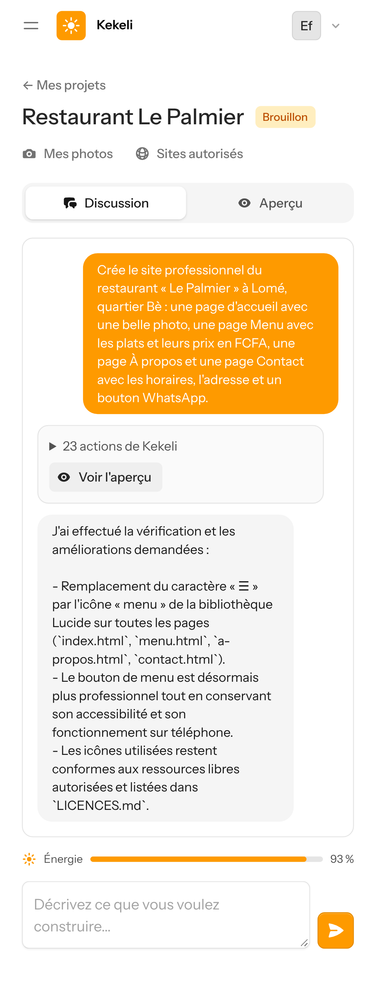

### 7. Accueil (page courte)
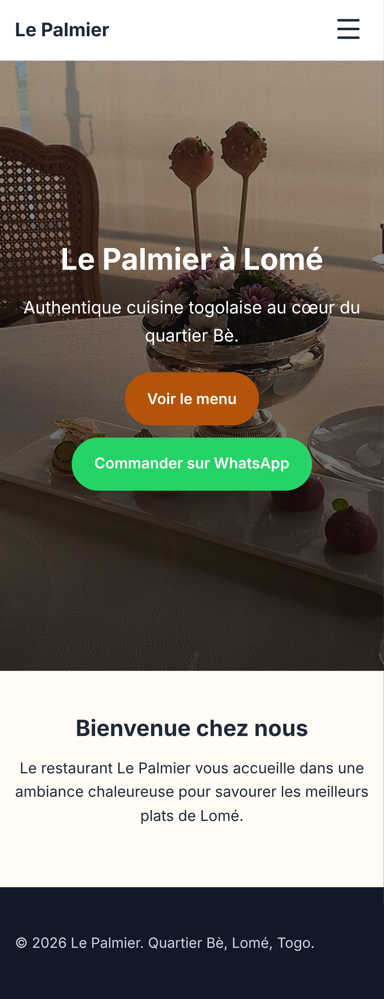

### 8. Menu
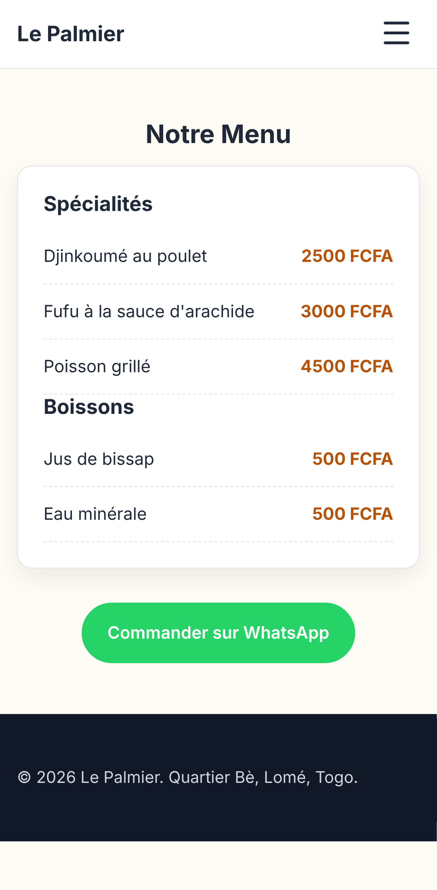

### 9. À propos
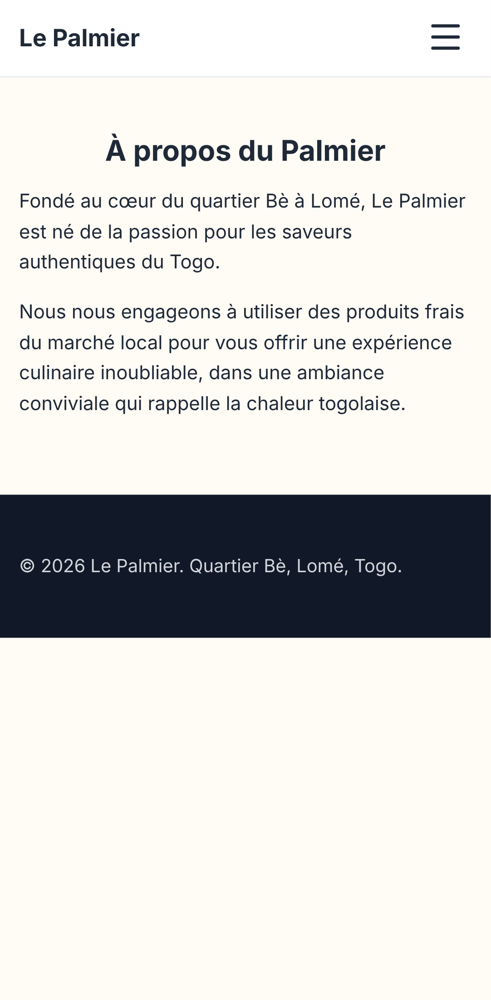

### 10. Contact
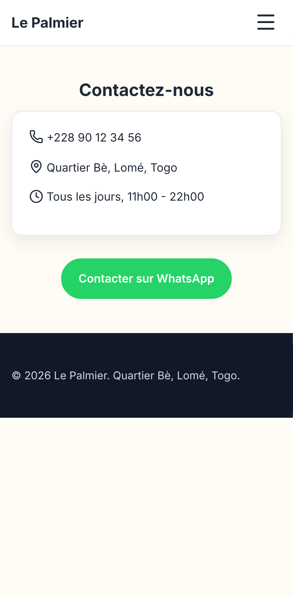

## Partie 3 — Gemini 3 Flash Preview (site non terminé, limite gratuite atteinte)

Pages enregistrées avant la limite. Ce modèle a aussi placé des photos libres à côté de plats précis (un poisson cantonais et un poulet rôti allemand pour un restaurant de Lomé) : **c'est corrigé** (voir plus bas).

### 11. Accueil
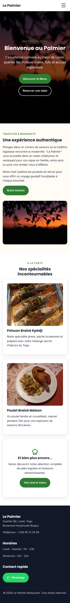

### 12. Menu
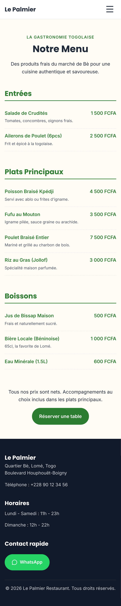

### 13. À propos
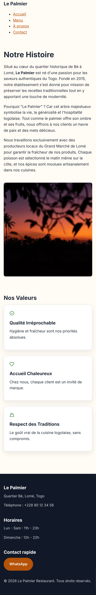

### 14. Contact
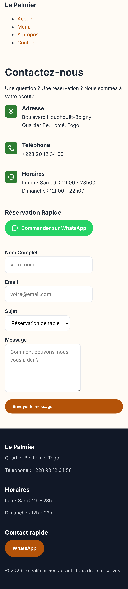

## Partie 4 — Les photos du client d'abord (Gemini 3.5 Flash-Lite)

Pour cet essai, deux photos libres (un poisson braisé et une scène de marché d'Afrique de l'Ouest) jouent le rôle des photos du client, envoyées depuis son téléphone.

### 15. L'inscription demande le pays (Togo par défaut)
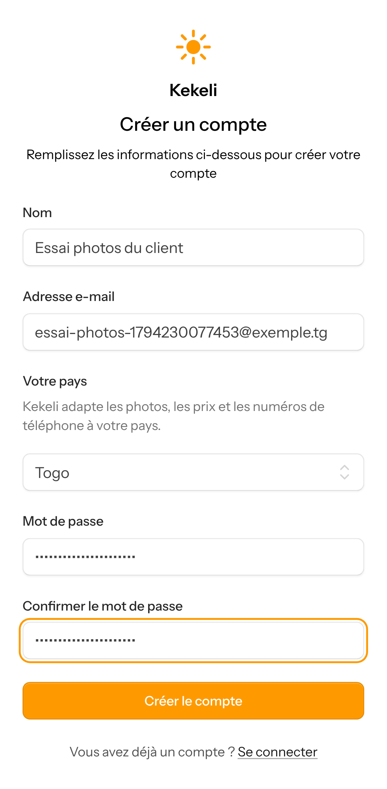

### 16. Le bouton « Mes photos » : le client ajoute ses photos depuis son téléphone
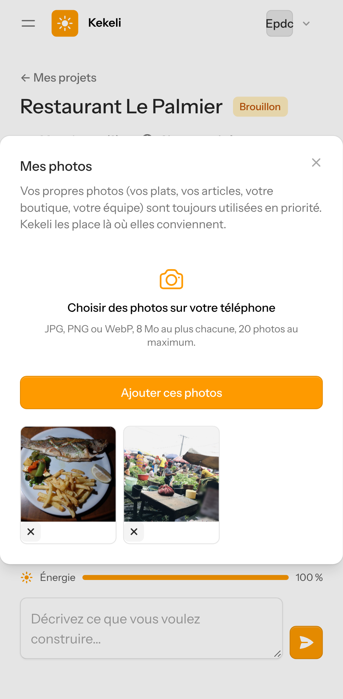

### 17. La discussion : « Crée la page d'accueil… Utilise mes photos. »
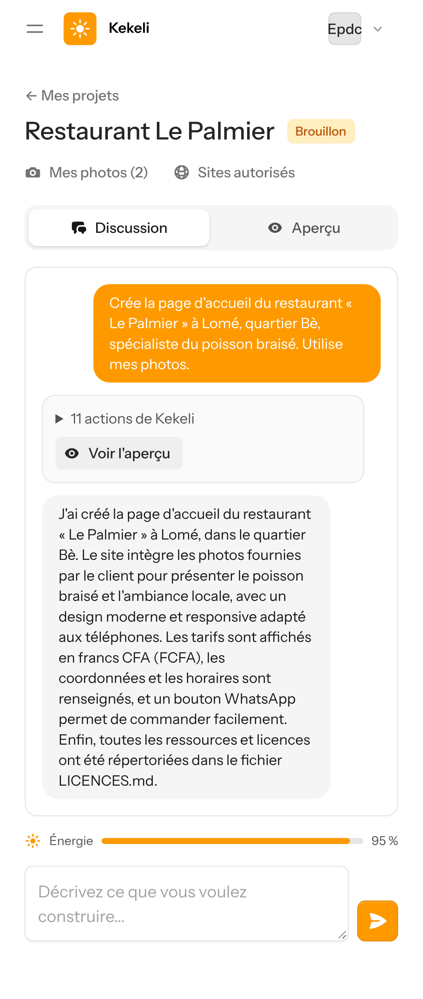

### 18. Le résultat : la photo du marché en grand, la photo du poisson à côté du « Poisson Braisé Signature » ; pour le plat suivant, sans photo du client, une icône au lieu d'une fausse photo

## Ce qui a été construit à cette étape

- **Photos du client d'abord** : bouton « Mes photos » dans chaque projet (jusqu'à 20 photos de 8 Mo), copiées dans l'ordinateur virtuel et utilisées en priorité par l'agent.
- **Photos libres choisies par Kekeli** : recherche sur Wikimedia Commons et Openverse (et Pexels dès qu'une clé gratuite est placée), seulement des licences qui **n'obligent pas à citer l'auteur**. Gemini **regarde chaque photo** et refuse les filigranes, les noms d'auteur effacés ou floutés, les personnes réelles reconnaissables et les photos d'un autre pays ou d'une autre culture. Les marques, enseignes, textes et visages apparus par hasard sont **floutés**. La photo est enregistrée dans le projet, allégée, et notée dans `LICENCES.md`.
- **Création d'images gratuite** : prête avec Cloudflare Workers AI (environ 10 000 « neurones » gratuits par jour, de l'ordre de 190 images, estimation), en attente d'une clé.
- **Pays du client** : choisi à l'inscription, modifiable dans le profil, demandé avant le premier message aux comptes qui ne l'ont pas encore. L'agent adapte images, monnaie et numéros de téléphone.
- **Icônes Lucide** (licence ISC) au lieu des émojis ; un émoji dans un site est signalé et corrigé.
- **Chaque image créée est comptée dans l'énergie** du client (prix réglable dans l'administration).

## Limite connue

Les sources libres ont très peu de photos du Togo : sans photo du client, la photo d'accueil reste souvent une ambiance générale de restaurant. Les vraies solutions sont les photos du client, puis la création d'images une fois la clé Cloudflare placée.
