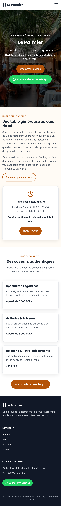
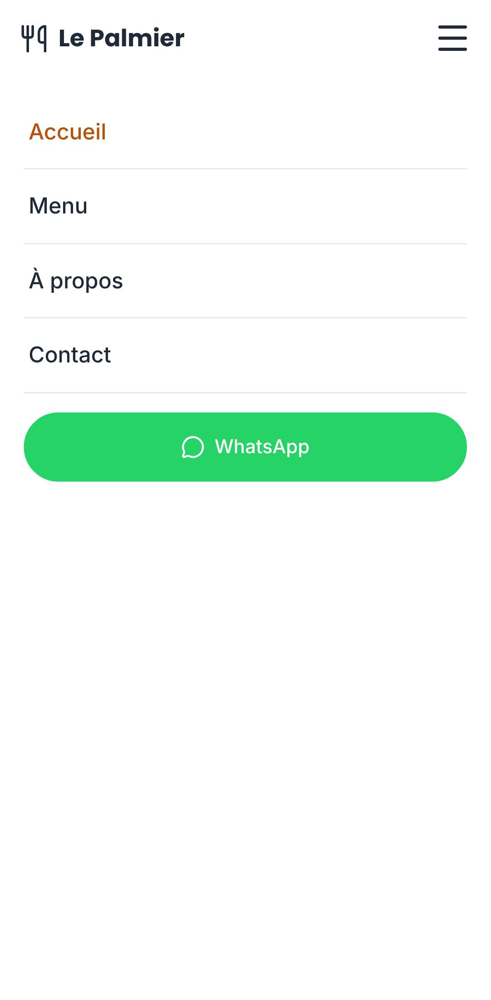
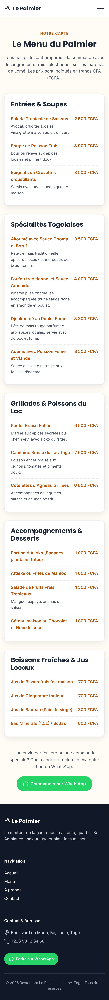
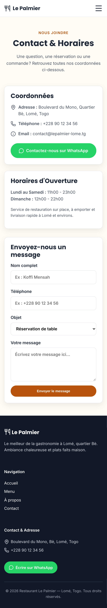

# Corrections du modèle de mise en page — captures du site en ligne

Captures prises le 9 novembre 2026 sur un téléphone simulé (Pixel 7, navigateur en français), sur le site réellement en ligne : https://restaurant-le-palmier-qzskk7.pages.dev (site d'essai, informations inventées).

Les 4 défauts vus par le porteur du projet ont été corrigés dans le **modèle de mise en page de Kekeli** (pour tous les futurs sites), puis Kekeli a repris ce modèle sur « Le Palmier » (7 requêtes) et le site a été publié à nouveau.

| Défaut | Avant | Après (mesuré sur le site en ligne) |
|---|---|---|
| 1. Petit texte sur la photo (« BIENVENUE À LOMÉ, QUARTIER BÈ ») | orange pâle sur la photo | blanc sur une pastille sombre, voile plus sombre sur la photo |
| 2. Menu mobile ouvert | une bande de 277 pixels ; bouton WhatsApp collé aux deux bords | un panneau qui couvre toute la page sous l'en-tête ; bouton WhatsApp centré, à 20 pixels de chaque bord |
| 3. Icône ☰ | à 120 pixels du bord droit (logo à 16 pixels du bord gauche) | à 16 pixels du bord droit, comme le logo |
| 4. Typographie française | « faim ? » avec une espace ordinaire, « Contact? » sans espace | espace insécable avant « ? », « ! », « : », « ; », dans les guillemets « » et dans les prix (« 2 500 FCFA ») : 48 corrections automatiques, plus aucun signe seul en début de ligne |

La typographie est corrigée **automatiquement par Kekeli après chaque demande**, sans toucher aux balises, aux scripts, aux heures (11:00), aux adresses ni aux numéros de téléphone.

### 1. L'accueil en ligne : petit texte lisible, ☰ à droite

### 2. Le menu ouvert : un vrai panneau, bouton WhatsApp avec des marges

### 3. La page Menu

### 4. La page Contact

