# Étape 7 — captures sur un écran de téléphone simulé

Captures prises le 9 novembre 2026 sur un téléphone simulé (Pixel 7, navigateur en français). La publication est réelle, sur le compte Cloudflare réservé à Kekeli, avec l'offre gratuite de Cloudflare Pages. Rien n'a été payé.

**Le site publié pendant l'essai est en ligne** : https://restaurant-le-palmier-qzskk7.pages.dev (site d'essai, avec des informations inventées).

## Partie 1 — Publier en un clic

### 1. Une fois le site construit par Kekeli, le bouton « Publier mon site » apparaît
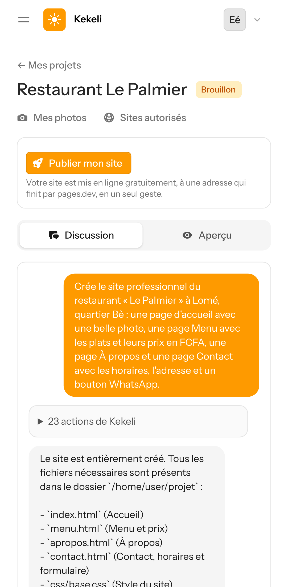

### 2. Publication en cours
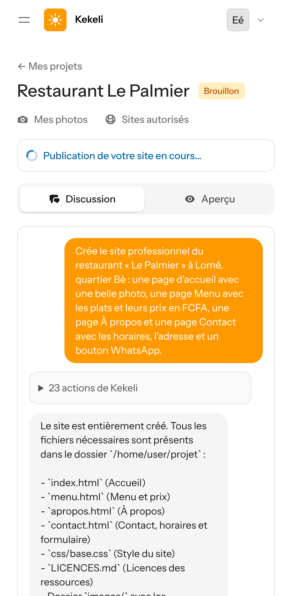

### 3. Le site est en ligne, à une adresse gratuite en pages.dev, en 11 secondes
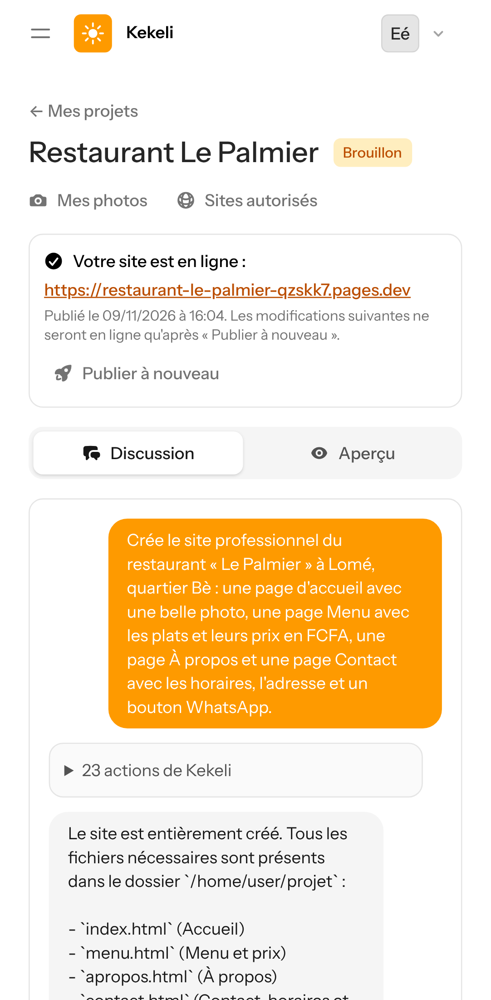

La toute première fois, Cloudflare a mis une dizaine de minutes avant d'ouvrir l'adresse (réponse « 522 » en attendant). La page de Kekeli le dit pendant les 15 minutes qui suivent une publication : « Si l'adresse ne s'ouvre pas encore, attendez quelques minutes ».

## Partie 2 — Le site en ligne, ouvert par un visiteur (sans compte Kekeli)

### 4. Accueil
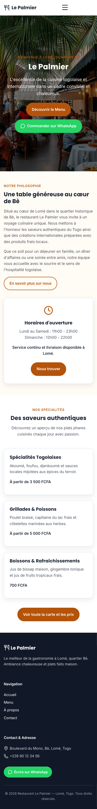

### 5. Menu
Défaut vu ici : sur téléphone, les noms de plats longs passaient par-dessus les prix (7 lignes). Corrigé dans le modèle de mise en page de Kekeli, puis sur ce site (partie 3).
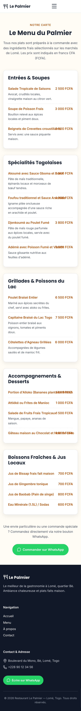

### 6. À propos
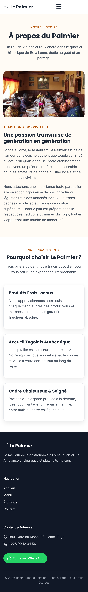

### 7. Contact
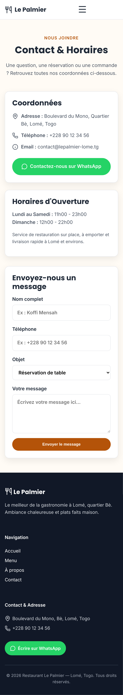

## Partie 3 — Corriger, puis « Publier à nouveau »

### 8. Le client demande la correction ; Kekeli remet le projet depuis sa sauvegarde et corrige la mise en page (7 requêtes)
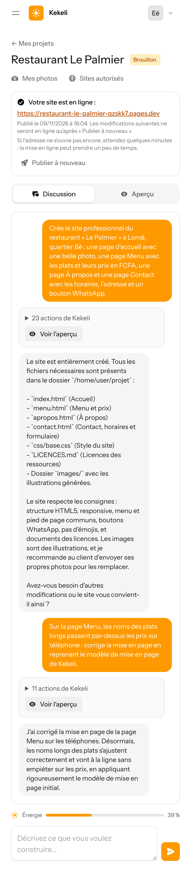

### 9. « Publier à nouveau » : la nouvelle version est en ligne, à la même adresse
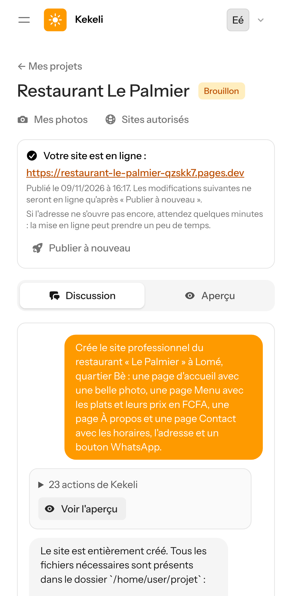

### 10. Le Menu en ligne, corrigé : plus aucun nom de plat ne passe par-dessus son prix
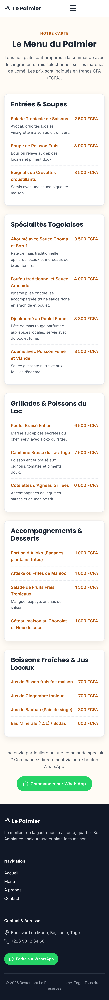

## Partie 4 — Nouvelle règle : aucun texte dans les images créées

Kekeli regarde chaque image créée : s'il voit des lettres, de faux mots ou une marque, il recrée l'image (deux fois au plus), puis floute ce qui resterait. Essai réel sur des sujets où le service de création ajoute souvent de faux mots :

### 11. Devanture d'une boutique : l'enseigne a été floutée
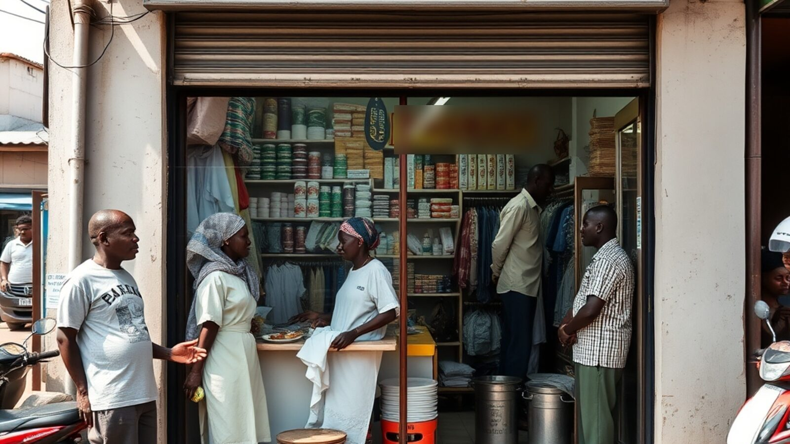

### 12. Machine à coudre : la fausse marque a été floutée

### 13. Étal de maïs grillé : aucun texte
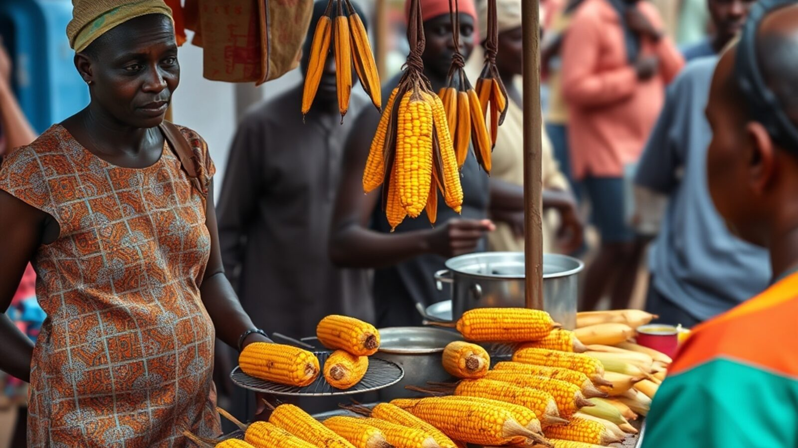

**Limite connue** : un petit mot sur un tee-shirt (à gauche de la devanture) n'a pas été repéré.
