# Étape 8 — captures sur un écran de téléphone simulé

Captures prises le 9 novembre 2026 sur un téléphone simulé (Pixel 7, navigateur en français), avec des comptes et une capture de paiement **inventés**. Rien n'a été payé.

## Partie 1 — Inscription et pages juridiques

### 1. Inscription : tous les pays du monde, et la case « J'accepte les conditions d'utilisation et la politique de confidentialité »
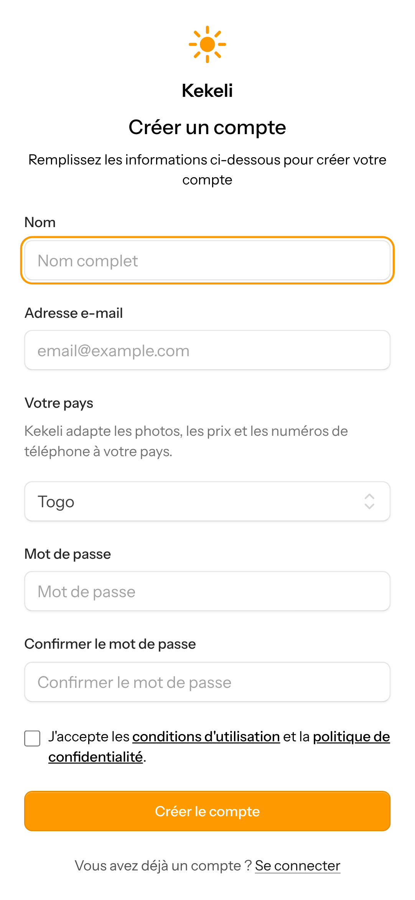

### 2. Conditions d'utilisation
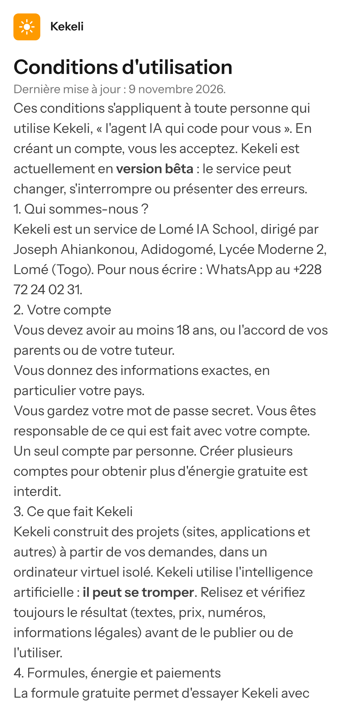

### 3. Politique de confidentialité : l'encadré sur la formule gratuite
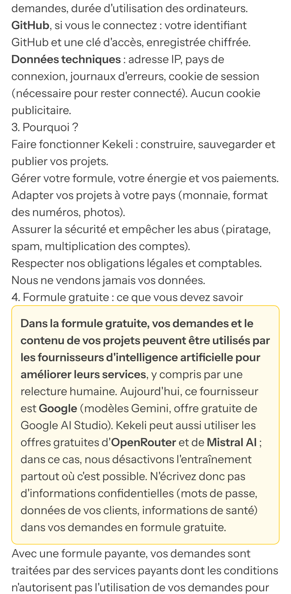

## Partie 2 — Payer une formule par Mobile Money

### 4. La page « Formules » avec les prix publiés
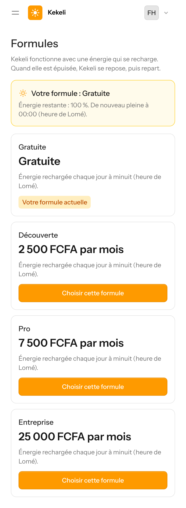

### 5. Une cliente du Bénin : numéros du Bénin et nom du titulaire
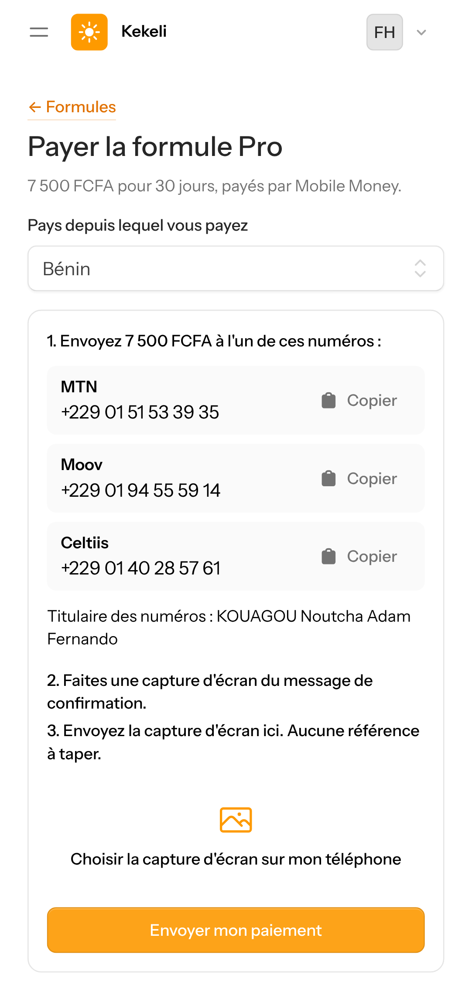

### 6. Si elle choisit le Togo : Mixx by Yas et Flooz
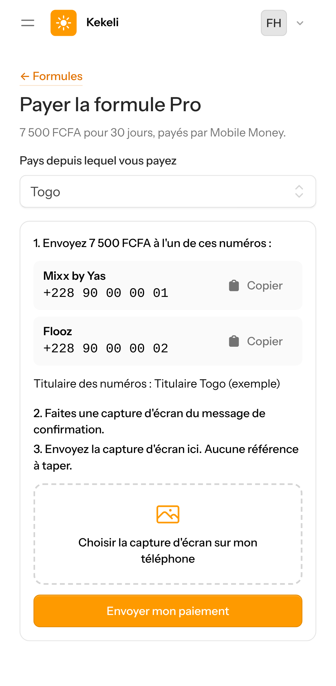

### 7. Un autre pays : bouton « Écrire sur WhatsApp »
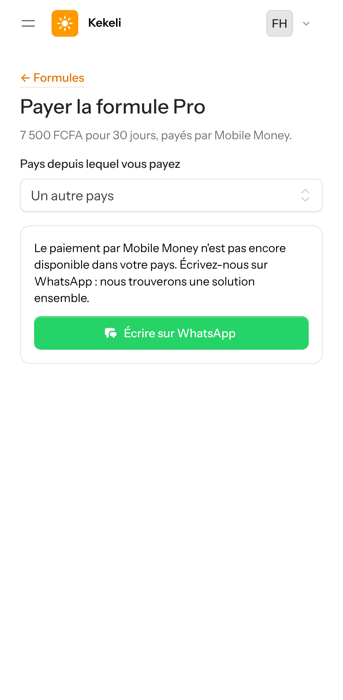

### 8. Elle choisit sa capture d'écran (aucune référence à taper)
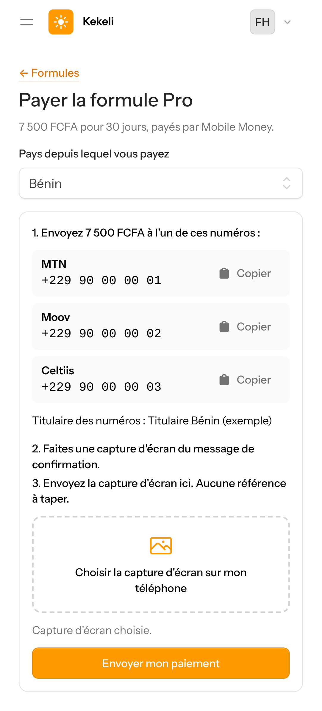

### 9. Paiement envoyé : en cours de vérification

## Partie 3 — L'administrateur vérifie

### 10. Administration → Paiements : la capture à vérifier, « Valider » ou « Refuser »
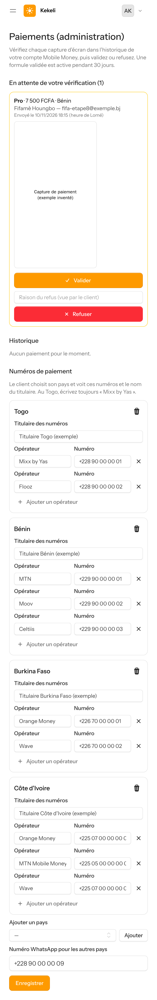

### 11. Les numéros de chaque pays se modifient ici
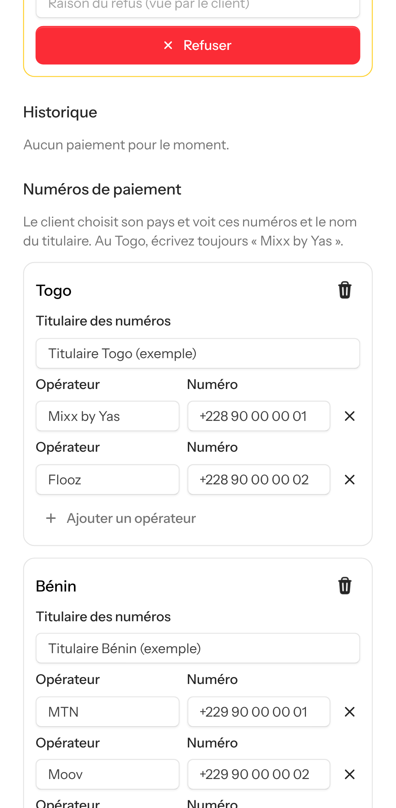

### 12. Paiement validé, dans l'historique
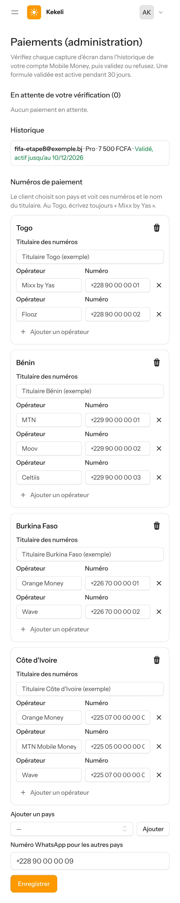

### 13. La cliente voit sa formule Pro, active pendant 30 jours
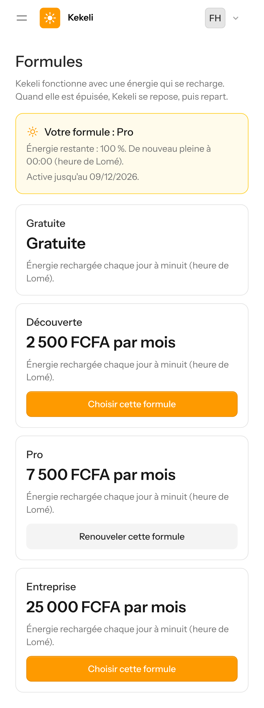

### 14. Rappel quelques jours avant la fin, avec le bouton « Renouveler »
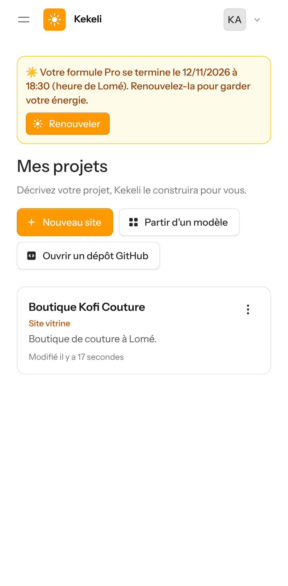

## Partie 4 — Le code du client

### 15. « Mon code » avec une formule payante : GitHub, fichier ZIP, nom de domaine
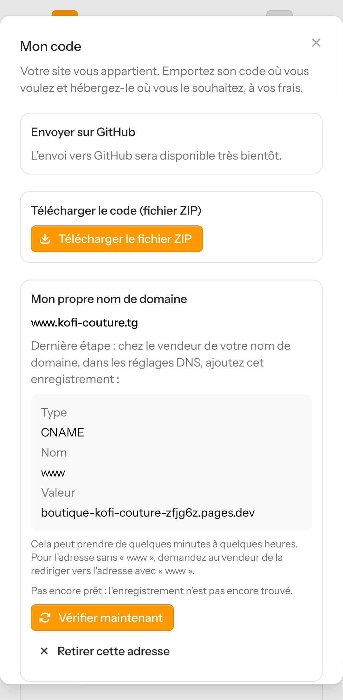

### 16. Nom de domaine : l'enregistrement à ajouter chez le vendeur, puis « Vérifier maintenant »

### 17. « Mon code » avec la formule gratuite : GitHub et le fichier ZIP sont gratuits ; seul le nom de domaine est payant
Avec l'application GitHub de Kekeli (créée après la mise en ligne), le bouton « Connecter GitHub » apparaît : on accepte sur GitHub, et le code part tout seul.
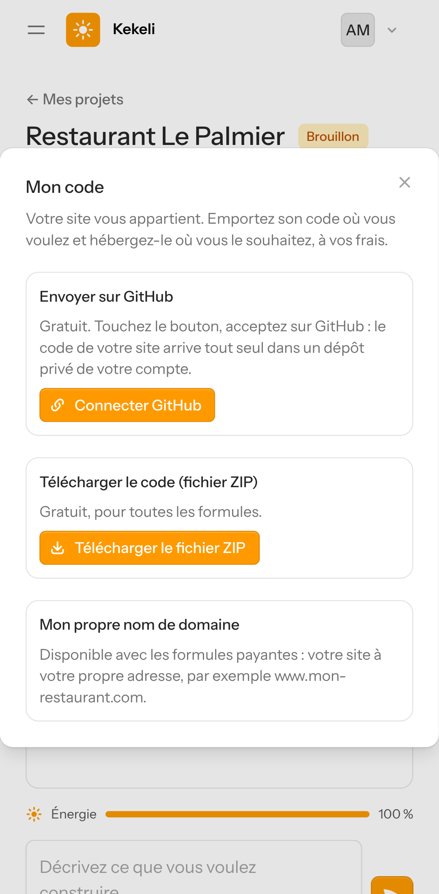

## Partie 5 — Pays et file d'attente

### 18. Une cliente en France : « Bientôt disponible dans votre pays »
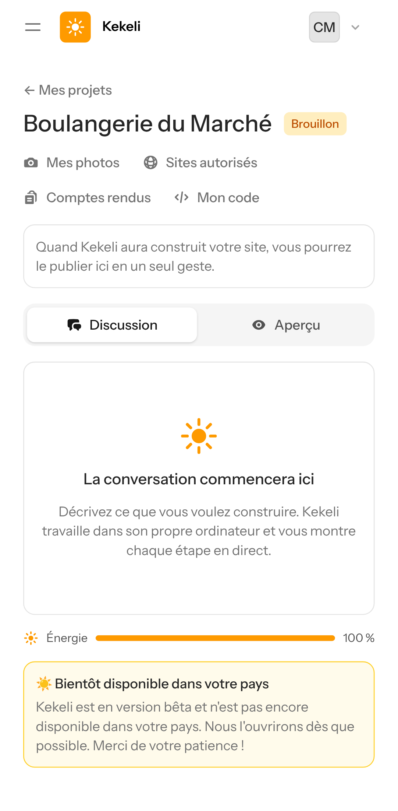

### 19. Plus de demandes que de places : la demande attend son tour, avec sa position
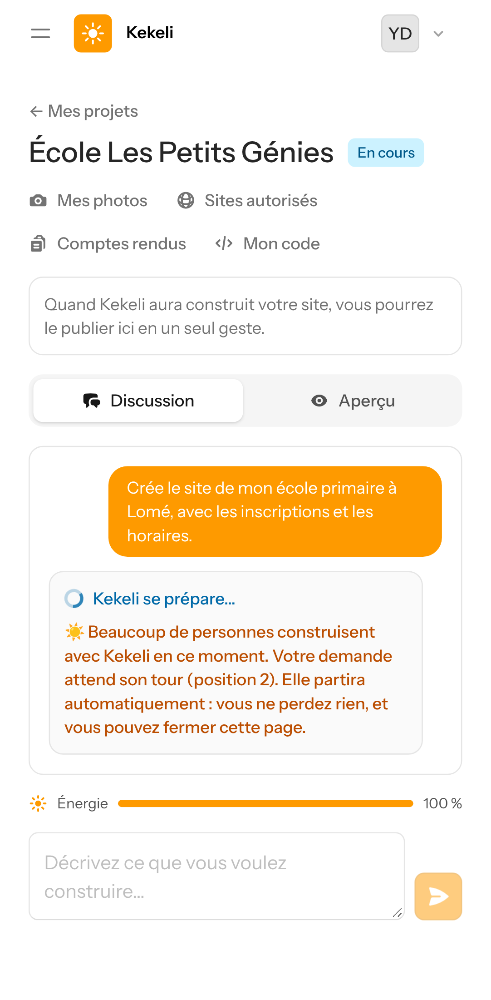
