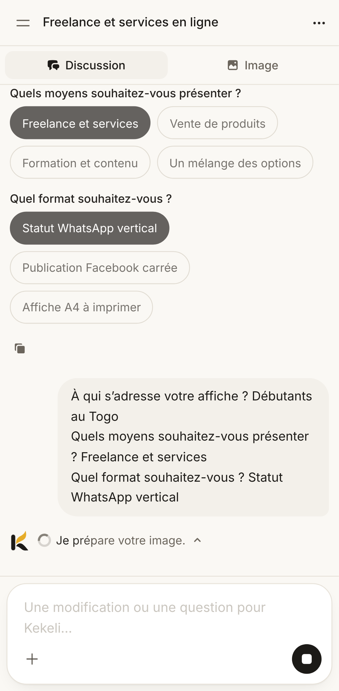
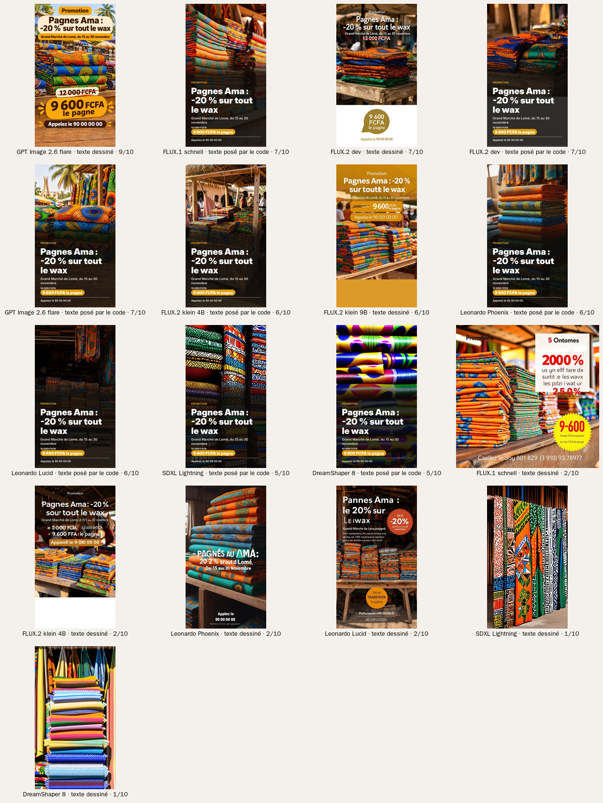
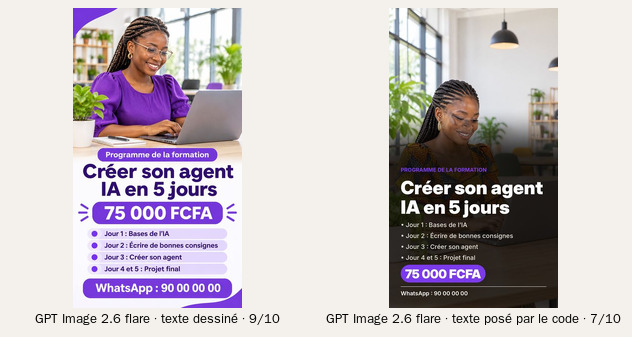
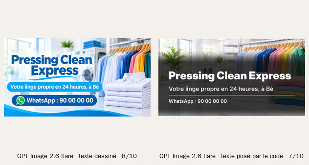
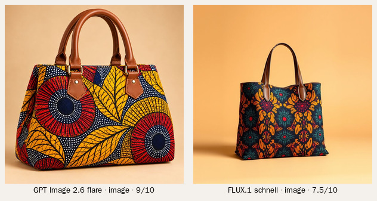
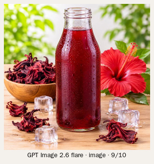
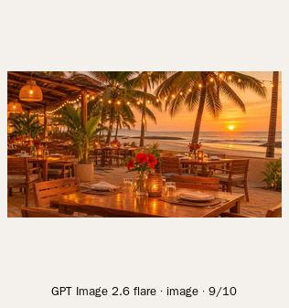
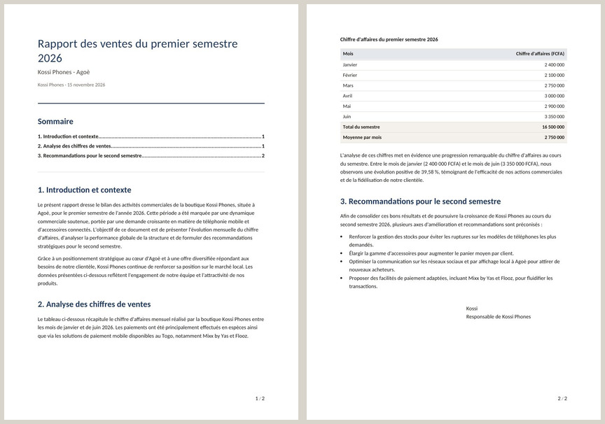
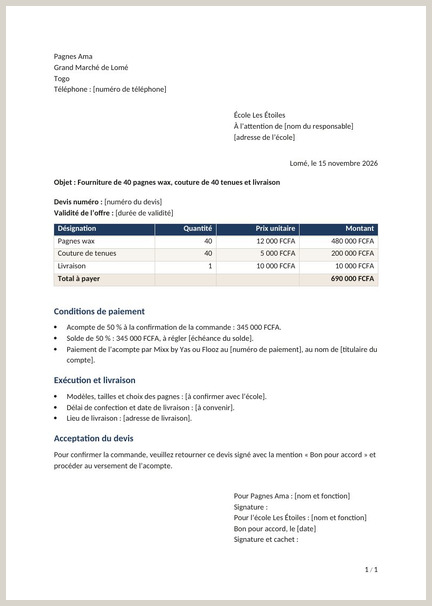
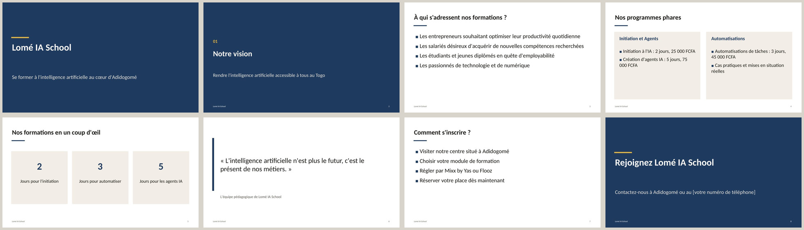

# Kekeli fait tout correctement, comme ChatGPT et Claude (15 novembre 2026)

Chantier demandé après les constats du porteur du projet sur https://kekeli.laravel.cloud (après la pull request 71). Détails des décisions : `docs/plan.md`, partie 26.37 ; coûts : `docs/couts.md`. Toutes les données des essais sont inventées. Les coûts sont des **estimations** tirées de ces essais (1 $ = 590 FCFA).

> **À décider par le porteur du projet** : le **crédit prépayé d'OpenAI est épuisé** depuis le 15 novembre 2026 vers 18 h (« credit_balance_exhausted », ce n'est pas le plafond de 10 $ de Kekeli). Tant qu'il n'est pas rechargé, les réponses passent sur Gemini gratuit, les constructions de sites, d'applications, d'agents et d'automatisations attendent, et les images n'ont que le générateur gratuit. La recharge est une dépense : elle n'a pas été faite.

## 1. Les deux défauts corrigés

### Le message s'affiche tout de suite

Cause : depuis l'envoi sans réaffichage de la page (pull request 71), le navigateur retirait la bulle du message en croyant que le site venait de l'afficher, et la réponse mot par mot s'écrivait dans une zone qui n'existait pas encore. Rien ne s'affichait donc avant la fin.

Mesure réelle sur un téléphone simulé (Pixel 7, `scripts/essai-envoi-instantane.js`, `envoi-avant.json` et `envoi-apres.json`) :

| Lieu | Avant | Après |
|---|---|---|
| Accueil | message à 84 ms, aucune réflexion visible | message à 98 ms, « Kekeli réfléchit… » en même temps |
| Discussion, « Et pour Facebook ? » | bulle affichée à 63 ms **puis disparue**, aucun mot avant la fin | message et réflexion à 74 ms, premier mot à 1,1 s, réponse écrite en 142 morceaux |
| Discussion, demande d'un exemple de message | bulle disparue, aucun mot avant la fin | message à 72 ms, premier mot à 1,4 s, 81 morceaux |

### Après les questions, la création part toujours

Cause : « Envoyer mes réponses » envoie « Quel format ? Statut WhatsApp vertical » ; le garde-fou des questions (`estQuestion`) y voyait une question et retirait tous les outils de création : le modèle répondait alors qu'il ne pouvait pas créer l'image. Correction : un message qui suit les questions n'est jamais une question, le site transmet l'outil prévu et la consigne demande de le lancer. Un test vérifie les huit fonctions.

Essai réel du cas du porteur du projet (`scripts/essai-questions-creation.js`) : « Fais-moi une affiche sur les moyens de gagner de l'argent sur Internet », trois questions, réponses touchées, puis l'affiche est créée.

| Questions | Création lancée | Affiche finale |
|---|---|---|
|  |  |  |

### La création d'images marche dans l'ordinateur

Le défaut vu à la pull request 68 ne venait pas de l'identifiant Cloudflare : dans l'ordinateur E2B, Node ne reconnaissait pas le certificat du proxy de sortie (celui qui ajoute la clé), d'où « fetch failed », alors que `curl` réussissait. Correction : `NODE_EXTRA_CA_CERTS` donné à l'ordinateur et à OpenCode. Essai réel (`runner/scripts/essai-cloudflare-ordinateur.mjs`) : avant, « Impossible pour le moment : fetch failed » en 1 s ; après, image créée en 7 s et vérifiée sans texte par Gemini. **À vérifier en ligne après le déploiement** (et après le retour de la réserve gratuite de Cloudflare).

## 2. Affiches et images comme ChatGPT

### Comment ChatGPT fait ses affiches

ChatGPT dessine l'affiche entière avec son modèle d'images (aujourd'hui la famille GPT Image) : le texte fait partie du dessin, avec une vraie hiérarchie (titre très grand, badge de prix, icônes, bandeaux de couleur) et une photo réaliste. C'est ce que fait Kekeli en formule payante depuis le 13 novembre 2026, avec en plus une relecture de chaque texte par un modèle de vision. La question était de savoir si un modèle gratuit peut faire aussi bien.

### Les modèles d'images de nos clés

| Fournisseur | Modèles | Gratuit ? |
|---|---|---|
| Google (clé Gemini) | Gemini 2.5 Flash Image, 3.1 Flash Image, 3.1 Flash Lite Image, Nano Banana 2.1, 3 Pro Image | **Non** : « Not available » sur la page des prix, quota de 0 dès la première demande |
| Cloudflare Workers AI | FLUX.1 schnell, FLUX.2 klein 4B et 9B, FLUX.2 dev, Leonardo Phoenix 1.0 et Lucid Origin, SDXL Lightning, DreamShaper 8 | Oui, dans 10 000 neurones par jour pour tout le compte |
| OpenRouter | Gemini Image, GPT Image (revendus) | **Non** : aucun modèle d'images « :free » |
| OpenAI (payant) | GPT Image 2.6 « flare » et « sunburst » (les plus récents le 15 novembre 2026) | 5 $, 8 $ et 30 $ par million de tokens (texte, image donnée, image produite) |

### Banc de 10 affiches et 5 images

`runner/scripts/banc-images.mjs`, résultats et notes image par image dans `fonctions/images/banc.json`. Chaque affiche est faite de deux façons : texte dessiné par le modèle, ou fond du modèle et texte posé par le code. Les modèles gratuits ont d'abord été présélectionnés sur 3 jeux (la réserve gratuite du jour a été épuisée après 33 images) ; GPT Image 2.6 « flare » a fait les 15 jeux.

| Générateur et méthode | Note moyenne | Texte exact | Coût par image | Temps |
|---|---|---|---|---|
| **GPT Image 2.6 « flare », texte dessiné** | **8,8** | 11 sur 11 | 0,026 à 0,045 $ (15 à 26 FCFA) | 6 à 9 s |
| GPT Image 2.6 « flare », image sans texte | 9 | | 0,026 à 0,044 $ | 7 à 8 s |
| GPT Image 2.6 « flare », texte posé par le code | 7 | toujours | même prix | 6 à 10 s |
| FLUX.1 schnell, texte posé par le code | 7 | toujours | gratuit (environ 58 neurones) | 2 à 3 s |
| FLUX.1 schnell, photo de produit | 7,5 | | gratuit | 4,5 s |
| FLUX.2 dev, texte posé par le code | 7 | toujours | gratuit, mais environ 3 000 neurones | 11 s |
| FLUX.2 dev, texte dessiné | 6 | 1 sur 2 (« l'argen' ») | | 16 s |
| FLUX.2 klein 9B, texte dessiné | 4,5 | 0 sur 2 (« toutt », « ginge de l'aggert ») | gratuit, environ 1 364 neurones | 2 s |
| Leonardo, SDXL, DreamShaper, FLUX.1 schnell, klein 4B : texte dessiné | 1 à 2 | 0 | | |

**Décision mesurée** : aucun modèle gratuit n'atteint 8 sur 10, et l'affiche de qualité ChatGPT coûte moins de 50 FCFA. GPT Image 2.6 « flare » passe en premier **pour toutes les formules** (la Gratuite avait FLUX.1 schnell), FLUX.1 schnell avec le texte posé par le code reste le secours (plafond OpenAI ou crédit épuisé). La consigne interdit maintenant tout logo d'application (un logo WhatsApp avait été dessiné). Le prix réel est compté dans l'énergie et dans le plafond OpenAI de 10 $ par jour.

### Les affiches de chaque modèle côte à côte

Promotion de pagnes (statut WhatsApp vertical), les 9 générateurs et les 2 méthodes :

« 5 façons de gagner de l'argent sur Internet » (le cas du porteur du projet) :

Les autres affiches (GPT Image 2.6 « flare », texte dessiné à gauche, texte posé par le code à droite) :

| Inscription | Programme | Restaurant | Paiement |
|---|---|---|---|
|  |  |  |  |

| Concert | Coiffure | Recrutement | Ouverture de boutique |
|---|---|---|---|
|  |  |  |  |

| Bannière pressing | Sac en pagne | Bissap | Ambiance | Illustration |
|---|---|---|---|---|
|  |  |  |  |  |

## 3. Documents comme Claude

`runner/scripts/banc-documents.mjs` : le modèle rédige une seule fois chaque document, puis la même structure est mise en page par l'ancien moteur et par le nouveau. Changements : paragraphes aérés (lettres, devis et CV restent compacts), tableaux à en-tête clair et filets fins, lignes de total en gras, tableau de 15 lignes au plus jamais coupé, page de titre seulement pour un long document, sommaire avec les numéros de page (deux passes dans le PDF), textes des présentations plus grands.

| Document | Avant | Après | Remarque |
|---|---|---|---|
| Devis (Pagnes Ama) | 7 | 8 | 690 000 FCFA et acompte de 345 000 FCFA justes ; tient sur une page |
| Plan d'affaires (Bissap Délice) | 6,5 | 7,5 | marge de 180 000 FCFA juste ; deux pages pour « une page » : consigne de longueur ajustée (330 mots par page) |
| Rapport des ventes (Kossi Phones) | 5 | 8,5 | 4 pages dont 2 presque vides → 2 pages ; total 16 500 000, moyenne 2 750 000 et hausse de 39,58 % justes |
| CV (Esi Lawson) | 7 | 7,5 | titres plus sobres |
| Présentation de 8 diapositives | 6 | 6,5 | textes plus grands ; encore sans image |
| **Moyenne** | **6,3** | **7,6** | |

| Rapport avant | Rapport après |
|---|---|
|  |  |

| Devis avant | Devis après | Présentation après |
|---|---|---|
|  |  |  |
