# Kekeli fait tout correctement, comme ChatGPT et Claude (15 novembre 2026)

Chantier demandé après les constats du porteur du projet sur https://kekeli.laravel.cloud (après la pull request 71). Détails des décisions : `docs/plan.md`, partie 26.37 ; coûts : `docs/couts.md`. Toutes les données des essais sont inventées. Les coûts sont des **estimations** tirées de ces essais (1 $ = 590 FCFA).

> **À décider par le porteur du projet** : le **crédit prépayé d'OpenAI est épuisé** depuis le 15 novembre 2026 vers 18 h (« credit_balance_exhausted », ce n'est pas le plafond de 10 $ de Kekeli). Tant qu'il n'est pas rechargé, les réponses passent sur Gemini gratuit, les constructions de sites, d'applications, d'agents et d'automatisations attendent, et les images n'ont que le générateur gratuit. La recharge est une dépense : elle n'a pas été faite.

## 1. Les deux défauts corrigés

### Le message s'affiche tout de suite

Cause : depuis l'envoi sans réaffichage de la page (pull request 71), le navigateur retirait la bulle du message en croyant que le site venait de l'afficher, et la réponse mot par mot s'écrivait dans une zone qui n'existait pas encore. Rien ne s'affichait donc avant la fin.

Mesure réelle sur un téléphone simulé (Pixel 7, `scripts/essai-envoi-instantane.js`, `envoi-avant.json` et `envoi-apres.json`) :

| Lieu | Avant | Après |
|---|---|---|
| Accueil | message à 84 ms, aucune réflexion visible | message à 98 ms, « Kekeli réfléchit… » en même temps |
| Discussion, « Et pour Facebook ? » | bulle affichée à 63 ms **puis disparue**, aucun mot avant la fin | message et réflexion à 74 ms, premier mot à 1,1 s, réponse écrite en 142 morceaux |
| Discussion, demande d'un exemple de message | bulle disparue, aucun mot avant la fin | message à 72 ms, premier mot à 1,4 s, 81 morceaux |

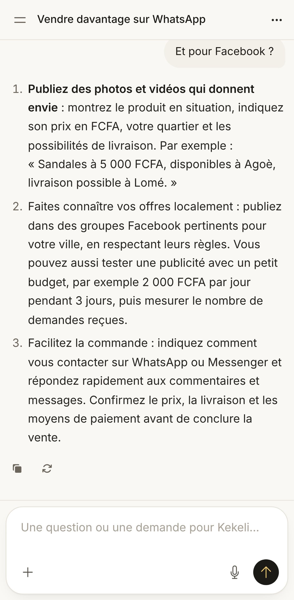

### Après les questions, la création part toujours

Cause : « Envoyer mes réponses » envoie « Quel format ? Statut WhatsApp vertical » ; le garde-fou des questions (`estQuestion`) y voyait une question et retirait tous les outils de création : le modèle répondait alors qu'il ne pouvait pas créer l'image. Correction : un message qui suit les questions n'est jamais une question, le site transmet l'outil prévu et la consigne demande de le lancer. Un test vérifie les huit fonctions.

Essai réel du cas du porteur du projet (`scripts/essai-questions-creation.js`) : « Fais-moi une affiche sur les moyens de gagner de l'argent sur Internet », trois questions, réponses touchées, puis l'affiche est créée.

| Questions | Création lancée | Affiche finale |
|---|---|---|
| 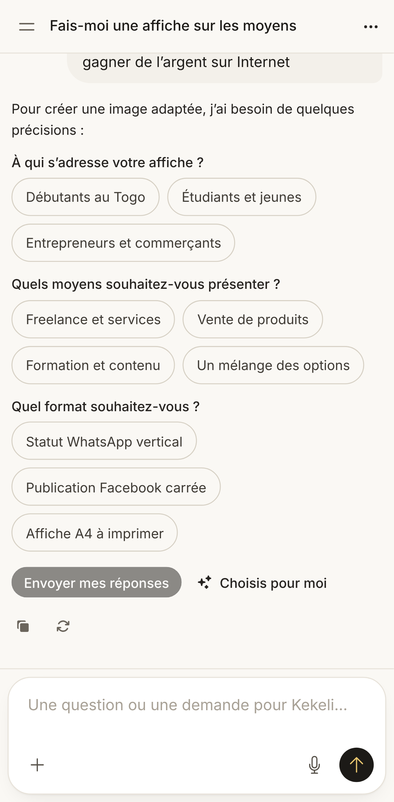 |  |  |

### La création d'images marche dans l'ordinateur

Le défaut vu à la pull request 68 ne venait pas de l'identifiant Cloudflare : dans l'ordinateur E2B, Node ne reconnaissait pas le certificat du proxy de sortie (celui qui ajoute la clé), d'où « fetch failed », alors que `curl` réussissait. Correction : `NODE_EXTRA_CA_CERTS` donné à l'ordinateur et à OpenCode. Essai réel (`runner/scripts/essai-cloudflare-ordinateur.mjs`) : avant, « Impossible pour le moment : fetch failed » en 1 s ; après, image créée en 7 s et vérifiée sans texte par Gemini. **À vérifier en ligne après le déploiement** (et après le retour de la réserve gratuite de Cloudflare).

### Le cas de la vidéo vu en ligne (15 novembre 2026, 18 h 57)

Captures du porteur du projet : « je veux créer une vidéo publicitaire pour vendre ma formation », trois questions, réponses touchées, puis Kekeli écrit un **script en texte** au lieu de créer la vidéo ; « Oui, créer la vidéo » échoue (« J'écris le script de la vidéo », puis « Désolé… ») ; chaque « Pourquoi ? » relance la vidéo, qui échoue encore, sans jamais d'explication. Trois causes, toutes corrigées dans cette pull request :

1. les réponses aux questions étaient prises pour une question (création retirée) : corrigé, voir plus haut ;
2. le crédit OpenAI venait d'être épuisé et la rédaction ne passait pas aux modèles gratuits : secours gratuit (partie 4) ;
3. dans un projet de document, d'image ou de vidéo, une question relançait le travail : elle reçoit maintenant une réponse, avec la vraie raison du dernier échec (`dernier_echec`), et une demande claire (« Réessaie ») relance le travail. Tests : `runner/tests/intention.test.js`, `tests/Feature/CreationQuestionsTest.php`.

## 2. Affiches et images comme ChatGPT

### Comment ChatGPT fait ses affiches

ChatGPT dessine l'affiche entière avec son modèle d'images (aujourd'hui la famille GPT Image) : le texte fait partie du dessin, avec une vraie hiérarchie (titre très grand, badge de prix, icônes, bandeaux de couleur) et une photo réaliste. C'est ce que fait Kekeli en formule payante depuis le 13 novembre 2026, avec en plus une relecture de chaque texte par un modèle de vision. La question était de savoir si un modèle gratuit peut faire aussi bien.

### Les modèles d'images de nos clés

| Fournisseur | Modèles | Gratuit ? |
|---|---|---|
| Google (clé Gemini) | Gemini 2.5 Flash Image, 3.1 Flash Image, 3.1 Flash Lite Image, Nano Banana 2.1, 3 Pro Image | **Non** : « Not available » sur la page des prix, quota de 0 dès la première demande |
| Cloudflare Workers AI | FLUX.1 schnell, FLUX.2 klein 4B et 9B, FLUX.2 dev, Leonardo Phoenix 1.0 et Lucid Origin, SDXL Lightning, DreamShaper 8 | Oui, dans 10 000 neurones par jour pour tout le compte |
| OpenRouter | Gemini Image, GPT Image (revendus) | **Non** : aucun modèle d'images « :free » |
| OpenAI (payant) | GPT Image 2.6 « flare » et « sunburst » (les plus récents le 15 novembre 2026) | 5 $, 8 $ et 30 $ par million de tokens (texte, image donnée, image produite) |

### Banc de 10 affiches et 5 images

`runner/scripts/banc-images.mjs`, résultats et notes image par image dans `fonctions/images/banc.json`. Chaque affiche est faite de deux façons : texte dessiné par le modèle, ou fond du modèle et texte posé par le code. Les modèles gratuits ont d'abord été présélectionnés sur 3 jeux (la réserve gratuite du jour a été épuisée après 33 images) ; GPT Image 2.6 « flare » a fait les 15 jeux.

| Générateur et méthode | Note moyenne | Texte exact | Coût par image | Temps |
|---|---|---|---|---|
| **GPT Image 2.6 « flare », texte dessiné** | **8,8** | 11 sur 11 | 0,026 à 0,045 $ (15 à 26 FCFA) | 6 à 9 s |
| GPT Image 2.6 « flare », image sans texte | 9 | | 0,026 à 0,044 $ | 7 à 8 s |
| GPT Image 2.6 « flare », texte posé par le code | 7 | toujours | même prix | 6 à 10 s |
| FLUX.1 schnell, texte posé par le code | 7 | toujours | gratuit (environ 58 neurones) | 2 à 3 s |
| FLUX.1 schnell, photo de produit | 7,5 | | gratuit | 4,5 s |
| FLUX.2 dev, texte posé par le code | 7 | toujours | gratuit, mais environ 3 000 neurones | 11 s |
| FLUX.2 dev, texte dessiné | 6 | 1 sur 2 (« l'argen' ») | | 16 s |
| FLUX.2 klein 9B, texte dessiné | 4,5 | 0 sur 2 (« toutt », « ginge de l'aggert ») | gratuit, environ 1 364 neurones | 2 s |
| Leonardo, SDXL, DreamShaper, FLUX.1 schnell, klein 4B : texte dessiné | 1 à 2 | 0 | | |

**Décision mesurée** : aucun modèle gratuit n'atteint 8 sur 10, et l'affiche de qualité ChatGPT coûte moins de 50 FCFA. GPT Image 2.6 « flare » passe en premier **pour toutes les formules** (la Gratuite avait FLUX.1 schnell), FLUX.1 schnell avec le texte posé par le code reste le secours (plafond OpenAI ou crédit épuisé). La consigne interdit maintenant tout logo d'application (un logo WhatsApp avait été dessiné). Le prix réel est compté dans l'énergie et dans le plafond OpenAI de 10 $ par jour.

### Les affiches de chaque modèle côte à côte

Promotion de pagnes (statut WhatsApp vertical), les 9 générateurs et les 2 méthodes :

« 5 façons de gagner de l'argent sur Internet » (le cas du porteur du projet) :

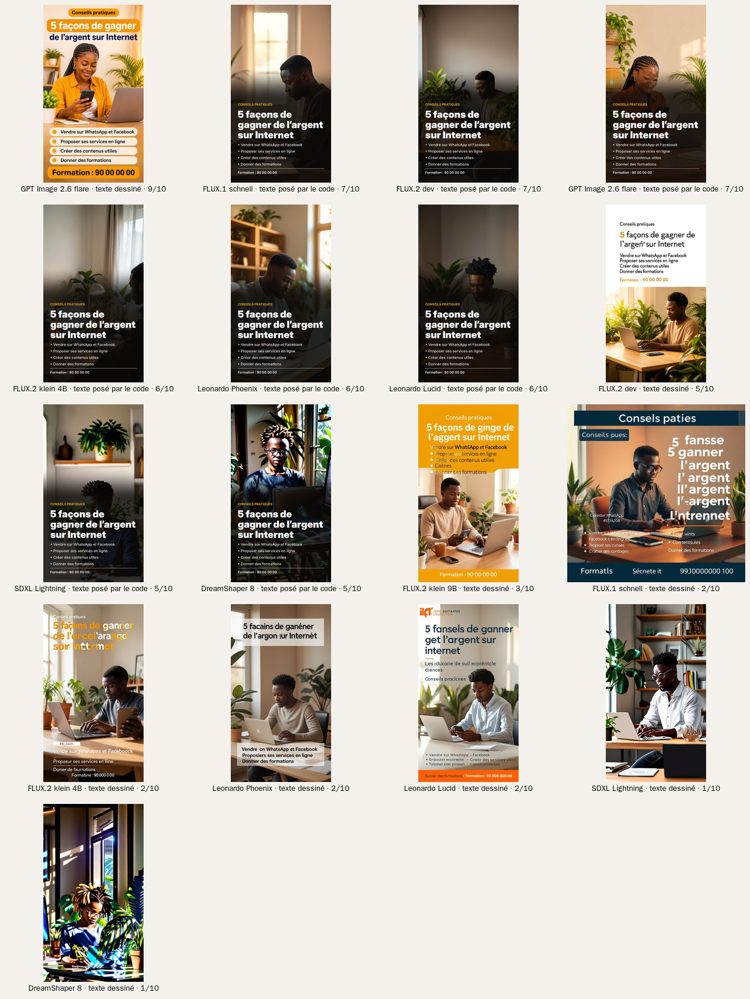

Les autres affiches (GPT Image 2.6 « flare », texte dessiné à gauche, texte posé par le code à droite) :

| Inscription | Programme | Restaurant | Paiement |
|---|---|---|---|
|  |  | 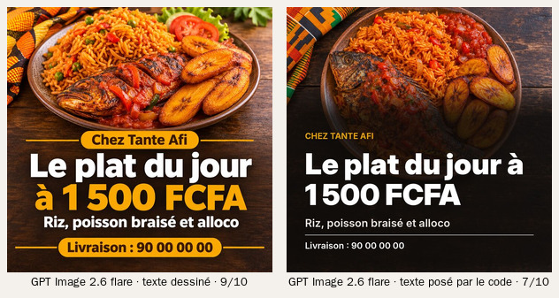 | 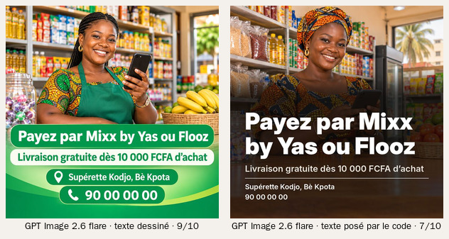 |

| Concert | Coiffure | Recrutement | Ouverture de boutique |
|---|---|---|---|
| 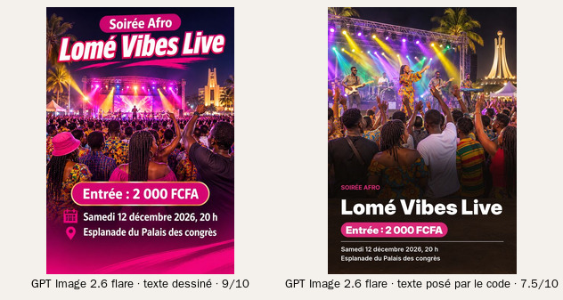 |  |  | 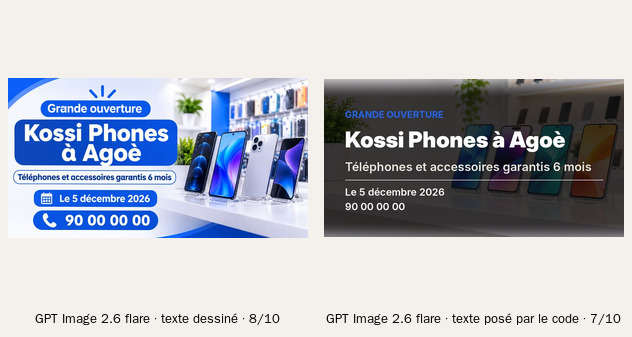 |

| Bannière pressing | Sac en pagne | Bissap | Ambiance | Illustration |
|---|---|---|---|---|
|  |  |  |  | 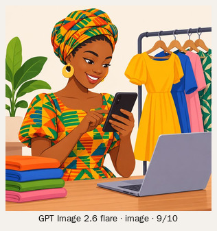 |

## 3. Documents comme Claude

`runner/scripts/banc-documents.mjs` : le modèle rédige une seule fois chaque document, puis la même structure est mise en page par l'ancien moteur et par le nouveau. Changements : paragraphes aérés (lettres, devis et CV restent compacts), tableaux à en-tête clair et filets fins, lignes de total en gras, tableau de 15 lignes au plus jamais coupé, page de titre seulement pour un long document, sommaire avec les numéros de page (deux passes dans le PDF), textes des présentations plus grands.

| Document | Avant | Après | Remarque |
|---|---|---|---|
| Devis (Pagnes Ama) | 7 | 8 | 690 000 FCFA et acompte de 345 000 FCFA justes ; tient sur une page |
| Plan d'affaires (Bissap Délice) | 6,5 | 7,5 | marge de 180 000 FCFA juste ; deux pages pour « une page » : consigne de longueur ajustée (330 mots par page) |
| Rapport des ventes (Kossi Phones) | 5 | 8,5 | 4 pages dont 2 presque vides → 2 pages ; total 16 500 000, moyenne 2 750 000 et hausse de 39,58 % justes |
| CV (Esi Lawson) | 7 | 7,5 | titres plus sobres |
| Présentation de 8 diapositives | 6 | 6,5 | textes plus grands ; encore sans image |
| **Moyenne** | **6,3** | **7,6** | |

| Rapport avant | Rapport après |
|---|---|
| 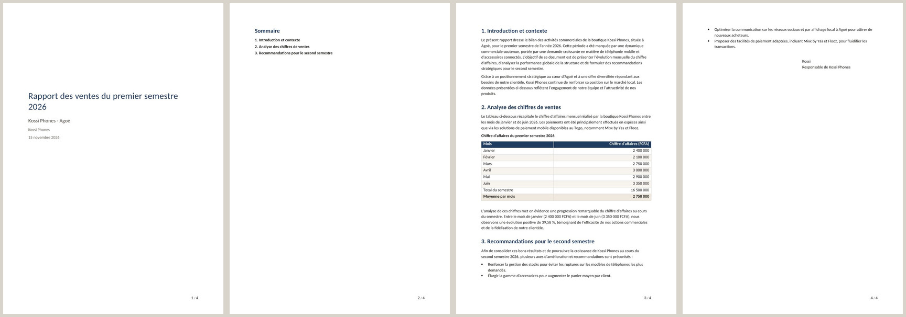 |  |

| Devis avant | Devis après | Présentation après |
|---|---|---|
|  | 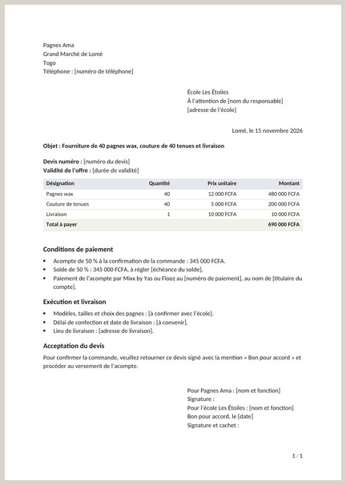 |  |

## 4. Toutes les fonctions essayées pour de vrai

Deux demandes réalistes par fonction, chacune partie de l'accueil sur un téléphone simulé, comme un client (`scripts/essai-fonctions.js`, résultats bruts dans `fonctions/essais/resultats.json`, captures dans `fonctions/essais/`). Les questions reçoivent « Choisis pour moi » et les plans « Construire ce plan ».

**Conditions réelles de l'essai, à lire avant les notes** : le crédit OpenAI était épuisé et la réserve gratuite de Cloudflare vide. Tous les essais ont donc tourné **sur les fournisseurs de secours** (surtout Gemini 3.1 et 3.5 Flash-Lite gratuits ; pour les constructions, le modèle a été réglé sur Gemini **dans la base locale seulement**). Ces notes mesurent donc Kekeli **quand OpenAI est indisponible**, pas son niveau habituel ; elles montrent surtout ce qui doit tenir même dans ce cas.

| Fonction | Essai | Résultat | Temps | Coût | Fournisseur qui a travaillé | Note | Défauts trouvés |
|---|---|---|---|---|---|---|---|
| Site web | Restaurant Le Palmier | réussi | 2 min 21 s | 35 FCFA | Gemini 3.1 Flash-Lite | 6,5 | grande bannière noire, sans photo (ni création ni photo libre) |
| Site web | Pressing Clean Express | réussi | 1 min 05 s | 15 FCFA | Gemini 3.1 Flash-Lite | 6,5 | même bannière sans photo |
| Application | École de couture | réussi en partie | 12 min 29 s | 54 FCFA | Gemini 3.5 Flash-Lite | 5 | titre « Mon site » ; « quelques points n'ont pas pu être terminés » |
| Application | Commandes de boulangerie | réussi en partie | 13 min 32 s | 82 FCFA | Gemini 3.5 Flash-Lite | 3 | l'écran de départ est resté (« Mon site », formulaire générique) |
| Agent IA | Salon Belle Afi | réussi en partie | 1 min 49 s | 22 FCFA | GPT-6.1 Sol (Coarena) | 3 | construction arrêtée au milieu, nom « Mon agent » |
| Agent IA | Kossi Phones | réussi | 1 min 47 s | 40 FCFA | Gemini 3.1 Flash-Lite | 6 | nom « Mon agent » |
| Automatisation | Résumé des ventes du lundi | réussi en partie | 1 min 49 s | 15 FCFA | GLM 4.7 Flash (Cloudflare) | 3 | « chaque jour à 7 h » au lieu de « chaque lundi à 8 h » ; code de test dans le compte rendu |
| Automatisation | Cours du dollar à 18 h | réussi | 12 min 01 s | 50 FCFA | Gemini 3.5 Flash-Lite | 6 | horaire juste ; compte rendu confus sur une action refusée |
| Présentation | Lomé IA School, 8 diapositives | réussi | 50 s | 7 FCFA | Gemini 3.5 Flash-Lite | 6,5 | diapositives sans image |
| Présentation | Ferme avicole pour une banque | réussi | 5 min 47 s (attente comprise) | 3 FCFA | Gemini 3.1 Flash-Lite | 7 | sans tableau de chiffres |
| Image | Affiche Pagnes Ama | réussi en partie | 40 s | 4 FCFA | aucun générateur (fond uni) | 3 | texte exact, mais sur un fond uni sombre |
| Image | Photo de bissap | **échec** | 50 s | 2 FCFA | aucun générateur | 1 | **image livrée vide** (dégradé gris) : corrigé, voir plus bas |
| Vidéo | Ouverture de Kossi Phones, 15 s | réussi | 2 min 35 s | 8 FCFA | Gemini 3.5 Flash-Lite | 5 | photo libre sans rapport (une personne) |
| Vidéo | Plat du jour, 20 s | réussi | 3 min 31 s | 9 FCFA | Gemini 3.5 Flash-Lite | 6,5 | photo du plat juste ; sous-titre sur les commandes du lecteur |
| Document | Devis Pagnes Ama | réussi | 5 min 52 s (attente comprise) | 3 FCFA | Gemini 3.1 Flash-Lite | 7,5 | calculs justes, nouvelle mise en page |
| Document | Lettre de motivation | réussi | 6 min 07 s (attente comprise) | 3 FCFA | Gemini 3.1 Flash-Lite | 7 | crochets à compléter, comme prévu |

Les temps « attente comprise » viennent de la file d'attente quand tous les fournisseurs gratuits étaient saturés à la minute (reprise automatique, comme prévu).

### Échecs complets corrigés tout de suite

1. **Documents, affiches et vidéos en panne quand OpenAI refuse** (avant la relance de l'essai) : « rédaction impossible » pour chaque document et chaque affiche. Le site envoie maintenant les fournisseurs gratuits en secours.
2. **Photo de produit livrée vide** quand aucun générateur ne répond : pour une affiche, Kekeli prend une photo libre de Pixabay seulement si elle parle vraiment du sujet ; pour une photo de produit ou une illustration (une photo de banque serait trompeuse), il dit que la création d'images est indisponible pour le moment au lieu de livrer une image vide.
3. **Application et agent au nom générique** (« Mon site », « Mon agent ») : le nom du projet est écrit dès la pose des fichiers de départ.
4. **Code de test recopié dans le compte rendu** d'une automatisation : le code n'est plus jamais montré au client.

### Ce qu'il faut faire pour atteindre Lovable, Bolt, Manus ou ChatGPT, par priorité

Règle gardée : on n'ajoute rien que ces outils n'ont pas. Priorité 1 = à faire au prochain chantier.

| Priorité | Fonction | Référence | Ce qu'il faut faire |
|---|---|---|---|
| 1 | Toutes | ChatGPT, Claude | **Recharger le crédit OpenAI** (décision du porteur du projet) et faire en sorte que le site **sache** quand OpenAI refuse pour un crédit épuisé (aujourd'hui il ne connaît que le plafond de 10 $) : alerte dans l'administration et par e-mail, comme pour le plafond. |
| 1 | Site web | Lovable, Bolt | **Jamais de grande bannière vide** : sans photo ni image créée, une photo libre de Pixabay (déjà utilisée pour les vidéos et maintenant pour les images) ou une illustration en couleurs du thème. |
| 1 | Application | Lovable, Bolt | Les vraies pages demandées (élèves, paiements, commandes) au lieu de l'écran de départ : avec un modèle de secours faible, le travail doit s'arrêter proprement (« Kekeli est très sollicité ») plutôt que livrer le point de départ. Mesurer à nouveau avec GPT-6.1 Sol dès que le crédit OpenAI est rechargé. |
| 1 | Agent IA | Manus, ChatGPT (GPTs) | Vérifier à la fin que l'agent répond vraiment à 3 questions d'essai de son rôle (prix, horaires, rendez-vous) avant de dire qu'il est prêt ; reprendre une fois sinon. |
| 2 | Automatisation | Manus, Zapier (référence du marché) | Contrôler l'horaire écrit dans le fichier GitHub Actions contre celui de la demande (« chaque lundi à 8 h ») avant de terminer ; plus jamais un horaire différent. |
| 2 | Image | ChatGPT | Avec le crédit OpenAI : 8,8 sur 10. Sans générateur : photo libre en fond (fait) ; garder une réserve de Cloudflare pour les clients (le banc d'essai ne doit plus la vider). |
| 2 | Vidéo | ChatGPT (Sora), CapCut | Photos libres plus pertinentes (refuser une personne quand la demande parle d'une boutique) ; sous-titres jamais sous les commandes du lecteur. |
| 2 | Présentation | Claude, Gamma (référence du marché) | Une image ou une icône par diapositive (photos libres ou images créées), un tableau de chiffres quand la demande en contient (budget, rentabilité). |
| 3 | Document | Claude | Respect strict de « une page » (vérifié après la mise en page, puis raccourci une fois) ; CV en deux colonnes. |
| 3 | Toutes | Claude Code | Une permission demandée et sans réponse ne doit pas laisser un compte rendu confus (« vous avez refusé cette action ») : dire simplement ce qui reste à faire. |

### Après les corrections (essais refaits)

| Essai | Avant | Après |
|---|---|---|
| Agent Kossi Phones | page de l'agent « Mon agent » | page « Boutique Kossi Phones » (2 min 37 s, 47 FCFA) ; la conversation d'essai dans l'aperçu n'a pas pu être vérifiée par le script |
| Photo de bissap, sans aucun générateur | image vide (dégradé gris) | premier essai : photo libre hors sujet (des ampoules) ; règle durcie : pour une photo de produit, message clair « La création d'images n'est pas disponible pour le moment… », jamais une image vide ni une photo hors sujet |

| Agent après | Photo de bissap : avant | Photo de bissap : après |
|---|---|---|
| 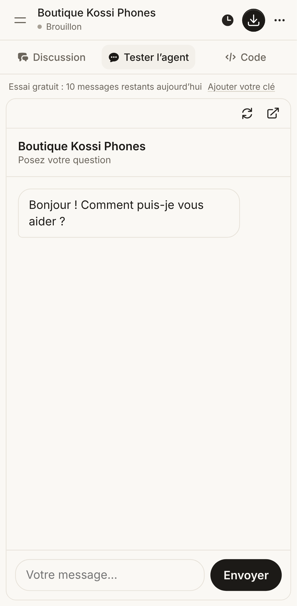 | 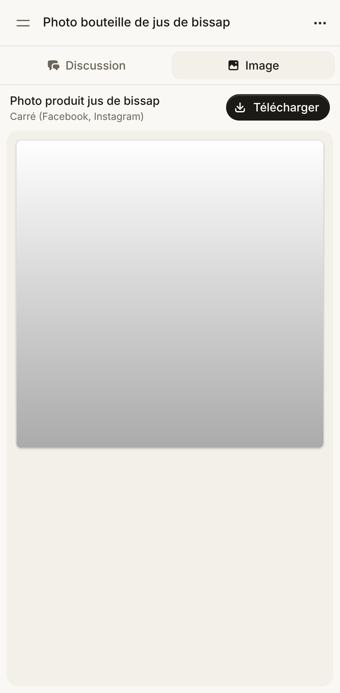 | 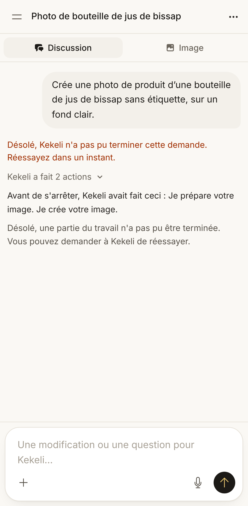 |

## Captures : téléphone et ordinateur, clair et sombre

150 millisecondes après le toucher sur « Envoyer » : le message est affiché, et Kekeli montre qu'il réfléchit (`scripts/captures-fonctions.js`).

| Téléphone, clair | Téléphone, sombre | Ordinateur, clair | Ordinateur, sombre |
|---|---|---|---|
| 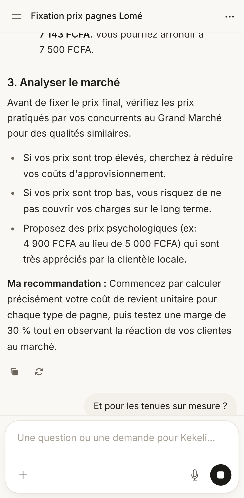 | 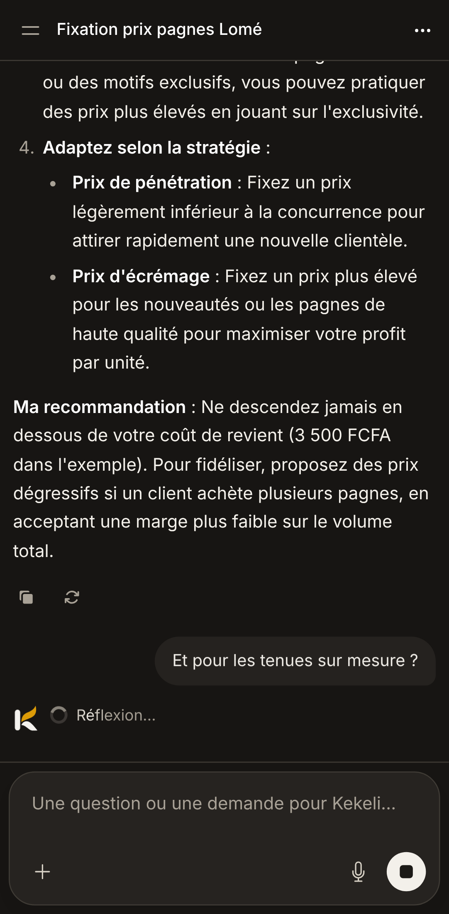 | 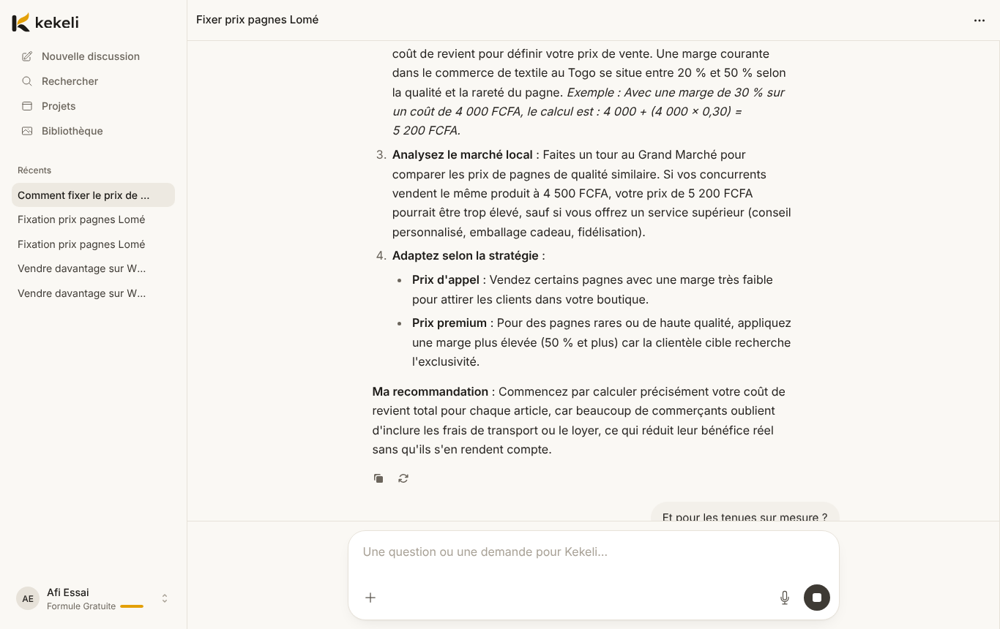 | 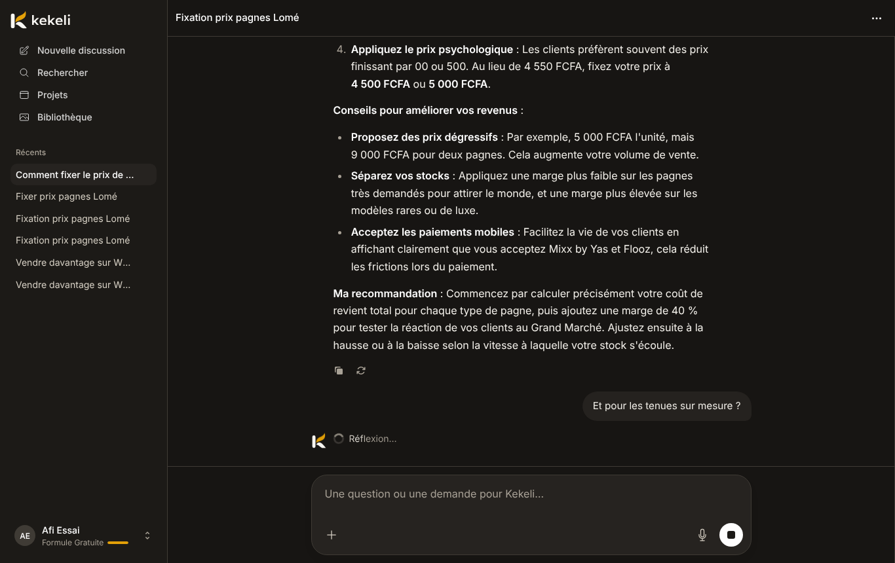 |

La discussion de l'affiche (questions, réponses, carte du fichier) et l'affiche :

| Téléphone, clair | Téléphone, sombre | Affiche, sombre | Ordinateur, sombre |
|---|---|---|---|
| 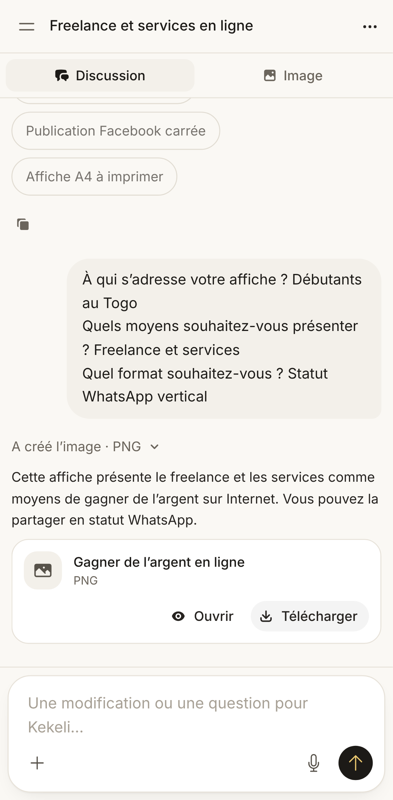 | 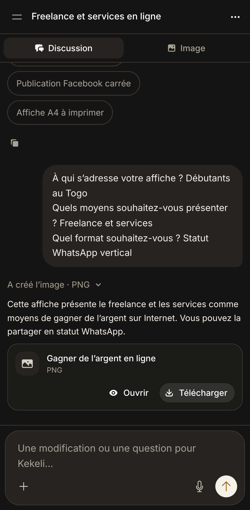 |  | 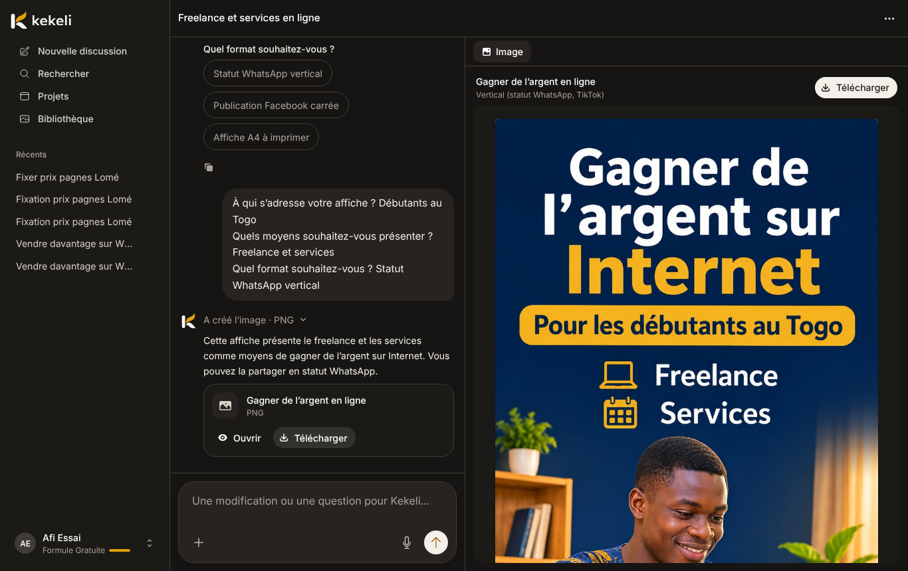 |

## Mesures de la page

| Mesure | Avant (copie de `main`) | Après |
|---|---|---|
| Lighthouse téléphone, accueil (performance, accessibilité) | 59, 100 | 59, 100 |
| Lighthouse téléphone, discussion (performance, accessibilité) | 45, 100 | 49, 100 |
| CSS (brut, compressé) | 353 313 octets, 42 136 octets | identique |
| JavaScript (brut, compressé) | 16 991 octets, 6 112 octets | 17 372 octets, 6 207 octets (+95 octets compressés) |

Mesures prises sur la même machine, avec le même compte inventé (`scripts/lighthouse-vitesse.js`) ; la performance locale varie de quelques points d'un essai à l'autre. Plafond OpenAI inchangé : 10 $ par jour.

Dépense de ce chantier : environ 1 $ chez OpenAI (banc des images 0,95 $, affiche de bout en bout 0,06 $, deux documents 0,03 $), puis plus rien (crédit épuisé) ; Cloudflare dans l'offre gratuite ; E2B dans l'offre habituelle.
