# Fournisseurs gratuits : Gemini, Groq et OpenRouter comparés

Essais réels du 10 novembre 2026, sur un téléphone simulé (Pixel 7, navigateur en français), avec un ordinateur E2B. Mêmes demandes pour les trois fournisseurs, chacun seul dans la liste. Les noms et les données sont inventés.

- **Gemini 3.5 Flash-Lite** (Google AI Studio, offre gratuite).
- **Groq, `openai/gpt-oss-120b`** (offre gratuite).
- **OpenRouter, `nvidia/nemotron-3-ultra-550b-a55b:free`** (modèle gratuit, aucun crédit acheté, dépense : 0 $).

Résultats complets et énergie : [`docs/couts.md`](../couts.md), partie « Fournisseurs gratuits comparés ».

## 1. Le restaurant (site vitrine)

La même description pour les trois fournisseurs :
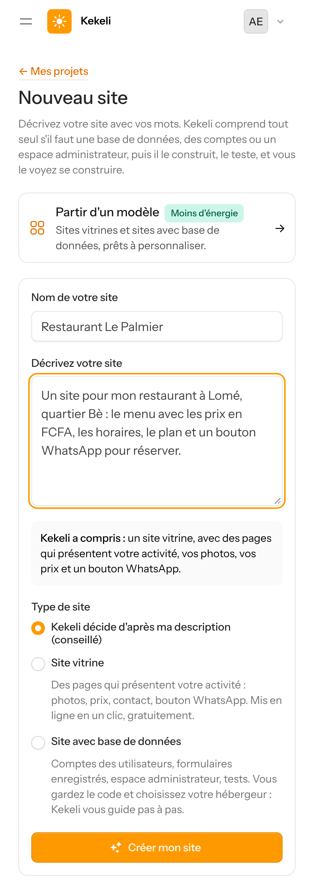

### Gemini 3.5 Flash-Lite : réussi, 4 minutes 30
Site propre, mais sans image en haut de page, et le menu déborde de l'écran du téléphone.
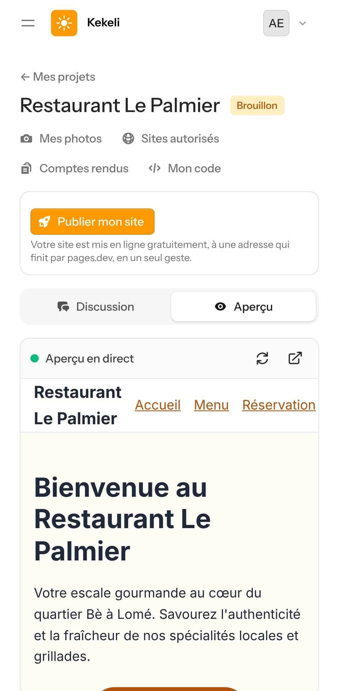
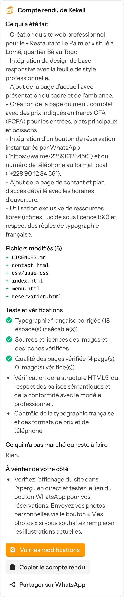

### OpenRouter (Nemotron 3 Ultra gratuit) : réussi, 9 minutes, le plus beau
Photo d'ambiance, logo en icône, bouton « Réserver sur WhatsApp », menu adapté au téléphone.
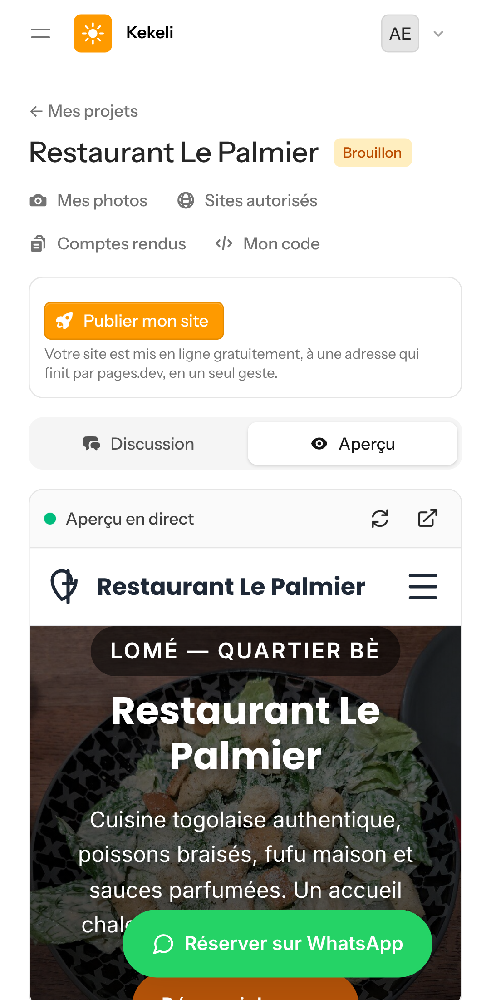
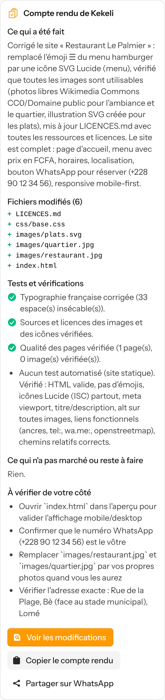

### Groq : impossible
Une demande de l'agent pèse environ 9 000 tokens (consignes et outils compris) ; l'offre gratuite de Groq n'en accepte que 8 000 par minute. Le client voit seulement un message général (aucun détail technique) ; depuis cette correction, Kekeli passe tout seul au fournisseur suivant au lieu d'échouer.
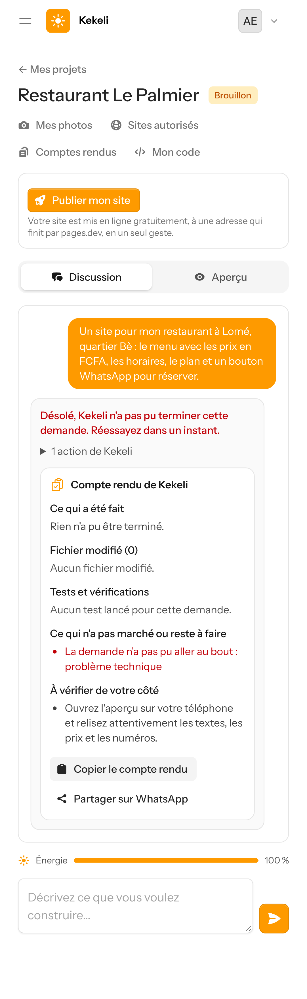

## 2. Le pressing (site avec base de données Laravel)

### Gemini 3.5 Flash-Lite : réussi, mais 27 minutes et 8 pauses
17 tests réussis, sécurité vérifiée, le site répond. La limite par minute de l'offre gratuite a mis la demande en pause 8 fois (reprise automatique).
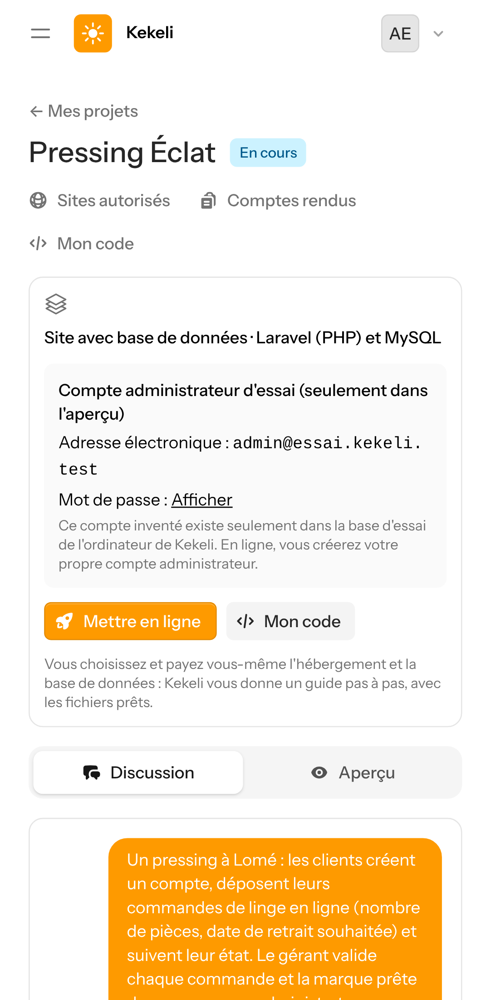
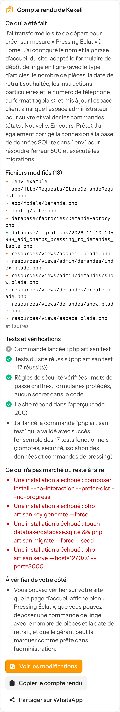

### OpenRouter : arrêté par le quota du jour
Le travail avançait bien (commandes, contrôleurs, migration, politique d'accès), mais l'offre gratuite d'OpenRouter ne permet que **50 requêtes par jour** : après le restaurant (27) et 28 requêtes du pressing, le quota du jour était épuisé. Le client voit « ☀️ Kekeli est très sollicité… » ; la demande reprend toute seule après minuit (heure de Lomé).
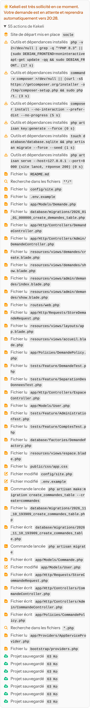

### Groq : impossible (même raison que pour le restaurant).

## 3. Fournisseurs repris de freellmapi (nuit du 10 au 11 novembre 2026)

Même restaurant à Lomé. Résultats et estimation du nombre de sites par jour : [`docs/couts.md`](../couts.md), dernière partie.

### Gemini 3.5 Flash-Lite : réussi en 2 minutes 12
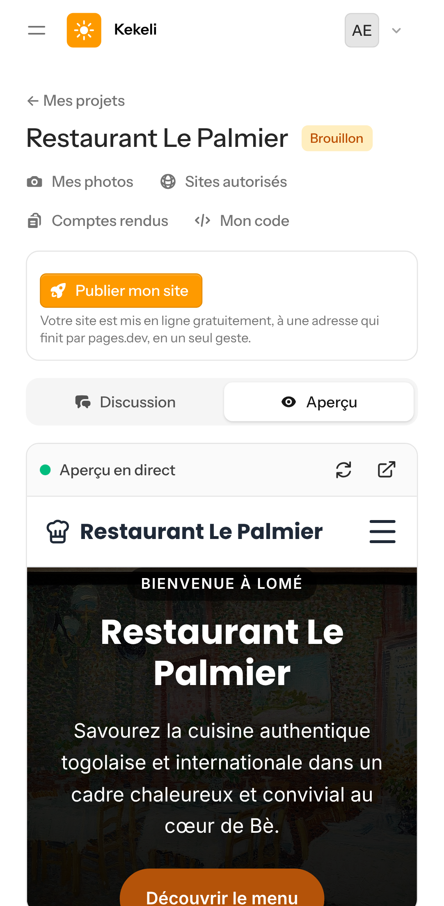

### Gemini 3.1 Flash-Lite : réussi en 12 minutes, qualité faible
Le menu reste vide dans l'aperçu. Gemini 3.1 sert surtout de relais : son quota gratuit est séparé de celui de Gemini 3.5.
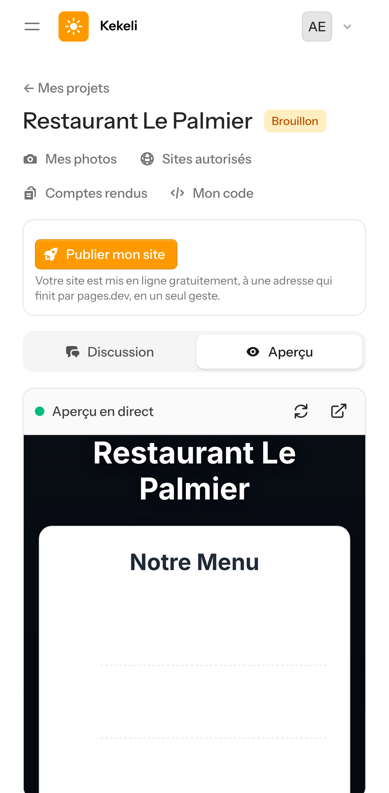

### OpenRouter, Cohere North Mini Code (gratuit) : réussi en 6 minutes 29
Photo d'ambiance libre, icônes Lucide, bouton WhatsApp, compte rendu complet.
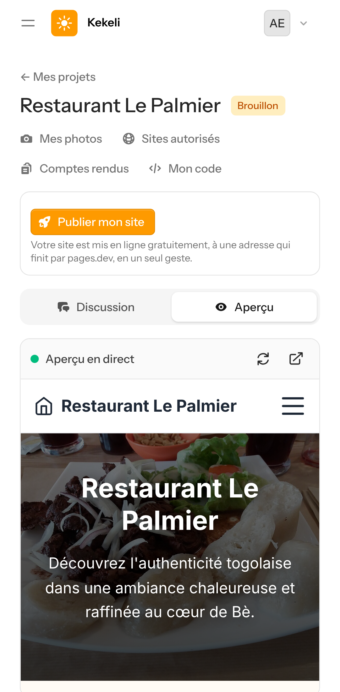
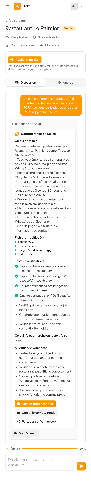

### Groq : toujours impossible

### Cloudflare Workers AI : non mesuré
La réserve gratuite du jour (10 000 neurones) était déjà prise par la création d'images. Cloudflare a refusé sans rien facturer, et Kekeli a mis la demande en attente, comme prévu.

## 4. Le pressing avec la chaîne Gemini 3.5 puis 3.1 : 5 minutes 45 au lieu de 27
17 tests réussis, sécurité vérifiée, le site répond dans l'aperçu (le compte administrateur affiché est un compte d'essai inventé, qui n'existe que dans l'ordinateur virtuel effacé).
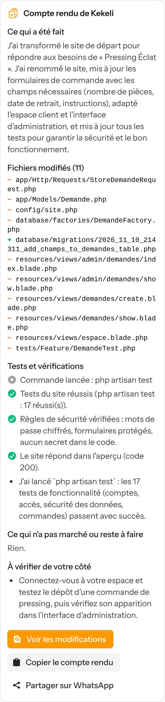
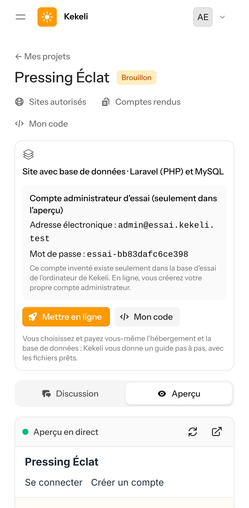

