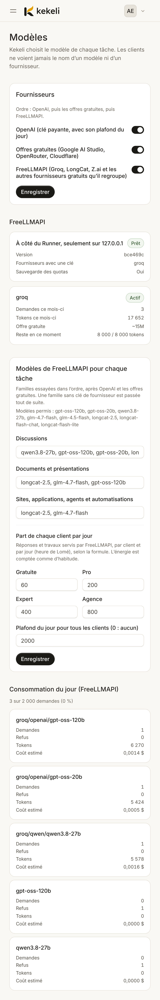
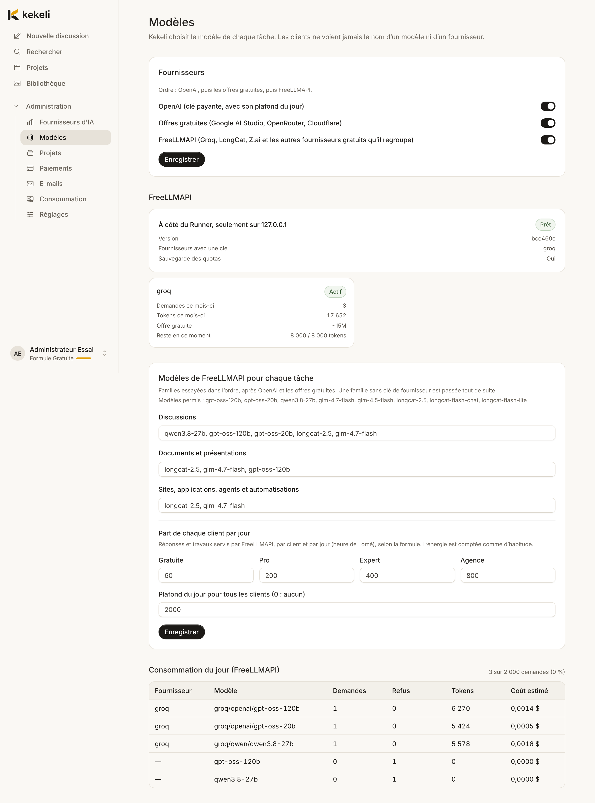

# FreeLLMAPI à la place de Coarena (15 novembre 2026)

Site, Runner et FreeLLMAPI lancés ensemble en local, avec la vraie clé Groq (aucune autre clé de fournisseur FreeLLMAPI n'était placée). Données inventées. Référence : `docs/freellmapi.md` ; détails : `docs/plan.md`, partie 26.38.

## Administration → Modèles

Téléphone simulé (Pixel 7, navigateur en français) :

Ordinateur :

On y voit : l'ordre des fournisseurs (OpenAI, puis les offres gratuites, puis FreeLLMAPI), l'état de FreeLLMAPI (« Prêt », version `bce469c`, Groq, sauvegarde des quotas), Groq avec son quota restant, les familles de modèles par type de tâche, la part de chaque formule, le plafond du jour et la consommation du jour par vrai modèle, avec son coût estimé. Aucune clé n'apparaît.

## Mesures réelles

### Avant : Coarena (15 novembre 2026, après-midi)

| Constat | Valeur |
|---|---|
| Offre gratuite | **1 $ par jour et par compte**, 10 demandes par minute (au lieu de 5 $ et 30) |
| GPT-6.1 Terra | **plus dans l'offre gratuite** (réponse 402) |
| GPT-6 Luna, premier mot | 3,4 s (salutation) et 9,2 s (questions) en médiane, pire 18,4 s |
| Gemini 3.8 Flash, premier mot | 11,2 s et 6,3 s en médiane, pire 17,9 s |

### FreeLLMAPI et Groq

| Essai | Résultat |
|---|---|
| Démarrage de FreeLLMAPI à côté du Runner | 0,6 s |
| Délai ajouté par FreeLLMAPI (même question, Groq direct puis par FreeLLMAPI) | 0,1 à 0,5 s |
| Discussion de bout en bout (site, Runner, FreeLLMAPI, Groq), 3 questions | 3 sur 3 réussies, réponse complète en **1,1 s, 2,9 s et 1,6 s** ; modèles servis : Qwen 3.8 27B, gpt-oss-120b, gpt-oss-20b ; une famille à sa limite par minute est remplacée par la suivante |
| Premier mot (premier répondant de Kekeli, questions) | 0,8 à 2,3 s |
| Coût estimé enregistré (prix de l'offre payante de Groq, estimation) | 0,0005 à 0,0016 $ par réponse |
| Document (devis d'une page) | 3 s, structure valide pour Kekeli (lettre, titres, paragraphes) |
| Agent, petite demande par la passerelle du Runner | 1 s, appel d'outil « write » par gpt-oss-120b |
| Agent, demande de la taille réelle d'une construction (environ 9 000 tokens) | refusée en 8 ms (413, au-dessus des 8 000 tokens par minute de Groq) : le fournisseur suivant prend le relais |
| Sauvegarde des quotas | envoyée au site toutes les 2 minutes, chiffrée (aucune trace de clé lisible), relue au démarrage |

**À retenir** : avec Groq seul, FreeLLMAPI sert les discussions et les petits documents, vite. Les constructions (sites, applications, agents, automatisations) demandent LongCat ou Z.ai, dont les clés sont à créer ; elles seront mesurées au banc de construction avant d'être gardées.

## Tests

- Runner : `runner/tests/freellmapi.test.js` (13 tests) ; 336 tests du Runner réussis.
- Site : `tests/Feature/FreeLlmApiTest.php` (11 tests) ; 580 tests du site réussis ; style vérifié.
- Captures : `node scripts/captures-freellmapi.js http://127.0.0.1:8131 docs/captures/freellmapi`.
