# Galerie de modèles de sites : captures sur un écran de téléphone simulé

> **Galerie retirée le 11 novembre 2026** (voir `docs/plan.md`, partie 23.8) : cette page est gardée seulement comme trace de l’ancienne version.

Captures prises le 10 novembre 2026 sur un téléphone simulé (Pixel 7, navigateur en français). Les comptes, les noms, les numéros et les prix sont **inventés**. Les deux personnalisations de la partie 3 sont des **essais réels** avec un ordinateur E2B et Gemini (offre gratuite). Rien n'a été payé.

## Partie 1 : la galerie, ouverte à tous, même sans compte

### 1. La page « Modèles de sites » (12 modèles pensés pour l'Afrique)

### 2. Un modèle, avec son aperçu sur téléphone et le bouton « Utiliser ce modèle »
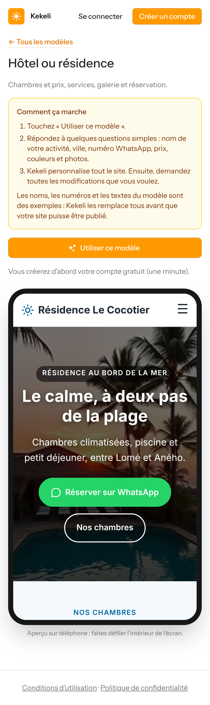

### 3. Les 12 modèles, en haut de page sur le téléphone
| | | |
|---|---|---|
| 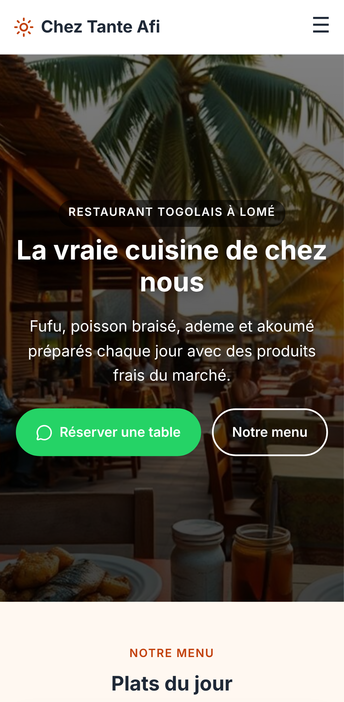 | 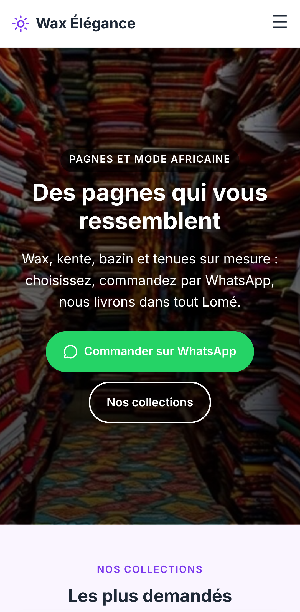 | 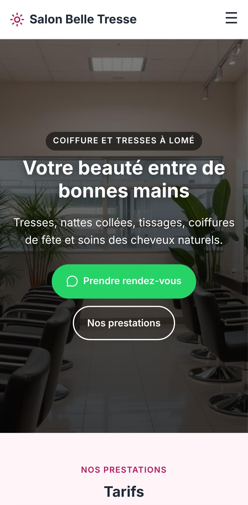 |
| 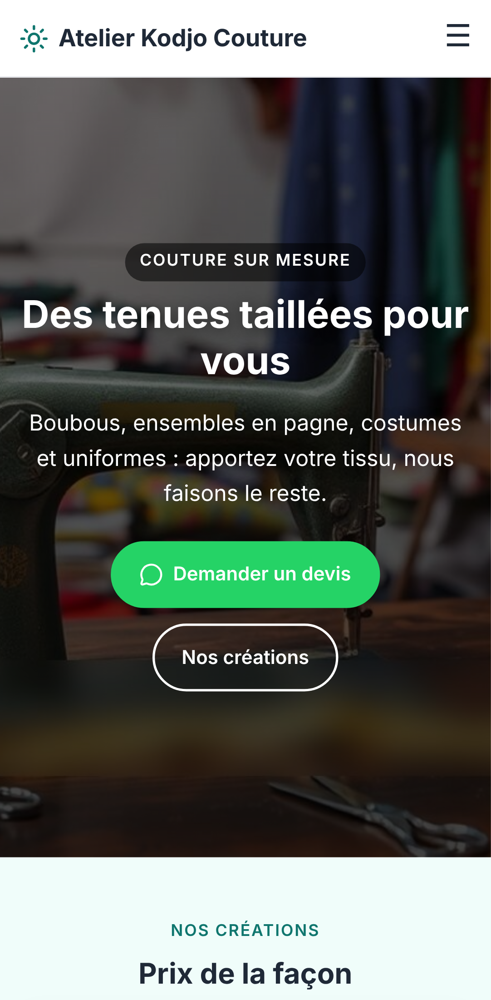 |  | 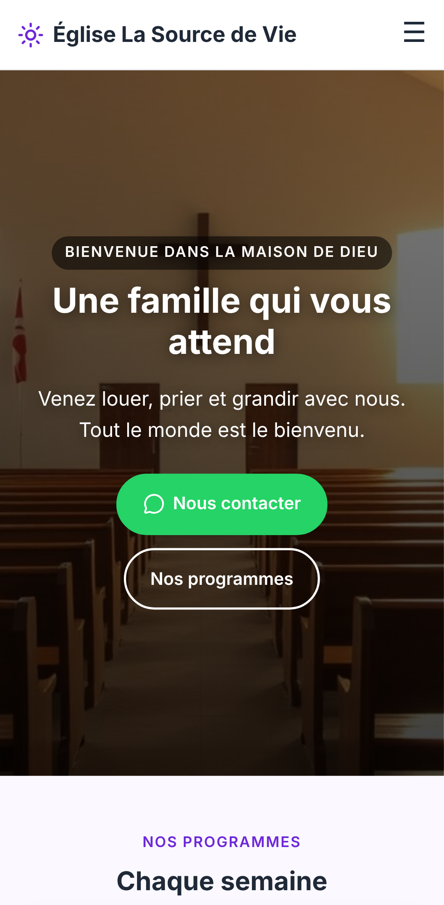 |
| 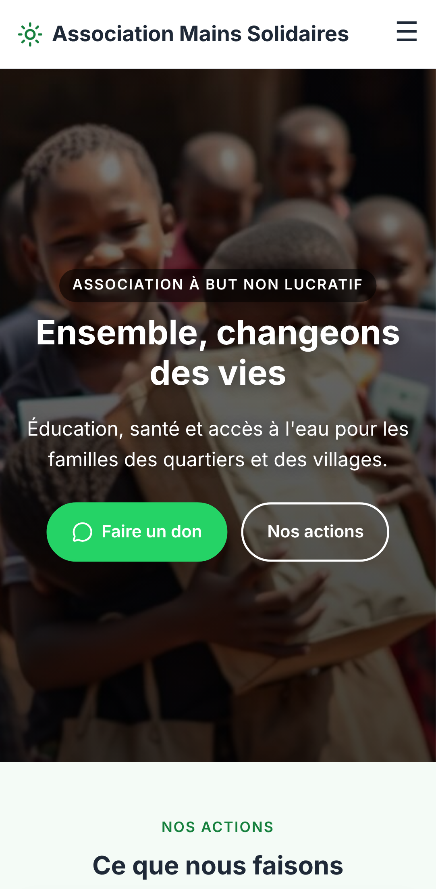 | 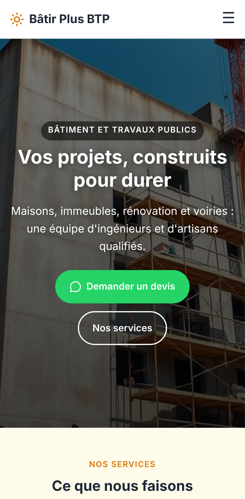 | 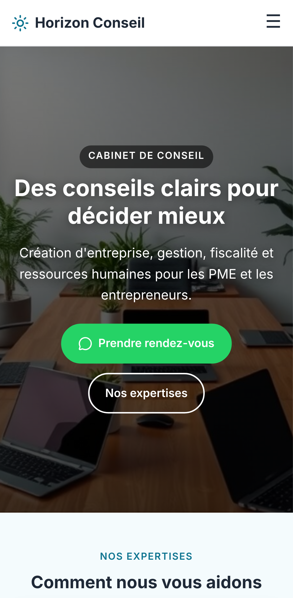 |
| 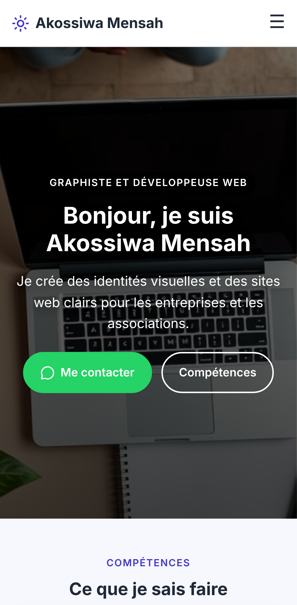 | 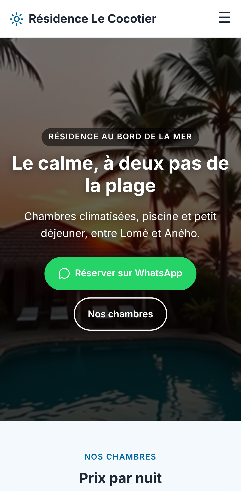 | 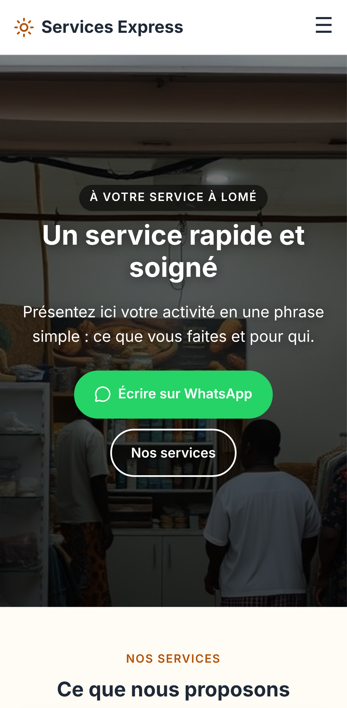 |

Les 60 images des modèles ont été créées par l'offre gratuite de Cloudflare et regardées par Kekeli. 41 étaient sans texte du premier coup ; les autres ont été recréées, et 5 gardaient un peu de texte, qui a été flouté (85 créations en tout).

## Partie 2 : les questions, une à la fois

### 4. Première question : le nom de l'activité
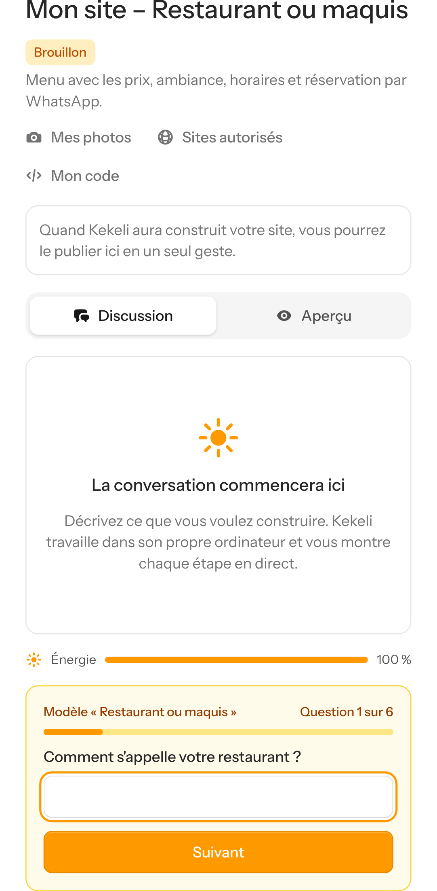

### 5. Les plats et leurs prix
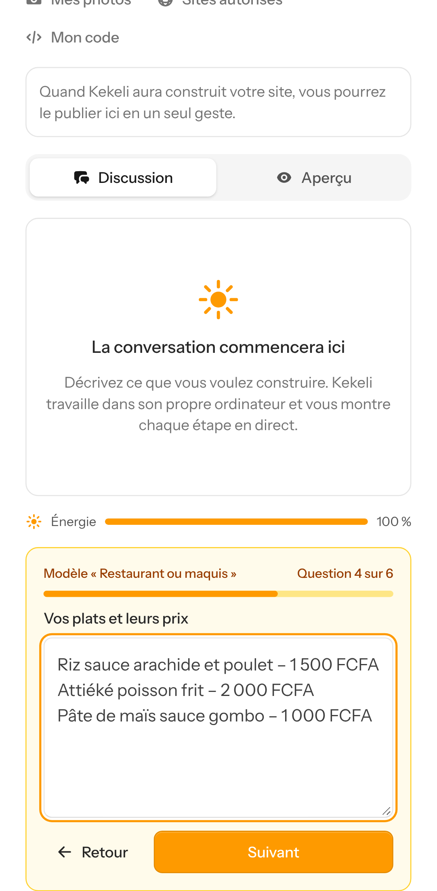

### 6. Les couleurs préférées
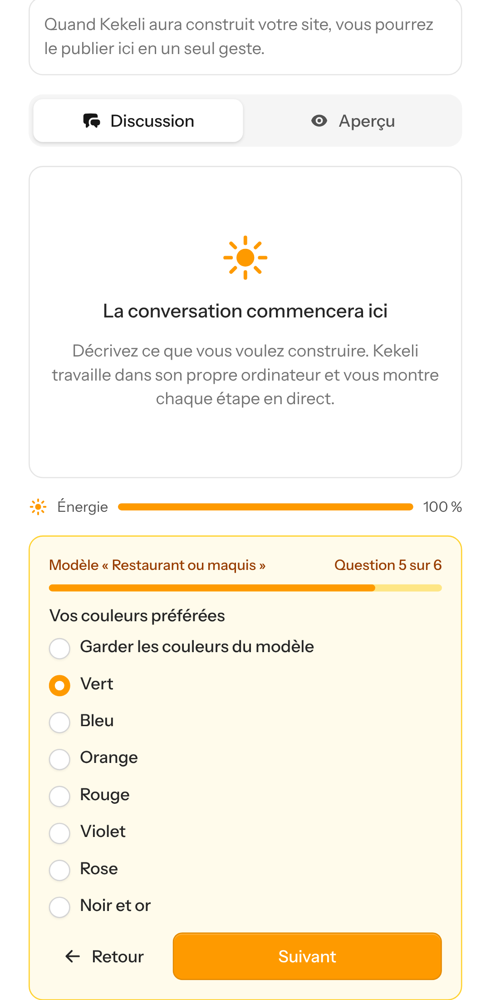

### 7. Les photos (facultatives), puis « Personnaliser mon site »
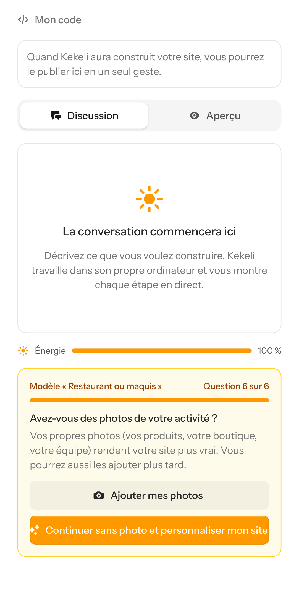

## Partie 3 : Kekeli personnalise tout le site (essais réels)

### 8. Restaurant devenu « Maquis Le Baobab » (Kara) : la discussion
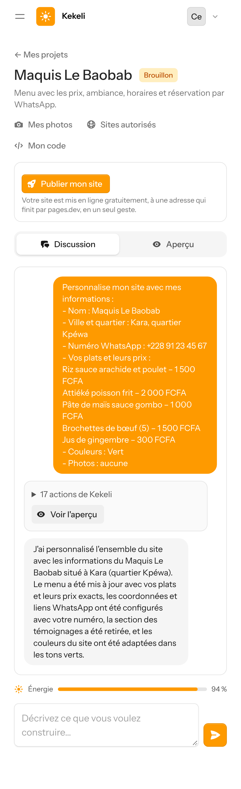

### 9. Le site personnalisé : nom, ville, menu et prix du client, couleurs vertes, numéro WhatsApp du client ; témoignages d'exemple retirés
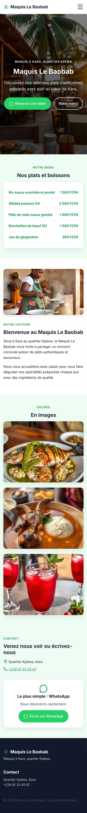

### 10. Salon de coiffure devenu « Salon Grâce Divine » : la discussion
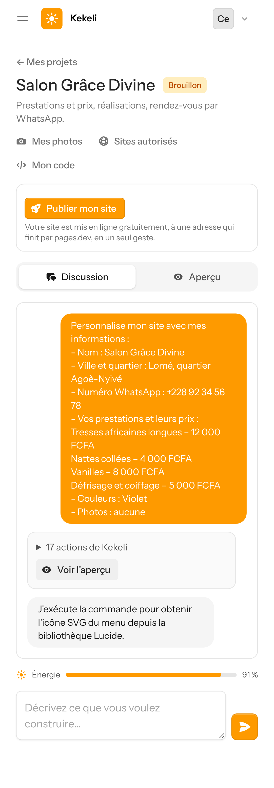

### 11. Le site personnalisé, en violet

## Partie 4 : pas de publication avec du contenu d'exemple

### 12. Un site qui contient encore un nom, une adresse, un numéro ou des témoignages d'exemple ne peut pas être publié ; Kekeli dit exactement ce qu'il reste à remplacer
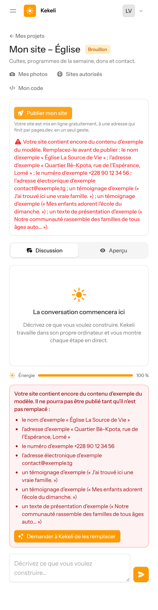
