# Mémoire, et finitions de la pull request 51 (14 novembre 2026)

Captures prises sur un téléphone simulé (Pixel 7) et sur un ordinateur, en mode clair et en mode sombre, avec les comptes inventés de la mesure réelle (`scripts/essai-memoire.js`). Détails et mesures : `docs/plan.md`, partie 26.21.

## 1. La ligne « Mémoire mise à jour »

Ama donne une seule fois ses informations (boutique, prix, WhatsApp, Mixx by Yas, Flooz, couleurs, logo), avec deux pièges : un mot de passe et une information de santé. Kekeli retient 8 souvenirs et le logo, **ni le mot de passe ni la santé**. La ligne se déplie pour voir ce qui a été retenu.

| Téléphone | Téléphone (sombre) |
|---|---|
| 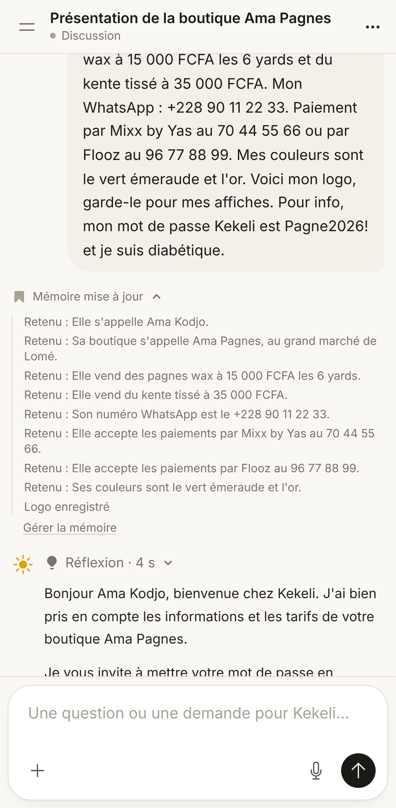 | 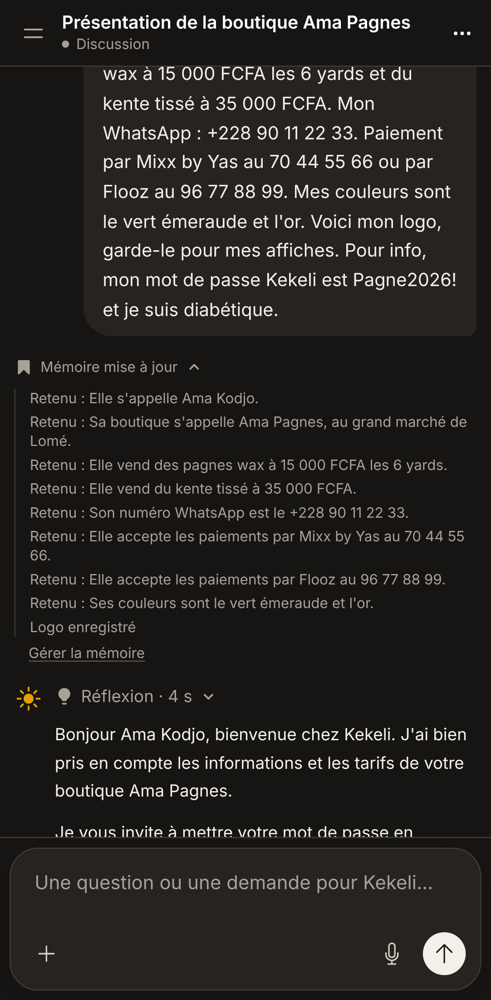 |

| Ordinateur | Ordinateur (sombre) |
|---|---|
| 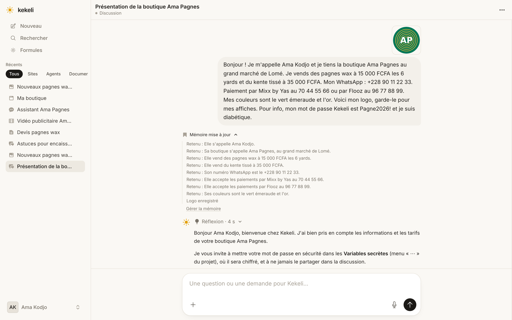 | 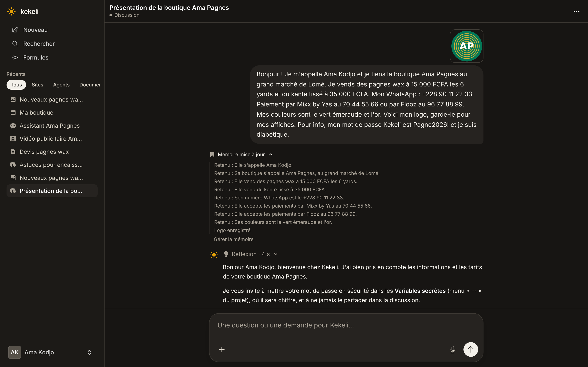 |

## 2. Réglages → Mémoire

Souvenirs lisibles, « Modifier » et « Supprimer » pour chacun, le logo enregistré, « Tout effacer » (avec confirmation) et l'interrupteur.

| Téléphone | Téléphone (sombre) |
|---|---|
| 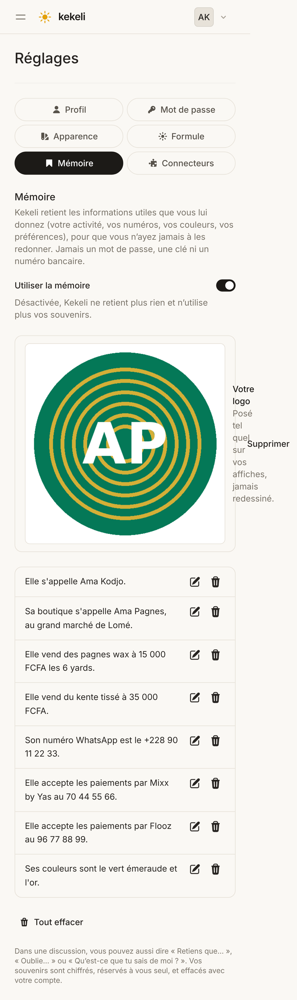 | 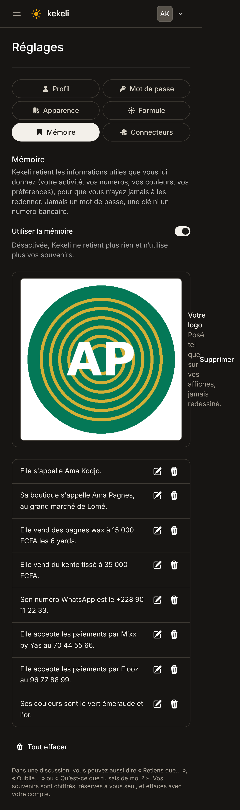 |

| Ordinateur | Ordinateur (sombre) |
|---|---|
| 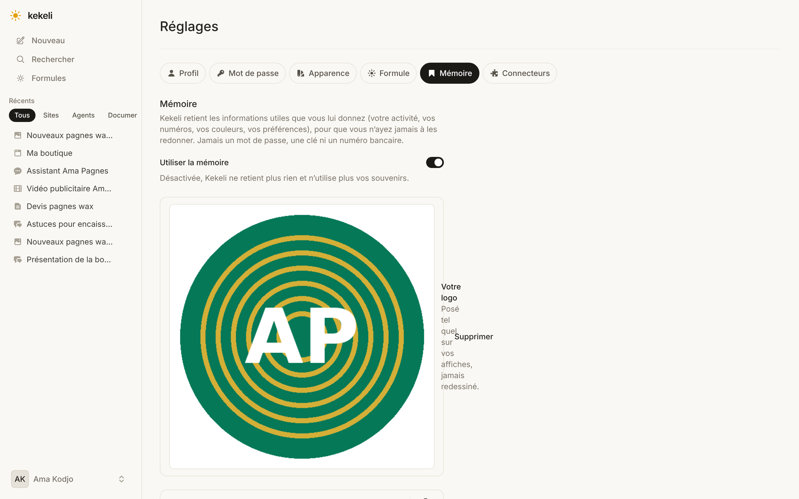 | 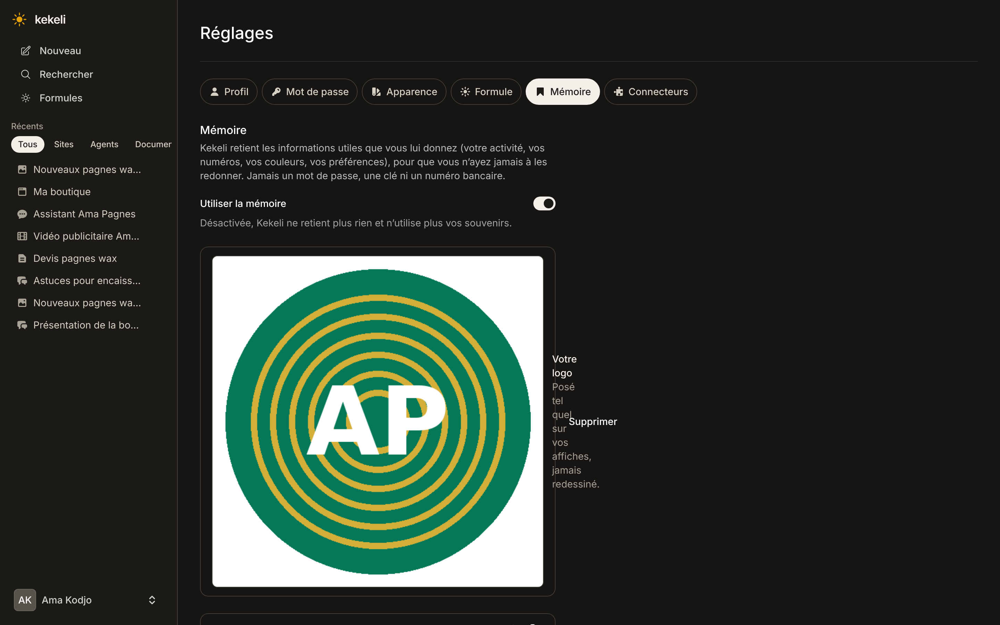 |

## 3. Une affiche faite sans redonner les informations

Dans une nouvelle discussion, Ama écrit seulement « Fais-moi une affiche pour annoncer l'arrivée des nouveaux pagnes wax. » : nom, prix, WhatsApp, Mixx by Yas et Flooz, couleurs vert et or, et son logo posé tel quel (formule Gratuite, générateur gratuit, texte posé par le code).

| Téléphone | Téléphone (sombre) | Discussion |
|---|---|---|
| 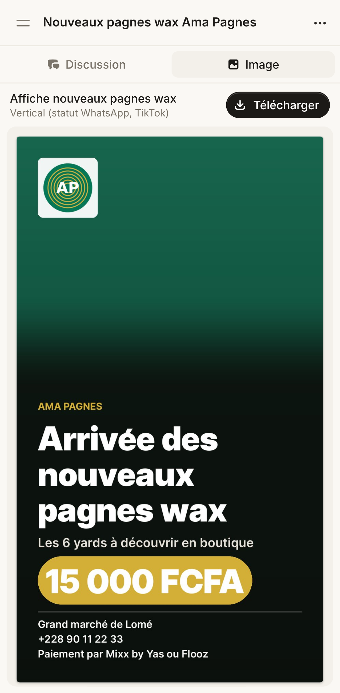 | 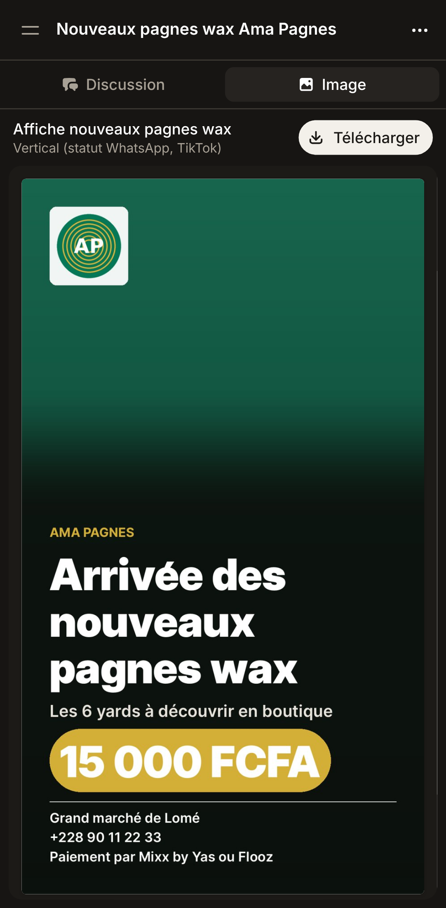 | 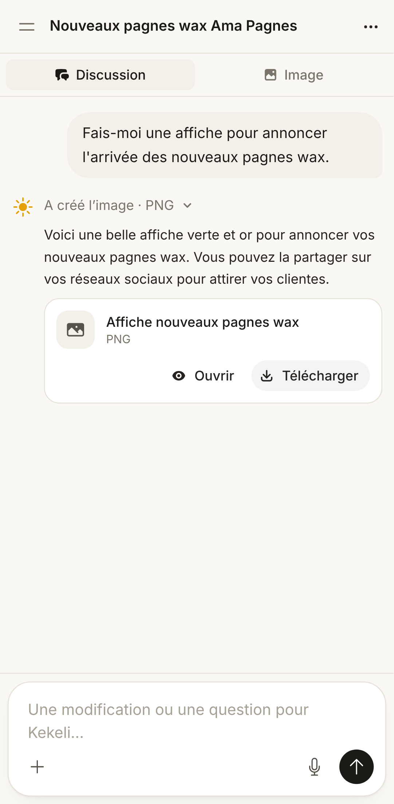 |

| Ordinateur | Ordinateur (sombre) |
|---|---|
| 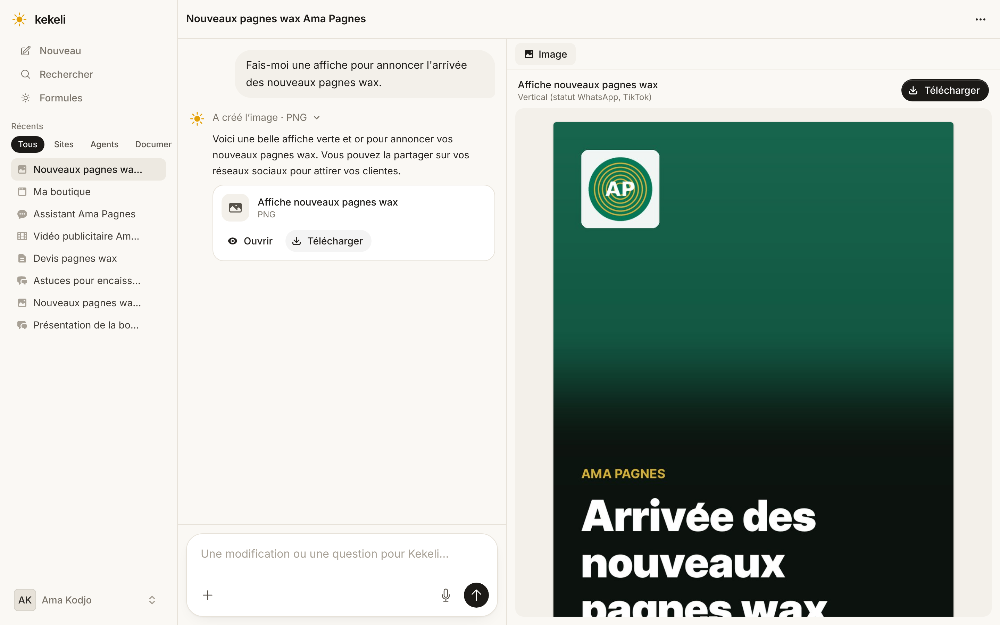 | 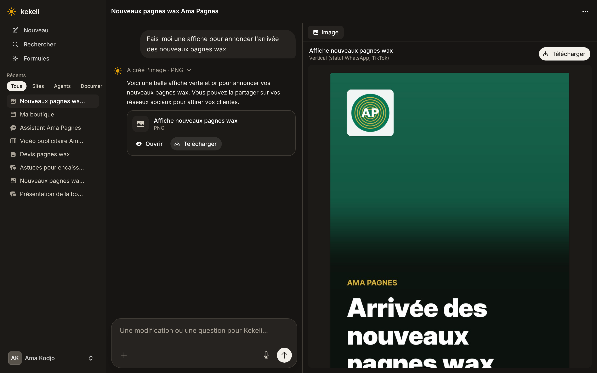 |

## 4. L'agent « Boutique Ama Pagnes », sans astérisques

Le gras et les listes s'affichent proprement, sans aucun « ** » (page de discussion de l'agent, aussi dans la bulle). Un seul agent, 10 réponses justes sur 10.

| Téléphone | Téléphone (sombre) |
|---|---|
| 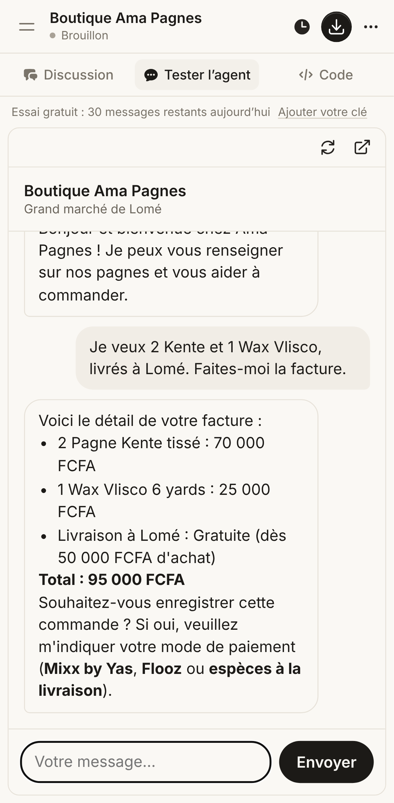 | 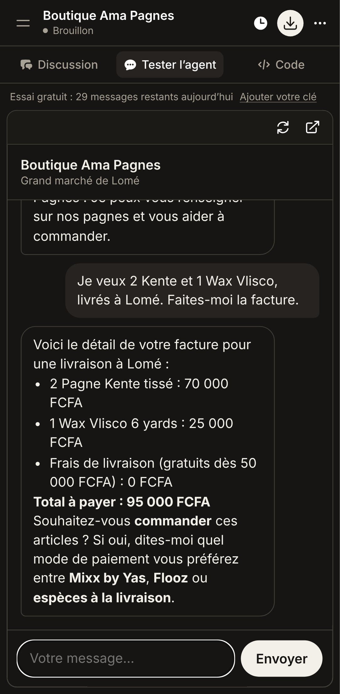 |

| Ordinateur | Ordinateur (sombre) |
|---|---|
| 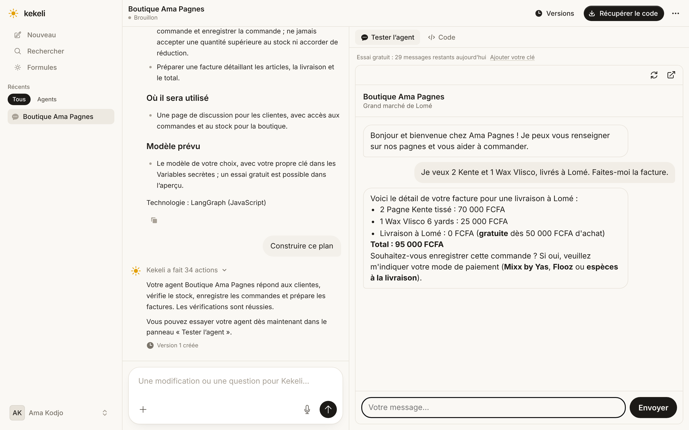 | 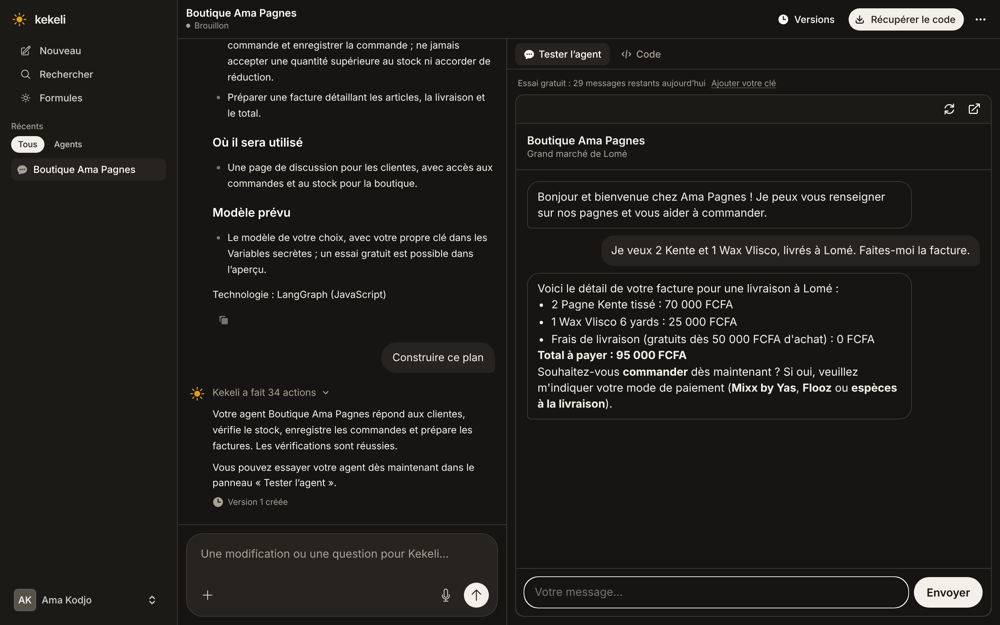 |
