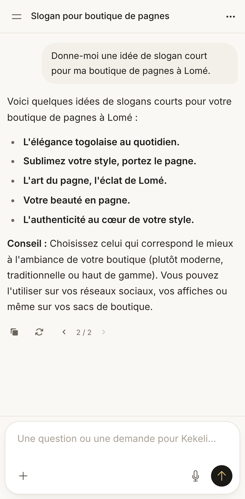
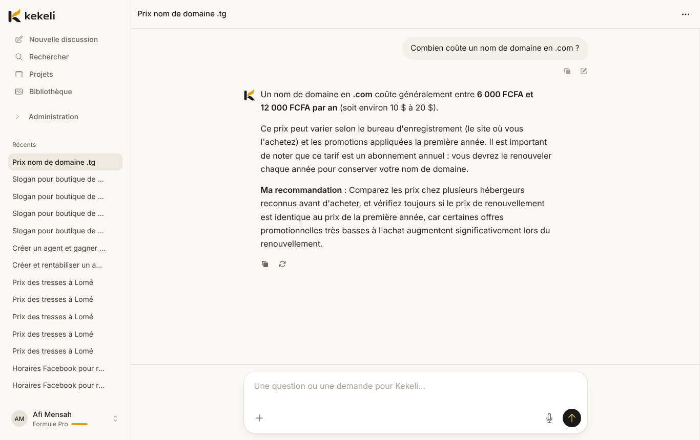
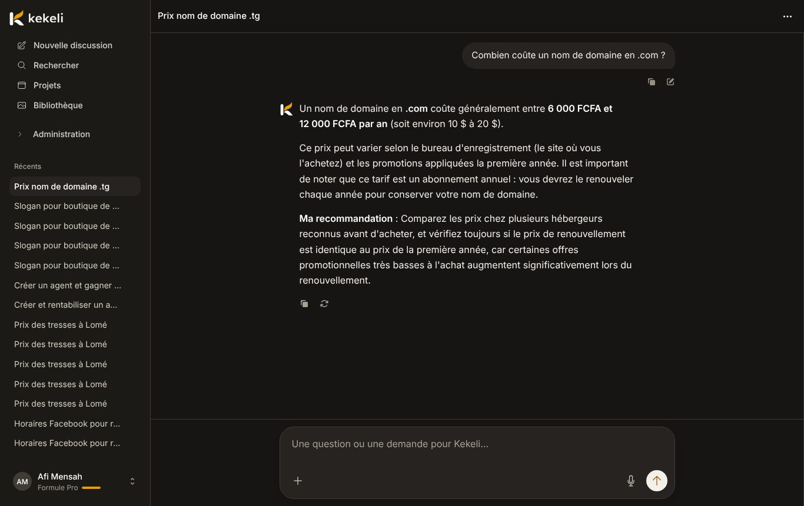

# Régénérer, modifier ses messages, vidéos cohérentes, réflexion plus courte (16 novembre 2026)

Détails et décisions : [`docs/plan.md`, partie 26.43](../plan.md). Aucune dépense : tout a été fait avec les offres gratuites.

## 1. « Régénérer » répond enfin, mot par mot

Cause : le bouton travaillait dans son petit bloc et ne trouvait jamais la zone de la réponse ; la page n'ouvrait donc jamais la réponse, et la tâche de secours partait sans délai. Correction : le bouton prévient la discussion, qui ouvre la nouvelle réponse mot par mot ; l'ancienne réponse est gardée, avec « ‹ 1 / 2 › » pour y revenir (comme Claude et ChatGPT).

Essai réel (site, Runner et vrai modèle gratuit) : **premier mot en 1,3 seconde, réponse complète en 3,6 secondes**, écrite mot par mot ; « 2 / 2 » affiché ; retour à la première réponse vérifié.

## 2. « Copier » et « Modifier » sous ses propres messages

Sous chaque message du client : « Copier » et « Modifier » (zones de 40 pixels sur téléphone, gris discrets). « Modifier » remet le texte dans la zone du message ; à l'envoi, la discussion repart du message modifié (la suite est masquée, jamais effacée). Seulement quand la suite ne contient que des réponses : jamais après une création (comme Lovable, qui passe par les versions).

Essai réel sur téléphone : le texte revient bien dans la zone, l'ancien message et sa réponse disparaissent, **premier mot de la nouvelle réponse en 1,1 seconde**.

| Téléphone, clair | Modification en cours | Après la modification |
|---|---|---|
|  |  |  |

| Téléphone, sombre | Ordinateur, clair | Ordinateur, sombre |
|---|---|---|
|  |  |  |

## 3. Vidéos : ce qui est montré correspond à ce qui est dit

Les mêmes 5 publicités que le banc du 15 novembre (`runner/mesures/publicites-5.json`, `runner/scripts/banc-publicites.mjs`), formule Gratuite, vrais modèles gratuits, vrais ordinateurs E2B. **Conditions** : le quota gratuit de Cloudflare du jour était déjà épuisé, comme lors du banc d'avant : aucune image créée, seulement des photos et des courtes vidéos Pixabay. Les deux bancs sont donc comparables.

Notes de cohérence image et phrase (de 1 à 10, données par Claude en regardant une image au milieu de chaque scène avec sa phrase ; un fond animé, faute d'image qui convienne, compte comme neutre) :

| Publicité | Avant (15 novembre) | Premier passage | Après (regard exigeant) |
|---|---|---|---|
| Pagnes | 7 | 6,5 | 7 |
| Formation en IA | 6 | 3,5 | 6 |
| Restaurant | 5 | 6,5 | 7 |
| Salon de coiffure | 5 | 5,5 | 7 |
| Offre de téléphone | 7 | 6 | 7 |
| **Moyenne** | **6,0** | **5,5** | **6,8** |
| Images sans rapport | 2 relevées | 6 sur 22 | **0** |

- **Premier passage** (courtes vidéos Pixabay et mots-clés de la phrase) : plus de mouvement réel, mais le regard acceptait encore des images faibles : un dessin animé pour « formation IA », un gratte-ciel pour « cours à Adidogomé », un homme en costume pour « 120 élèves formés ». **Moins bien qu'avant : corrigé.**
- **Après** : le regard exige une vraie photo ou une vraie vidéo, des personnes qui correspondent au public du client, et une note d'au moins 7 sur 10 (le sujet précis de la phrase est visible). Quand rien ne convient, Kekeli met le texte sur un fond animé plutôt qu'une image sans rapport. Avec le générateur gratuit disponible, ces scènes reçoivent une image créée pour elles.
- **Courtes vidéos réelles** : 9 scènes sur 22 avec une vidéo Pixabay (tresses, salon, élèves, téléphone en main).
- **Compte rendu au passé** dans les 5 cas (« Votre publicité pour Ama Pagnes est prête… ») ; un message écrit au futur est corrigé par le code (`messageVideoFinie`).
- **À améliorer encore** : le rythme (4 à 5 scènes pour 25 secondes au lieu de 6 à 9 demandées) ; des personnes pas toujours africaines dans les banques libres.
- Coût réel : **0 $** ; temps de fabrication : 4 à 5 minutes par publicité.

Une image au milieu de chaque scène, après :

Premier passage (pour comparer) : [pagnes](messages-videos/videos/pagnes-premier-passage.jpg), [formation](messages-videos/videos/formation-ia-premier-passage.jpg), [restaurant](messages-videos/videos/restaurant-premier-passage.jpg), [coiffure](messages-videos/videos/coiffure-premier-passage.jpg), [téléphone](messages-videos/videos/telephone-premier-passage.jpg). Vidéo du salon de coiffure : [coiffure.mp4](messages-videos/videos/coiffure.mp4).

## 4. Réflexion trop longue

En local, « Tu peux aussi me créer une vidéo film ? » reçoit son premier mot en **3,5 secondes** (le temps du modèle). Les 18 secondes vues en ligne venaient donc d'ailleurs ; deux attentes trouvées et retirées :

1. **GitHub à chaque message** : depuis la pull request 77, chaque message demandait la liste des dépôts à GitHub avant de répondre (jusqu'à 30 secondes si GitHub est lent ou refuse, et rien n'était gardé en cas d'échec). Maintenant, GitHub n'est appelé que si le message parle de code ou de dépôt, 4 secondes au plus, et un échec n'est pas redemandé pendant 2 minutes.
2. **Runner endormi** : Laravel Cloud endort le Runner quand personne ne s'en sert ; le premier message attendait son réveil. Maintenant, la page le réveille dès le premier toucher dans la zone du message (pendant que le client écrit), au plus une fois par minute, sans aucune donnée envoyée. Rien n'est changé ni payé sur Laravel Cloud.

**À mesurer en ligne après le déploiement** (Administration → Consommation → « Vitesse des réponses »).

## 5. Lighthouse téléphone et poids

| Page | Avant | Après |
|---|---|---|
| Accueil, performance | 76, 59 | 59, 59, 76 |
| Discussion, performance | 53, 49 | 54, 53, 55 |
| Accessibilité | 100 | 100 |

Les écarts viennent du bruit de la machine (le banc vidéo tournait en même temps) : pas de différence réelle.

| Fichier | Avant | Après |
|---|---|---|
| JavaScript | 17,37 Ko (6,21 Ko compressé) | 18,74 Ko (6,54 Ko compressé) |
| CSS | 353,3 Ko (42,13 Ko compressé) | 353,5 Ko (42,16 Ko compressé) |
