# Messages clairs de Kekeli : captures sur un écran de téléphone simulé

Captures prises le 10 novembre 2026 sur un téléphone simulé (Pixel 7, navigateur en français), pendant des **essais réels** avec un ordinateur E2B et Gemini (offre gratuite) :

- **Partie 1** : un site d'une page pour un restaurant inventé, « Chez Ama » à Lomé (création, puis une modification) ;
- **Partie 2** : le mode développeur, sur le dépôt public `jonschlinkert/is-number`, ouvert en lecture seule (rien n'a été envoyé sur GitHub).

Les noms, numéros et prix sont inventés.

## Partie 1 : un site (essai réel)

### 1. Pendant le travail : une phrase courte à chaque étape
Kekeli dit ce qu'il fait et pourquoi, en français simple. La phrase en cours tourne ; les phrases terminées sont cochées.
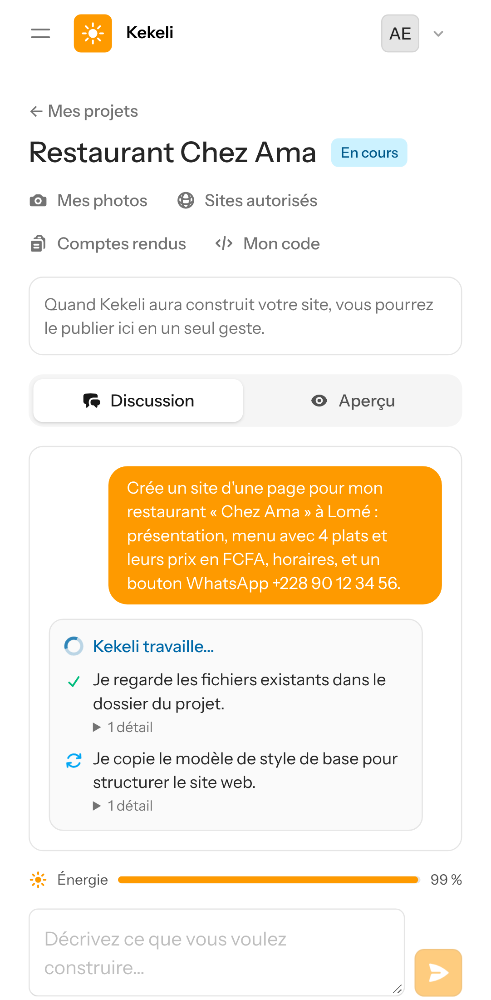

### 2. Les détails techniques restent en petit, dépliables
En touchant « 1 détail », on voit les commandes et les fichiers.
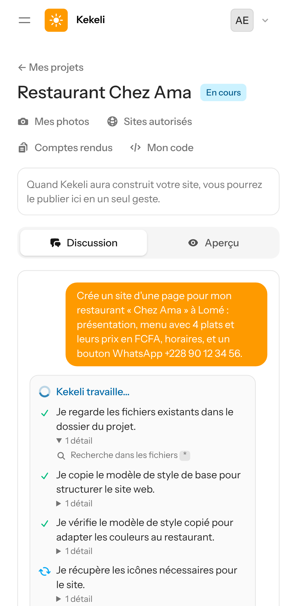

### 3. À la fin : le compte rendu, toujours dans le même ordre
Ce qui a été fait ; les fichiers modifiés ; les tests et vérifications ; ce qui n'a pas marché ou reste à faire ; ce que le client doit vérifier lui-même.
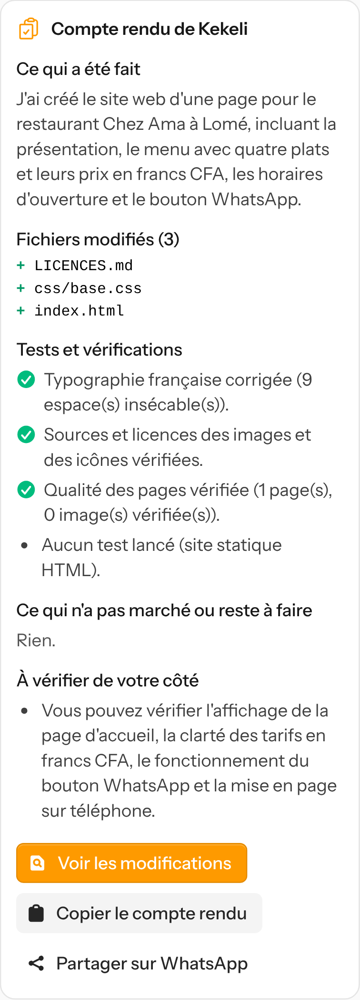

La page entière, avec les phrases du travail au-dessus du compte rendu :
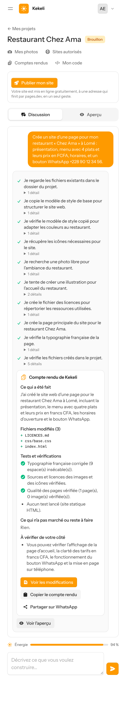

### 4. « Voir les modifications »
Chaque fichier ajouté, modifié ou supprimé ; en vert, ce qui a été ajouté ; en rouge, ce qui a été retiré.
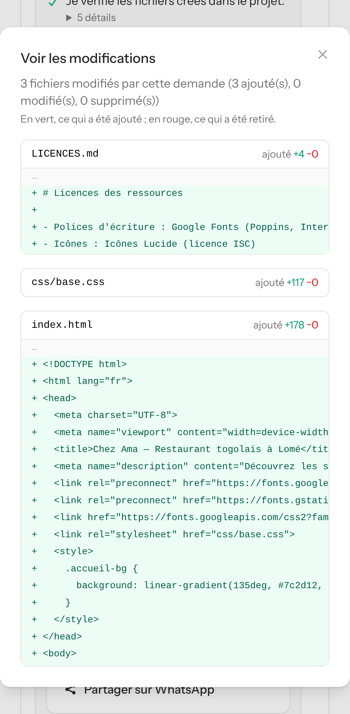

### 5. « Copier le compte rendu » et « Partager sur WhatsApp »
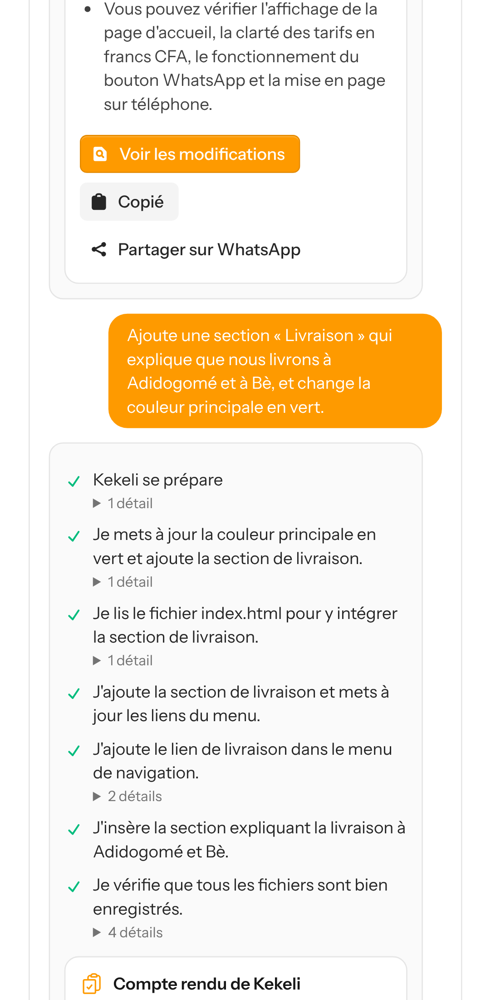

### 6. Une modification : « ajoute une section Livraison et passe la couleur en vert »
Pendant le travail :
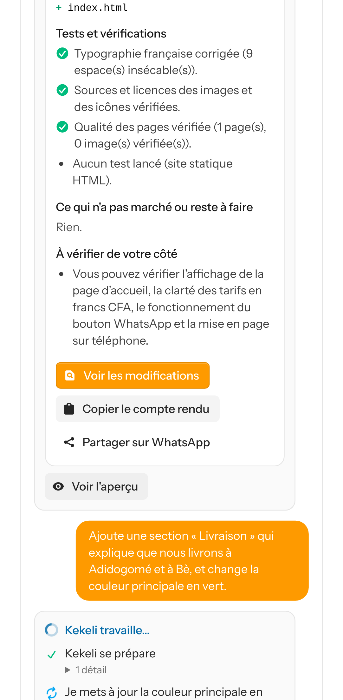

Le compte rendu :
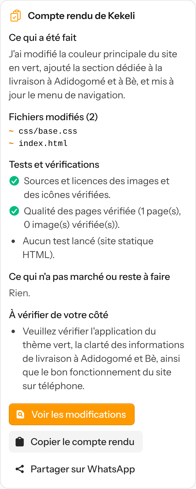

Les modifications : l'ancienne couleur en rouge, le nouveau vert et la nouvelle section en vert.
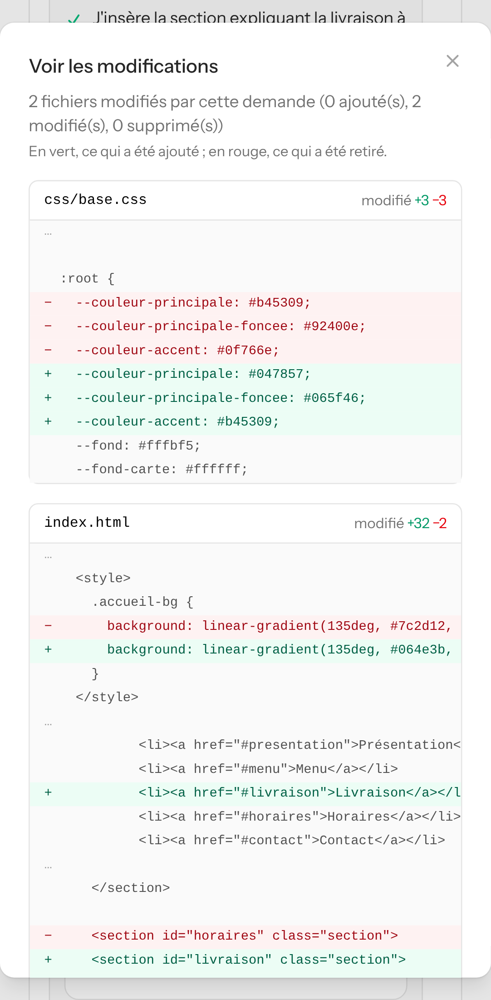

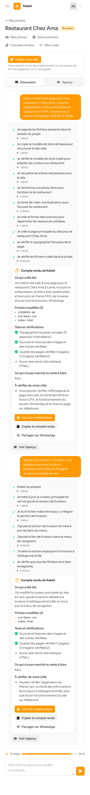
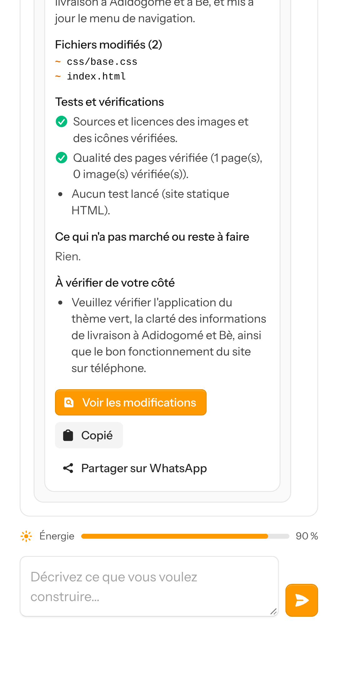

### 7. L'historique de tous les comptes rendus du projet
Bouton « Comptes rendus » du projet, du plus récent au plus ancien.
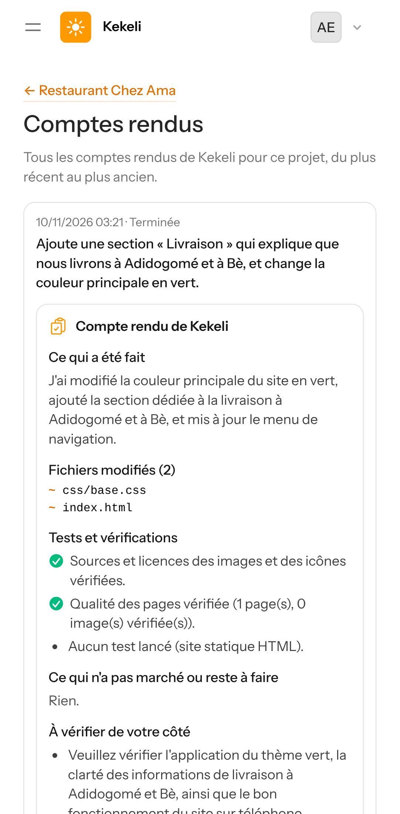
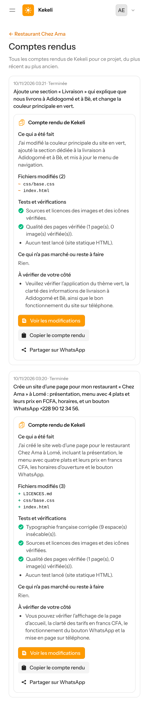

## Partie 2 : le mode développeur (essai réel)

### 1. Pendant le travail
Kekeli ouvre le dépôt, reconnaît un projet Node.js et installe les outils (« Kekeli se prépare »), puis explique chaque étape : il lit la documentation, lance les tests existants, ajoute l'option, ajoute ses tests, relance les tests et enregistre son travail.
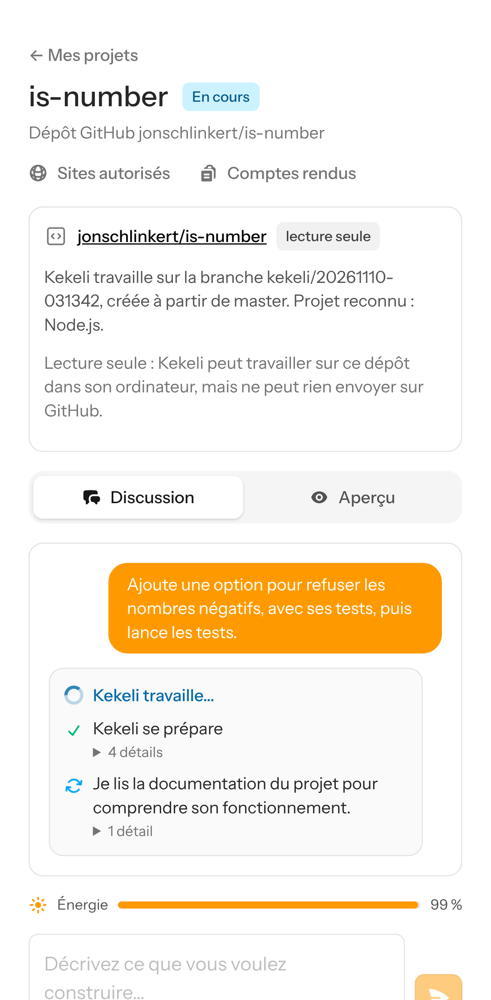
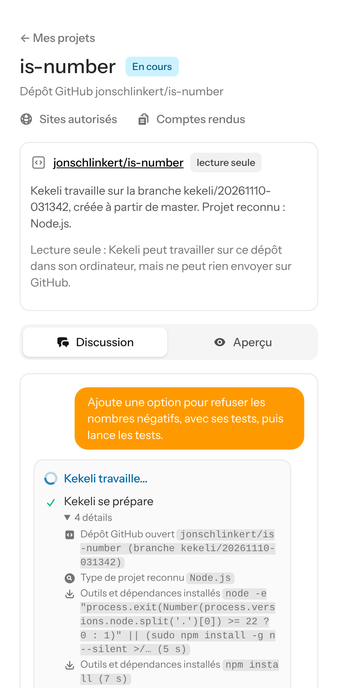

### 2. Le compte rendu
Les tests lancés (« npm test ») et le résultat dit par Kekeli : les 113 tests ont réussi.
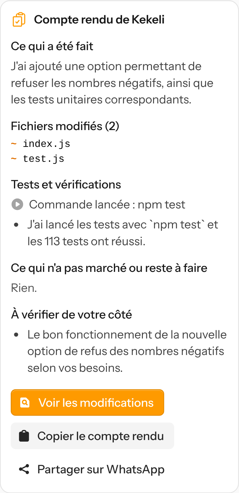
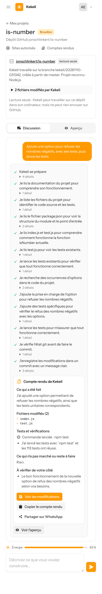

### 3. « Voir les modifications »
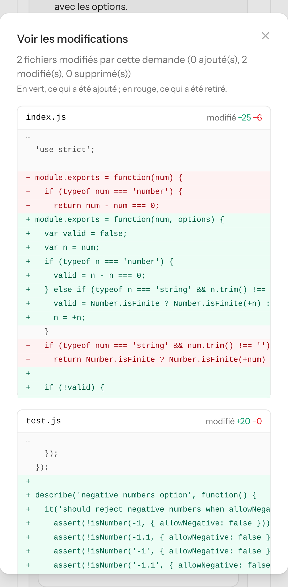

### 4. Copier, partager et historique
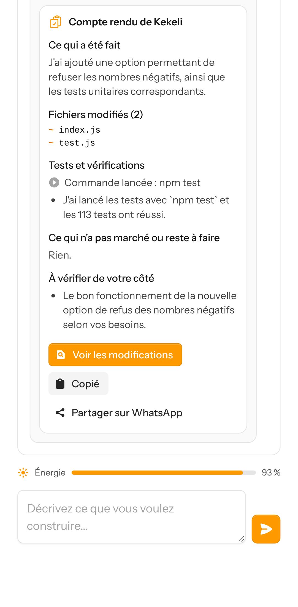
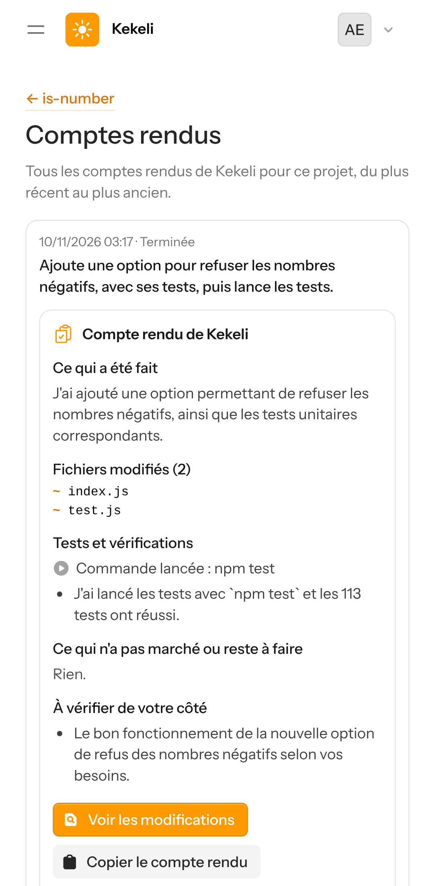
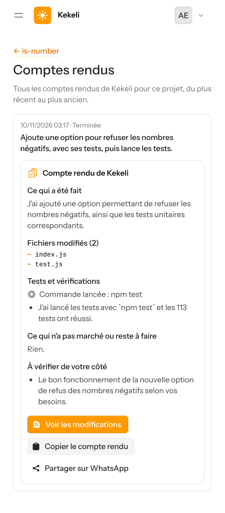

## Coût en plus
Environ 0,3 à 0,5 FCFA par demande, soit 1 à 2 % de l'énergie d'une demande (estimation mesurée sur ces essais). Détails dans [`docs/couts.md`](../couts.md), partie « Messages clairs ».
