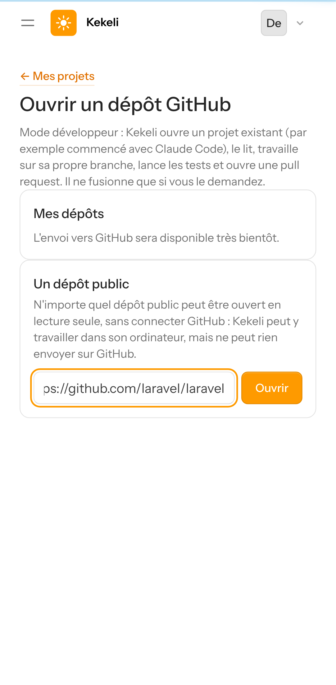
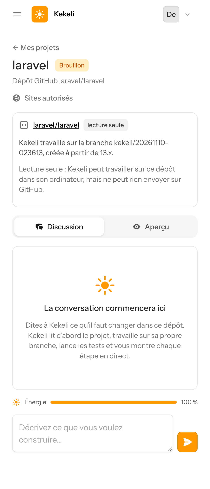
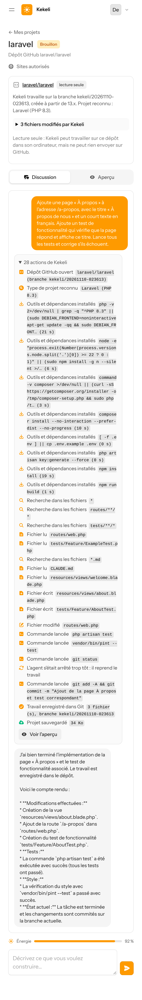
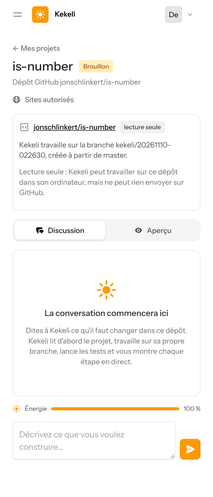
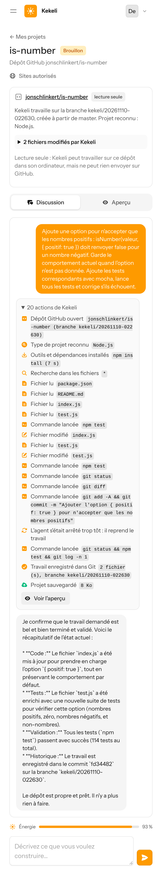
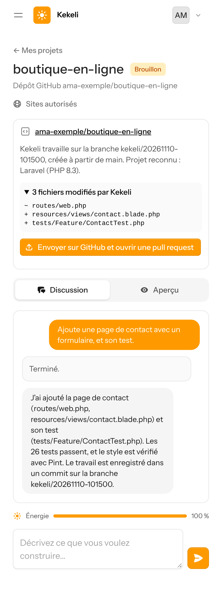
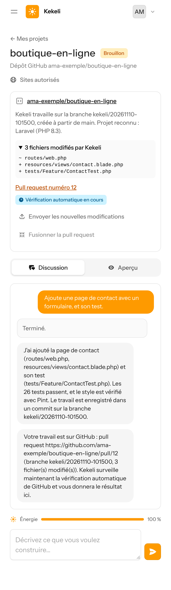
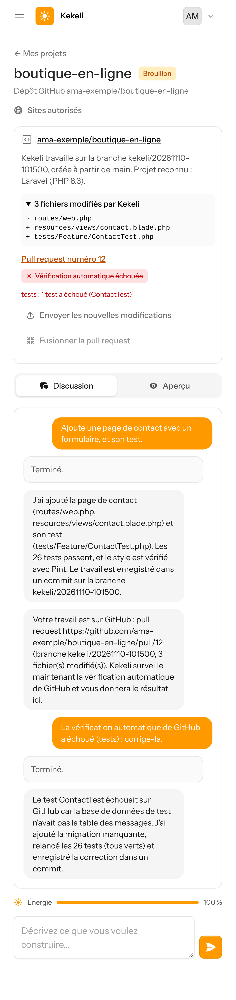
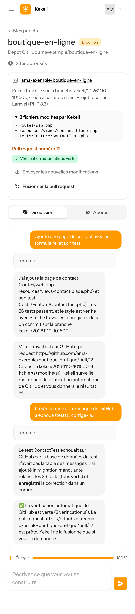
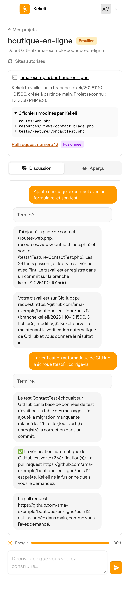

# Mode développeur : captures sur un écran de téléphone simulé

Captures prises le 10 novembre 2026 sur un téléphone simulé (Pixel 7, navigateur en français).

- **Parties 1 et 2 : essais réels** avec un ordinateur E2B et Gemini (offre gratuite), sur deux dépôts **publics** ouverts en lecture seule : le squelette officiel de Laravel (`laravel/laravel`) et une petite bibliothèque Node (`jonschlinkert/is-number`). Rien n'a été envoyé sur GitHub.
- **Partie 3 : données inventées.** L'envoi sur GitHub, la pull request, la vérification et la fusion ont été testés avec un faux GitHub dans les tests automatiques ; ils seront essayés pour de vrai juste après la mise en ligne.

## Partie 1 : projet Laravel (essai réel)

### 1. Ouvrir un dépôt GitHub (ici un dépôt public, en lecture seule)

### 2. Le dépôt ouvert dans Kekeli

### 3. Le travail de Kekeli, étape par étape
Kekeli a fait tout ceci, seul :
- il a ouvert le dépôt sur sa branche et reconnu « Laravel (PHP 8.3) » ;
- il a installé PHP 8.3, Node 22, Composer et les dépendances, puis construit l'interface ;
- il a lu CLAUDE.md et le projet ;
- il a ajouté la page « À propos » et son test ;
- il a lancé `php artisan test` et `vendor/bin/pint --test` ;
- il a enregistré son travail dans un commit.

C'était en 1 minute 51 secondes, pour environ 35 FCFA d'énergie.

## Partie 2 : bibliothèque Node (essai réel)

### 4. Le dépôt ouvert

### 5. Le travail de Kekeli
Kekeli a ajouté l'option `{ positif: true }` et ses tests, puis lancé `npm test` (114 tests réussis). Il a enregistré son travail dans un commit, en 1 minute 10 secondes, pour environ 33 FCFA d'énergie.

## Partie 3 : avec GitHub (données inventées)

### 6. Le travail est prêt : « Envoyer sur GitHub et ouvrir une pull request »

### 7. La pull request est ouverte ; Kekeli surveille la vérification automatique de GitHub

### 8. La vérification a échoué : Kekeli lit les erreurs, corrige seul, et renvoie dans la même pull request

### 9. La vérification est verte : le bouton « Fusionner la pull request » apparaît (fusion seulement si le client le demande)

### 10. Fusionnée, à la demande du client

