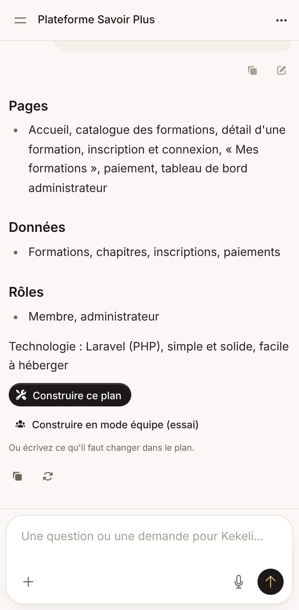
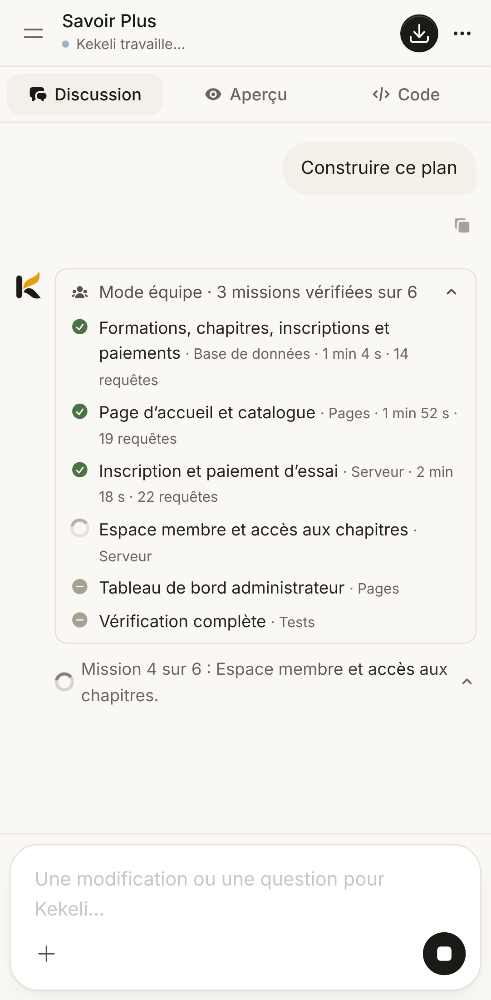
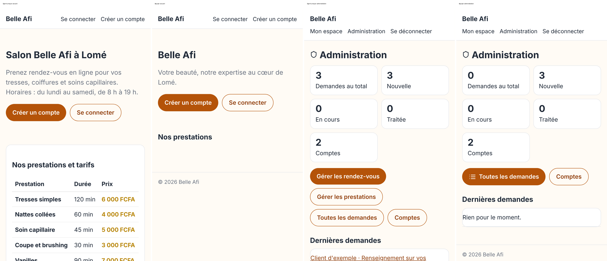
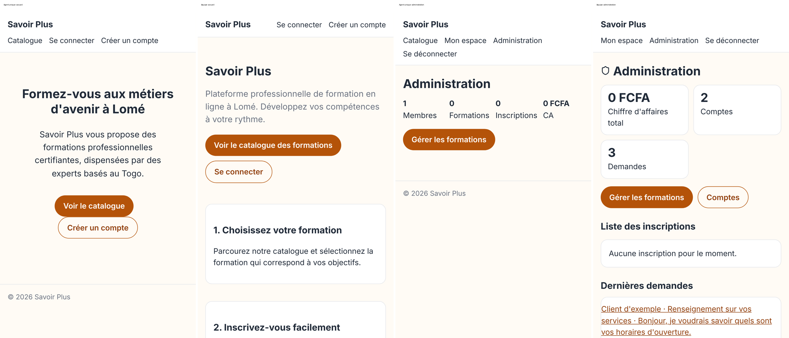
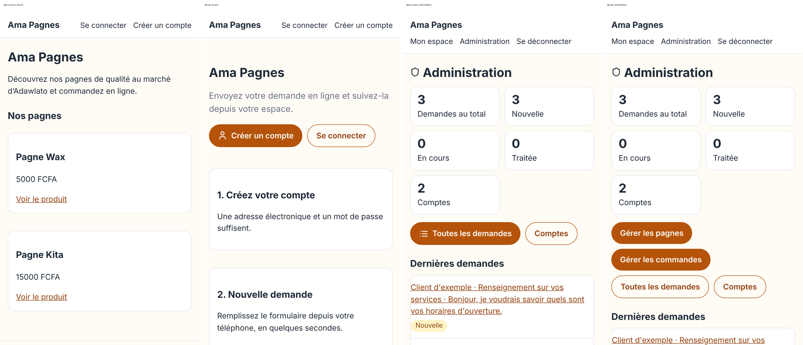
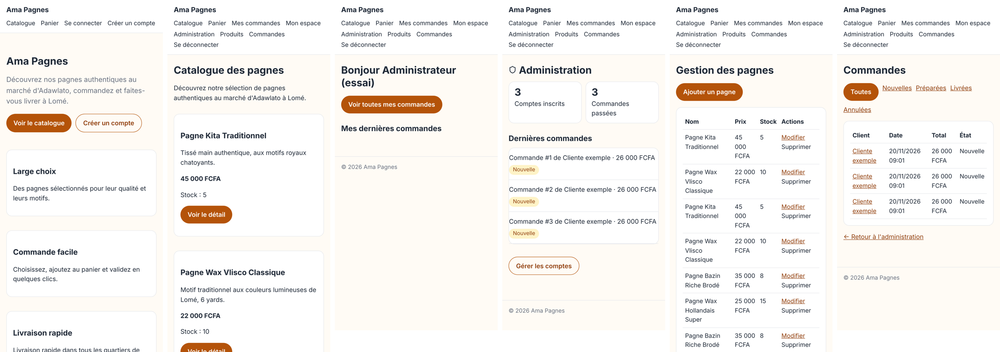
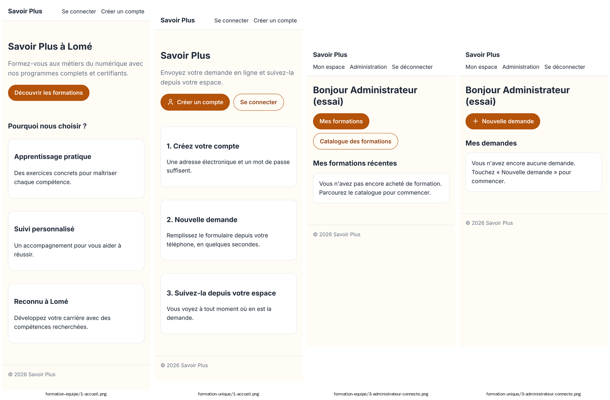
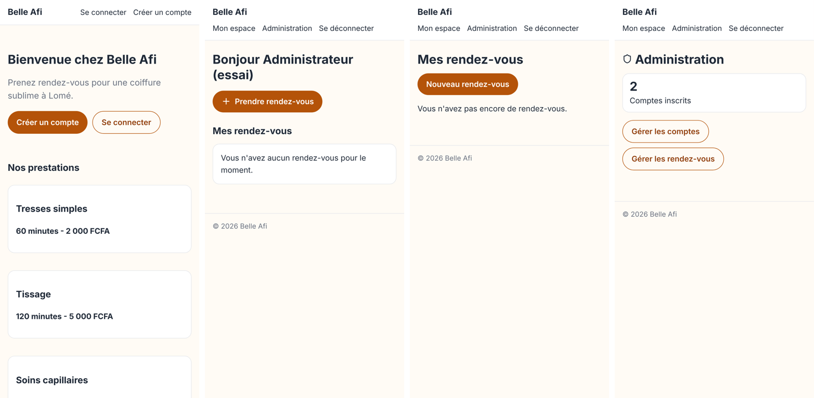

# Mode équipe, phase 1 (MVP) : résultats et captures (18 novembre 2026)

Étude : `docs/multi-agents-etude.md`. Détails : `docs/plan.md`, partie 26.46. Mesures brutes : `runner/mesures/banc-equipe.json`.

## Les écrans (téléphone simulé, compte administrateur d'essai, données inventées)

Le plan d'une application : « Construire ce plan » (agent unique, chemin normal) et, **pour un administrateur seulement**, « Construire en mode équipe (essai) ». Un client ne voit jamais ce second bouton.

Pendant une construction en mode équipe : les missions cochées une à une, avec leur rôle, leur durée et leurs requêtes.

## Le banc : agent unique contre équipe

Méthode : 3 applications réelles, chacune construite une fois par l'agent unique habituel et une fois par l'équipe, dans un vrai ordinateur E2B, avec les mêmes modèles gratuits (Gemini 3.5 Flash-Lite puis Gemini 3.1 Flash-Lite), par le même code que pour un client (`runner/scripts/banc-equipe.mjs`). Chaque demande a 10 critères concrets, notés par un même juge (Gemini gratuit) à partir de preuves prises dans l'ordinateur : routes, fichiers, extraits de règles, tests, et le texte des pages vraiment ouvertes.

| Application | Mode | Critères (juge) | Requêtes | Minutes | Tests | Coût équivalent payant (modèle + E2B) |
|---|---|---|---|---|---|---|
| Salon Belle Afi | Agent unique | **10/10** | 72 | 9,6 | 21 réussis | 0,21 $ + 0,03 $ |
| Salon Belle Afi | Équipe | 9/10 | 77 | 21,4 | 22 réussis | 0,22 $ + 0,06 $ |
| Plateforme de formation Savoir Plus | Agent unique | 4/10 | 53 | 7,1 | 20 réussis | 0,17 $ + 0,02 $ |
| Plateforme de formation Savoir Plus | Équipe | 5/10 | 103 | 13,7 | 22 réussis | 0,32 $ + 0,04 $ |
| Boutique Ama Pagnes | Agent unique | 2/10 | 35 | 3,4 | 3 en échec, 14 réussis | 0,11 $ + 0,01 $ |
| Boutique Ama Pagnes | Équipe | 9/10 | 126 | 11,9 | 24 réussis | 0,28 $ + 0,03 $ |
| **Total** | **Agent unique** | **16/30** | **160** | **20,1** | | **0,49 $ + 0,06 $** |
| **Total** | **Équipe** | **23/30** | **306** | **47,0** | | **0,81 $ + 0,13 $** |

Les coûts sont des **estimations** au prix payant de Gemini 3.5 Flash-Lite (les essais eux-mêmes ont coûté 0 $ : offres gratuites). Les minutes de l'équipe comprennent beaucoup d'attentes dues à la limite de 15 requêtes par minute des offres gratuites. Un premier essai de l'équipe sur le salon, avec la version qui n'imposait pas la mission de la page d'accueil, avait donné 8/10 (81 requêtes, 8,7 minutes).

## Ce que montrent les captures (relecture faite par Claude, plus sévère que le juge)

Le juge a été **trop indulgent avec l'équipe** sur deux points visibles : la page d'accueil de la boutique est restée celle du point de départ, et l'administration garde les « demandes » du point de départ.

**Salon** : l'agent unique est meilleur (accueil avec le tableau des prestations et leurs prix ; administration qui gère les rendez-vous et les prestations). L'accueil de l'équipe montre « Nos prestations » sans rien dessous, et son administration est encore celle du point de départ.

**Formation** : proche. L'agent unique est plus propre ; l'équipe a une administration plus riche (chiffre d'affaires, inscriptions) mais garde les « demandes » du point de départ. Aucune des deux n'a mis de formations d'essai dans le catalogue.

**Boutique** : l'équipe couvre bien plus de fonctions (panier, commandes, stock, gestion des pagnes et des commandes) mais **a laissé l'accueil du point de départ** (« Envoyez votre demande en ligne »). L'agent unique a un vrai accueil avec les pagnes, mais s'est arrêté avant le panier, les commandes et l'administration.

## Conclusion honnête

- **Fonctions couvertes** : l'équipe en couvre plus (23 critères contre 16 selon le juge), surtout parce que l'agent unique s'arrête parfois trop tôt avec les modèles gratuits (boutique, formation).
- **Finition visible** : l'agent unique est souvent plus propre (accueil réel, moins de restes du point de départ) ; l'équipe oublie des finitions entre les missions.
- **Coût** : l'équipe demande environ **1,9 fois plus de requêtes** et **1,7 fois plus de coût de modèle** ; elle est plus lente avec les limites par minute des offres gratuites.
- **Taille de l'échantillon** : un seul essai par application et par mode ; les modèles gratuits sont irréguliers. Ces chiffres sont des indications, pas une preuve.
- La règle de décision de l'étude (« nettement mieux pour au plus 2,5 fois le coût ») **n'est pas clairement remplie** une fois les captures relues : le mode équipe reste **désactivé pour les clients**.

## Défauts trouvés et corrigés pendant le banc

1. Une limite par minute arrêtait toute l'équipe (et la reprise repartait avec l'agent unique) : la mission attend maintenant et reprend seule dans sa session.
2. Le planificateur oubliait la page d'accueil : le code confie maintenant toujours l'accueil d'une application neuve à une mission « pages ».
3. La vérification de l'accueil du point de départ regardait un seul fichier : en mode équipe, Kekeli lit maintenant la page vraiment affichée (la boutique de l'équipe aurait ainsi reçu une relance pour remplacer son accueil). Correction ajoutée après les essais : **pas encore mesurée**.
4. Le juge pouvait être occupé : il réessaie, et les preuves sont gardées pour relire un essai.

# Phase 1 bis : deuxième manche et vérification des pages (19 et 20 novembre 2026)

Feu vert du porteur du projet (« il faut voir ce qui est bien et tu fais ») : corriger les défauts de la phase 1, mesurer de nouveau, présenter avant toute suite. Mêmes 3 applications, mêmes modèles gratuits (0 FCFA), même juge.

## Ce qui a changé dans le mode équipe (le chemin normal, sans mode équipe, est inchangé)

1. **Restes du point de départ** : après la validation finale, Kekeli cherche dans le code les « demandes » du point de départ ; s'il en reste, une consigne les fait retirer (`TEXTE_RESTES`), puis Kekeli revérifie.
2. **Données d'essai** : le planificateur prévoit des données d'essai pour que le catalogue ou les prestations ne soient pas vides.
3. **Toutes les pages s'ouvrent** (défaut trouvé pendant cette manche) : dans 4 constructions sur 6, la page d'arrivée après la connexion plantait, sans que les tests ni l'accueil le voient (une mission ou le retrait des restes supprimait un contrôleur ou un modèle encore utilisé). Kekeli charge maintenant la liste des routes avec `--except-vendor` (qui vérifie que chaque contrôleur existe), puis ouvre chaque page sans paramètre, en visiteur et avec l'administrateur d'essai, un processus par page (`runner/src/equipe-pages.php`), et fait corriger celles qui plantent. Une liste des pages qui plante elle-même n'est jamais prise pour « aucune page cassée ». Essayé sur le vrai point de départ cassé exprès (contrôleur supprimé, classe inexistante, modèle supprimé) : chaque panne est trouvée en 0,2 à 4 secondes, aucune fausse alerte sur le point de départ intact.

La première version de cette vérification (avec `route:list --json`) **laissait passer** un contrôleur supprimé : vu sur la boutique du 20 novembre (essai gardé à part, `essais_controle_incomplet`), corrigé, puis refait.

## Résultats de la deuxième manche (juge Gemini gratuit, sur 10)

| Application | Mode | Juge | Requêtes | Minutes | Tests | Coût équivalent payant (modèle + E2B) |
|---|---|---|---|---|---|---|
| Salon Belle Afi | Agent unique | 1 | 82 | 14,4 | 7 en échec, 12 réussis | 0,33 $ + 0,04 $ |
| Salon Belle Afi | Équipe | 5 | 79 | 13,2 | 15 réussis | 0,26 $ + 0,04 $ |
| Plateforme Savoir Plus | Agent unique | 2 | 45 | 5,6 | 17 réussis | 0,12 $ + 0,02 $ |
| Plateforme Savoir Plus | Équipe | 9 | 135 | 14,8 | 18 réussis | 0,33 $ + 0,04 $ |
| Boutique Ama Pagnes | Agent unique | 10 (en réalité bien moins) | 67 | 13,7 | 13 réussis | 0,32 $ + 0,04 $ |
| Boutique Ama Pagnes | Équipe | 9 | 171 | 21,4 | 13 réussis | 0,45 $ + 0,06 $ |
| **Total** | **Agent unique** | **13/30** | **194** | **33,7** | | **0,77 $ + 0,09 $** |
| **Total** | **Équipe** | **23/30** | **385** | **49,4** | | **1,05 $ + 0,14 $** |

Les essais ont coûté 0 $ (offres gratuites) ; les coûts sont des **estimations** au prix payant de Gemini 3.5 Flash-Lite. Les minutes comprennent les attentes dues à la limite de 15 requêtes par minute. Les essais de l'équipe du salon et de la boutique sont ceux du 20 novembre, avec la vérification complète des pages ; les essais du 19 novembre (salon 9 avec la page `/espace` qui plantait, boutique 3) sont gardés dans `essais_avant_correction`.

## Relecture des captures par Claude (le juge est trop indulgent)

- **Boutique, agent unique** : le juge donne 10, mais le catalogue est vide et l'espace connecté plante. **Boutique, équipe** : une vraie boutique (catalogue avec prix et stock, panier, « Mes commandes », gestion des pagnes et des commandes), toutes les pages s'ouvrent ; défauts : pagnes d'essai en double, une marque réelle (« Vlisco ») dans les exemples.

- **Formation** : l'équipe a construit une vraie plateforme (« Mes formations », catalogue) ; l'agent unique a laissé le point de départ presque intact (« Envoyez votre demande »).

- **Salon** : l'agent unique a une erreur fatale dans le code. L'équipe : accueil avec les prestations et leurs prix, toutes les pages s'ouvrent, mais **la prise et l'annulation de rendez-vous et la gestion des prestations manquent** (boutons « Prendre rendez-vous » sans page).

## Conclusion honnête de la phase 1 bis

- **Qualité** : dans cette manche, l'équipe fait mieux sur les 3 applications, selon le juge (23 contre 13) comme selon la relecture des captures. La vérification des pages évite maintenant de livrer une page qui plante.
- **Coût** : environ **2 fois plus de requêtes** et **1,4 fois plus de coût de modèle** (estimation) ; plus lent avec les limites par minute.
- **Irrégularité** : les écarts d'un essai à l'autre sont très grands avec les modèles gratuits (agent unique sur le salon : 10 à la première manche, 1 à la deuxième ; équipe sur le salon : 9, puis 5). Deux manches ne suffisent pas pour une preuve.
- **Ce qui reste faible** : l'équipe peut encore oublier une fonction demandée (le salon) ou mettre des données d'essai en double ; la vérification des pages est réservée au mode équipe (l'agent unique ne l'a pas encore).
- Le mode équipe **reste réservé à l'administrateur**. Suite à décider par le porteur du projet.
