# Nouveaux modèles : test, choix automatique, une seule expérience — captures

Captures prises le 14 novembre 2026 sur un téléphone simulé (Pixel 6, Chrome, en français) et sur un ordinateur, en clair et en sombre. Comptes, comptes Coarena (noms, empreintes, quotas) et consommation **inventés** ; aucune vraie clé. Les deux réponses viennent d'un **vrai essai** (`docs/captures/modeles/reponses-standard-pro.json`). Scripts : `scripts/preparer-captures-design.php`, `scripts/preparer-captures-modeles.php`, `scripts/captures-modeles.js`. Détails : `docs/plan.md`, partie 26.26 ; banc d'essai : `runner/mesures/modeles-coarena.md`.

## Administration → Modèles

Interrupteurs des fournisseurs et du passage d'un compte Coarena à l'autre, comptes Coarena (seulement le **nom** de chaque variable, jamais un caractère de la clé) avec « Tester » et « Éteindre », modèles par tâche (« Qualité » pour tous, « Économie » quand le crédit est presque épuisé), classement du banc d'essai, consommation du jour.

| Téléphone clair | Téléphone sombre |
|---|---|
|  |  |

| Ordinateur clair | Ordinateur sombre |
|---|---|
| 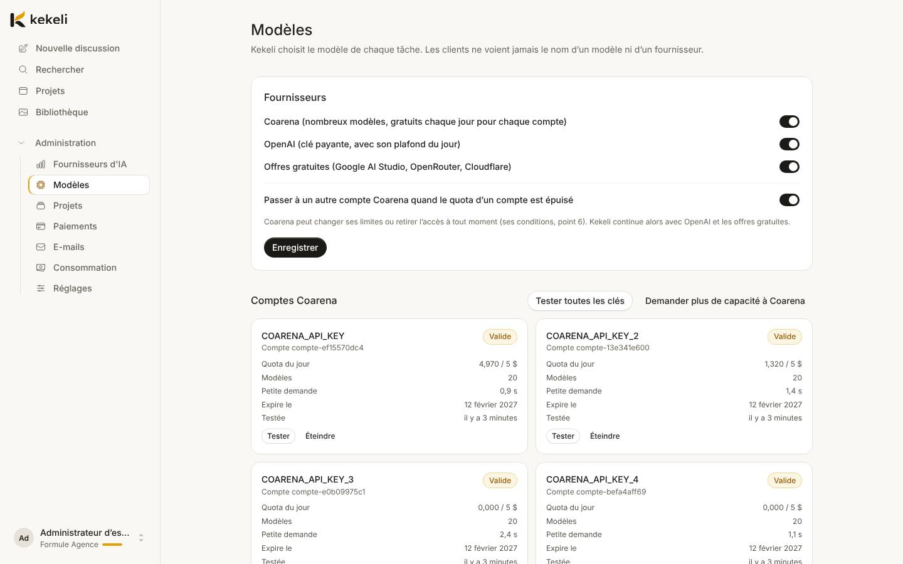 | 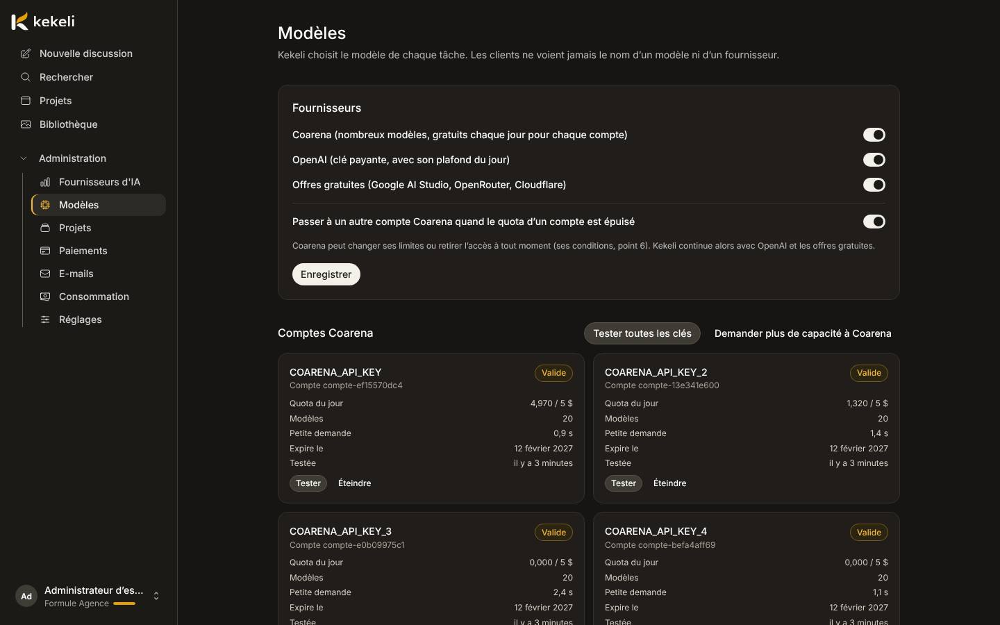 |

## Crédits gratuits utilisés

Une seule expérience pour tous (comme Lovable et Manus) : aucune mention « Pro », aucun outil caché. Quand le crédit gratuit est utilisé : « Vous avez utilisé tous vos crédits gratuits. Votre projet est toujours disponible. Pour continuer à créer avec Kekeli, choisissez une formule d'abonnement. », l'heure du retour du crédit gratuit, ce qui a déjà été réalisé, les formules avec leur crédit, et « Choisir une formule ». Rien n'est effacé.

| Téléphone clair | Téléphone sombre |
|---|---|
| 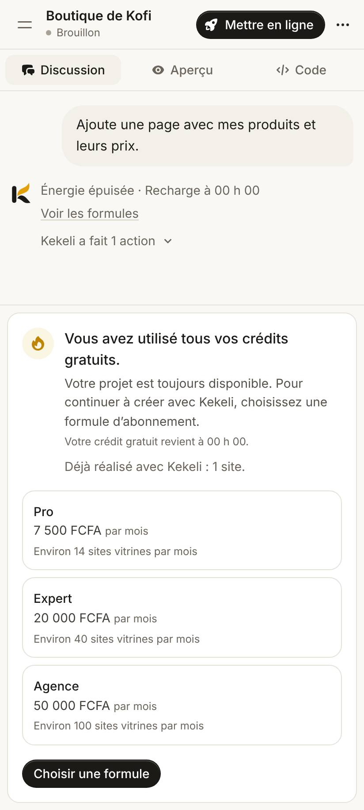 | 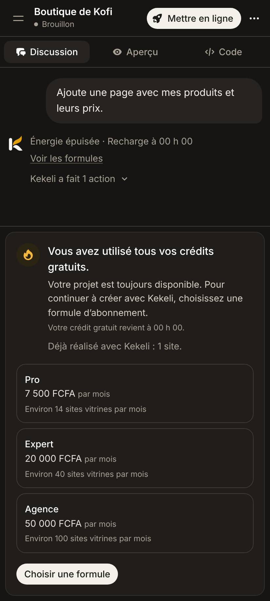 |

## La même question, modèles économiques et modèles de qualité

« Je vends des pagnes à Lomé. Comment fixer mes prix pour gagner 30 % après une remise de 10 % ? J'achète chaque pagne 7 500 FCFA. » Modèles économiques (GPT-6 Luna, seulement quand le crédit est presque épuisé) : juste et court. Modèles de qualité (GPT-6.1 Sol, **pour tous les clients**) : la même réponse, plus l'autre façon de compter (30 % du montant encaissé), les frais à ajouter et une recommandation. Le client ne voit jamais le nom du modèle.

| Économiques, clair | Économiques, sombre | Qualité, clair | Qualité, sombre |
|---|---|---|---|
| 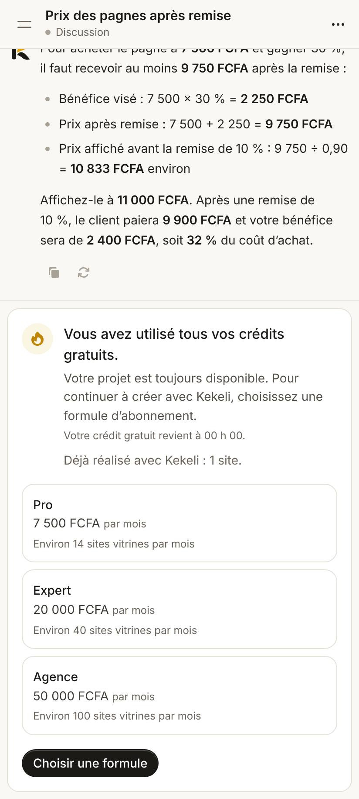 | 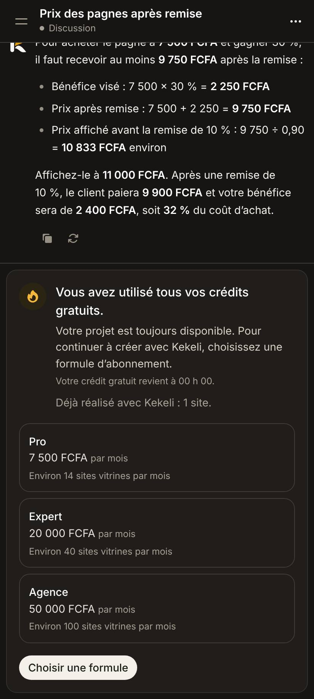 | 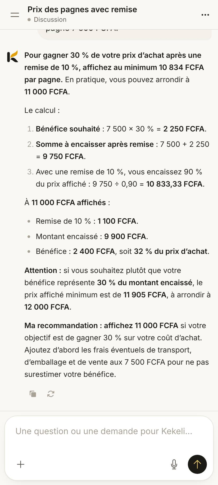 | 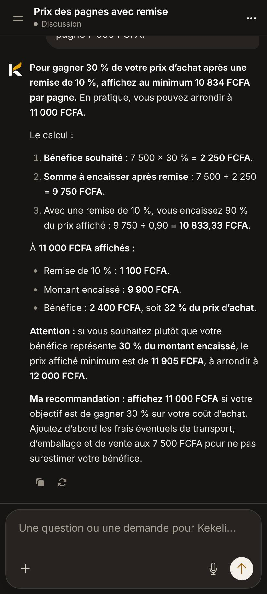 |

## Les sites du banc d'essai

Le même site (salon « Belle Afi », Kpalimé) écrit par chaque modèle, affiché sur un téléphone :

| GPT-6.1 Sol | GPT-6.1 Terra | GPT-6 Luna | Kimi K3.1 Pro | Gemini 3.8 Flash |
|---|---|---|---|---|
|  | 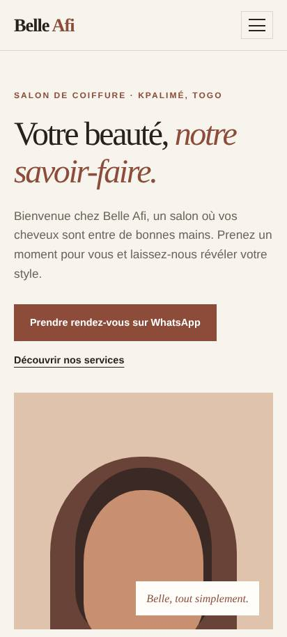 | 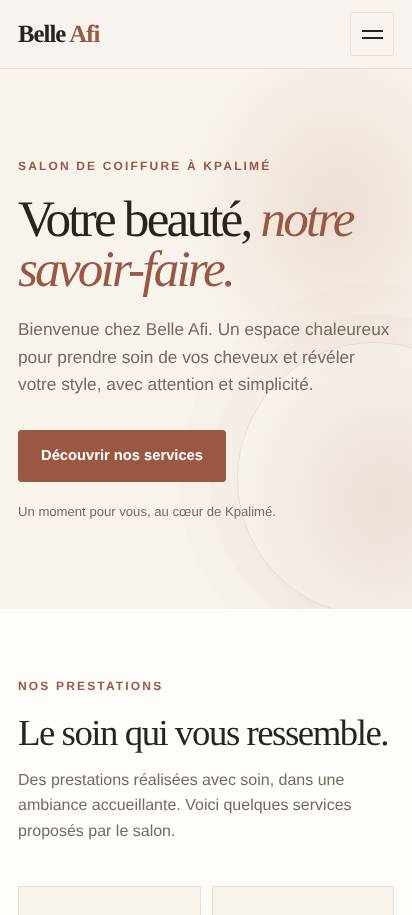 | 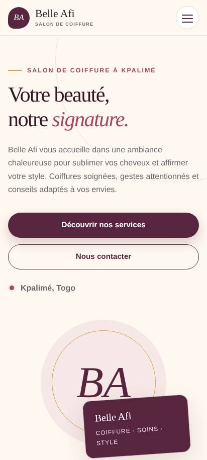 |  |

| GLM 5.3 Flash | Gemini 4 Argon (écarté) | DeepSeek V4.1 Flash (écarté) | MiniMax M3.1 Flash (écarté) |
|---|---|---|---|
| 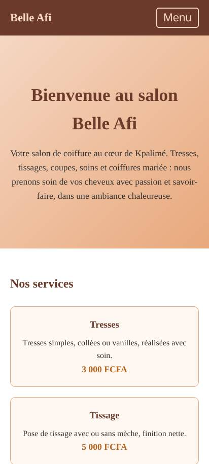 | 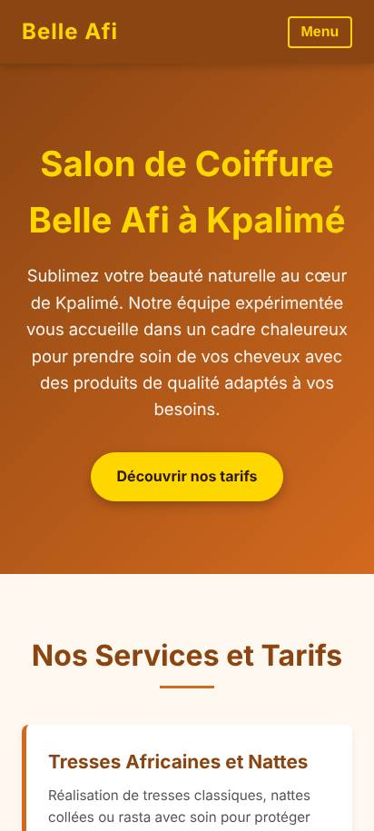 | 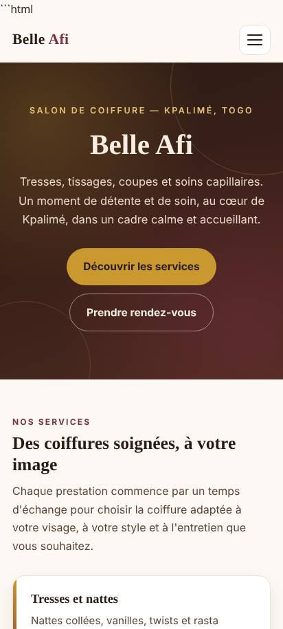 | 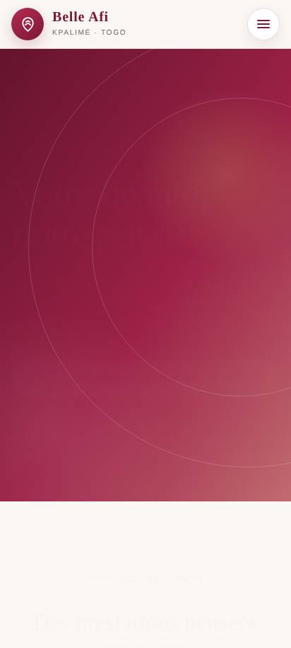 |
