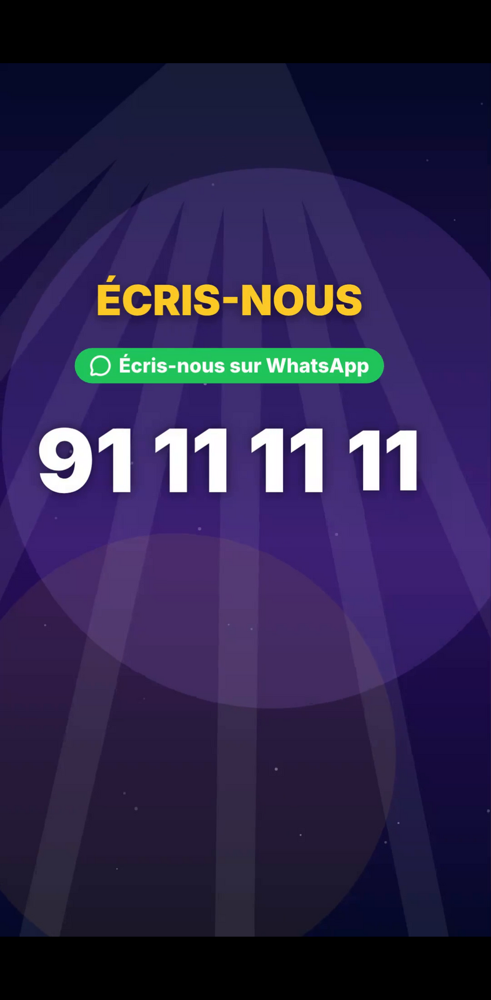
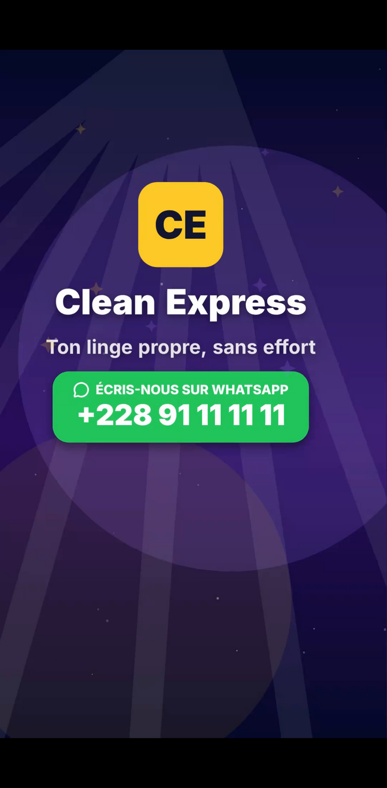
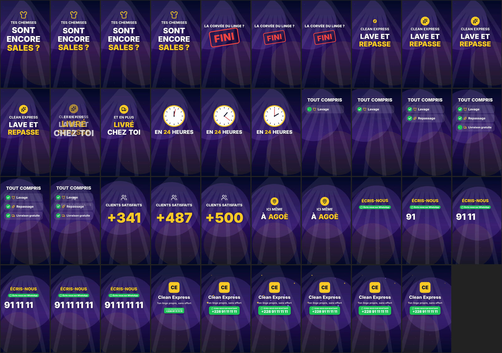
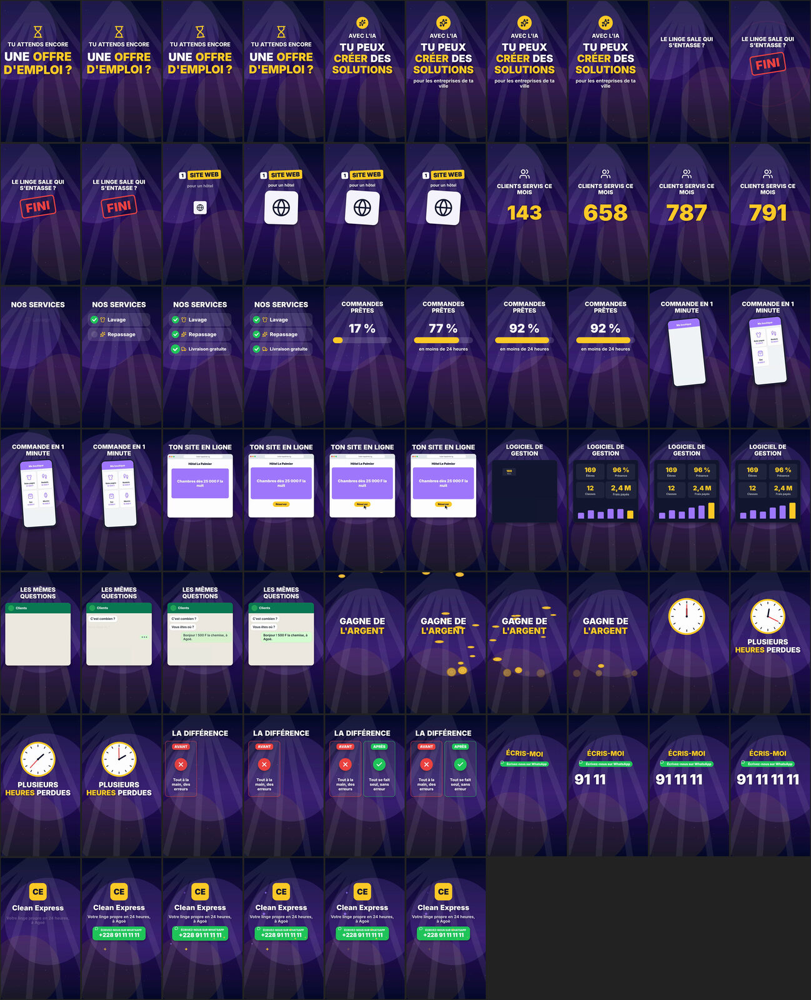

# Vidéos « motion design », étape 1 : bibliothèque animée et style « Dynamique »

16 novembre 2026. Publicité d'essai écrite à la main (plan de montage JSON, données inventées : « Clean Express », pressing à Agoè, numéro +228 91 11 11 11 inventé), voix off gratuite de Gemini (voix d'homme « Charon »), temps calés sur les mots de la voix, rendu par Revideo (licence MIT). Le son travaillé (musique, bruitages, volume) et les sous-titres arrivent aux étapes 2 et 3.

## La vidéo d'essai (22 secondes)

- Vidéo avec la voix : [essai-clean-express.mp4](montage-etape-1/essai-clean-express.mp4)
- Les 16 composants animés, 2 secondes chacun, sans voix : [galerie-composants.mp4](montage-etape-1/galerie-composants.mp4)

Mesures : rendu en 30 à 38 secondes dans l'environnement de Claude, aucune alerte de texte (rien ne déborde), rythme bon (jamais plus de 2,5 secondes sans changement à l'écran).

## Sur un téléphone (Pixel 7 simulé, navigateur en français)

| Image 0 (la miniature) | La liste qui se coche | Le numéro, groupe par groupe | La carte finale |
|---|---|---|---|
|  |  |  |  |

## Planche de la vidéo d'essai (2 images par seconde)

## Planche des 16 composants

Accroche, texte, tampon, étiquette numérotée, compteur, liste qui se coche, barre de progression, téléphone (boutique), navigateur (site), tableau de bord, discussion, pièces qui tombent, horloge, avant et après, numéro géant, carte finale.

