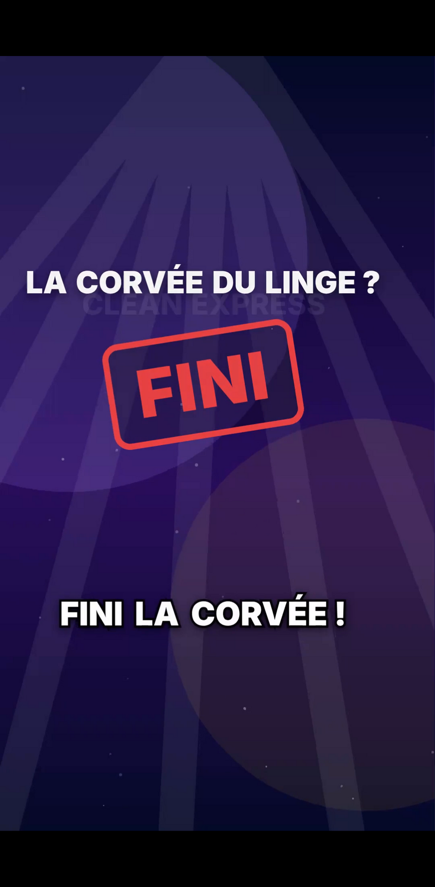
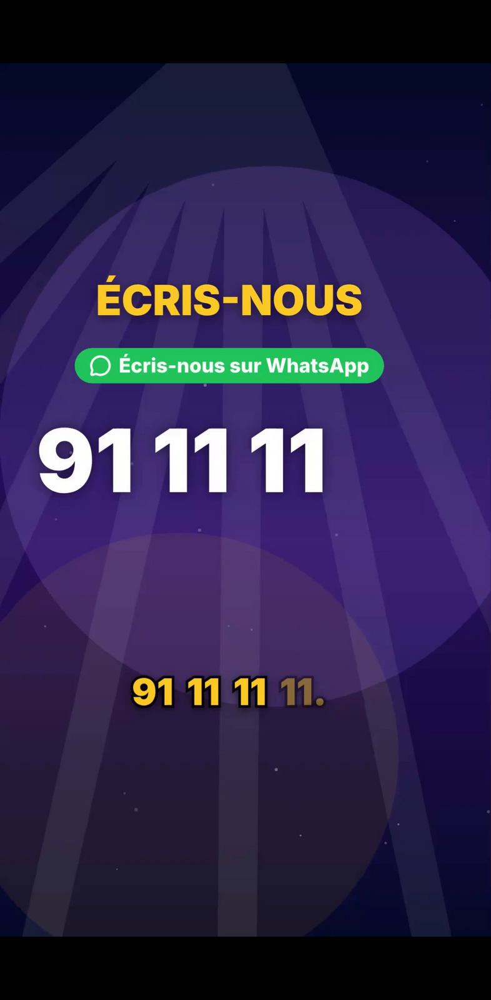
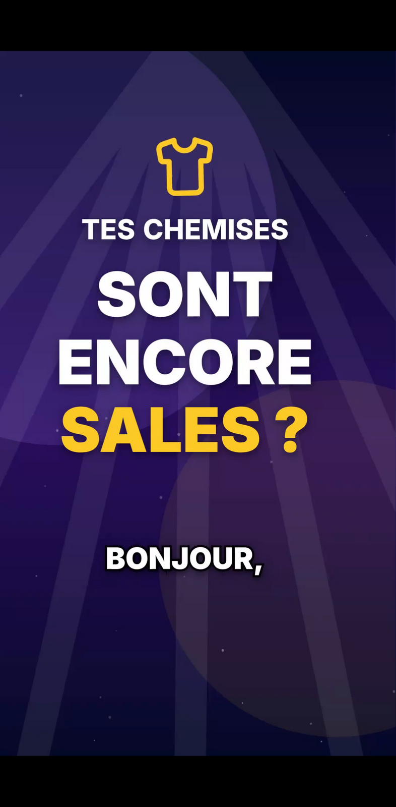
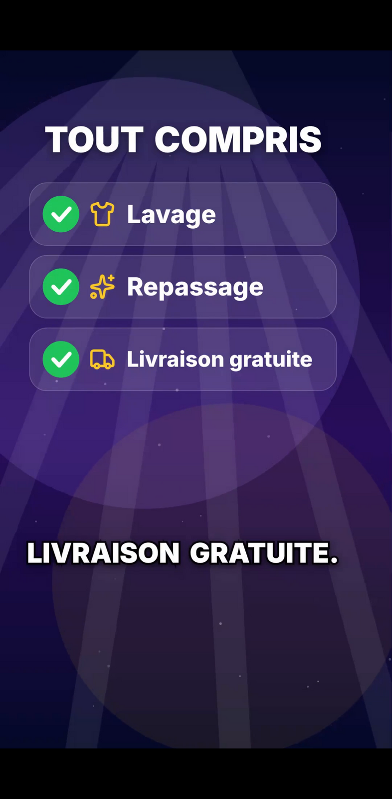
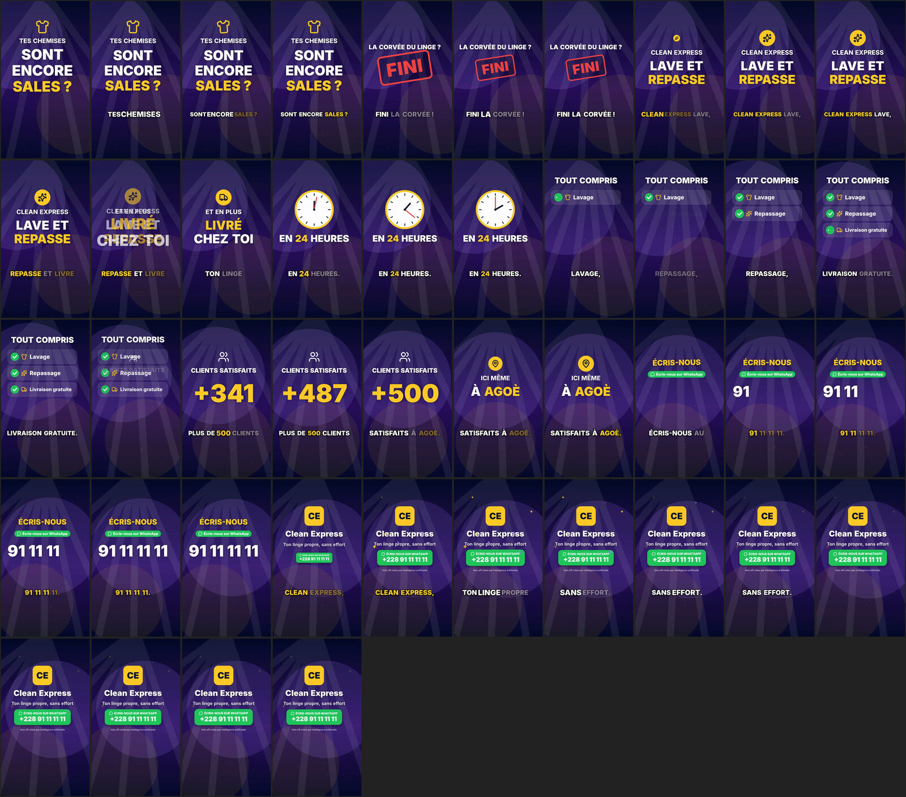
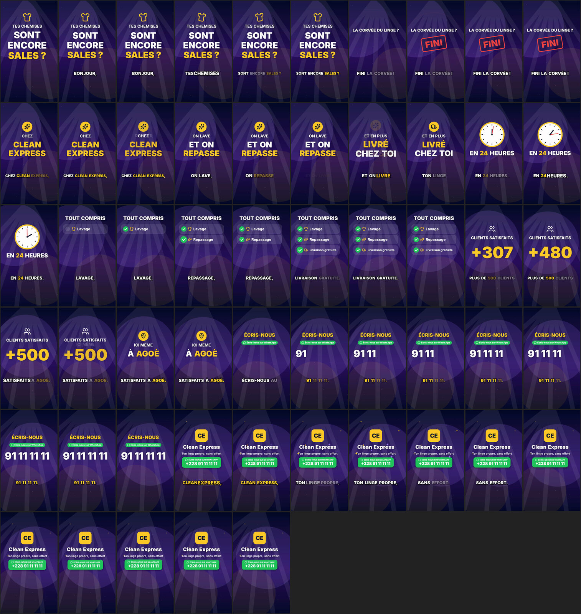

# Vidéos « motion design », étape 2 : sous-titres mot par mot et voix du client

16 novembre 2026. Deux essais avec le même plan de montage (données inventées : « Clean Express », pressing à Agoè, numéro inventé). Le son travaillé (musique, bruitages, volume à -14 LUFS) arrive à l'étape 3.

## Les deux vidéos

- **Voix de Kekeli** (voix gratuite de Gemini, voix d'homme) : [voix-kekeli.mp4](montage-etape-2/voix-kekeli.mp4), sous-titres [voix-kekeli.srt](montage-etape-2/voix-kekeli.srt). La carte finale affiche « Voix off créée par intelligence artificielle ».
- **Voix du client** (simulée : une voix de femme envoyée comme une note vocale de WhatsApp, au format OGG) : [note-vocale-simulee.ogg](montage-etape-2/note-vocale-simulee.ogg), vidéo [voix-client.mp4](montage-etape-2/voix-client.mp4), sous-titres [voix-client.srt](montage-etape-2/voix-client.srt). Les sous-titres suivent ce que le client dit vraiment (« Bonjour », « Chez Clean Express, on lave… »), sans mention d'intelligence artificielle.

## Ce que font les sous-titres

- Des blocs de **4 mots au plus** (24 caractères), coupés à la fin d'une phrase, après une virgule, à une pause de la voix, puis à la meilleure place : jamais après un petit mot (« ton | linge »), jamais au milieu d'un numéro.
- Chaque mot **s'allume au moment exact où il est dit** (les mots suivants sont visibles en retrait), avec un petit rebond ; les mots-clés, le nom de la marque et les nombres sont **en jaune**.
- Toujours dans la bande réservée en bas de la zone sûre de TikTok, avec un contour sombre lisible sur n'importe quel fond ; jamais deux blocs l'un sur l'autre.
- **Orthographe exacte** : la transcription gratuite (Whisper chez Groq ; OpenAI seulement en dernier secours) est corrigée par le texte lu par la voix de Kekeli (« Finis » entendu devient « Fini », « Agwe » devient « Agoè ») ; pour la voix du client, seuls les noms propres du plan corrigent (la marque, « Agoè ») : un mot ordinaire n'est jamais changé.
- Un fichier **SRT** est produit avec la vidéo (pour les plateformes qui affichent leurs propres sous-titres).

Mesures : rendu en 37 à 45 secondes, aucune alerte de texte, rythme bon dans les deux essais. Avec la voix du client, plus lente, le contrôle du rythme a signalé un plan trop long (3,1 secondes) : le plan d'essai a été recoupé ; à l'étape 4, c'est le modèle qui écrira le plan à partir de ce que le client a dit.

## Sur un téléphone (Pixel 7 simulé, navigateur en français)

| Voix de Kekeli | Voix de Kekeli | Voix du client | Voix du client |
|---|---|---|---|
|  |  |  |  |

## Planches (2 images par seconde)

Voix de Kekeli :

Voix du client :

