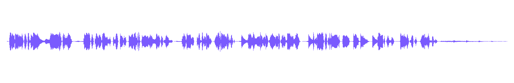
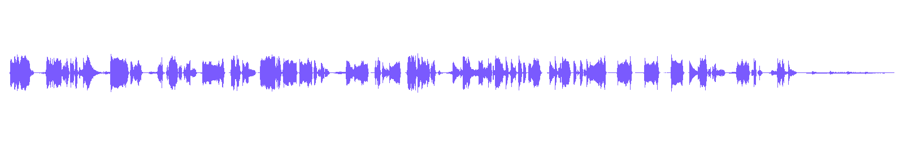
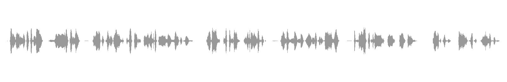
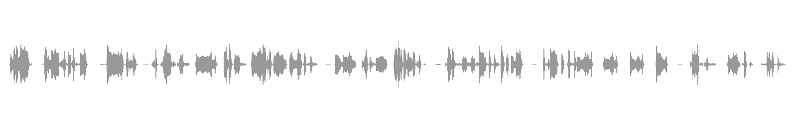
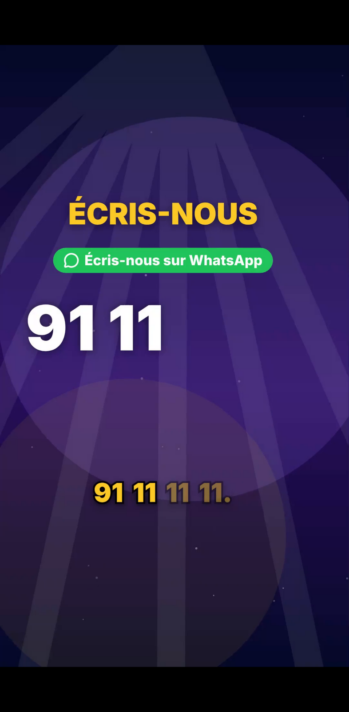
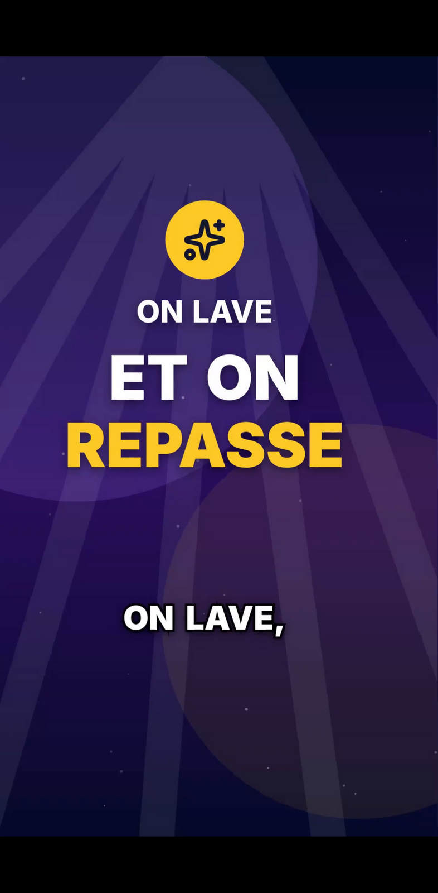
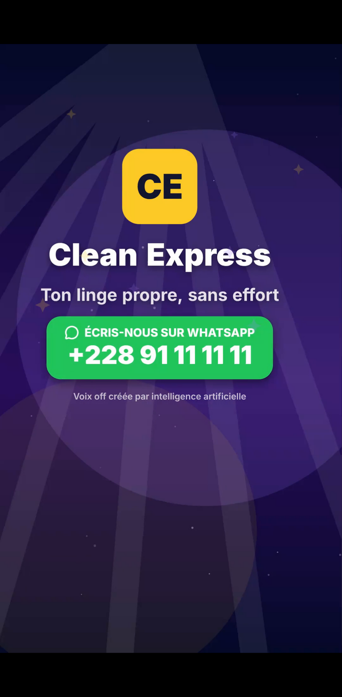
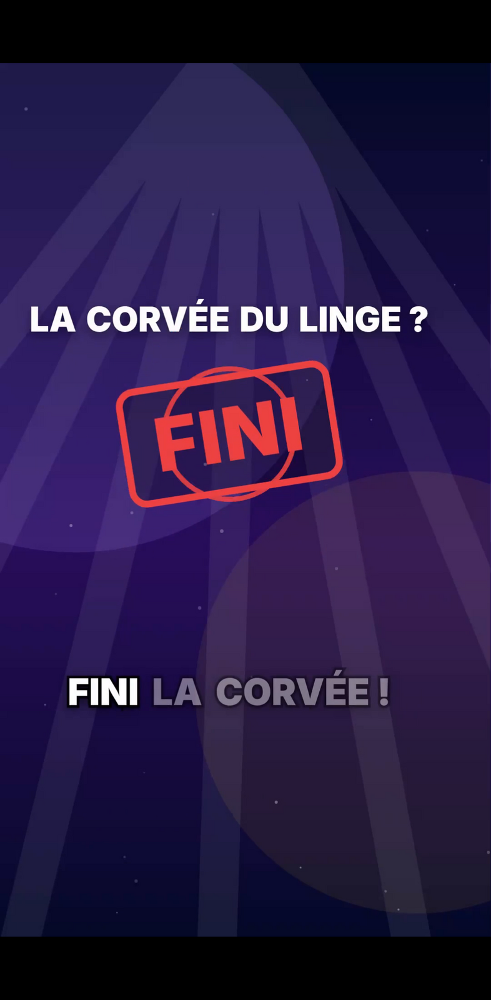

# Vidéos « motion design », étape 3 : le son

16 novembre 2026. Les deux essais de l'étape 2 (voix de Kekeli et voix d'un client simulée en note vocale WhatsApp), maintenant avec le son travaillé. **Mettez le son du téléphone** pour les écouter.

## Les deux vidéos

- **Voix de Kekeli** : [voix-kekeli.mp4](montage-etape-3/voix-kekeli.mp4)
- **Voix du client** : [voix-client.mp4](montage-etape-3/voix-client.mp4)

## Ce qui est fait au son

1. **La voix est préparée avant tout le reste** (les images et les sous-titres se calent ensuite sur cette voix finale) :
   - silences raccourcis à **0,2 seconde** au plus (la voix de Kekeli passe de 19,2 à 17,4 secondes, celle du client de 24,5 à 22,7 secondes, sans perdre un seul mot) ;
   - tempo légèrement plus vif : **× 1,07** pour la voix de Kekeli, **× 1,05** pour celle du client ;
   - traitement « radio » : graves inutiles coupés, voix plus présente et plus égale (compression).
2. **La musique** est posée **20 LU sous la voix** (mesuré : voix -12,9 LUFS, musique ramenée à -32,9 LUFS) et **baisse encore quand la voix parle**, puis remonte doucement dans les silences.
3. **Des bruitages discrets**, fabriqués par Kekeli (aucun fichier extérieur, aucune licence) : un souffle à chaque changement de plan, un choc sourd sur les temps forts (« FINI », le numéro, la carte finale), un petit « pop » quand une case se coche ou qu'un chiffre arrive ; jamais deux à moins d'un quart de seconde.
4. **Le volume final est mesuré puis réglé** : **-14 LUFS** (le niveau des réseaux sociaux), pic vrai sous **-1,5 dBTP** (aucune saturation), son AAC 192 kb/s, 48 kHz, stéréo.

## Mesures

| Vidéo | Volume | Pic vrai | Plage (LRA) | Bruitages | Résultat |
|---|---|---|---|---|---|
| Voix de Kekeli | -14,0 LUFS | -3,0 dBTP | 2,2 LU | 14 | conforme |
| Voix du client | -14,0 LUFS | -3,2 dBTP | 4,4 LU | 16 | conforme |

Formes d'onde du son final (voix, musique et bruitages) :

Et la voix avant préparation (silences plus longs, volume inégal) :

**Musique** : dans cet essai, la musique est celle écrite par Kekeli (FFmpeg), car le site de musiques libres CC0 (Freesound) refuse le téléchargement depuis l'environnement de Claude. Dans Kekeli, la musique libre CC0 est cherchée comme pour les vidéos actuelles (Openverse, surtout Freesound), et la musique de Kekeli ne sert qu'en secours.

## Sur un téléphone (Pixel 7 simulé, navigateur en français)

| Voix du client | Voix du client | Voix de Kekeli | Voix de Kekeli |
|---|---|---|---|
|  |  |  |  |
