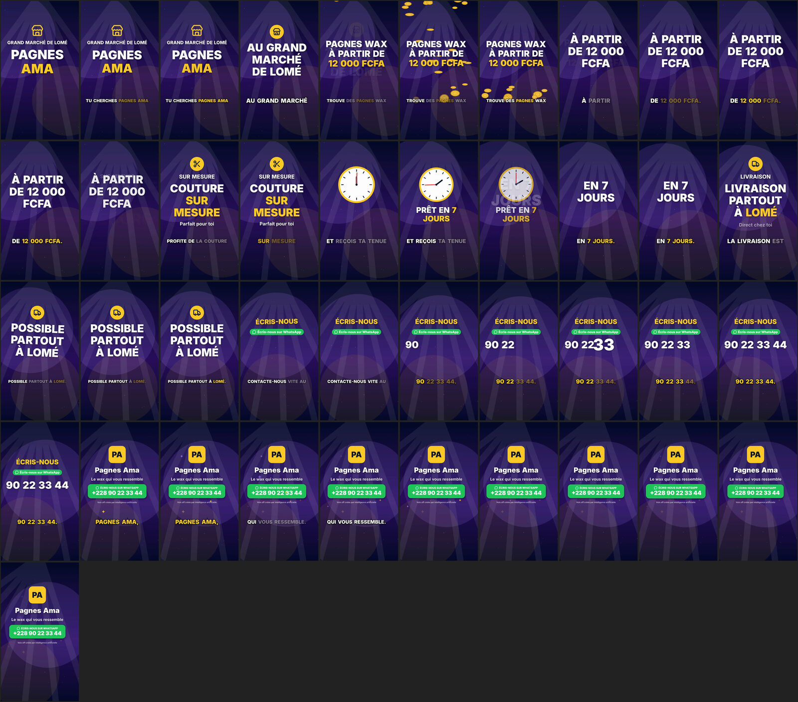
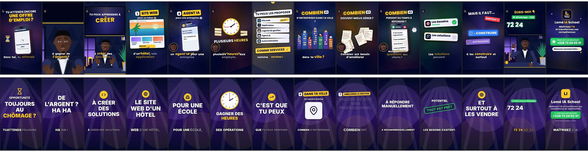
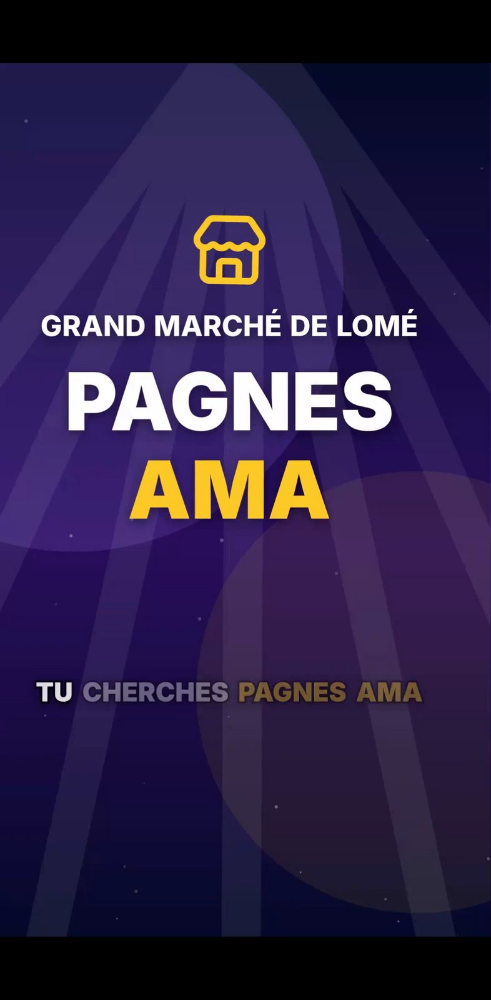
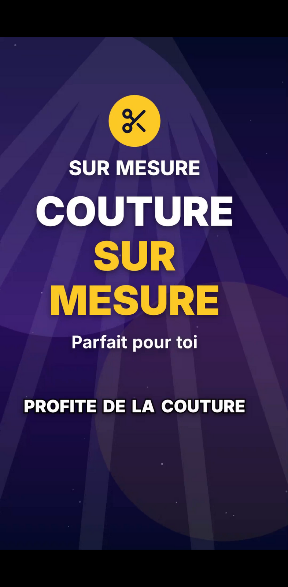
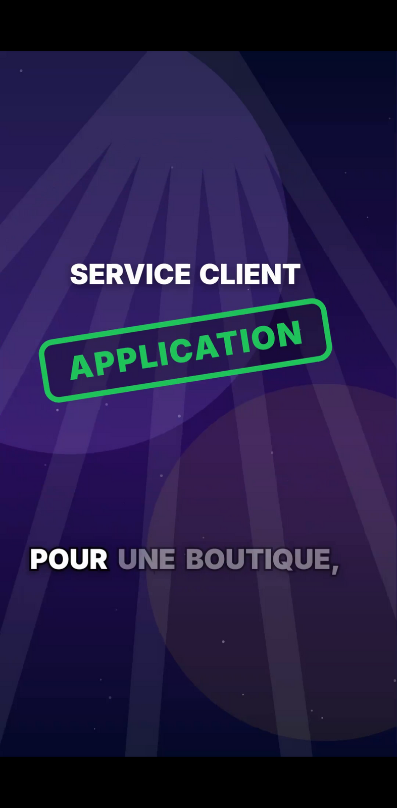
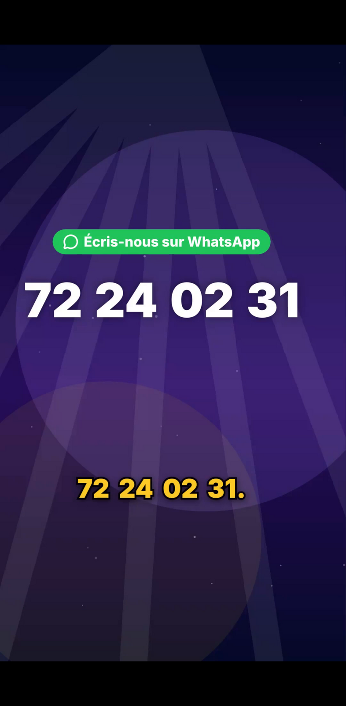
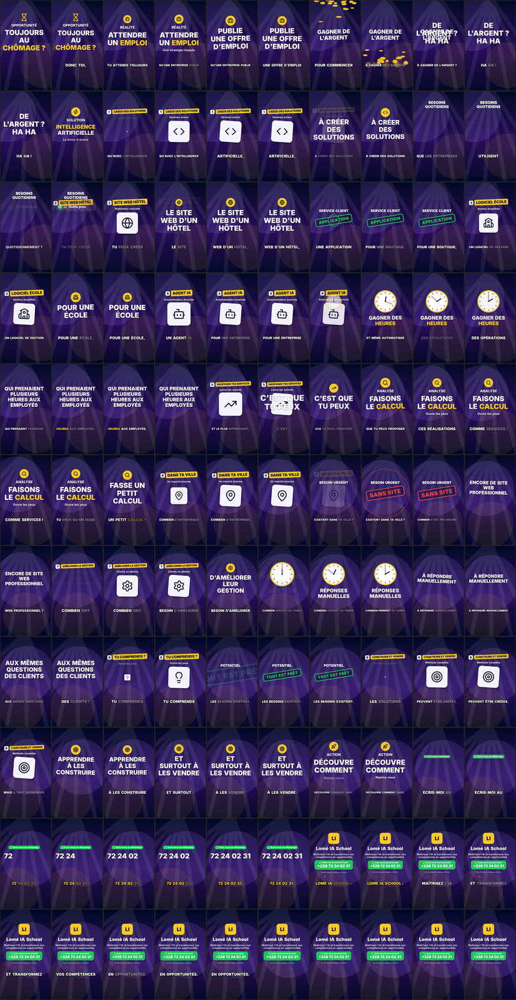

# Vidéos « motion design », étape 4 : le plan écrit par Kekeli, la référence refaite, les coûts réels

16 novembre 2026. Kekeli reçoit une demande en une phrase, écrit lui-même le plan de montage (modèle gratuit Gemini Flash-Lite), le code le vérifie, puis la voix, les sous-titres, le son et le rendu des étapes 1 à 3 font le reste. Données de la publicité « Pagnes Ama » inventées.

## 1. Une publicité écrite par Kekeli à partir d'une phrase

Demande : « Fais-moi une pub vidéo TikTok de 30 secondes pour ma boutique « Pagnes Ama » au Grand Marché de Lomé : pagnes wax à partir de 12 000 FCFA, couture sur mesure en 7 jours, livraison partout à Lomé. Contact WhatsApp : +228 90 22 33 44. Slogan : « Le wax qui vous ressemble ». »

- Vidéo : [pub-30s-ecrite-par-kekeli.mp4](montage-etape-4/pub-30s-ecrite-par-kekeli.mp4) (voix de femme gratuite de Gemini), sous-titres [pub-30s.srt](montage-etape-4/pub-30s.srt)
- Le plan écrit par Kekeli : [plan-pub-30s.json](montage-etape-4/plan-pub-30s.json)
- Durée obtenue : 20 secondes (le modèle écrit la voix un peu courte : 54 mots au lieu d'environ 75 ; le code accepte à partir de 70 %).

## 2. La publicité de Lomé IA School refaite par Kekeli

Kekeli a reçu **le même texte** que la publicité de référence « Tu attends encore une offre d'emploi ? » et a écrit son propre plan de 41 plans (sa voix d'homme gratuite de Gemini remplace la voix de Coach Joseph, qui n'est pas disponible seule).

- Vidéo : [reference-refaite-par-kekeli.mp4](montage-etape-4/reference-refaite-par-kekeli.mp4) (55 secondes), plan : [plan-reference.json](montage-etape-4/plan-reference.json), sous-titres : [reference.srt](montage-etape-4/reference.srt)

En haut, la référence (faite à la main avec Claude, Remotion) ; en bas, Kekeli seul, au même moment de la voix :

**Ce que Kekeli fait aussi bien** : le rythme (une image toutes les 1 à 2,5 secondes, contrôlé), les sous-titres mot par mot avec les mots-clés en jaune, le numéro groupe par groupe, la carte finale, le son à -14 LUFS, l'accroche lisible sur l'image 0.

**Ce qui reste en dessous de la référence** (dit honnêtement) : la référence a des illustrations dessinées pour chaque idée (la ville et ses immeubles, des papiers en désordre, un téléphone avec les vraies questions des clients, un personnage) ; Kekeli s'appuie surtout sur des textes, des icônes, des étiquettes et des tampons. Il faudra plus de composants illustrés (et le médaillon photo du client) pour l'égaler : c'est le travail de l'étape 5 (les autres styles) et d'un chantier d'illustrations à décider.

## Ce que le code vérifie (sans modèle)

- le schéma du plan, l'accroche en premier et la carte finale en dernier ;
- chaque plan a son propre morceau de voix ; un morceau de plus de 6 mots est **coupé par le code** aux meilleures places (après une ponctuation, jamais après un petit mot), les suites gardent le pictogramme du plan ;
- au plus 4 plans « texte » sur 10 choisis par le modèle, jamais trois de suite ;
- **aucun chiffre inventé** (à l'écran ou dans la voix) et **aucune promesse inventée** (« prix imbattables », « qualité premium », « le meilleur »…) : refusés si le client ne les a pas dits ;
- longueur de la voix (70 à 130 % de la durée visée) ; voix du client recopiée mot pour mot ;
- jusqu'à deux corrections par le modèle, avec la liste exacte des défauts ; mesure : **10 plans valides sur 11** lors des derniers essais.
- Au rendu : le texte connu est **aligné** sur la transcription (« Des panneaux » entendu devient « Des pagnes ») ; un plan trop court pour être lu (moins de 0,6 seconde) est fondu avec son voisin.

Défauts trouvés pendant l'essai et corrigés : un mot prononcé recouvrait ses voisins (petit saut au lieu d'un agrandissement), certaines icônes faisaient échouer le rendu (tracés réécrits), le préfixe « +228 » empêchait de caler le numéro, deux sous-titres pouvaient tomber au même instant.

## Coûts réels (détail dans `docs/couts.md`)

| | Publicité de 30 secondes | Publicité de 60 secondes |
|---|---|---|
| Plan écrit par le modèle (prix payant de Gemini 3.5 Flash-Lite ; gratuit aujourd'hui) | 0,0015 à 0,0063 $ | 0,005 à 0,013 $ |
| Voix off et transcription | 0 $ (gratuites) | 0 $ (gratuites) |
| Ordinateur E2B (rendu mesuré 37 à 51 secondes et 86 à 99 secondes, plus environ 90 secondes de préparation, estimation) | environ 4 FCFA | environ 6 FCFA |
| **Total dans l'énergie** (estimation) | **environ 5 à 8 FCFA** | **environ 9 à 14 FCFA** |

## Sur un téléphone (Pixel 7 simulé, navigateur en français)

| Publicité Pagnes Ama | Publicité Pagnes Ama | Référence refaite | Référence refaite |
|---|---|---|---|
|  |  |  |  |

Planche de la référence refaite :

