# Vidéos « motion design », étape 5 : les cinq styles et les trois questions

16 et 17 novembre 2026. Une même vidéo peut maintenant sortir dans cinq styles. Avant chaque vidéo, Kekeli pose trois questions : le style, le format et la voix. Toutes les données (Pagnes Ama, Clean Express, Belle Afi, Ama Cosmétiques, Akossiwa) sont inventées pour les essais.

## 1. Les trois questions avant une vidéo, sur un téléphone

Le client touche ses choix, puis « Envoyer mes réponses » ; « Choisis pour moi » laisse Kekeli décider. Les questions ne coûtent pas d'énergie.

| Demande détaillée : les trois questions | Style et format déjà donnés : seulement ce qui manque |
|---|---|
| 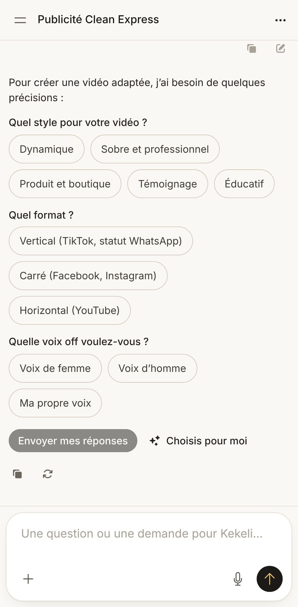 | 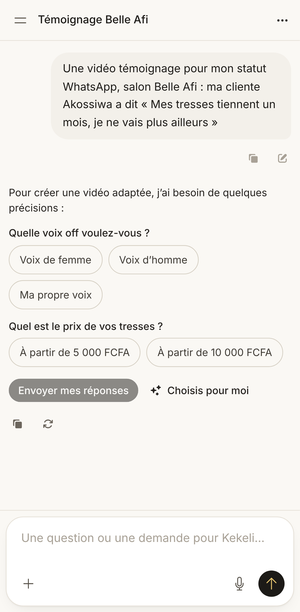 |

En mode sombre : [trois questions](montage-etape-5/ecrans/1-trois-questions-telephone-sombre.png), [questions restantes](montage-etape-5/ecrans/2-questions-restantes-telephone-sombre.png) ; sur un ordinateur : [trois questions](montage-etape-5/ecrans/1-trois-questions-ordinateur-clair.png).

**Banc réel avec le modèle gratuit Gemini 3.1 Flash-Lite** (`runner/scripts/mesurer-questions-video.mjs`, résultat `runner/mesures/questions-video-etape-5.json`) : **6 sur 6**. Il était à 3 sur 6 avant la correction de la consigne : une demande détaillée partait sans les questions, et le style « témoignage » déjà donné était redemandé.

| Demande | Questions posées |
|---|---|
| Publicité détaillée du pressing Clean Express | style, format, voix |
| « je veux une vidéo pour ma boutique de pagnes » | style, format, voix |
| Vidéo pour le statut WhatsApp du restaurant Chez Dédé | style, voix (le format vertical est déjà donné) |
| Vidéo témoignage du salon Belle Afi, avec l'avis d'Akossiwa | format, voix (le style est déjà donné) |
| Vidéo éducative « avec ma propre voix » | le format, ou directement le texte à lire et « Enregistrer ma voix » (les deux sont acceptés) |
| Vidéo YouTube sobre et professionnelle | voix (le style et le format sont déjà donnés) |

## 2. La même publicité dans les cinq styles

Le même plan de montage (« Pagnes Ama », 20 secondes, voix de femme gratuite de Gemini), rendu cinq fois. Seul le style change. Le son est conforme dans les cinq cas : -14 LUFS, pic vrai sous -2,4 dBTP.

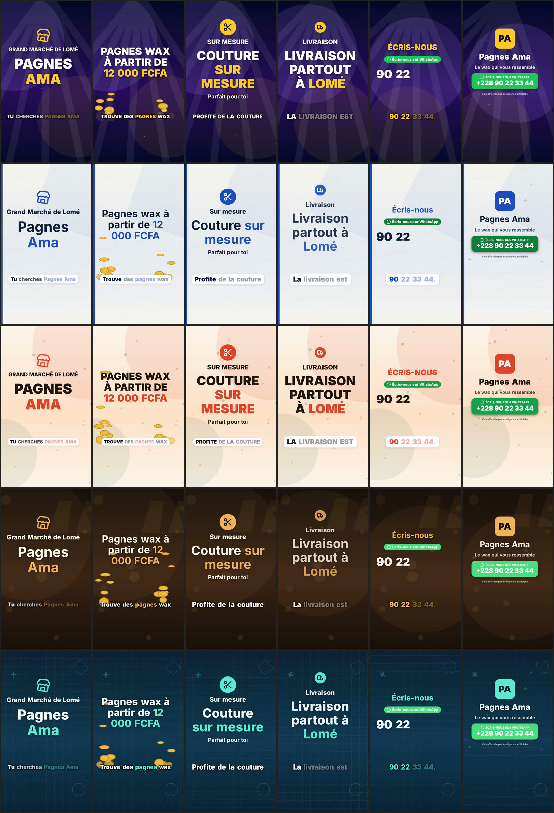

De haut en bas : Dynamique, Sobre et professionnel, Produit et boutique, Témoignage, Éducatif.

| Style | Ce qui change | Vidéo |
|---|---|---|
| **Dynamique** | nuit profonde, or et violet, gros textes en capitales qui claquent, chocs sonores | [pub-dynamique.mp4](montage-etape-5/pub-dynamique.mp4) |
| **Sobre et professionnel** | papier clair, bleu profond, minuscules, entrées douces, sous-titres en bandeau clair, souffles discrets, vouvoiement par défaut | [pub-sobre.mp4](montage-etape-5/pub-sobre.mp4) |
| **Produit et boutique** | vitrine claire et chaude, prix en corail, formes rondes qui flottent, vouvoiement par défaut | [pub-produit.mp4](montage-etape-5/pub-produit.mp4) |
| **Témoignage** | veillée chaude et sombre, grands guillemets, rythme lent, aucun choc sonore | [pub-temoignage.mp4](montage-etape-5/pub-temoignage.mp4) |
| **Éducatif** | tableau bleu nuit quadrillé, menthe et jaune, étapes numérotées | [pub-educatif.mp4](montage-etape-5/pub-educatif.mp4) |

## 3. Deux vidéos écrites par Kekeli dans leur style

Kekeli a reçu une demande en quelques phrases, puis a écrit lui-même le plan de montage dans le style demandé, avec le modèle gratuit Gemini Flash-Lite.

**Témoignage** (salon Belle Afi, voix de femme gratuite) : la voix pose la situation, puis l'avis d'Akossiwa est **recopié mot pour mot** depuis la demande, avec un médaillon à ses initiales ; viennent ensuite le prix et la carte finale. Vidéo : [temoignage-belle-afi.mp4](montage-etape-5/temoignage-belle-afi.mp4). Plan : [plan-temoignage.json](montage-etape-5/plan-temoignage.json).

**Produit et boutique** (Ama Cosmétiques, voix d'homme gratuite) : une carte par produit, l'étiquette de prix tombe au moment où la voix dit le prix, et le téléphone montre la boutique avec les vrais prix donnés par le client. Vidéo : [produit-ama-cosmetiques.mp4](montage-etape-5/produit-ama-cosmetiques.mp4). Plan : [plan-produit.json](montage-etape-5/plan-produit.json).

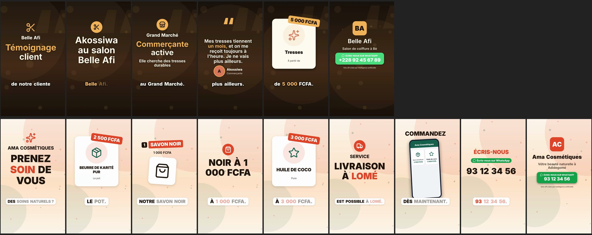

| Témoignage : la citation | Produit : l'étiquette de prix | Produit : la boutique |
|---|---|---|
| 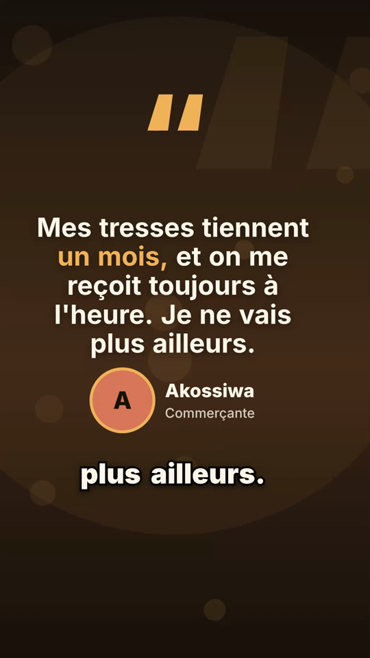 | 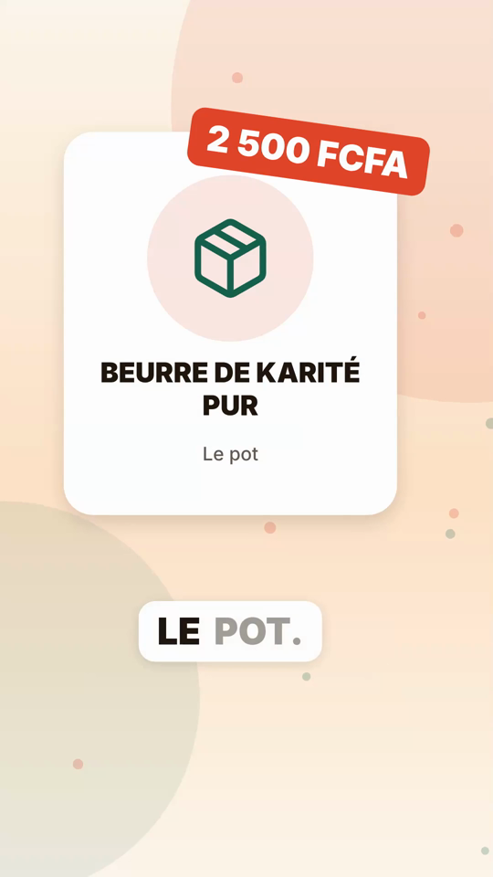 | 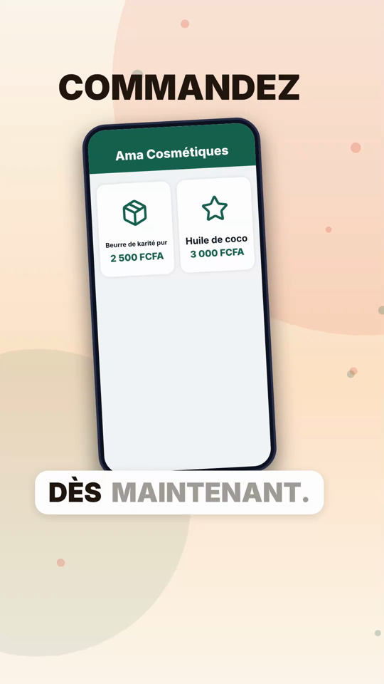 |

## 4. Tous les types de plans dans chaque style (galeries)

Une image au milieu de chaque plan, avec les deux nouveaux types : la citation et le produit (avant-derniers).

| Sobre et professionnel | Produit et boutique |
|---|---|
| 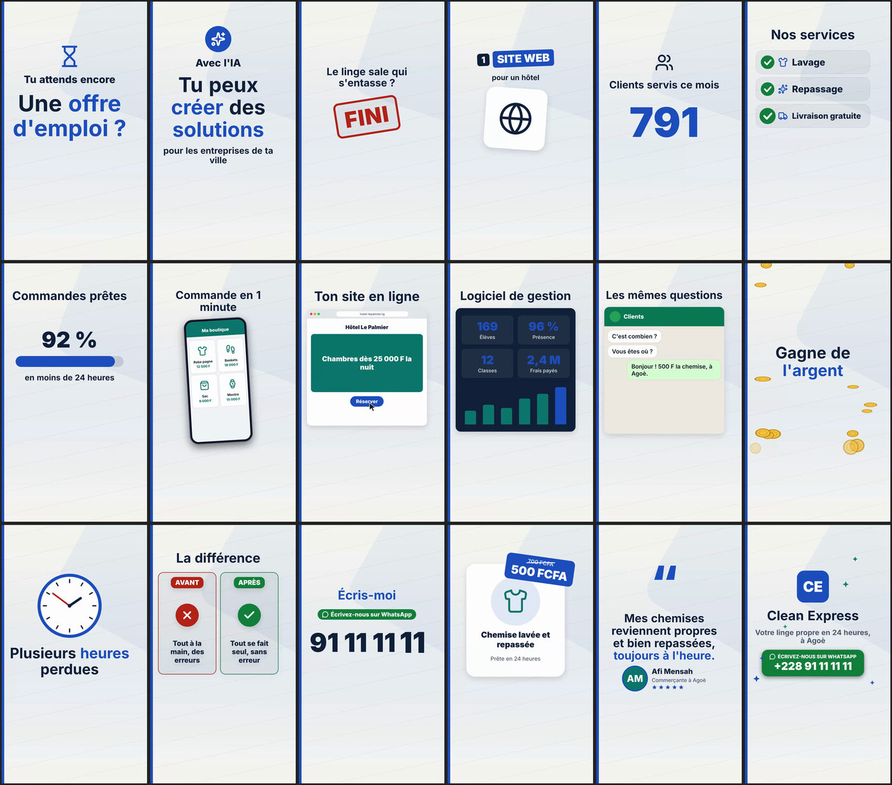 | 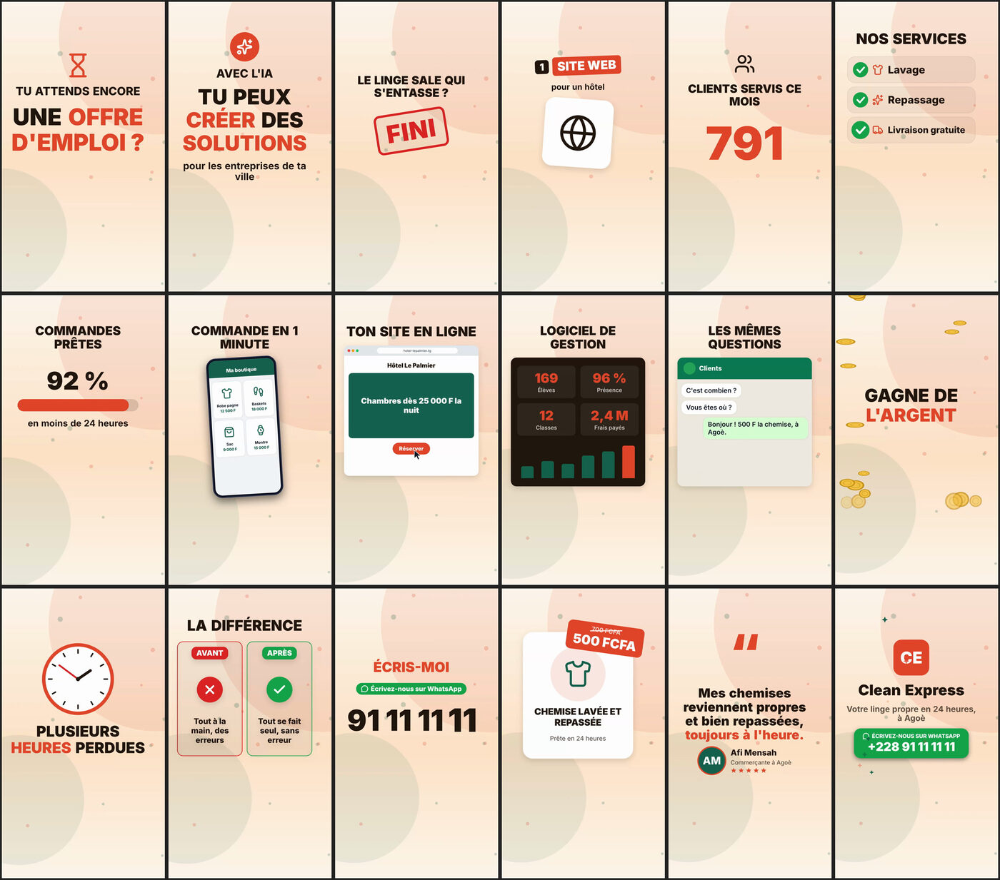 |

| Témoignage | Éducatif |
|---|---|
| 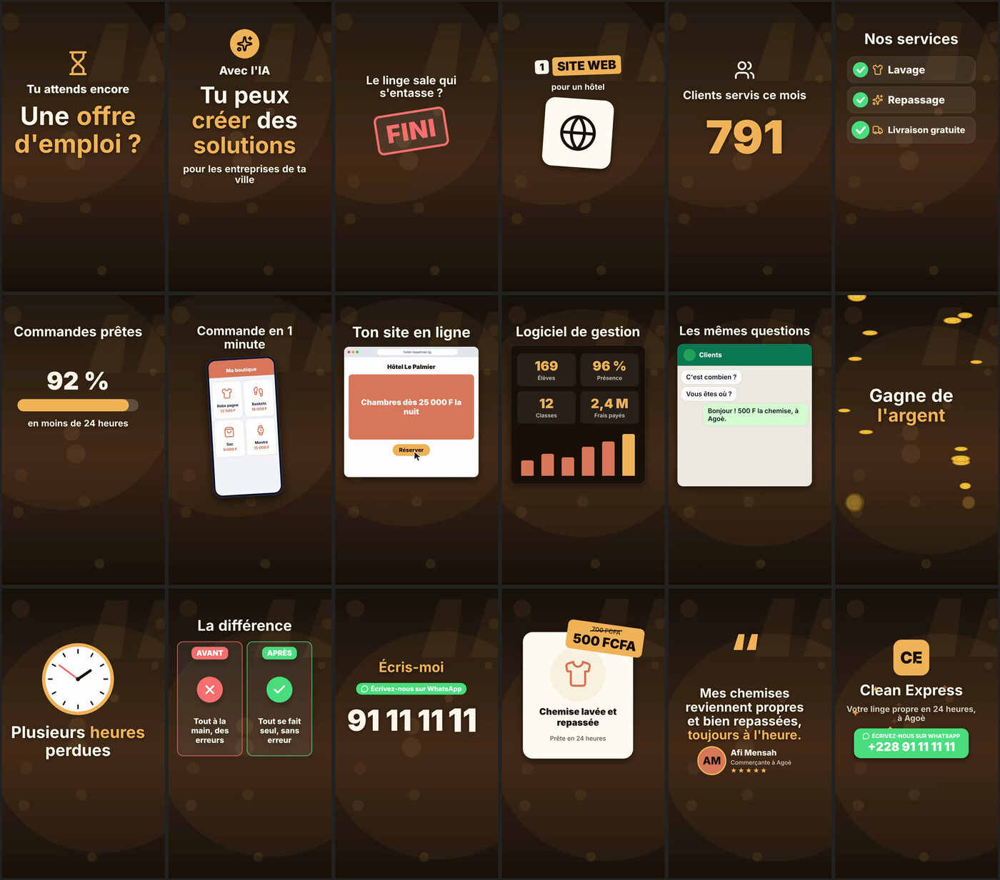 | 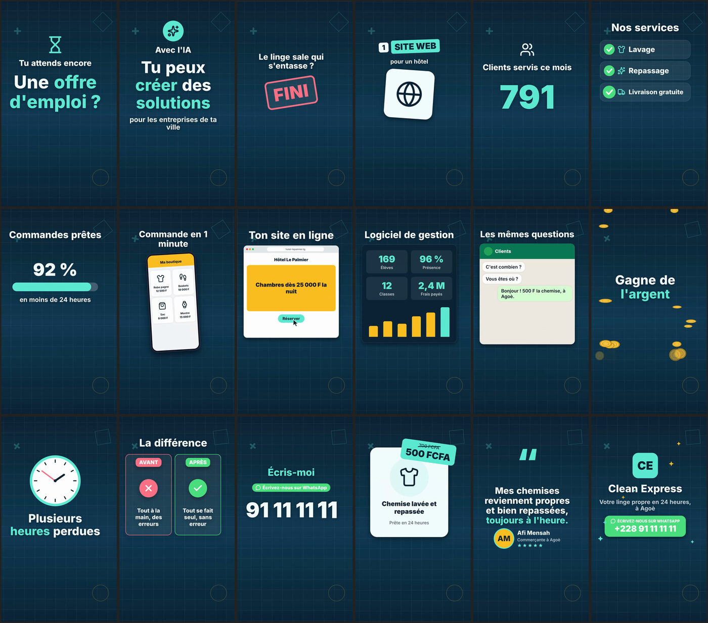 |

Galerie du style Dynamique : [galerie-dynamique.jpg](montage-etape-5/galerie-dynamique.jpg).

## Ce que le code vérifie (sans modèle)

- **Jamais un avis inventé** : une citation doit reprendre au moins 80 % des mots d'un avis donné par le client, et le nom de la personne doit venir de lui ; sinon, le modèle doit corriger ou enlever le plan. Les étoiles et les prix sont contrôlés comme tous les chiffres.
- Le même avis coupé en deux plans par le modèle devient une seule citation.
- Un téléphone sans contenu montre la boutique du client, avec les produits et les prix de la vidéo.
- Le texte posé sur une couleur est blanc ou foncé selon le contraste calculé (jamais de blanc sur jaune).
- Le ton suit le style : « Sobre » et « Produit » vouvoient, les autres tutoient ; le texte du client décide toujours.

**Défauts trouvés pendant les essais, puis corrigés** :
- l'étiquette de prix, le bouton de la carte finale et la signature pouvaient devenir minuscules (la boucle de réduction ne tenait pas compte de l'échelle ; le bouton de la carte avait ce défaut depuis l'étape 1) ;
- dans les styles lents, le plan qui partait restait visible sous le suivant ;
- la pluie de pièces passait sur le prix ;
- un plan déjà nettoyé, relu, perdait le genre de son écran ;
- le nom d'un article pouvait dépasser de sa case.

## Ce qui reste pour l'étape 6

- **Brancher le montage dans la production** : pour l'instant, une vidéo demandée dans Kekeli passe encore par l'ancien moteur, et le style choisi est seulement transmis au Runner.
- La **photo du client dans le médaillon** : aujourd'hui, ce sont ses initiales.
- Les contrôles finaux (lecture des chiffres à l'image, images vides, poids du fichier), l'aperçu, les versions et les boutons de suite.
