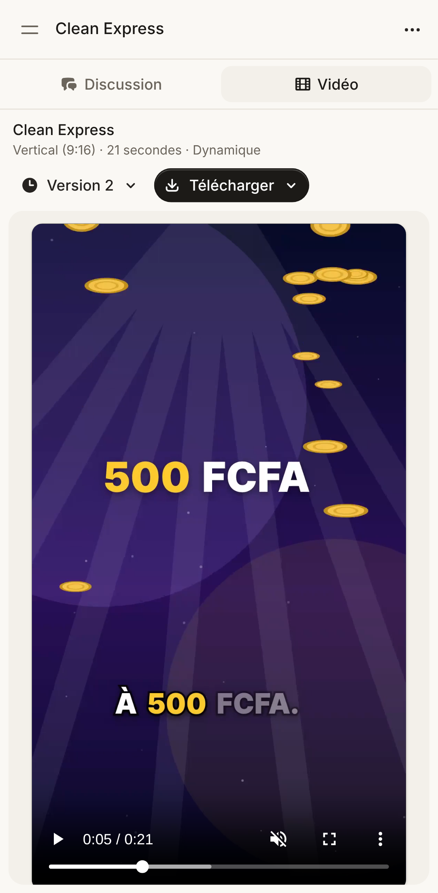
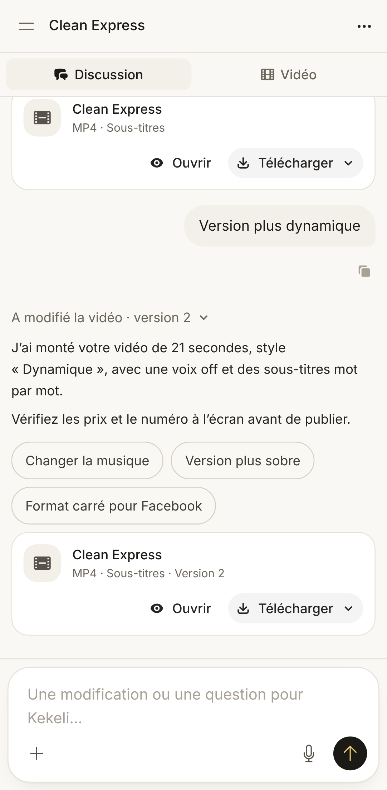
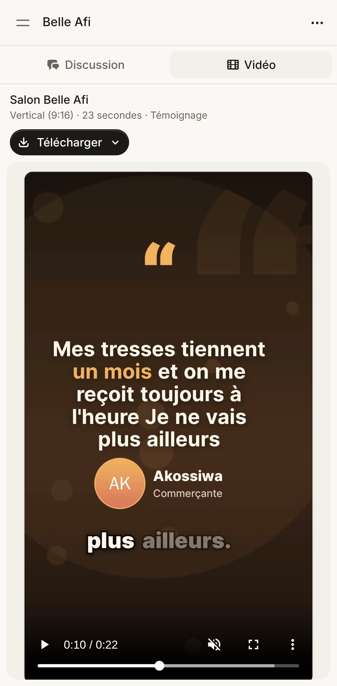
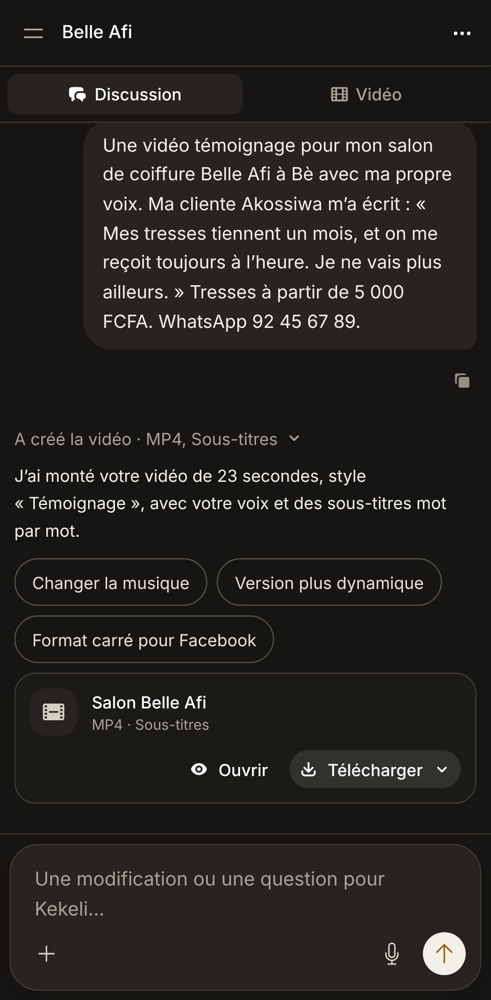
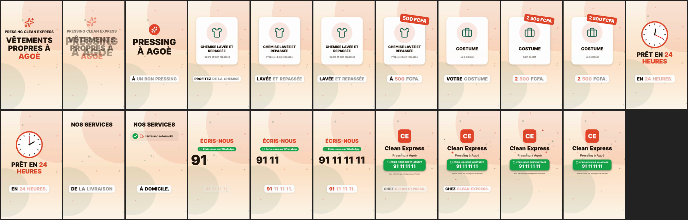
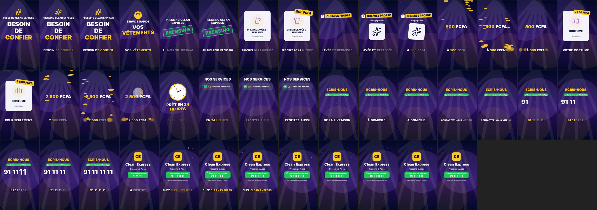
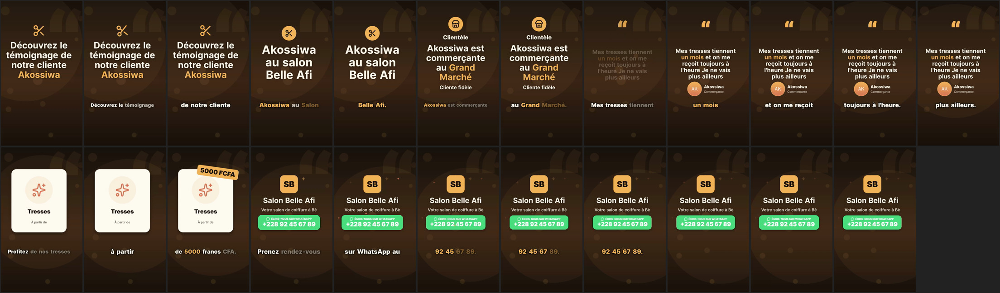

# Vidéos « motion design », étape 6 : le nouveau montage dans le vrai parcours de Kekeli

17 novembre 2026. Quand un client demande une vidéo dans Kekeli (publicité, explication, présentation animée), elle est maintenant fabriquée par le nouveau montage des étapes 1 à 5, du plan jusqu'au fichier MP4, avec ses contrôles finaux, sa version, son aperçu et ses boutons de suite. Données inventées (Clean Express, Belle Afi, Akossiwa).

## 1. Sur le téléphone du client

| La vidéo dans le lecteur | Le message de fin et ses boutons | Le témoignage, photo de la cliente | En mode sombre |
|---|---|---|---|
|  |  |  |  |

- Sous le lecteur : le format, la durée et **le style** (« Vertical (9:16) · 21 secondes · Dynamique »), le menu des **versions** et « Télécharger » (MP4 ou sous-titres SRT).
- Le message de fin dit ce qui a été fait, puis propose **trois boutons de suite** : « Changer la musique », « Version plus sobre » (ou « plus dynamique ») et « Format carré pour Facebook ». Un toucher envoie la demande comme un message.
- Si un chiffre n'a pas pu être relu à l'image, le message le dit : « Vérifiez les prix et le numéro à l'écran avant de publier. »
- Autres écrans : [ordinateur](montage-etape-6/ecrans/2-produit-video-ordinateur-clair.png), [mode sombre du lecteur](montage-etape-6/ecrans/2-produit-video-telephone-sombre.png).

## 2. Trois essais réels, de bout en bout dans l'atelier E2B

Chaque essai est passé par le vrai Runner : plan écrit par le modèle gratuit, voix gratuite de Gemini ou voix de la cliente, transcription gratuite (Groq), rendu dans l'atelier E2B isolé, son, contrôles, envoi des fichiers.

| Essai | Vidéo | Temps total | Durée | Poids | Son | Coût OpenAI |
|---|---|---|---|---|---|---|
| Publicité du pressing, style Produit, voix d'homme | [pressing-produit.mp4](montage-etape-6/pressing-produit.mp4) | 109 secondes | 21 secondes | 2,1 Mo | -14,1 LUFS, pic -2,3 dBTP | 0 $ |
| « Version plus dynamique » (modification de la vidéo précédente) | [pressing-version-plus-dynamique.mp4](montage-etape-6/pressing-version-plus-dynamique.mp4) | 201 secondes | 21 secondes | 4,4 Mo | -14,0 LUFS, pic -2,1 dBTP | 0 $ |
| Témoignage avec la voix et la photo de la cliente | [temoignage-voix-cliente.mp4](montage-etape-6/temoignage-voix-cliente.mp4) | 109 secondes | 23 secondes | 2,4 Mo | -14,0 LUFS, pic -2,7 dBTP | 0 $ |

Le temps total comprend la préparation de l'atelier E2B (environ une minute quand il n'est pas encore allumé). Le coût dans l'énergie reste celui mesuré à l'étape 4 : environ 5 à 8 FCFA pour 30 secondes (estimation).

Publicité du pressing (une image par seconde) :

« Version plus dynamique » (une image toutes les demi-secondes) : le plan précédent est repris (mêmes prix, même numéro), le style change, le format est gardé.

Témoignage : la voix de la cliente, l'avis recopié mot pour mot, sa photo dans le médaillon (ici une image d'essai « AK »), les noms bien écrits.

## 3. Ce que Kekeli vérifie avant d'envoyer la vidéo

- **Chiffres relus à l'image** : à l'instant où chaque prix, numéro ou compteur est à l'écran, la vision gratuite de Gemini relit l'image ; un nombre attendu qui n'est pas lu est signalé dans le message et dans la version.
- **Images vides** : une image de chaque plan est mesurée (une image d'une seule couleur est signalée).
- **Poids** : au-delà de 30 Mo, la vidéo est réencodée plus légère, une seule fois.
- **Son** : -14 LUFS à 0,3 LU près et pic vrai sous -1,5 dBTP, mesurés sur le fichier final.
- **Textes trop longs** et **rythme** (un plan qui reste plus de 2,5 secondes sans changement) sont gardés avec la version.

## 4. Défauts trouvés par ces contrôles et corrigés

- **Deux plans l'un sur l'autre** (le numéro sous la carte finale, le produit sous l'étiquette) : un mot répété plus loin dans la voix (« 500 », « 11 ») gardait le plan à l'écran. Chaque élément est maintenant cherché dans les mots de son plan seulement, et un plan ne dépasse jamais sa durée.
- **Prix relu trop tôt** : le prix tombe maintenant au moment où la voix le dit (le code trouve ce mot si le modèle l'oublie), et la relecture se fait juste après.
- **Pièces sur le prix** : elles tombent plus loin du texte.
- **Voix de la cliente mal transcrite** (« 13 » pour « tresses », « Bellafi ») : la transcription gratuite reçoit la liste des noms et des mots de la demande (« Belle Afi, Akossiwa, Grand Marché, tresses »), jamais une phrase entière, sinon elle recopiait une phrase qui n'avait pas été dite.
- **Avis coupé en trois citations** : les citations qui se suivent deviennent une seule ; la voix de la cliente est acceptée à partir de 90 % des mots repris dans l'ordre.

## Ce qui reste

- **Le secours** : une vidéo faite à partir des vidéos du client, d'un document joint, ou dont le plan ne peut pas être écrit, passe toujours par l'ancien moteur (vérifié par un test et par un essai réel : la vidéo est faite quand même).
- **L'essai sur Kekeli en ligne**, dès la mise en ligne.
