# Kekeli Motion, étape 1 : captures (18 novembre 2026)

Essai réel sur un téléphone simulé (Pixel 7, navigateur en français), avec le vrai modèle gratuit (Gemini) et un vrai ordinateur virtuel E2B pour le site. Compte d'essai et restaurant inventés. Détails : `docs/plan.md`, partie 26.45.

Phrase envoyée depuis « Que voulez-vous créer aujourd’hui ? » : « Crée un personnage animé qui marche dans un jardin avec un soleil qui se couche. »

## 1. La demande et la réponse de Kekeli

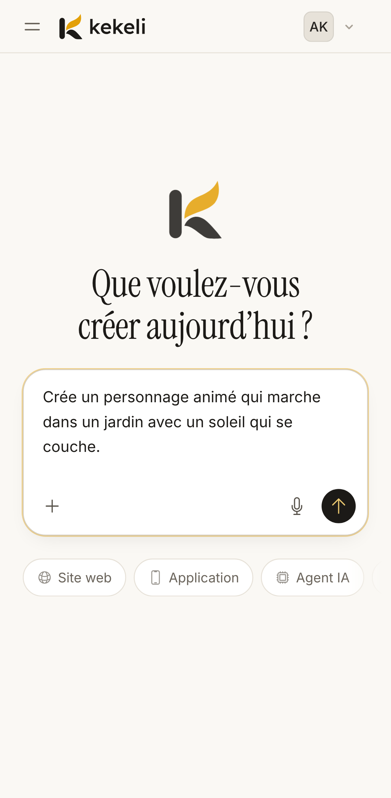

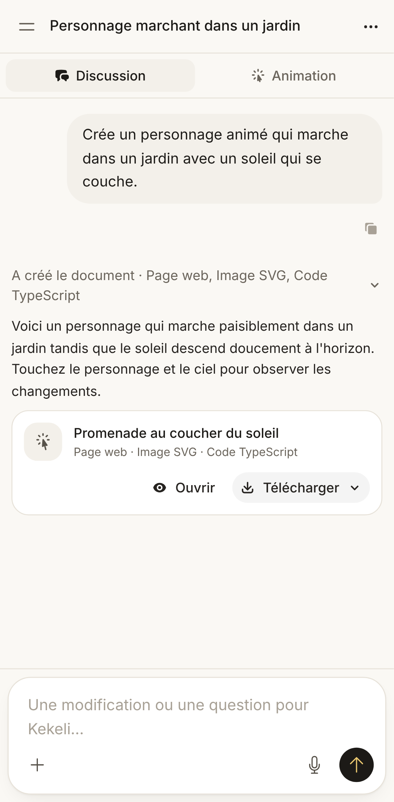

## 2. L'animation vivante, puis touchée (le soleil, puis le personnage qui salue)

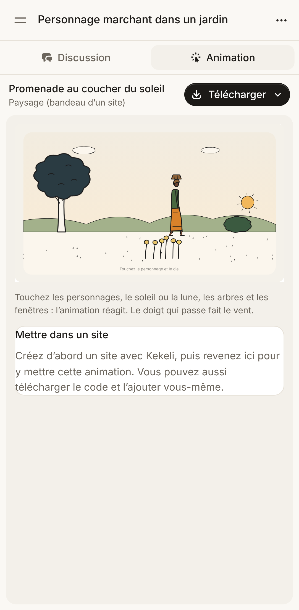

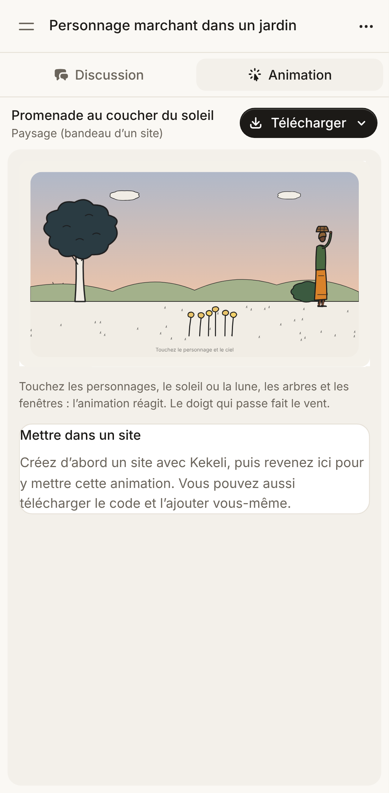

## 3. Télécharger : page web, image SVG, code TypeScript

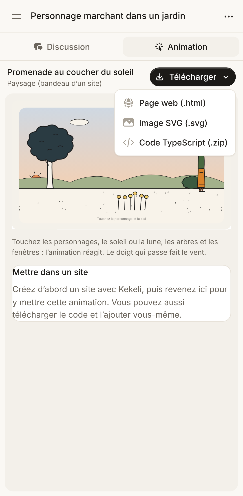

## 4. La bibliothèque

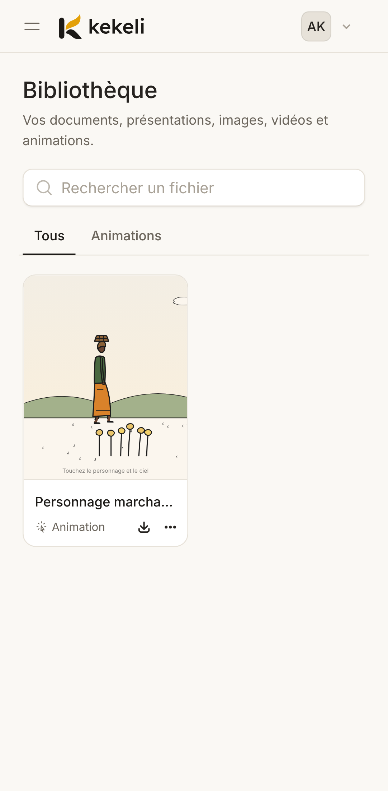

## 5. Mettre l'animation dans un site créé par Kekeli

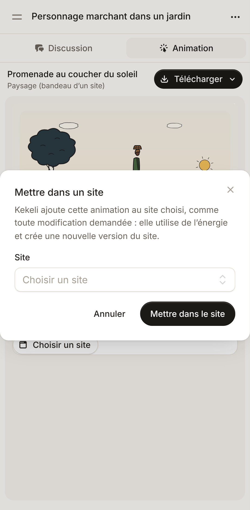

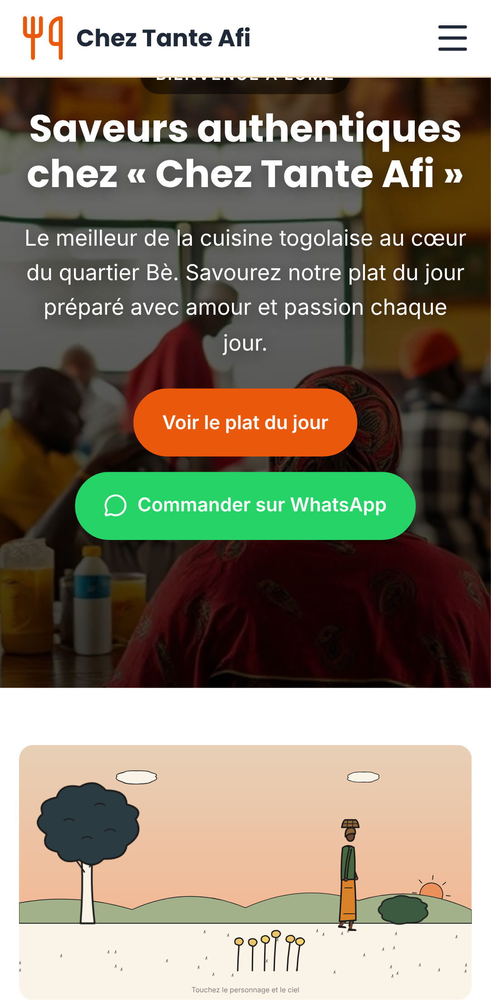

Le site a été construit par Kekeli dans un vrai ordinateur virtuel ; l'animation y a été ajoutée en 38 secondes (deux lignes de HTML posées par l'agent, script déposé par Kekeli).

## 6. Les décors et le format vertical (moteur seul)

| Rue, la nuit | Village, au coucher du soleil |
|---|---|
| 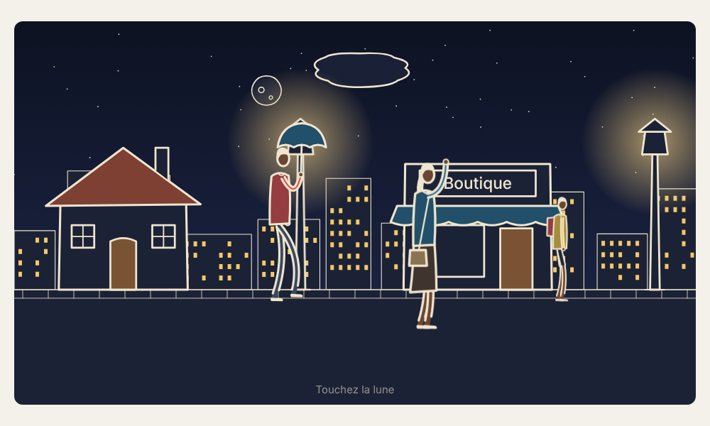 | 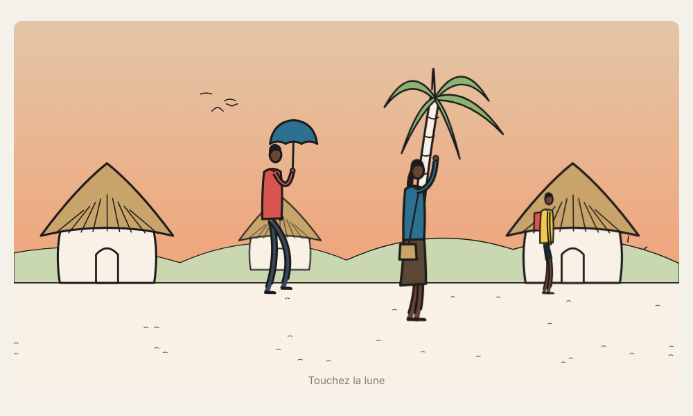 |
| **Plage, carré** | **Marché, le matin** |
| 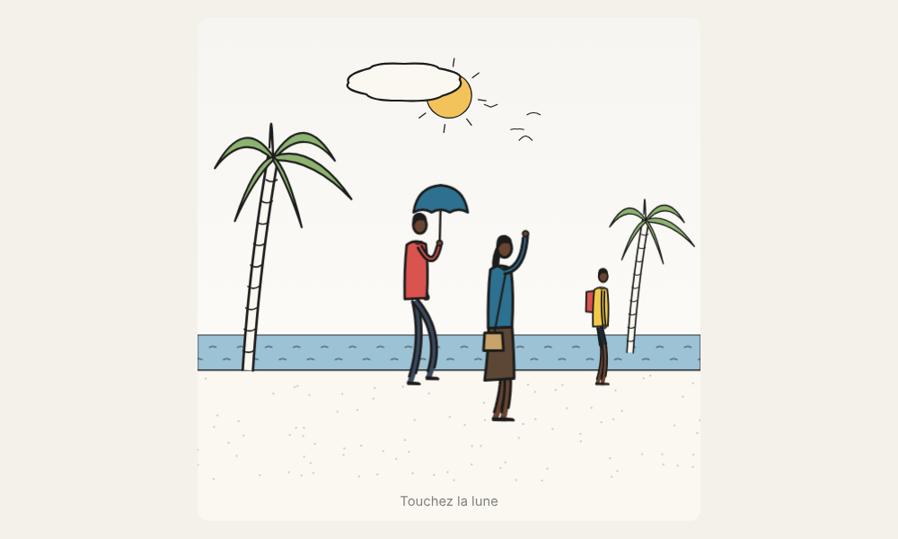 | 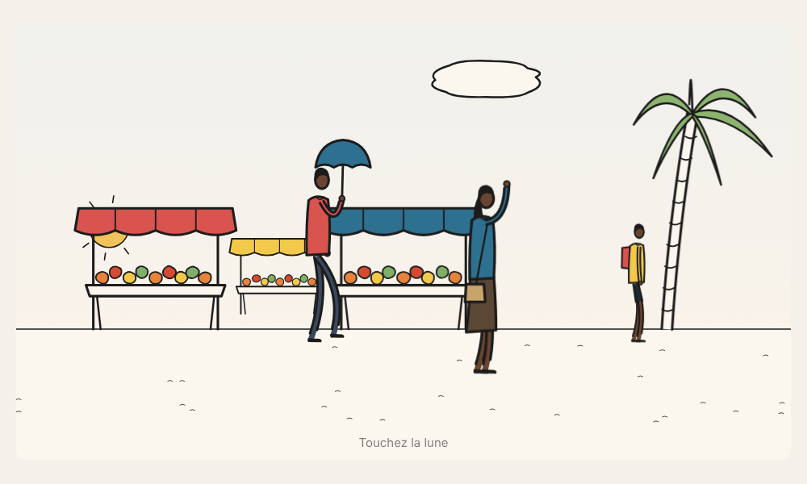 |

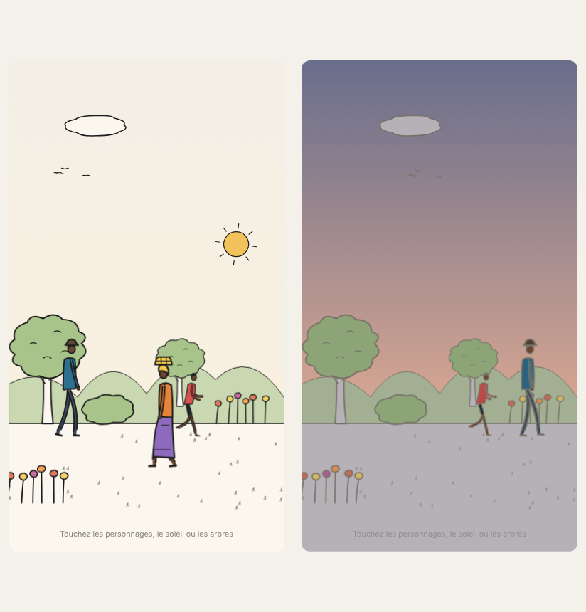
