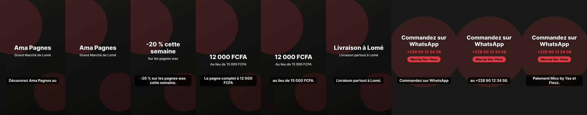
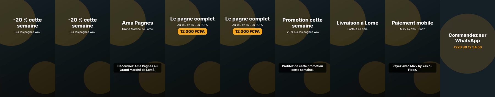

# Optimisations internes (13 novembre 2026)

Règle du porteur du projet : pour chaque point, qualité et coût mesurés **avant** et **après** sur les jeux d'essai ; ce qui n'améliore rien est annulé. Les coûts sont des **estimations** (prix officiels, 1 $ = 590 FCFA). Détails : `docs/plan.md`, partie 26.19.

## Finitions vidéo : avant et après

Même demande (publicité TikTok de 25 secondes pour « Ama Pagnes », formule Pro), avant cette pull request puis après.

**Avant** (pull request 49) : fonds animés ou images du générateur gratuit, sous-titres coupés au milieu des phrases et qui répétaient le titre ; vidéo : [a-publicite-tiktok-ama-pagnes.mp4](videos/a-publicite-tiktok-ama-pagnes.mp4).

**Après, formule Pro** : 6 images du générateur des affiches payantes, sous-titres en phrases entières, jamais le texte du titre répété, jamais par-dessus le titre ; voix off complète ; vidéo : [apres-publicite-pro.mp4](optimisations/apres-publicite-pro.mp4) (sous-titres : [apres-publicite-pro-sous-titres.srt](optimisations/apres-publicite-pro-sous-titres.srt)).

**Après, formule Gratuite** : le jour de l'essai, le quota gratuit de création d'images (Cloudflare) était épuisé par les essais et Pixabay n'a trouvé aucune photo assez proche du sujet : Kekeli a pris le dernier recours (fonds animés) plutôt qu'une photo hors sujet ; vidéo : [apres-publicite-gratuite.mp4](optimisations/apres-publicite-gratuite.mp4).

| Point | Avant | Après |
|---|---|---|
| Images, formules payantes | Générateur gratuit (environ 0,6 FCFA l'image) | Générateur des affiches payantes en qualité « basse » (environ 10 FCFA l'image ; la qualité « moyenne », 19 FCFA, donne à l'œil le même résultat dans une vidéo) |
| Images, Gratuite | Générateur gratuit, sinon fond animé | Générateur gratuit, puis photo Pixabay **pertinente** (mots-clés vérifiés, jamais de marque ni d'écran, jamais deux fois la même), sinon fond animé |
| Sous-titres (scénarios réels, `runner/mesures/sous-titres.json`) | 32 sous-titres : 12 coupés au milieu d'une phrase, 11 qui répétaient le titre | 13 sous-titres : 0 coupé, 0 répété |
| Voix off | OpenAI (environ 9 FCFA la minute) | Voix gratuites de Gemini d'abord (0 FCFA), OpenAI en secours ; une seule voix par vidéo ; jamais une voix à moitié |
| Publicité Pro de 25 secondes | environ 16 FCFA | environ 80 FCFA (dont 64 FCFA d’images payantes) |

**Limite des voix gratuites de Gemini** (constatée à l'essai) : 3 phrases par minute et **10 phrases par jour** par voix, pour tout Kekeli, soit environ 3 vidéos par jour. Au-delà, la voix d'OpenAI prend le relais quand le plafond du jour le permet ; sinon la vidéo n'a pas de voix (textes et musique).

## Les autres optimisations

| Optimisation | Qualité avant | Qualité après | Coût avant | Coût après | Décision |
|---|---|---|---|---|---|
| Identité de Kekeli (6 phrases, 3 modèles) | 6 bonnes réponses sur 18 | 18 sur 18 | 0,008 $ | 0,008 $ | Gardée |
| Compétences (36 phrases du premier répondant) | 34 bonnes décisions sur 36 | 35 sur 36 | 4 372 tokens par message dans un projet de site | 2 704 (38 % de moins) | Gardée |
| Modèle selon la difficulté, formules payantes (8 retouches réelles) | 8 sur 8 (GPT-6.1 Sol) | 8 sur 8 (GPT-6.1 Terra) | 0,056 $ | 0,027 $ (51 % de moins) | Gardée |
| Modèle selon la difficulté, Gratuite (8 retouches) | 8 sur 8 (GPT-6.1 Terra) | 8 sur 8 (GPT-6 Luna) | 0,017 $ | 0,003 $ (83 % de moins) | Gardée (documents, présentations, images, vidéos ; pas les sites, non mesurés) |
| Résumé des longues discussions (24 messages, 3 questions) | 0 fait sur 3 retrouvé | 3 sur 3 | 5 528 tokens par message | 5 265 (5 % de moins), plus 0,00026 $ par résumé | Gardée |
| Relecteur des vidéos (6 scénarios réels) | 0 défaut sur 4 trouvé | 4 sur 4, aucune fausse alerte | 0 | 0,0001 $ par vidéo | Gardé |
| Relecteur des faits des sites (5 constructions et modifications réelles) | 0 fait oublié sur 40 | 0 fait oublié sur 40 | 0 | 0 | **Annulé** (n'améliore rien de mesurable) |
