# Premier écran : « Que voulez-vous créer aujourd’hui ? » (pull requests 2 et 3 réunies)

Captures du 11 novembre 2026 sur un téléphone simulé (Pixel 7, navigateur en français). Données inventées. Script : `scripts/captures-premier-ecran.js`.

## 1. L’accueil, sans compte : une question, une seule zone de saisie
Plus de formulaire, plus de galerie, plus de badge « Version d’essai en construction ». Les idées sous la zone complètent la phrase « Demandez à Kekeli de créer un site web pour… ».
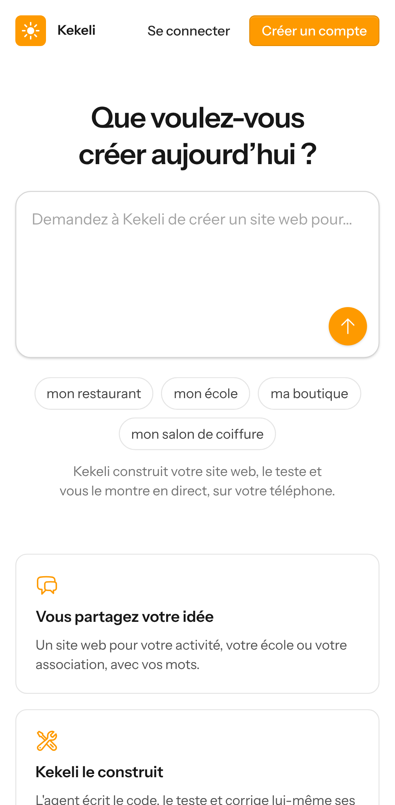

Toute la page :
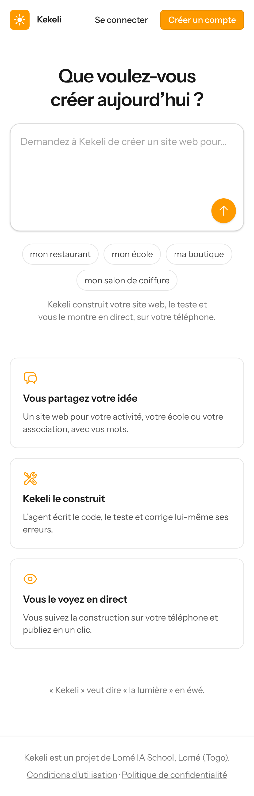

## 2. Une idée touchée remplit la zone (le texte reste modifiable)
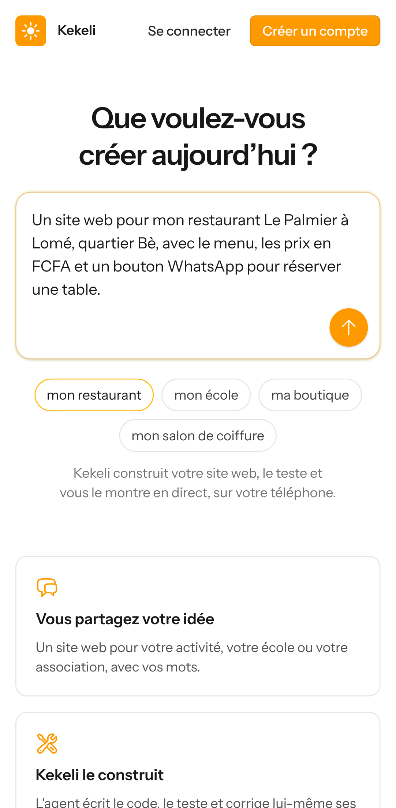

## 3. Sans compte, le texte est gardé pendant l’inscription
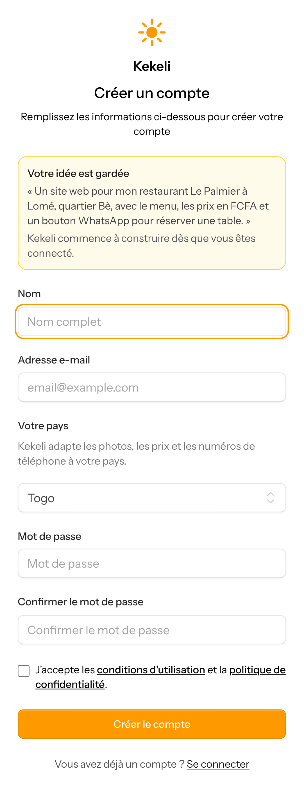

## 4. Après l’inscription, Kekeli crée le site et commence tout seul
Le nom « Restaurant Le Palmier » est deviné à partir du texte. Le type de site et la technologie ne sont jamais demandés ni montrés.
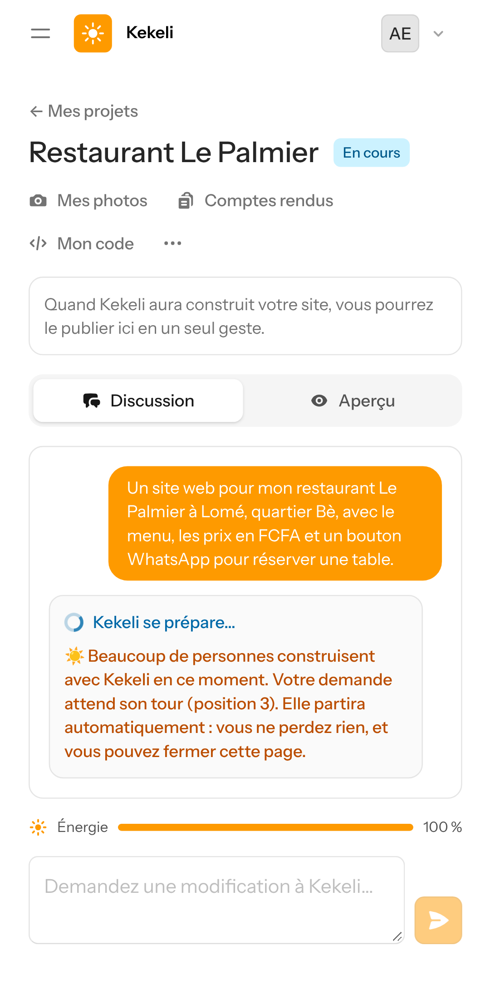

## 5. « Mes projets » : la même question en haut, puis les sites
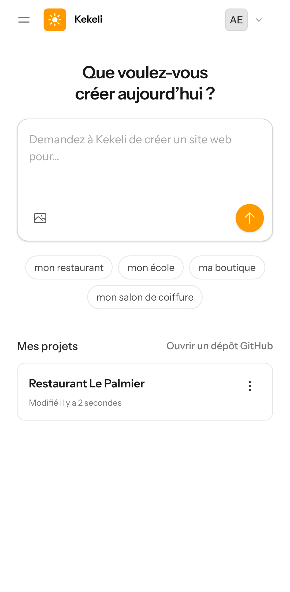

Une photo peut être jointe depuis le téléphone (bouton photo de la zone) :
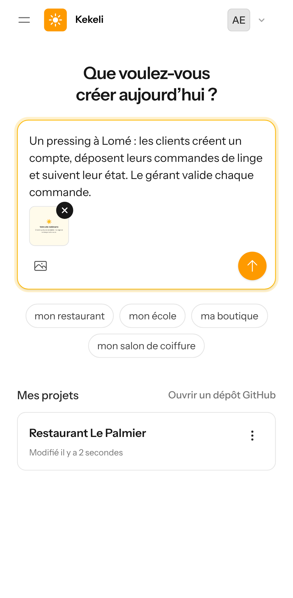

## 6. Un site avec base de données, sans aucun détail technique
Kekeli a compris tout seul qu’il fallait des comptes et une base de données ; « Laravel (PHP) et MySQL » n’apparaît plus.
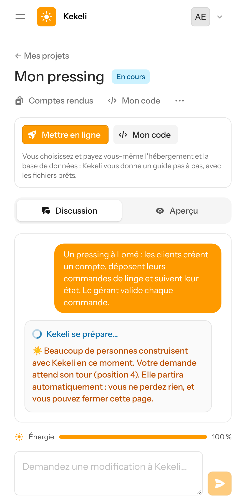

## 7. « Sites autorisés » rangé dans le menu « ⋯ », sous le nom « Accès à Internet de Kekeli »
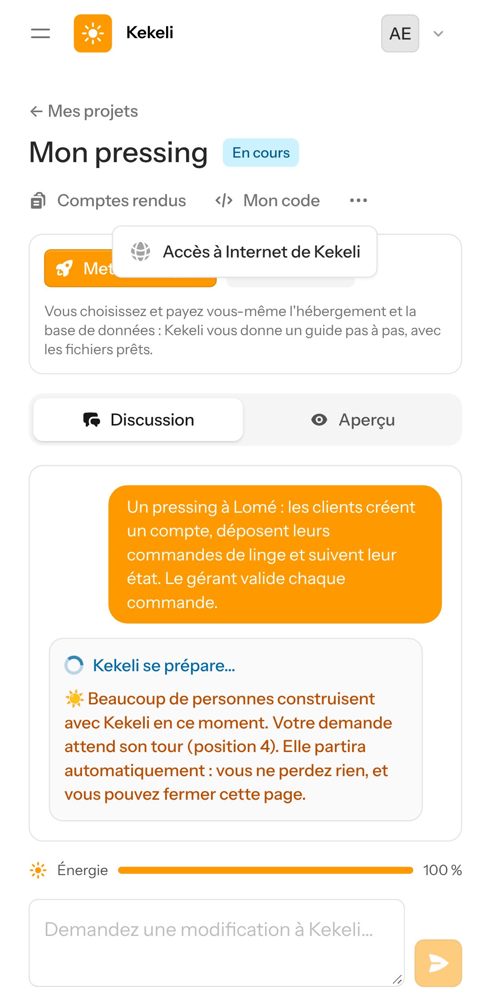

## 8. La liste des sites, et un message clair quand le texte est trop court
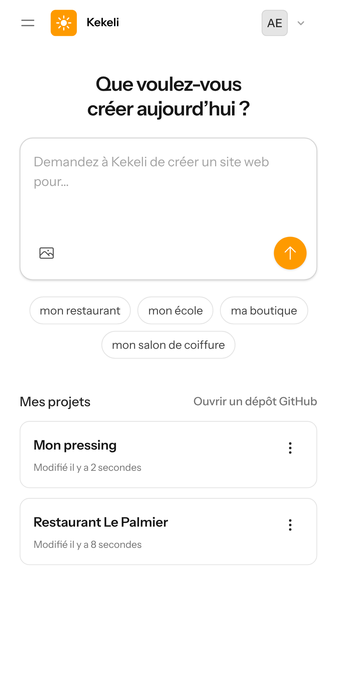
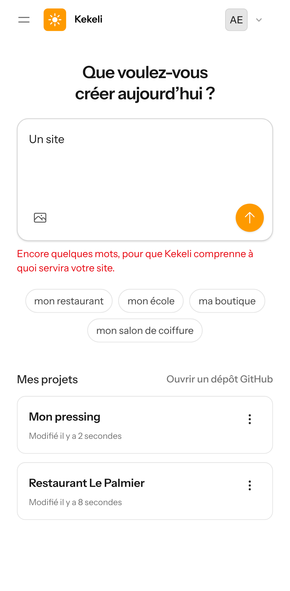
