# Publier et récupérer son site : captures avant et après

Captures prises le 12 novembre 2026 sur un téléphone simulé (Pixel 7, navigateur en français) et sur un ordinateur (1440 × 900), avec des comptes et des projets inventés (`scripts/preparer-captures-nettoyage.php`, `scripts/preparer-captures-publier.php`, `scripts/captures-publier.js`). La réponse de Kekeli à la question « Où héberger mon site et combien ça coûte ? » est celle de l'essai réel avec Gemini (offre gratuite).

« Relier à GitHub » n'apparaît que lorsque l'accès à GitHub est réglé : les captures « après, avec GitHub réglé » ont été prises avec des réglages inventés, pour montrer où il apparaîtra.

## Téléphone

### Site avec base de données : bouton du haut et discussion (après : une question sur l'hébergement et la réponse réelle de Kekeli)

| Avant | Après |
|---|---|
| 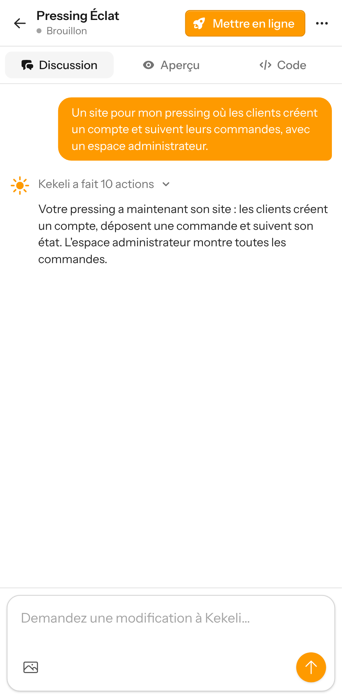 |  |

### Site avec base de données : fenêtre du bouton du haut

| Avant | Après | Après, avec GitHub réglé |
|---|---|---|
| 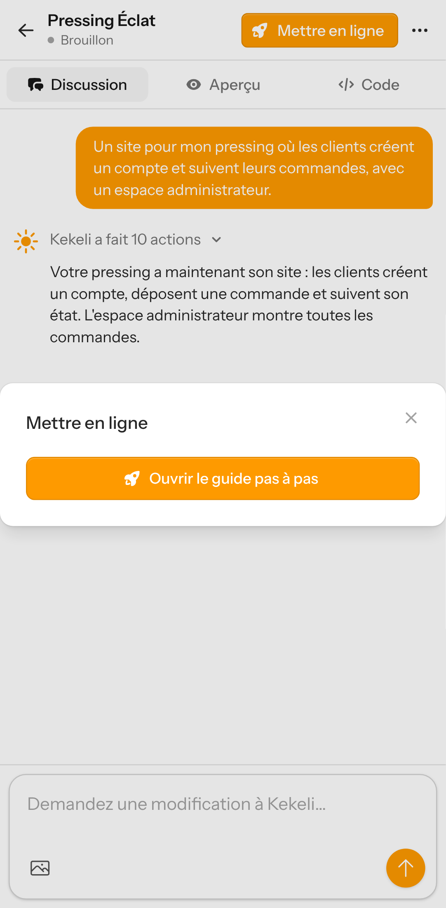 |  |  |

### Ancienne adresse du guide de mise en ligne (après : renvoie vers le projet)

| Avant | Après |
|---|---|
|  |  |

### Site avec base de données : onglet Code

| Avant | Après |
|---|---|
| 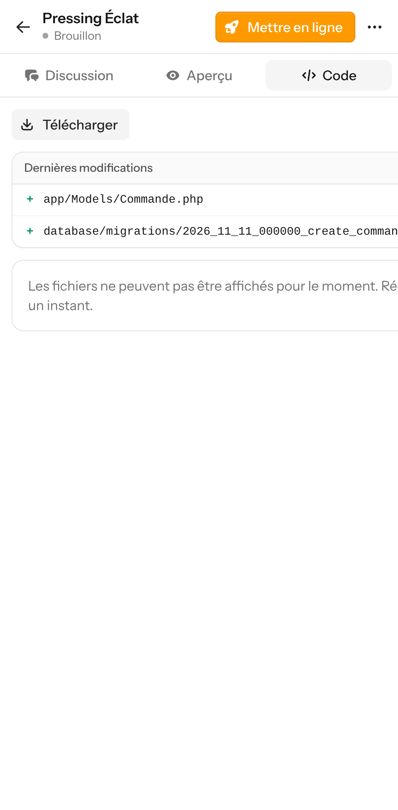 | 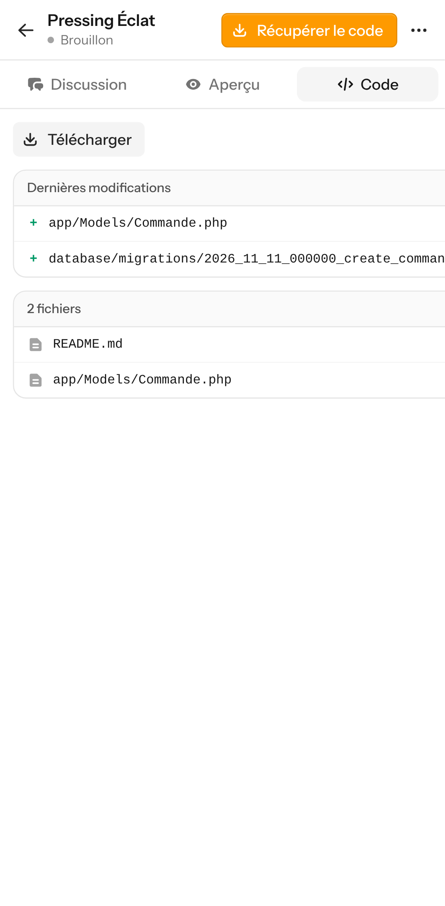 |

### Site vitrine : fenêtre « Mettre en ligne »

| Avant | Après | Après, avec GitHub réglé |
|---|---|---|
|  |  |  |

### Site vitrine déjà publié : fenêtre « Mettre en ligne »

| Avant | Après |
|---|---|
|  |  |

## Ordinateur

### Site avec base de données : bouton du haut et discussion (après : une question sur l'hébergement et la réponse réelle de Kekeli)

| Avant | Après |
|---|---|
| 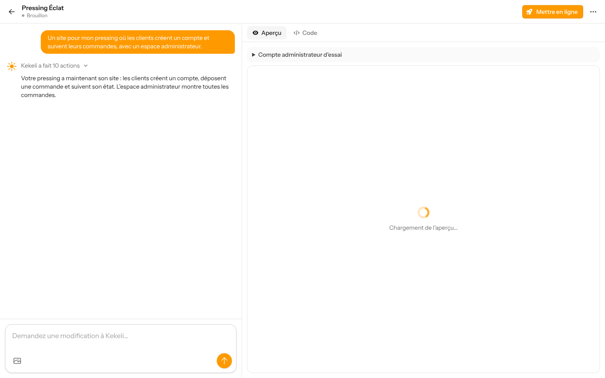 |  |

### Site avec base de données : fenêtre du bouton du haut

| Avant | Après | Après, avec GitHub réglé |
|---|---|---|
| 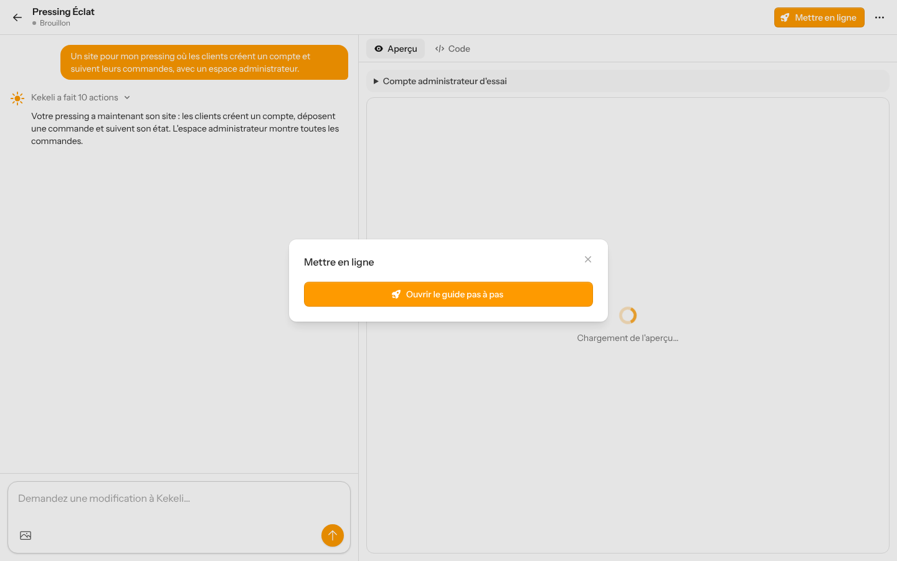 | 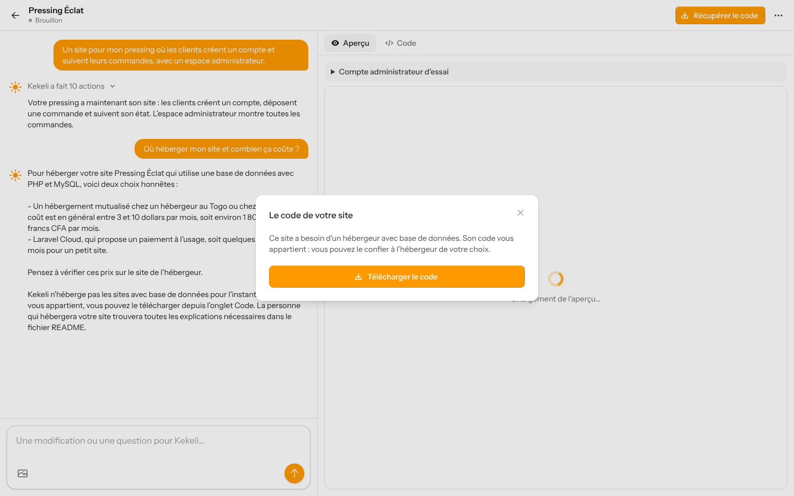 | 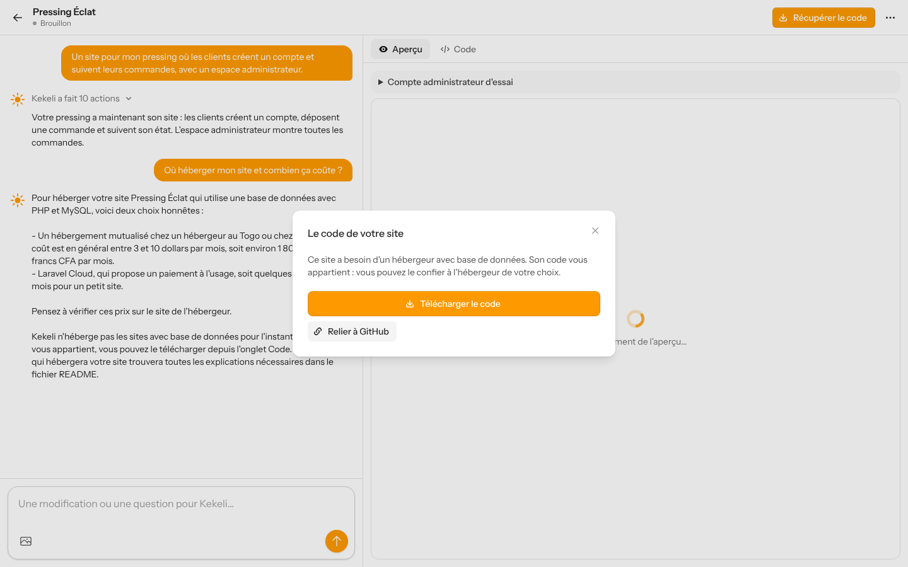 |

### Ancienne adresse du guide de mise en ligne (après : renvoie vers le projet)

| Avant | Après |
|---|---|
| 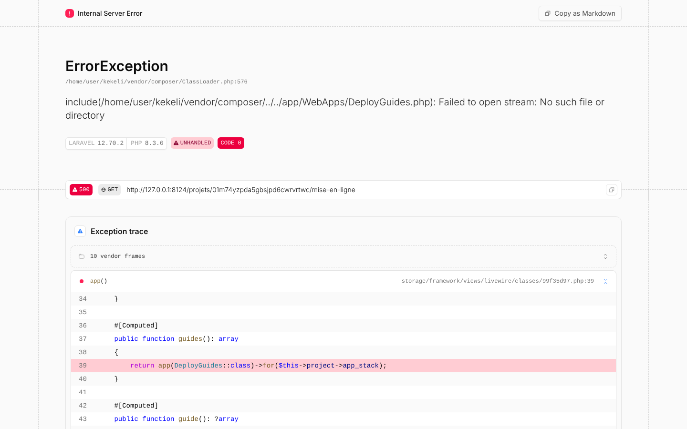 | 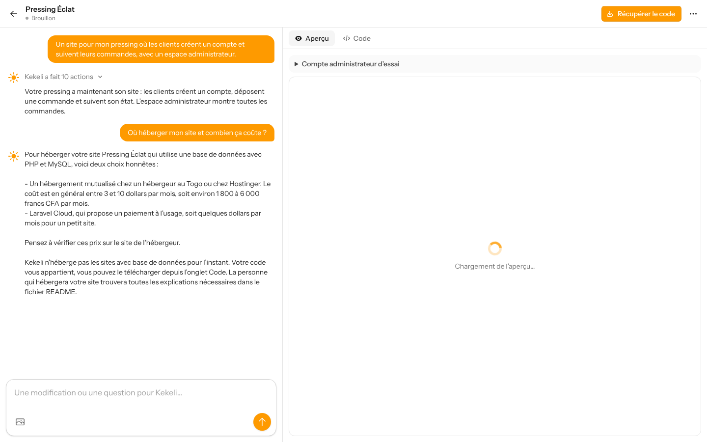 |

### Site avec base de données : onglet Code

| Avant | Après |
|---|---|
| 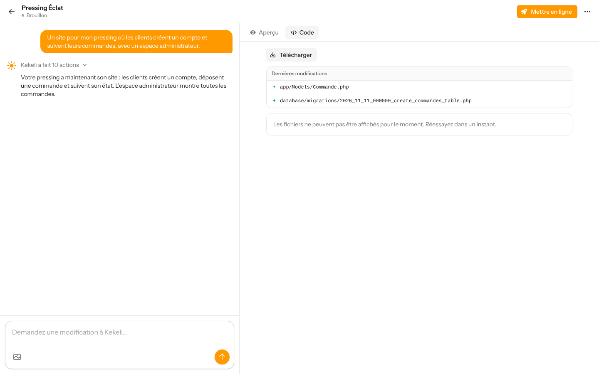 | 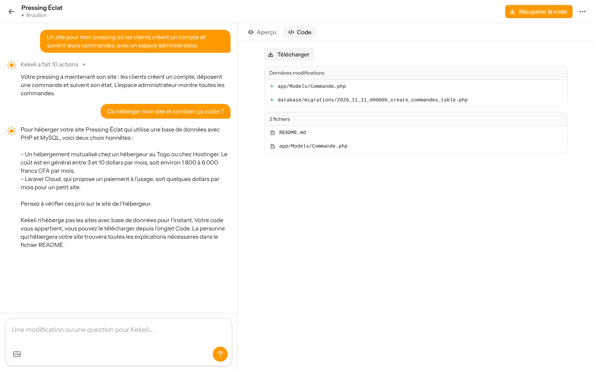 |

### Site vitrine : fenêtre « Mettre en ligne »

| Avant | Après | Après, avec GitHub réglé |
|---|---|---|
| 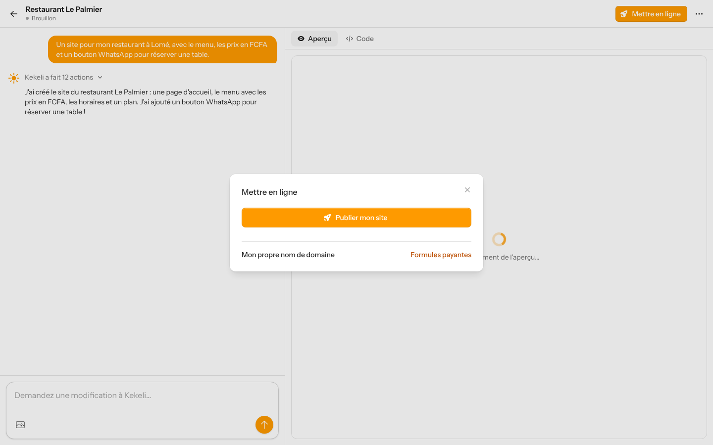 | 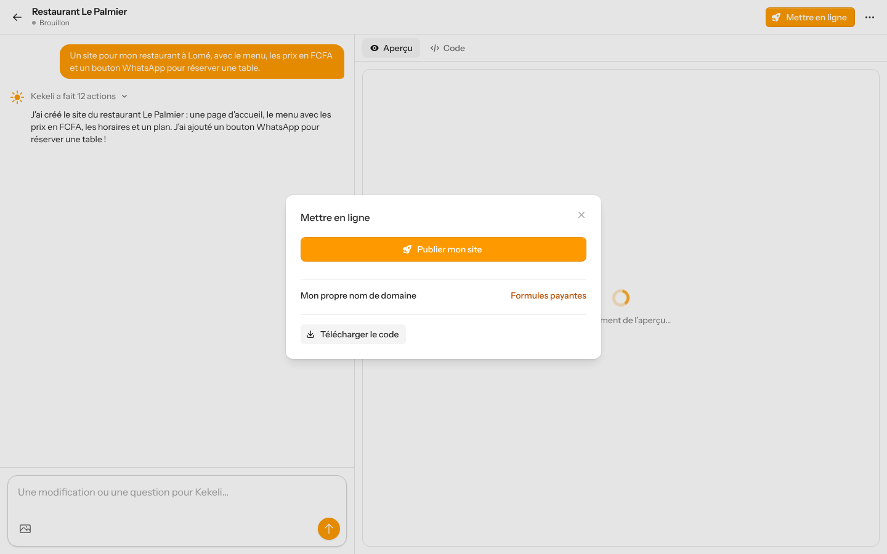 | 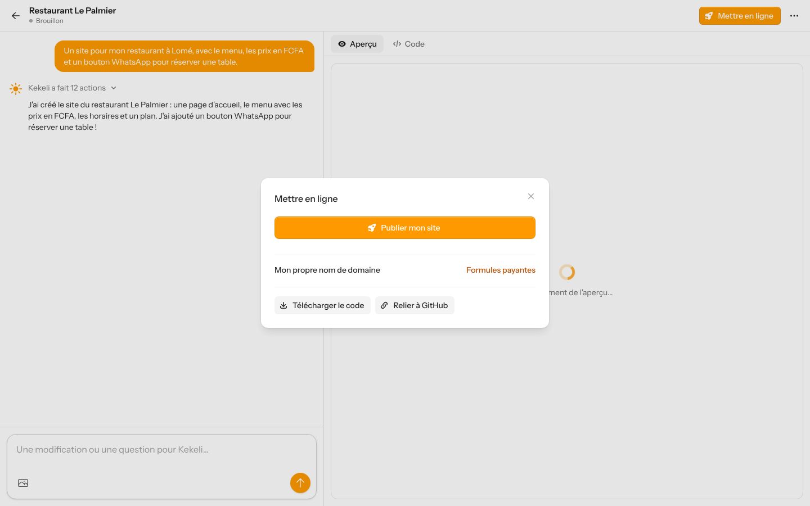 |

### Site vitrine déjà publié : fenêtre « Mettre en ligne »

| Avant | Après |
|---|---|
| 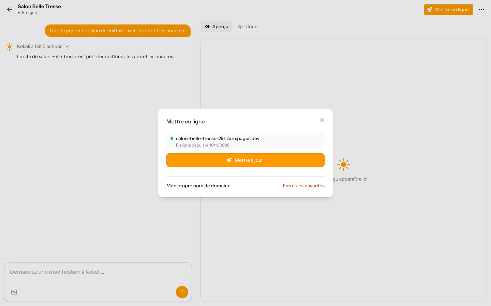 | 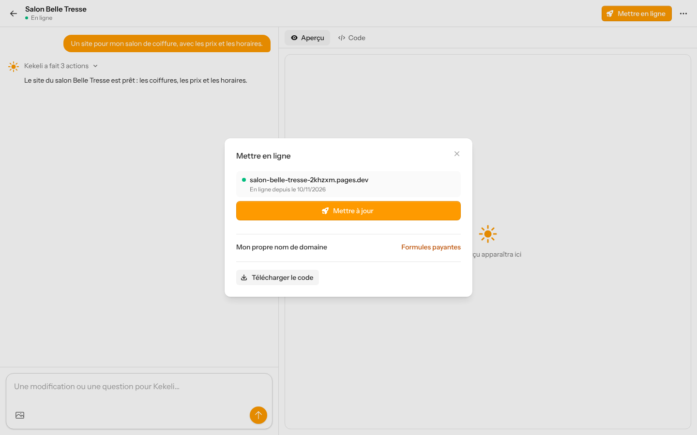 |
