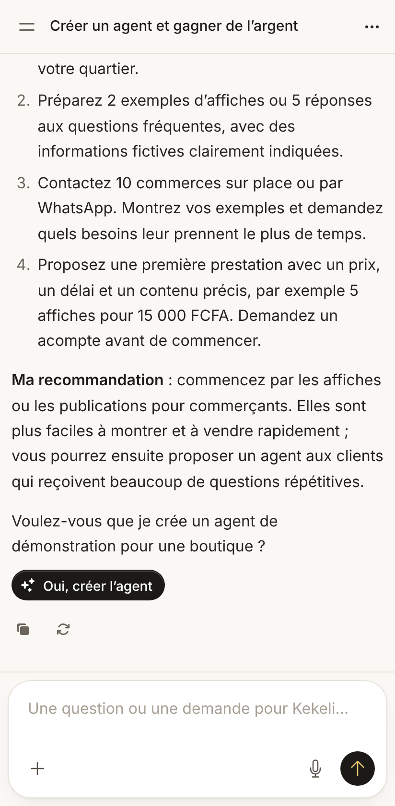
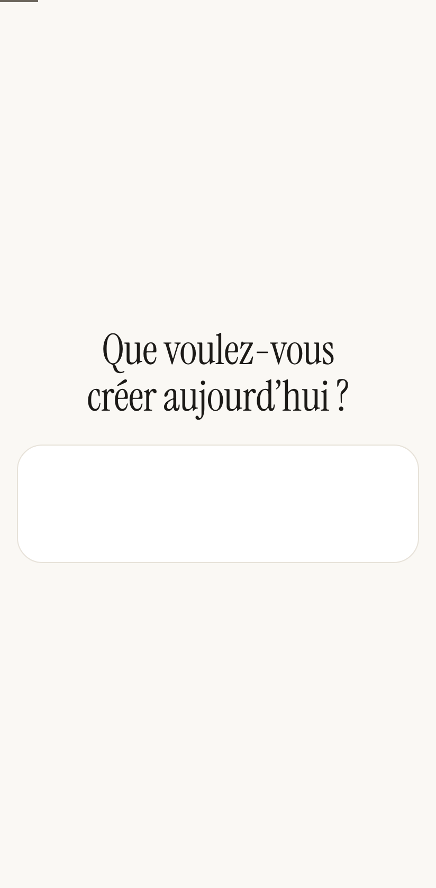
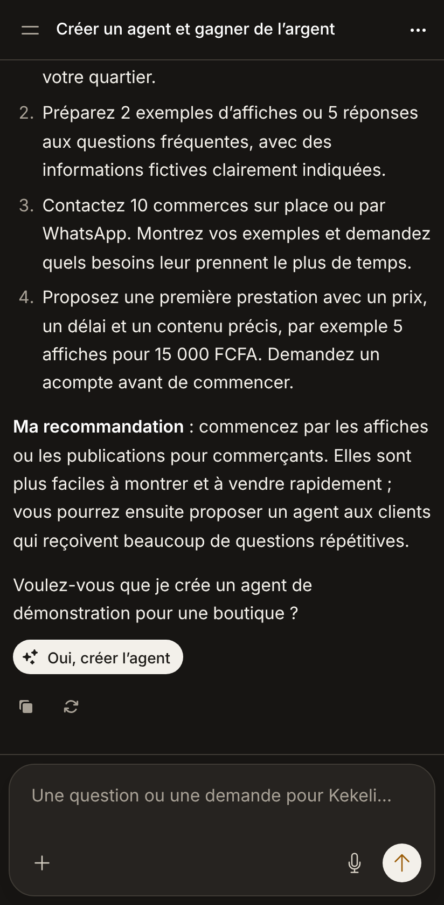
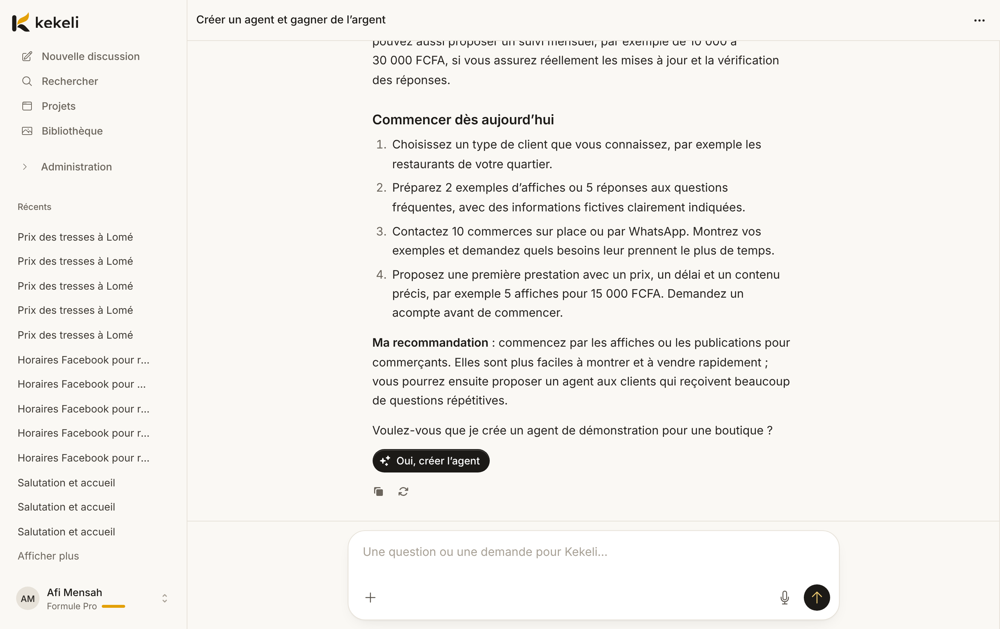
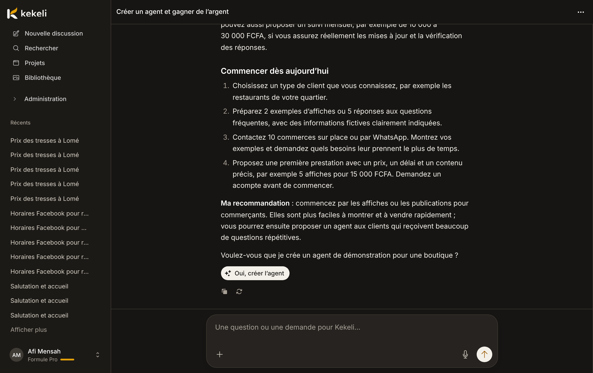
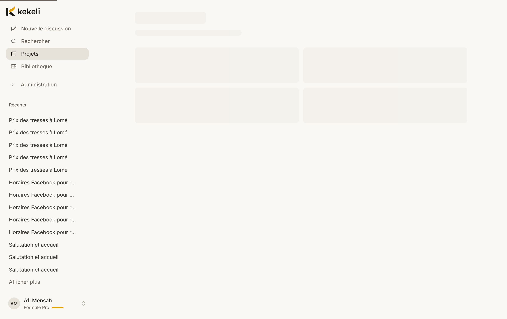

# Comprendre, répondre et réagir comme Claude et ChatGPT (15 novembre 2026)

Constat du porteur du projet sur https://kekeli.laravel.cloud après la pull request 70 : un premier mot qui met encore 5 à 15 secondes, une question (« C'est possible de créer un agent IA aujourd'hui avec l'IA ? Et comment gagner de l'argent avec l'IA ») traitée comme une demande de création d'agent, et des clics lents. Toutes les données de ce chantier sont inventées. Les coûts sont des estimations tirées des mesures, au prix officiel d'OpenAI.

## 1. Bien comprendre la demande

Banc de 30 demandes réelles (`runner/mesures/decisions-30.json`), avec la décision attendue (répondre, chercher, demander une précision, créer). Mesure : `node runner/scripts/banc-decisions.mjs <étiquette>`.

| | Avant | Après |
|---|---|---|
| Bonnes décisions | **22 sur 30** | **30 sur 30** |
| Question exacte du porteur du projet | recherche sur Internet inutile (avant la partie 1, la production montrait même une fiche d'agent) | réponse complète, puis « Voulez-vous que je crée cet agent… ? » avec le bouton « Oui, créer l'agent » |
| Questions générales sur l'IA et le business | 5 recherches inutiles sur 8 | aucune |
| « fais un site » | création lancée sans rien savoir | une seule question de précision |

Ce qui a changé :
- **Une question n'ouvre jamais les outils de création** (`runner/src/intention.js`, sans modèle, donc gratuit) : « est-ce possible ? », « comment ? », « pourquoi ? », « combien ? », « quelle différence ? » reçoivent une réponse ; « crée-moi », « je veux un… », « peux-tu me faire… » restent des demandes.
- **Proposition finale avec un bouton**, comme Claude : quand le client semble avoir un projet, la réponse se termine par une phrase (« Voulez-vous que je crée cet agent pour votre boutique ? ») et le bouton « Oui, créer l'agent » (ou le site, l'application, l'automatisation, l'image, le document, la présentation, la vidéo), qui répond comme un message écrit.
- **Recherche seulement si elle sert** : plus de recherche pour une question de connaissance générale, une méthode, une possibilité, un conseil, ni pour le prix que le client doit demander pour ses propres services, même avec « aujourd'hui ».
- **Des questions mal formées ne lancent plus jamais une création** : une seule question de précision à la place (défaut trouvé par le banc).

## 2. Des réponses de qualité, comme Claude

Banc exigeant de 30 questions d'entrepreneurs et d'étudiants d'Afrique de l'Ouest (`runner/mesures/questions-30.json`, dont la question du porteur du projet), qui remplace le banc de 20 questions. Chaque réponse a été notée de 1 à 10 en la comparant à une réponse de référence écrite par Claude (`runner/mesures/reponses-reference-30.md`) ; notes détaillées : `runner/mesures/notes-reponses-30.json`.

| | Avant (GPT-6 Luna) | GPT-6.1 Terra, réflexion « low » | **Après (GPT-6.1 Terra, sans réflexion)** |
|---|---|---|---|
| Note moyenne | 7,80 | 8,95 | **9,03** |
| Note la plus basse | 6,5 (trois réponses) | 7 | **8** |
| Mots par réponse | 251 | 337 | 345 |
| Premier mot (Runner, médiane) | 1,26 s | 1,24 s | 1,21 s |
| Coût moyen d'une réponse | 0,24 FCFA (0,0004 $) | 2,0 FCFA | **2,46 FCFA (0,0041 $)** |

- **Ordre des discussions** : GPT-6.1 Terra, puis GPT-6 Luna (OpenAI), puis Gemini 3.1 Flash-Lite gratuit, OpenRouter, Cloudflare Workers AI, et Coarena en tout dernier.
- **Réglage de réflexion de Terra choisi par la mesure** : « none », le plus bas. Les variantes « low » et « medium » (réglage précédent) donnent la même qualité (13 réponses comparées une à une), avec un premier mot un peu plus lent.
- **Consignes revues** : répondre exactement à chaque partie de la question ; du concret (FCFA, Mixx by Yas, Flooz, Orange Money, Wave, WhatsApp, villes et quartiers) avec des ordres de grandeur chiffrés ; des étapes que l'on peut suivre aujourd'hui ; « **Ma recommandation** » ; un tableau pour toute comparaison ; chaque calcul montré ; un texte à rédiger complet (montant, moyens de paiement, solution en cas de difficulté). Défauts corrigés au passage : une ligne « PROPOSITION » qui restait visible, l'opérateur de Mixx by Yas (Yas, l'ancien Togocom) et de Flooz (Moov Africa Togo).
- **Effet sur le plafond OpenAI de 10 $ par jour** : environ **2 400 réponses par jour** de ce genre (0,0041 $ chacune), contre environ 25 000 avec GPT-6 Luna. Au-delà, Kekeli passe à Gemini sans rien dire au client. 100 messages par jour coûtent environ 0,41 $ par jour (12 $ par mois) ; 1 000 messages, environ 4,1 $ par jour (123 $ par mois). Estimations à partir de 30 questions riches ; une salutation coûte beaucoup moins.

## 3. Le premier mot

Mesure de bout en bout sur un téléphone simulé (site local, vrais modèles, GPT-6.1 Terra, 5 essais, médianes, `scripts/mesurer-vitesse.js`) :

| | Avant ce chantier | Après |
|---|---|---|
| « Salut » | 1,3 s | **1,3 s** |
| Question courte | 2,1 s | **1,2 s** |
| Tableau des prix | 1,8 s | **1,2 s** |

Où passait le temps, mesuré étape par étape (`agent_runs.timings`) :
- **Le titre de la discussion était écrit en premier** : le modèle commençait par une ligne « TITRE : … » cachée au client, et le premier mot visible attendait la fin de cette ligne (environ 0,45 seconde). Le titre est maintenant écrit **à la fin** de la réponse (`CONSIGNE_TITRE`, `titreDeFin`).
- **Une ligne « RÉFLEXION » était demandée à un modèle qui ne réfléchit pas** : elle n'était jamais montrée et retardait le premier mot d'une question riche. Elle n'est plus demandée sans réflexion.
- **L'envoi réaffichait toute la page** avant d'ouvrir la réponse mot par mot : inutile, le message est déjà affiché sur le téléphone (`skipRender`).
- **Environ 220 requêtes à la base par page** (voir partie 4), aussi pendant l'envoi.

**En ligne** : la mesure de bout en bout sur https://kekeli.laravel.cloud demande un compte de test. Les codes de connexion ne sont arrivés dans aucune des deux boîtes e-mail jetables essayées (mail.tm et Guerrilla Mail, 20 minutes d'attente) ; le porteur du projet a accepté l'adresse « +essai » de son Gmail, lue par le connecteur Gmail, qui doit être reconnecté (claude.ai → Réglages → Connecteurs). Les mesures en ligne seront faites dès ce moment-là (`scripts/mesurer-clics.js` et la même mesure du premier mot, site endormi et éveillé). Pages publiques mesurées depuis le serveur de Claude (premier octet) : connexion 0,44 à 0,49 s éveillé, 1,13 s pour la première visite après une pause.

## 4. Des clics instantanés

**La cause principale, trouvée dans le code** : chaque page lisait environ 160 fois les réglages, et chaque lecture était une requête à la base (le cache est rangé dans la base). En ligne, la base PostgreSQL est sur un autre serveur : chaque requête ajoute quelques millisecondes.

| Page | Requêtes avant | Requêtes après |
|---|---|---|
| Nouvelle discussion | 219 | 14 |
| Ouvrir une discussion ou un projet | 235 | 24 |
| Projets, Bibliothèque | 209 | 12 |
| Formules | 233 | 12 |
| Réglages | 207 | 10 |

(`scripts/compter-requetes.php`, compte local avec 118 discussions inventées.) Les réglages sont lus une fois par requête (`Settings`, « scoped ») et l'énergie une fois par page (`Energy::remembered`, seulement pour l'affichage d'une page, jamais pendant une réponse, un travail ou un paiement).

Comme Claude et ChatGPT :
- **Préchargement** : la page part dès que la souris survole un lien, et sur un téléphone dès que le doigt le touche (`wire:navigate.hover`, `resources/js/navigation.js`).
- **Réponse visible tout de suite** : le lien touché devient actif, le menu du téléphone se referme, la page quittée s'efface légèrement, et la page qui arrive montre un squelette léger (« Nouvelle discussion » montre déjà sa grande question).
- **Barre de progression grise** au lieu du bleu vif de Livewire (règle du système de design).

Mesure sur un téléphone simulé (site local, 3 essais, médianes, secondes, `scripts/mesurer-clics.js`) :

| Action | Visible avant | Visible après | Page complète après |
|---|---|---|---|
| Ouvrir l'accueil | 0,21 | 0,23 | 0,23 |
| Nouvelle discussion | 0,24 | **0,07** | 0,19 |
| Ouvrir une discussion | 0,24 | **0,07** | 0,24 |
| Projets | 0,21 | **0,08** | 0,21 |
| Bibliothèque | 0,22 | **0,07** | 0,23 |
| Rechercher | 0,06 | 0,07 | 0,08 |
| Menu du compte | 0,07 | 0,07 | 0,08 |
| Formules | 0,21 | **0,07** | 0,21 |
| Réglages | 0,26 | **0,06** | 0,26 |

En local, il n'y a ni réseau ni base distante : les pages complètes y sont déjà rapides. Le gain des requêtes en moins se verra en ligne. Fichiers : `qualite-vitesse/clics-local-avant.json`, `clics-local-apres.json`.

### Si le réveil du site reste la cause principale

Rien n'est changé sur Laravel Cloud. Prix officiels notés le 9 novembre 2026 (`docs/mise-en-ligne.md`, partie 2) : petit ordinateur Flex 0,00893 $ par heure allumée ; base PostgreSQL serverless de 0,25 unité, environ 0,027 $ par heure active. Coût mensuel estimé pour rester toujours éveillé (730 heures par mois), à comparer aux 0,50 à 3 $ par mois actuels avec le sommeil :

| Solution | Coût estimé par mois |
|---|---|
| Site toujours éveillé | environ 6,5 $ (3 900 FCFA) |
| Runner toujours éveillé | environ 6,5 $ (3 900 FCFA) |
| Base toujours éveillée | environ 19,7 $ (11 600 FCFA) |
| Les trois | environ 33 $ (19 400 FCFA) |

Ce sont des estimations ; la décision attend les mesures en ligne (site endormi et éveillé) et l'accord du porteur du projet.

## Captures

| Téléphone, clair | Téléphone, sombre |
|---|---|
|  |  |

| Ordinateur, clair | Ordinateur, sombre |
|---|---|
|  |  |

## Lighthouse et poids

Lighthouse sur téléphone (médiane de 3, site local) : accueil 59 avant (pull request 69) et 58 à 59 après ; discussion 57 à 58 avant et 52 à 54 après (écart de la mesure sur cette machine : les pages se ressemblent, seul le script de navigation s'ajoute) ; accessibilité 100. CSS 352,85 Ko (42,15 Ko compressé) → 353,31 Ko (42,25 Ko) ; JavaScript 15,14 Ko (5,49 Ko compressé) → 16,99 Ko (6,04 Ko).
