# Répondre comme Claude et ChatGPT (15 novembre 2026)

Trois parties : la mise en page des réponses, leur qualité et la fluidité de leur affichage. Données des captures inventées (`scripts/preparer-captures-reponses.php`, compte `afi-reponses@exemple.tg`), site local réglé comme en production.

## Partie 1 : mise en page

Ce que font Claude et ChatGPT (pages publiques et application, observées le 15 novembre 2026), et ce que Kekeli fait maintenant :

| Élément | Claude et ChatGPT | Kekeli avant | Kekeli après |
|---|---|---|---|
| Taille du texte | 16 pixels | 14 pixels | 16 pixels |
| Interligne | environ 1,6 à 1,75 | 1,65 (sur 14 pixels) | 1,65 |
| Largeur de lecture sur ordinateur | colonne centrée, lignes longues mais limitées | environ 95 caractères | environ 70 caractères (`36em`), tableaux et code sur toute la colonne |
| Espace entre paragraphes | net (environ une ligne) | 12 pixels | environ 14 pixels (`0,9em`), 26 pixels avant un titre |
| Icône à côté d'une réponse sur téléphone | aucune | logo de Kekeli (40 pixels de largeur perdus) | aucune pour une réponse finie ; la flamme reste pendant le travail |
| Tableaux | défilent sur le côté, chiffres alignés | cellules larges, beaucoup de retours à la ligne | texte un peu plus petit, chiffres tabulaires, cellules plus étroites |
| Code | bloc avec « Copier » | bloc avec « Copier » | inchangé |
| Gras | rare | rare (consigne) | inchangé |

**Police** : Inter (version variable, licence libre OFL, déjà servie par Kekeli, sans service extérieur). C'est une police sans empattement nette et moderne, de la même famille de style que celles de ChatGPT et de Lovable : elle est gardée, aucune police ni aucun poids n'est ajouté.

**Poids et Lighthouse** (téléphone, deux séries, même machine, données inventées) :

| Mesure | Avant | Après |
|---|---|---|
| CSS | 352,26 Ko (41,47 Ko compressé) | 352,71 Ko (41,57 Ko compressé) |
| JavaScript | 11,79 Ko (4,30 Ko compressé) | inchangé |
| Polices | 9 fichiers | inchangé |
| Lighthouse, accueil | 59 · 59 | 59 · 59 |
| Lighthouse, discussion avec une longue réponse | 71 · 55 | 69 · 57 |
| Accessibilité | 100 | 100 |

Les écarts de la discussion (55 à 71) sont ceux de la mesure elle-même, des deux côtés.

### Captures avant et après

| Réponse | Avant (téléphone, clair) | Après (téléphone, clair) | Après (téléphone, sombre) | Après (ordinateur, clair) | Après (ordinateur, sombre) |
|---|---|---|---|---|---|
| Réponse courte | 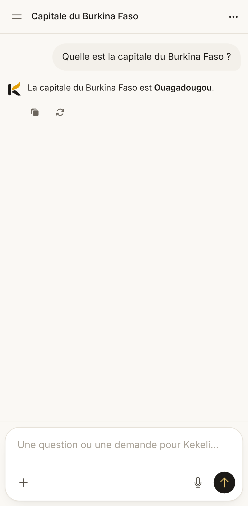 | 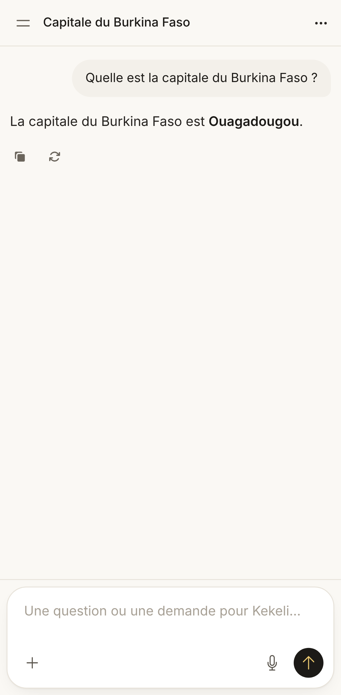 | 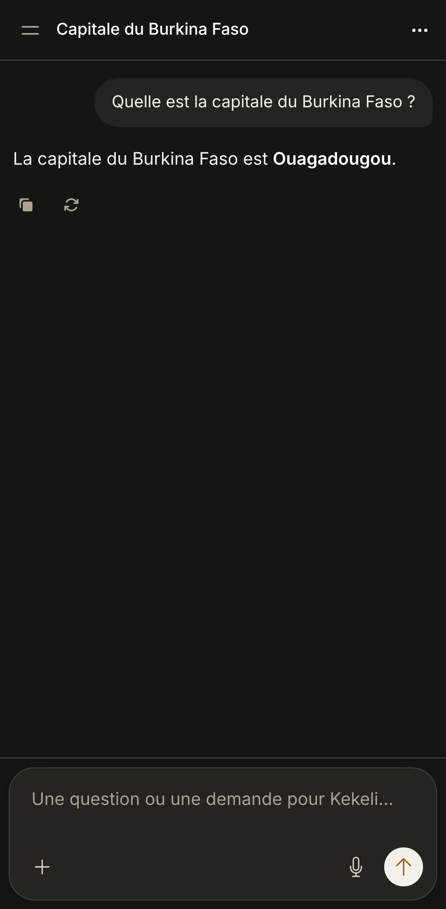 | 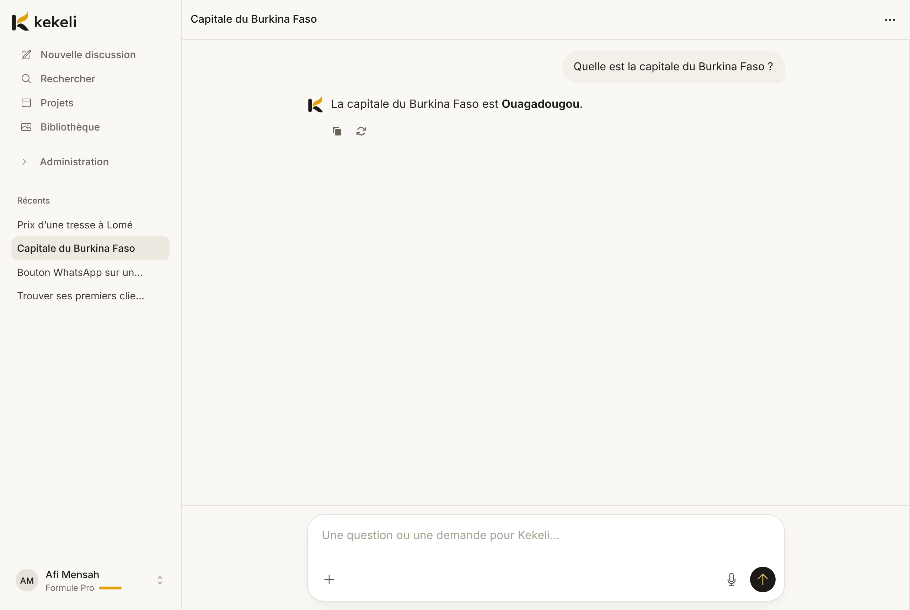 | 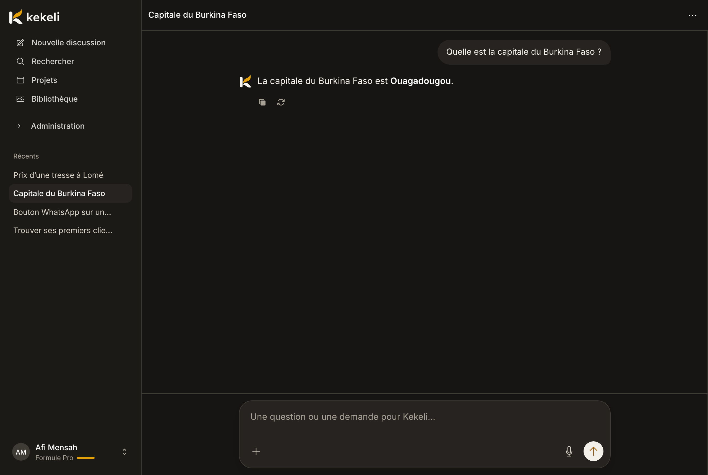 |
| Réponse longue (titres, tableau, liste) | 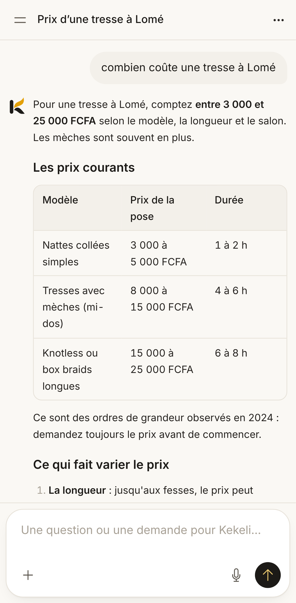 | 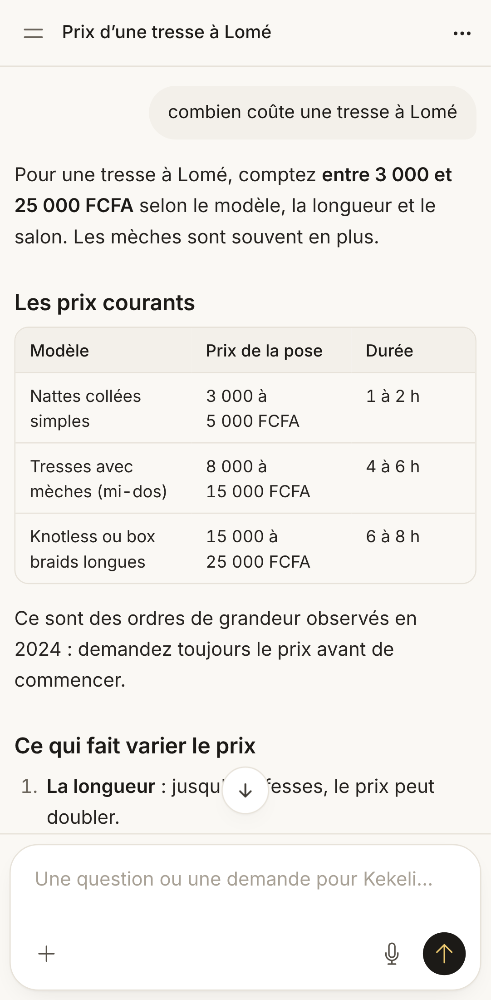 | 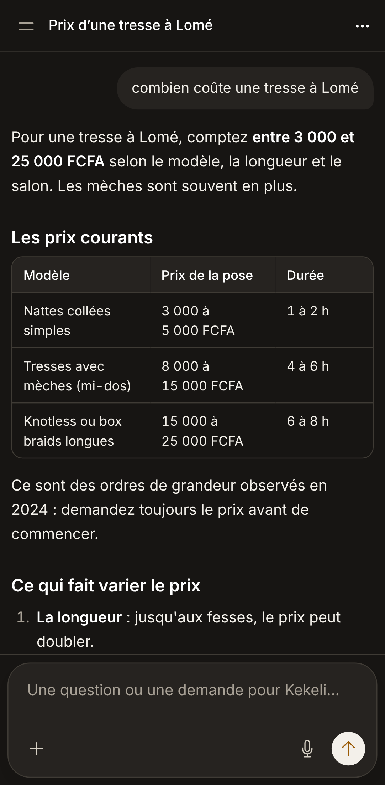 | 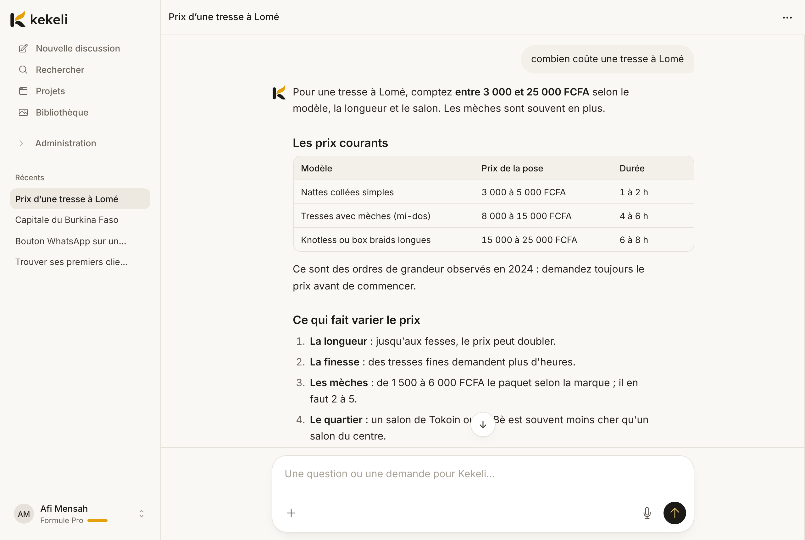 | 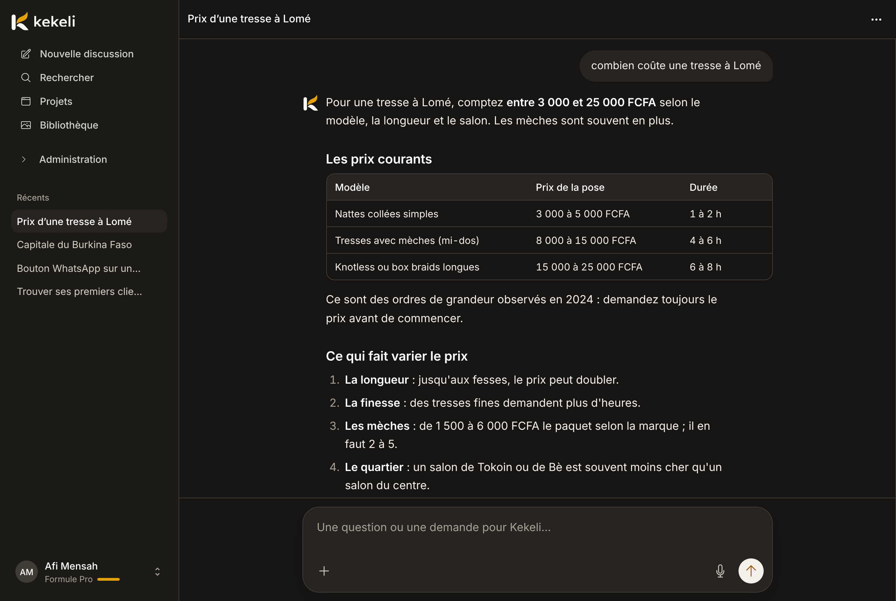 |
| Bloc de code avec « Copier » | 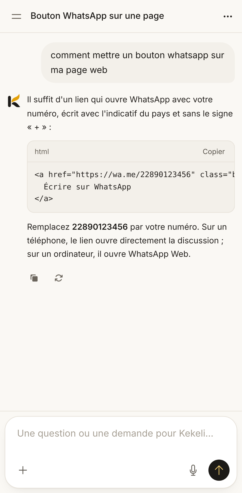 | 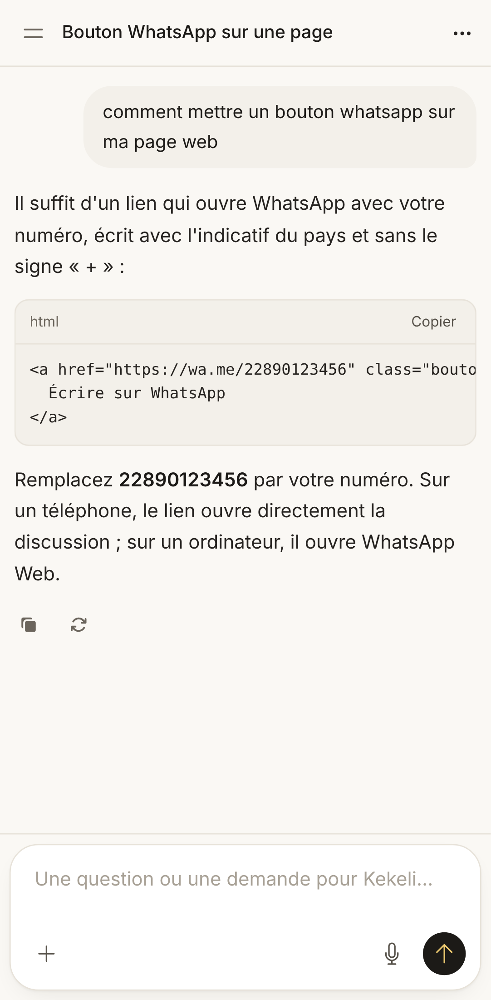 | 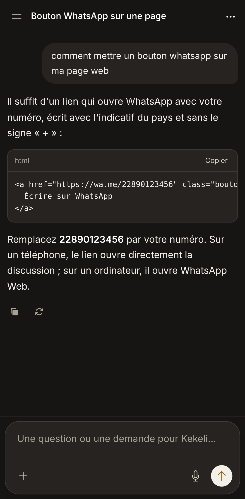 | 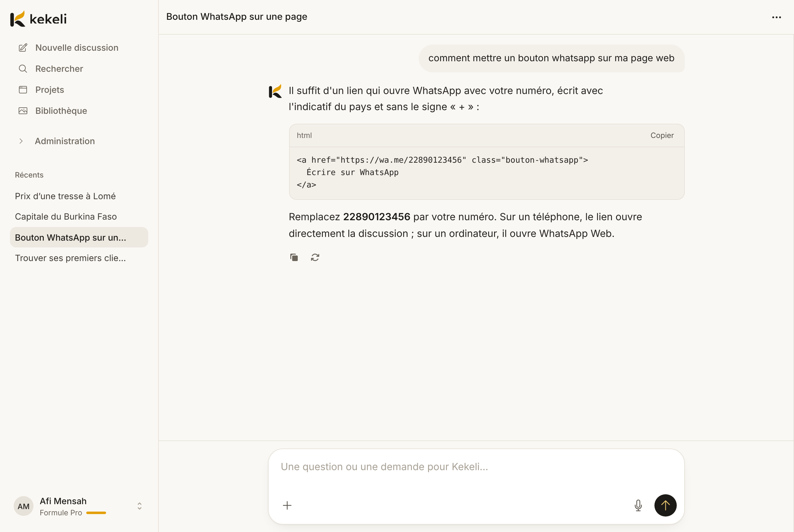 | 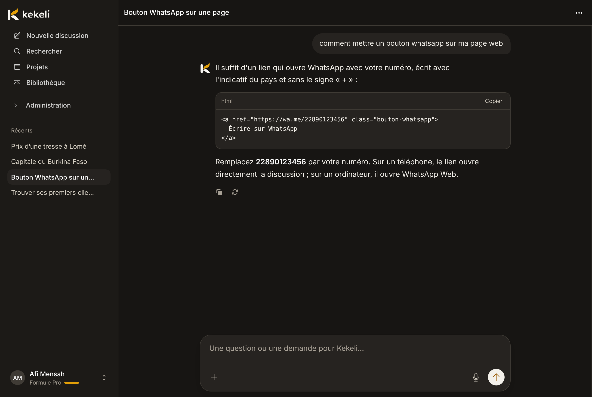 |

Toutes les captures avant, en clair et en sombre, sont dans `docs/captures/reponses/avant/`.

## Partie 2 : qualité des réponses (banc de 20 vraies questions)

Méthode : 20 vraies questions variées (`runner/mesures/questions-reponses.json`), posées au vrai premier répondant comme dans une discussion du site (Togo, FCFA, titre demandé, recherche sur Internet permise), avec le modèle des réponses de la production : GPT-6.1 Terra chez Coarena, puis chez OpenAI en secours (`node runner/scripts/banc-reponses.mjs <etiquette>`). Chaque réponse est notée de 1 à 10 par Claude, en la comparant à ce qu'il aurait répondu lui-même (exactitude, utilité, structure, longueur adaptée) : ces notes sont un jugement, pas une mesure automatique.

**Ce que le banc a montré avant** : la tresse (exemple du porteur du projet) n'avait **aucun prix** parce que la page trouvée n'en donnait pas ; les explications étaient minces (l'API en 2 phrases) ; les comparaisons manquaient de faits concrets ; une réponse passait au tutoiement.

**Consignes changées** (rien d'autre ; toutes les règles existantes sont gardées : sources honnêtes, fiches Talkami et Lomé IA School, aucun fournisseur nommé, questions avant une création vague) :

- une question pratique de la vie courante (un prix, « combien », « où », « comment faire ») n'est plus traitée comme une question simple : la réponse d'abord, ce qui la fait varier, un conseil concret, une liste ou un tableau quand il y a plusieurs cas ;
- une explication : la définition, une image de la vie courante, un exemple ;
- une comparaison : des critères concrets, un tableau à partir de 3 critères, une recommandation ;
- vouvoiement toujours ;
- après une recherche qui ne donne pas le prix (ou seulement pour une partie des cas) : la fourchette habituelle connue, présentée comme un ordre de grandeur daté, sans numéro de source.

**Coût moyen par réponse** (estimation au prix payant d'OpenAI pour GPT-6.1 Terra, 1 $ et 5 $ par million de tokens, 600 FCFA pour 1 $ ; gratuit tant que les crédits du jour de Coarena suffisent) : **environ 1,85 FCFA avant et 1,80 FCFA après** (sans le tout premier message, dont la consigne n'est pas encore en cache : 5,7 FCFA). Réponses un peu plus longues (153 mots en moyenne avant, 170 après), même coût.

**Autre modèle déjà configuré, mesuré sur les mêmes 20 questions** : Gemini 3.8 Flash (chez Coarena) écrit des réponses très riches (sa réponse sur la tresse donne les prix de chaque modèle et des mèches), mais plus longues (291 mots en moyenne, avec des formules de fin que la consigne interdit), environ 3 fois plus chères (environ 6 FCFA par réponse à son prix officiel, car ses consignes ne sont pas gardées en cache) et plus lentes au premier mot (environ 3,4 secondes contre 1,2, mesure du 14 novembre 2026). **GPT-6.1 Terra est gardé.** Résultats complets : `runner/mesures/banc-reponses-gemini-3-8-flash.json`.

<!-- banc : début -->

**Moyenne des notes : 7,85 sur 10 avant, 8,30 sur 10 après.**

| Numéro | Question | Genre | Note avant | Note après | Mots avant → après | Pourquoi |
|---|---|---|---|---|---|---|
| 1 | Salut | salutation | 8 | 8 | 7 → 7 | Salutation courte et polie, comme Claude ; identique. |
| 2 | Merci beaucoup pour ton aide ! | remerciement | 8 | 8 | 3 → 3 | « Avec plaisir ! » : juste ce qu'il faut ; identique. |
| 3 | Quelle est la capitale du Bénin ? | question simple | 9 | 8 | 12 → 6 | Juste dans les deux cas ; l'avant ajoutait que le gouvernement siège à Cotonou, détail utile qu'aurait donné Claude. |
| 4 | combien coûte une tresse à Lomé | prix au Togo | 3 | 6 | 64 → 89 | Avant : aucun prix (« je ne peux pas vous donner un prix fiable »). Après : de vrais prix de 2 salons de Lomé, datés et sourcés, mais seulement pour les nattes ; Claude donnerait aussi les fourchettes des modèles longs (obtenu à un essai sur deux). |
| 5 | Comment fixer le prix de mes gâteaux pour faire vraiment du bénéfice ? Je vends à la maison. | conseil d'affaires | 9 | 9 | 360 → 380 | Méthode complète avec calcul en FCFA et recommandation, au niveau de Claude. |
| 6 | Explique-moi simplement ce qu'est une API. | explication technique | 7 | 8 | 47 → 76 | Après : l'image du serveur de restaurant et un exemple concret rendent l'idée évidente. |
| 7 | Mixx by Yas ou Flooz pour recevoir les paiements de ma boutique, lequel choisir ? | comparaison | 6 | 6 | 131 → 163 | Conseil sûr (accepter les deux, vérifier le paiement) mais peu de faits concrets sur chaque service ; un tableau après, encore générique. |
| 8 | Je veux ouvrir un petit restaurant à Lomé. Fais-moi un plan pour les 3 premiers mois. | demande de plan | 9 | 9 | 587 → 513 | Plan mois par mois, seuil de rentabilité chiffré, recommandation : très bon. |
| 9 | What is the best way to save money as a student in Togo? | question en anglais | 8 | 9 | 139 → 226 | Après : budget d'exemple en FCFA dans un tableau, conseils plus concrets, en anglais comme la question. |
| 10 | Facebook ou TikTok pour vendre des pagnes ? | comparaison | 7 | 8 | 106 → 190 | Après : comparaison sur 4 critères dans un tableau, puis recommandation claire. |
| 11 | combien font 18 % de TVA sur 250 000 FCFA | calcul | 9 | 9 | 20 → 24 | Résultat juste et en gras, avec le total TTC. |
| 12 | Rédige un message WhatsApp poli pour relancer un client qui me doit 50 000 FCFA depuis un mois. | texte à rédiger | 8 | 8 | 65 → 66 | Message prêt à envoyer, poli et ferme. |
| 13 | comment créer une entreprise au Togo | démarches | 9 | 9 | 416 → 481 | Démarches, frais officiels et délais sourcés et datés ; après, l'adresse et le numéro du CFE en plus. |
| 14 | c'est quoi la différence entre un site vitrine et une boutique en ligne | explication | 8 | 9 | 124 → 172 | Après : tableau sur 4 critères et exemple, puis recommandation. |
| 15 | donne moi des idées de business avec 100 000 FCFA à Lomé | idées | 7 | 8 | 481 → 367 | Avant : passage au tutoiement. Après : vouvoiement, idées en tableau avec budgets et répartition chiffrée. |
| 16 | Comment sécuriser mon compte Facebook ? | sécurité | 8 | 9 | 160 → 199 | Après : le chemin exact dans les réglages de Facebook et la protection de l'e-mail en plus. |
| 17 | Quelle est la différence entre HTML, CSS et JavaScript ? Montre un petit exemple. | code | 9 | 9 | 105 → 130 | Définitions, image de la vie courante, exemple de code commenté et prêt à copier. |
| 18 | j'ai mal à la tête depuis 3 jours, que faire ? | santé | 8 | 8 | 160 → 205 | Prudent, signes d'urgence clairs ; l'avant rappelait le paludisme en cas de fièvre (utile au Togo), l'après précise les doses de paracétamol. |
| 19 | Quel est le prix d'un sac de ciment à Lomé en ce moment ? | prix actuel (recherche) | 9 | 9 | 62 → 92 | Prix daté et sourcé par marque ; après, en tableau. |
| 20 | Traduis en anglais : « Nous livrons partout à Lomé en 24 heures, paiement à la livraison. » | traduction | 8 | 9 | 10 → 11 | Traduction juste ; l'après est plus naturelle (« with payment on delivery »). |

### Les 20 réponses complètes, avant et après

<details>
<summary>1. Salut (note 8 → 8)</summary>

**Avant** (7 mots, 5,73 FCFA au prix payant) :

> Salut ! Comment puis-je vous aider ?

**Après** (7 mots, 0,07 FCFA au prix payant) :

> Salut ! Comment puis-je vous aider ?

</details>

<details>
<summary>2. Merci beaucoup pour ton aide ! (note 8 → 8)</summary>

**Avant** (3 mots, 0,06 FCFA au prix payant) :

> Avec plaisir !

**Après** (3 mots, 0,06 FCFA au prix payant) :

> Avec plaisir !

</details>

<details>
<summary>3. Quelle est la capitale du Bénin ? (note 9 → 8)</summary>

**Avant** (12 mots, 0,12 FCFA au prix payant) :

> La capitale du Bénin est **Porto-Novo**. Le gouvernement siège principalement à Cotonou.

**Après** (6 mots, 0,10 FCFA au prix payant) :

> La capitale du Bénin est **Porto-Novo**.

</details>

<details>
<summary>4. combien coûte une tresse à Lomé (note 3 → 6)</summary>

**Avant** (64 mots, 5,01 FCFA au prix payant) :

> Je ne peux pas vous donner un prix fiable pour Lomé : le salon consulté propose des tresses, mais n’affiche pas leur tarif sur sa page. [1]
> 
> Le prix dépend notamment du modèle, de la longueur et des mèches utilisées. [2] Le plus simple est d’envoyer une photo du modèle à une coiffeuse et de demander si les mèches sont comprises dans le prix.

**Après** (89 mots, 2,24 FCFA au prix payant) :

> À Lomé, comptez environ **3 000 à 5 000 FCFA** pour des nattes simples, selon les tarifs affichés par ces salons : [1]
> 
> - À Togblé Kopé : nattes à 3 000 FCFA. [1]
> - À Bè-Klikamé : nattes à 5 000 FCFA et tresses pour enfants à 3 000 FCFA. [1]
> 
> Le prix peut augmenter selon le modèle, la longueur et les mèches utilisées. La page ne précise pas la date de ces tarifs : demandez au salon si les mèches sont comprises avant de prendre rendez-vous. [1]

</details>

<details>
<summary>5. Comment fixer le prix de mes gâteaux pour faire vraiment du bénéfice ? Je vends à la maison. (note 9 → 9)</summary>

**Avant** (360 mots, 7,78 FCFA au prix payant) :

> Pour faire vraiment du bénéfice, votre prix doit couvrir **toutes vos dépenses, y compris votre travail**, puis laisser une somme supplémentaire.
> 
> ## 1. Calculez le coût d’une fournée
> 
> Additionnez :
> 
> - Les ingrédients utilisés : farine, sucre, œufs, beurre, etc.
> - Le gaz ou l’électricité pour la cuisson et la préparation.
> - Les emballages : boîtes, sachets, étiquettes.
> - Une part des autres frais : transport des ingrédients, ustensiles et nettoyage.
> - Votre travail : fixez-vous une rémunération pour le temps passé.
> - Une petite réserve pour les pertes et les invendus.
> 
> Même si vous travaillez à la maison, ces frais comptent.
> 
> ## 2. Divisez par le nombre de gâteaux vendables
> 
> Exemple fictif pour une fournée :
> 
> | Dépense | Montant |
> |---|---:|
> | Ingrédients | 5 000 FCFA |
> | Gaz, emballages et autres frais | 2 000 FCFA |
> | Votre travail | 3 000 FCFA |
> | **Total** | **10 000 FCFA** |
> 
> Si vous prévoyez de vendre 20 gâteaux, le coût est de :
> 
> 10 000 FCFA ÷ 20 = **500 FCFA par gâteau**
> 
> À 500 FCFA, vous couvrez vos frais et votre travail, mais vous ne faites pas encore de bénéfice supplémentaire.
> 
> ## 3. Ajoutez votre bénéfice
> 
> Si vous souhaitez que le bénéfice représente 25 % du prix de vente, divisez le coût par 0,75 :
> 
> 500 FCFA ÷ 0,75 = 667 FCFA environ.
> 
> Vous pouvez arrondir à **700 FCFA par gâteau**. Si les 20 sont vendus, il reste :
> 
> 20 × 700 FCFA − 10 000 FCFA = 4 000 FCFA de bénéfice, après les frais prévus et votre rémunération.
> 
> Si vous vendez seulement 15 gâteaux, il ne reste que 500 FCFA sur la fournée : les invendus changent beaucoup le résultat. Ajoutez aussi les frais de livraison lorsqu’ils sont à votre charge, et prévoyez les éventuelles taxes.
> 
> **Ma recommandation** : commencez par noter vos dépenses et vos ventes pendant quelques fournées. Fixez ensuite un prix qui couvre vos coûts même avec quelques invendus, puis comparez-le aux prix pratiqués autour de vous. Ne baissez pas votre prix en dessous de votre coût pour attirer des clients : adaptez plutôt la taille ou la recette.

**Après** (380 mots, 8,30 FCFA au prix payant) :

> Pour faire du bénéfice, votre prix doit couvrir **tous vos coûts**, y compris votre temps, puis laisser une marge. Le prix des ingrédients ne suffit pas.
> 
> ## 1. Calculez le coût d’une fournée
> 
> Additionnez :
> 
> - Les ingrédients : farine, sucre, œufs, beurre, levure, décoration.
> - Les emballages : boîtes, sachets, rubans.
> - Le gaz ou l’électricité et l’eau utilisés.
> - Votre travail : fixez une rémunération pour le temps passé à préparer, cuire et emballer.
> - Une petite part des autres dépenses : entretien du matériel, téléphone, etc.
> 
> Divisez ensuite ce total par le **nombre de gâteaux que vous pensez réellement vendre**, pas forcément par le nombre fabriqué.
> 
> ## 2. Ajoutez votre marge
> 
> Exemple fictif pour 12 gâteaux vendus :
> 
> | Dépense pour la fournée | Montant |
> |---|---:|
> | Ingrédients | 4 800 FCFA |
> | Emballages | 1 200 FCFA |
> | Gaz et électricité | 600 FCFA |
> | Votre travail | 2 400 FCFA |
> | Autres dépenses | 1 000 FCFA |
> | Total | 10 000 FCFA |
> 
> Le coût par gâteau est de 10 000 ÷ 12, soit environ **833 FCFA**.
> 
> Pour viser une marge de 30 % sur le prix de vente, calculez : 833 ÷ 0,70, soit environ 1 190 FCFA. Vous pouvez donc arrondir à 1 200 FCFA par gâteau.
> 
> Si vous vendez les 12, vous encaissez 14 400 FCFA. Après les 10 000 FCFA de coûts, il reste 4 400 FCFA de bénéfice, en plus de votre rémunération déjà comptée. Cet exemple suppose qu’il n’y a pas d’autres frais ou taxes à payer.
> 
> ## 3. Ajustez selon votre activité
> 
> - Si vous ne vendez habituellement que 10 gâteaux sur 12, divisez le coût de la fournée par 10 : les invendus ont aussi un coût.
> - Facturez la livraison séparément ou incluez son coût dans le prix.
> - Pour les commandes personnalisées, ajoutez le coût de la décoration et du temps supplémentaire.
> - Comparez vos prix avec ceux de pâtisseries similaires, mais évitez de vendre à perte pour être moins chère.
> 
> **Ma recommandation :** notez pendant 2 à 4 semaines vos dépenses et le nombre de gâteaux réellement vendus. Vous pourrez ensuite fixer un prix fiable pour chaque taille ou recette, et le revoir si vos coûts augmentent.

</details>

<details>
<summary>6. Explique-moi simplement ce qu'est une API. (note 7 → 8)</summary>

**Avant** (47 mots, 0,31 FCFA au prix payant) :

> Une **API** est un moyen pour deux logiciels de communiquer et d’échanger des informations.
> 
> Par exemple, une application de livraison peut utiliser l’API d’un service de cartes pour afficher une adresse et calculer un trajet. Elle envoie une demande au service, qui lui renvoie les informations nécessaires.

**Après** (76 mots, 0,42 FCFA au prix payant) :

> Une **API** est un moyen pour 2 logiciels de communiquer et d'échanger des informations.
> 
> Imaginez un serveur dans un restaurant : il prend votre commande, la transmet à la cuisine, puis vous apporte votre plat. L'API joue un rôle semblable entre 2 logiciels.
> 
> Par exemple, une application de livraison peut demander à un service de cartes de calculer la distance entre le restaurant et votre adresse. L'API transmet la demande et renvoie la distance à l'application.

</details>

<details>
<summary>7. Mixx by Yas ou Flooz pour recevoir les paiements de ma boutique, lequel choisir ? (note 6 → 6)</summary>

**Avant** (131 mots, 0,92 FCFA au prix payant) :

> Pour votre boutique, le choix dépend surtout de **ce que vos clients utilisent déjà**. Demandez à une dizaine de clients s’ils paient plutôt avec Mixx by Yas ou avec Flooz.
> 
> Avant de choisir, comparez auprès des 2 services :
> 
> - Les frais pour recevoir les paiements et retirer l’argent.
> - Les conditions d’ouverture d’un compte marchand et les justificatifs demandés.
> - La facilité de consulter les paiements et de résoudre un problème.
> 
> Dans tous les cas, vérifiez la réception du paiement sur votre propre compte avant de remettre la marchandise : une capture d’écran ne suffit pas.
> 
> **Ma recommandation** : si les conditions vous conviennent, acceptez les 2 moyens pour ne pas perdre de ventes. Si vous devez commencer par un seul, choisissez celui que la majorité de vos clients utilise.

**Après** (163 mots, 2,52 FCFA au prix payant) :

> **Ma recommandation : acceptez Mixx by Yas et Flooz si possible.** Vous éviterez de perdre une vente parce qu’un client utilise l’autre service.
> 
> | Critère | Mixx by Yas | Flooz |
> |---|---|---|
> | Clients | Pratique pour ceux qui utilisent Mixx | Pratique pour ceux qui utilisent Flooz |
> | Paiement en boutique | Yas propose une solution de paiement marchand [1] | Renseignez-vous auprès de Moov sur la solution adaptée à votre boutique |
> | Frais et retraits | À demander selon votre contrat | À demander selon votre contrat |
> 
> Si vous devez commencer avec **un seul service**, observez pendant quelques jours lequel vos clients demandent le plus, puis comparez les frais de réception et de retrait auprès des 2 opérateurs. La page de Yas consultée ne précise pas sa date. [1]
> 
> Dans tous les cas, vérifiez que le paiement apparaît sur votre propre compte avant de remettre la marchandise : ne vous fiez pas uniquement à une capture d’écran.

</details>

<details>
<summary>8. Je veux ouvrir un petit restaurant à Lomé. Fais-moi un plan pour les 3 premiers mois. (note 9 → 9)</summary>

**Avant** (587 mots, 2,94 FCFA au prix payant) :

> Pour les 3 premiers mois, l’objectif est de **commencer petit, mesurer les ventes et ajuster rapidement**. Ce plan suppose un restaurant de quartier avec une carte courte et un petit nombre de places.
> 
> ## Mois 1 : préparer et ouvrir
> 
> - Visitez 3 à 5 emplacements et observez le passage aux heures de repas : bureaux, écoles, marché ou habitations à proximité.
> - Interrogez une vingtaine de clients potentiels : quels plats cherchent-ils, à quel prix et à quelles heures ?
> - Choisissez 3 à 5 plats faciles à préparer avec des ingrédients disponibles, par exemple du riz sauce, du foufou ou une pâte accompagnée de sauce. Prévoyez au moins une option abordable.
> - Calculez le coût de chaque plat : ingrédients, emballage éventuel, gaz et autres dépenses liées à sa préparation. Fixez ensuite vos prix.
> - Avant de signer un bail, renseignez-vous auprès du Centre de formalités des entreprises et de la mairie sur les démarches applicables, ainsi que sur les exigences d’hygiène.
> - Préparez le local : eau disponible, matériel propre, conservation adaptée des aliments et espace de lavage.
> - Organisez une ouverture simple et annoncez-la aux voisins, sur WhatsApp et auprès des commerces proches.
> 
> **Objectif du mois :** ouvrir avec une carte maîtrisée, sans acheter trop de stock.
> 
> ## Mois 2 : attirer et fidéliser
> 
> - Notez chaque jour les plats vendus, les recettes, les achats et les pertes.
> - Demandez aux clients leur avis sur le goût, les portions, les prix et le temps d’attente.
> - Affichez clairement le menu et les prix. Publiez chaque matin le plat du jour sur votre statut WhatsApp.
> - Proposez aux bureaux ou boutiques voisines de commander à l’avance, si vous pouvez les servir à l’heure.
> - Réduisez les quantités préparées pour les plats qui se vendent mal et négociez les achats réguliers auprès de 2 ou 3 fournisseurs.
> 
> Objectif du mois : identifier vos plats les plus rentables et commencer à constituer une clientèle régulière.
> 
> ## Mois 3 : ajuster et stabiliser
> 
> - Comparez les ventes et les dépenses des 2 premiers mois pour voir si l’activité couvre ses charges.
> - Gardez les plats appréciés et rentables ; modifiez ou retirez ceux qui génèrent trop de pertes.
> - Testez une offre simple, par exemple un repas à emporter ou une formule déjeuner, sans agrandir trop vite la carte.
> - Faites le point sur les horaires : concentrez le personnel et la préparation aux heures les plus fréquentées.
> - Constituez une réserve pour les achats, les réparations et les journées moins bonnes.
> 
> Objectif du mois : savoir combien de repas vous devez vendre et décider des améliorations à financer.
> 
> ## Repère financier simple
> 
> À titre d’exemple, si un repas est vendu **3 000 FCFA** et coûte 1 500 FCFA en ingrédients et autres frais par repas, il reste 1 500 FCFA pour couvrir les charges fixes.
> 
> Avec des charges fixes estimées à 450 000 FCFA par mois :
> 
> - 450 000 ÷ 1 500 = 300 repas par mois ;
> - sur 26 jours d’ouverture, cela représente environ **12 repas par jour** pour couvrir ces charges.
> 
> Ce n’est qu’un exemple : le loyer, les salaires, le gaz, l’électricité et les prix varient selon votre projet. Prévoyez aussi une marge pour les imprévus et les pertes : atteindre ce seuil ne garantit pas un bénéfice suffisant.
> 
> **Ma recommandation :** choisissez d’abord un emplacement adapté et une carte courte, puis suivez vos chiffres chaque jour. Vous pourrez ainsi développer ce qui fonctionne sans immobiliser trop d’argent dès le départ.

**Après** (513 mots, 2,60 FCFA au prix payant) :

> Pour les 3 premiers mois, avancez en 3 étapes : **préparer sans trop dépenser, ouvrir avec une carte courte, puis améliorer selon les ventes**.
> 
> ## Mois 1 : préparer le lancement
> 
> - Visitez 3 quartiers et observez les restaurants aux heures de déjeuner : clientèle, plats, prix et affluence.
> - Choisissez un emplacement visible, facile d’accès, avec de l’eau et de l’électricité. Vérifiez aussi l’état de la cuisine et de l’évacuation des eaux.
> - Définissez une carte de 4 à 6 plats que vous maîtrisez, par exemple du riz accompagné de sauces, du poulet ou du poisson, selon votre clientèle.
> - Comparez les prix de 2 ou 3 fournisseurs pour les produits, le gaz et les emballages.
> - Renseignez-vous auprès des services compétents de Lomé sur l’immatriculation, les autorisations et les règles d’hygiène avant de signer ou d’ouvrir.
> - Préparez le local, le matériel et une réserve d’argent pour les premières semaines.
> 
> **Objectif :** connaître vos coûts et être prêt à ouvrir sans utiliser toute votre trésorerie.
> 
> ## Mois 2 : ouvrir et trouver les premiers clients
> 
> - Commencez par une ouverture simple, avec une équipe réduite et des quantités prudentes.
> - Affichez les prix clairement et proposez le paiement en espèces ainsi que par Mixx by Yas ou Flooz si vous pouvez les accepter.
> - Faites connaître le restaurant dans le quartier : enseigne visible, distribution de petits prospectus et statut WhatsApp avec le menu du jour.
> - Chaque soir, notez le nombre de plats vendus, l’argent encaissé, les dépenses et les invendus.
> - Demandez aux premiers clients ce qu’ils pensent du goût, des portions, du prix et du temps d’attente.
> 
> **Objectif :** identifier les plats appréciés et éviter le gaspillage.
> 
> ## Mois 3 : ajuster et fidéliser
> 
> - Gardez les plats qui se vendent bien et revoyez ceux qui restent souvent invendus.
> - Négociez avec vos fournisseurs sur les produits que vous achetez régulièrement.
> - Testez une formule simple, par exemple « plat + boisson », si elle reste rentable.
> - Proposez les commandes à emporter et, si votre organisation le permet, les commandes par WhatsApp.
> - Comparez chaque semaine vos ventes et vos dépenses. Constituez progressivement une réserve pour les réparations et les périodes calmes.
> 
> **Objectif :** obtenir des clients réguliers et savoir si le restaurant couvre ses charges.
> 
> ## Suivre la rentabilité
> 
> Pour chaque plat, calculez : **prix de vente − ingrédients − emballage éventuel**. La somme restante doit aussi contribuer à payer le loyer, le gaz, les salaires et les autres charges.
> 
> Par exemple, si un plat vendu 2 000 FCFA coûte 1 000 FCFA en ingrédients et emballage, il reste 1 000 FCFA pour les autres charges. Si celles-ci représentent 300 000 FCFA par mois, il faudrait vendre environ **300 plats par mois**, soit 10 par jour sur 30 jours, pour les couvrir. C’est un exemple de calcul, pas une estimation de vos futurs coûts.
> 
> Ma recommandation : commencez avec une carte courte et mesurez vos ventes chaque jour. Vous pourrez agrandir l’offre quand vous saurez ce que vos clients commandent et ce qui vous rapporte réellement.

</details>

<details>
<summary>9. What is the best way to save money as a student in Togo? (note 8 → 9)</summary>

**Avant** (139 mots, 0,59 FCFA au prix payant) :

> The best way is to **set a simple weekly budget and save a small amount as soon as you receive money**, even if it is only 500 FCFA.
> 
> 1. List your monthly income and essential expenses: rent, food, transport, phone credit and school supplies.
> 2. Divide what remains by 4 to set a weekly spending limit.
> 3. Keep your savings separate, in a savings account or a Mobile Money wallet, and reserve them for emergencies.
> 4. Reduce everyday costs: cook with classmates, share textbooks, compare transport options and avoid small impulse purchases.
> 5. Track what you spend for 1 month, even in a notebook, to see where your money goes.
> 
> For example, saving 500 FCFA each week gives you **2 000 FCFA after 4 weeks**. Start with an amount you can afford without skipping meals or essential school expenses.

**Après** (226 mots, 1,07 FCFA au prix payant) :

> The best approach is to **set aside a small amount as soon as you receive money**, then plan your spending for the week. Even a modest, regular saving can help with emergencies.
> 
> For example, if you receive 40 000 FCFA for a month, you could plan:
> 
> | Use | Example amount |
> |---|---:|
> | Food, transport and study needs | 36 000 FCFA |
> | Savings | 2 000 FCFA |
> | Flexible spending | 2 000 FCFA |
> 
> Adjust the amounts to your situation. If money is tight, start with 500 FCFA or whatever you can manage without skipping essential meals or transport.
> 
> To make your money last:
> 
> - **Track your spending** for 2 weeks in a notebook or on your phone. Look for small purchases that add up, such as snacks or mobile data.
> - Share food purchases or cooking with trusted classmates, and compare transport options or walk when it is safe and practical.
> - Keep savings separate from spending money. A savings account or a separate mobile-money balance may help; check the fees and access conditions before choosing.
> - Build a small emergency fund first, for unexpected transport, health or study expenses. Avoid borrowing for non-essential purchases.
> 
> My recommendation: start with a realistic weekly savings target, however small, and review your spending after a month. Consistency matters more than the initial amount.

</details>

<details>
<summary>10. Facebook ou TikTok pour vendre des pagnes ? (note 7 → 8)</summary>

**Avant** (106 mots, 0,47 FCFA au prix payant) :

> **TikTok est un bon choix pour faire découvrir vos pagnes**, surtout si vous pouvez publier de courtes vidéos montrant les tissus portés, leurs couleurs et les nouveautés. Facebook est utile pour présenter vos modèles avec leurs prix, échanger dans des groupes locaux et toucher une clientèle plus large en âge.
> 
> Sur les 2 plateformes, indiquez le prix, la ville, les possibilités de livraison et votre numéro WhatsApp pour faciliter les commandes.
> 
> **Ma recommandation** : commencez par TikTok pour attirer de nouvelles clientes, puis partagez vos meilleures vidéos sur Facebook. Si vous êtes plus à l’aise avec les photos et les groupes locaux, commencez plutôt par Facebook.

**Après** (190 mots, 0,96 FCFA au prix payant) :

> **Facebook est un bon point de départ** pour vendre vos pagnes, surtout si vous voulez montrer vos modèles, leurs prix et prendre des commandes par message. TikTok est intéressant pour attirer de nouvelles clientes grâce aux vidéos.
> 
> | Critère | Facebook | TikTok |
> |---|---|---|
> | Présentation | Photos, albums et descriptions détaillées | Vidéos courtes et démonstrations |
> | Public | Clientèles variées, notamment dans les groupes locaux | Public souvent plus jeune, attiré par les tendances |
> | Contact | Messages et échanges dans les groupes | Commentaires et messages, selon les réglages |
> | Effort | Quelques belles photos suffisent pour commencer | Demande de filmer régulièrement |
> 
> Sur Facebook, publiez chaque pagne avec son **prix, le nombre de yards, votre ville et votre contact WhatsApp**. Dans les groupes locaux, vérifiez que les publications commerciales sont autorisées.
> 
> Sur TikTok, montrez par exemple le tissu déplié, ses couleurs à la lumière et une idée de tenue confectionnée avec le pagne.
> 
> **Ma recommandation :** commencez par Facebook pour présenter votre stock et recevoir des commandes. Ajoutez TikTok si vous aimez faire des vidéos et souhaitez toucher de nouvelles clientes.

</details>

<details>
<summary>11. combien font 18 % de TVA sur 250 000 FCFA (note 9 → 9)</summary>

**Avant** (20 mots, 0,24 FCFA au prix payant) :

> 18 % de 250 000 FCFA font **45 000 FCFA**.
> 
> Le montant total avec TVA est de **295 000 FCFA**.

**Après** (24 mots, 0,17 FCFA au prix payant) :

> La TVA de 18 % sur 250 000 FCFA est de **45 000 FCFA**.
> 
> Le montant total avec TVA est de **295 000 FCFA**.

</details>

<details>
<summary>12. Rédige un message WhatsApp poli pour relancer un client qui me doit 50 000 FCFA depuis un mois. (note 8 → 8)</summary>

**Avant** (65 mots, 0,42 FCFA au prix payant) :

> Bonjour [Nom],
> 
> J’espère que vous allez bien. Je me permets de vous relancer concernant le règlement de **50 000 FCFA**, en attente depuis 1 mois.
> 
> Pourriez-vous me préciser à quelle date vous pensez pouvoir effectuer le paiement ? Si vous rencontrez une difficulté, n’hésitez pas à m’en faire part afin que nous puissions trouver une solution.
> 
> Merci d’avance pour votre retour. Bonne journée à vous.

**Après** (66 mots, 0,39 FCFA au prix payant) :

> Bonjour [Nom],
> 
> J’espère que vous allez bien. Je me permets de vous contacter au sujet du règlement de **50 000 FCFA**, en attente depuis 1 mois.
> 
> Pourriez-vous me préciser à quelle date vous pensez pouvoir effectuer le paiement ? Si celui-ci a déjà été fait, merci de ne pas tenir compte de ce message.
> 
> Je vous remercie pour votre retour et vous souhaite une bonne journée.

</details>

<details>
<summary>13. comment créer une entreprise au Togo (note 9 → 9)</summary>

**Avant** (416 mots, 6,22 FCFA au prix payant) :

> Pour créer votre entreprise au Togo, vous passez généralement par le **Centre de formalités des entreprises (CFE)**, qui regroupe les formalités de création. Il propose aussi une déclaration en ligne. [1]
> 
> ## 1. Choisir la forme de l’entreprise
> 
> - **Entreprise individuelle** : vous exercez seul, avec une structure généralement plus simple à gérer.
> - SARLU : vous créez une société dont vous êtes l’unique associé.
> - SARL : vous créez une société avec un ou plusieurs associés.
> 
> Le choix a des conséquences sur vos responsabilités, votre comptabilité et vos impôts. Si vous hésitez, demandez conseil au CFE ou à un comptable avant de déposer le dossier.
> 
> ## 2. Préparer le dossier
> 
> Définissez le nom de l’entreprise, son activité, son adresse et l’identité de son dirigeant. Pour une société, il faudra aussi préparer ses statuts, qui fixent notamment son fonctionnement et la répartition des parts.
> 
> Le CFE met à disposition les listes de pièces, des questionnaires et des modèles de statuts pour les SARL et SARLU. [2] Les pièces exactes dépendent de la forme choisie et de votre situation : consultez sa liste avant de déposer le dossier.
> 
> ## 3. Déposer la demande et payer les frais
> 
> Le CFE affiche les frais suivants pour les nationaux togolais et les ressortissants de la CEDEAO : [1]
> 
> | Forme | Frais affichés |
> |---|---:|
> | Entreprise individuelle | 25 400 FCFA |
> | Société | 28 250 FCFA |
> 
> Pour les personnes hors CEDEAO, les montants affichés sont respectivement de 30 400 FCFA et 33 250 FCFA. [1] Ces frais ne comprennent pas nécessairement toutes les dépenses de votre projet, comme la rédaction des statuts ou les autorisations propres à votre activité.
> 
> ## 4. Récupérer les documents et démarrer
> 
> La carte unique de création comporte notamment le numéro du registre du commerce, le numéro d’identification fiscale et le numéro CNSS. [2] Le CFE annonce une création en moins de 4 heures, tandis qu’un guide destiné aux investisseurs indique plutôt 24 à 48 heures après validation du dossier : prévoyez donc un délai variable. [1] [3]
> 
> Avant de commencer, vérifiez auprès de l’Office togolais des recettes vos obligations fiscales et, si vous employez du personnel, vos démarches auprès de la CNSS. Certaines activités peuvent aussi nécessiter une autorisation particulière.
> 
> **Ma recommandation** : commencez par définir votre activité et demander au CFE la liste correspondant à votre forme d’entreprise. La page du CFE ne précise pas la date des tarifs : confirmez les frais et les pièces avant de payer. [1]

**Après** (481 mots, 6,85 FCFA au prix payant) :

> Pour créer votre entreprise au Togo, vous pouvez accomplir les formalités auprès du **Centre de formalités des entreprises (CFE)**, au guichet ou en ligne. [1] [2]
> 
> ## 1. Choisir votre forme d’entreprise
> 
> - **Entreprise individuelle** : adaptée si vous démarrez seul et recherchez une structure simple. Attention : elle ne sépare pas votre activité de votre personne comme le fait une société.
> - **SARLU** : une société à responsabilité limitée avec 1 associé.
> - **SARL** : une société à responsabilité limitée avec 2 associés ou plus.
> 
> Pour une SARL ou une SARLU, il faut notamment préparer des *statuts* : le document qui fixe les règles de fonctionnement de la société. Le CFE propose des modèles. [2]
> 
> ## 2. Préparer votre projet et votre dossier
> 
> Choisissez le nom de votre entreprise, décrivez précisément votre activité et prévoyez une adresse pour son siège. Pour une société, déterminez aussi les associés, le gérant et le capital à apporter.
> 
> Les pièces dépendent de votre statut et de votre nationalité. Pour une SARL, elles comprennent notamment le questionnaire du CFE, une pièce d’identité, une déclaration de non-condamnation, les statuts, une photo du gérant et un plan de situation du siège. [1]
> 
> Vérifiez la liste adaptée à votre cas auprès du CFE avant le dépôt. Certaines activités peuvent aussi nécessiter une autorisation particulière. [1] [2]
> 
> ## 3. Déposer le dossier et payer les frais
> 
> Pour les Togolais et les ressortissants de la CEDEAO, le CFE affiche les frais suivants : [3]
> 
> | Forme | Frais de création |
> |---|---:|
> | Entreprise individuelle | 25 400 FCFA |
> | Société, dont SARL ou SARLU | 28 250 FCFA |
> 
> Pour les ressortissants hors CEDEAO, les montants affichés sont respectivement de 30 400 FCFA et 33 250 FCFA. [3] Ces frais ne couvrent pas nécessairement toutes vos dépenses, comme la préparation des statuts ou les autorisations propres à votre activité.
> 
> La page des tarifs ne donne pas de date : **confirmez les montants et les pièces auprès du CFE** avant de payer. [3] Le CFE annonce une création en moins de 4 heures, mais prévoyez davantage si votre dossier doit être corrigé. [2]
> 
> ## 4. Récupérer votre immatriculation
> 
> La carte unique de création comporte notamment le numéro RCCM, qui identifie l’entreprise au registre du commerce, et le NIF, son numéro d’identification fiscale. [3]
> 
> À Lomé, le CFE se trouve à la Chambre de commerce et d’industrie du Togo, à l’angle des avenues de la Présidence et Georges Pompidou. Le numéro indiqué par le service public est le 22 20 63 60. [4]
> 
> Après l’immatriculation, renseignez-vous sur vos obligations fiscales, sociales et les autorisations liées à votre activité. Prévoyez également votre budget de démarrage : stock, local, matériel et trésorerie.
> 
> **Ma recommandation** : si vous démarrez seul avec une petite activité, comparez d’abord l’entreprise individuelle et la SARLU ; faites-vous conseiller sur les risques et les obligations avant de choisir.

</details>

<details>
<summary>14. c'est quoi la différence entre un site vitrine et une boutique en ligne (note 8 → 9)</summary>

**Avant** (124 mots, 0,56 FCFA au prix payant) :

> Un **site vitrine** présente une activité : ses services, ses prix, ses photos et ses coordonnées. Le client contacte généralement l’entreprise par téléphone ou WhatsApp pour acheter ou réserver.
> 
> Une **boutique en ligne** permet de choisir des produits, de les ajouter à un panier et de passer commande directement sur le site. Elle peut aussi proposer le paiement en ligne et suivre les commandes.
> 
> Par exemple, un salon de coiffure peut présenter ses prestations sur un site vitrine. Une boutique de vêtements peut utiliser une boutique en ligne pour vendre ses articles.
> 
> Ma recommandation : choisissez un site vitrine pour vous faire connaître et recevoir des contacts ; choisissez une boutique en ligne si vous souhaitez que les clients commandent directement sur le site.

**Après** (172 mots, 0,77 FCFA au prix payant) :

> Un **site vitrine** présente votre activité, vos produits ou vos services. Une **boutique en ligne** permet aux clients de choisir des produits et de passer commande directement sur le site.
> 
> | Critère | Site vitrine | Boutique en ligne |
> |---|---|---|
> | Objectif | Faire connaître votre activité | Vendre sur Internet |
> | Contenu | Présentation, photos, tarifs, contact | Catalogue, prix, panier et commande |
> | Achat | Le client vous contacte, par exemple sur WhatsApp | Le client commande sur le site et peut parfois payer en ligne |
> | Gestion | Mise à jour des informations | Suivi des commandes et, éventuellement, des stocks |
> 
> Par exemple, une couturière peut présenter ses modèles et son numéro WhatsApp sur un site vitrine. Avec une boutique en ligne, ses clientes peuvent ajouter un modèle au panier et le commander.
> 
> **Ma recommandation** : choisissez un site vitrine pour présenter votre activité et recevoir des demandes ; choisissez une boutique en ligne si vous voulez gérer des commandes directement sur votre site.

</details>

<details>
<summary>15. donne moi des idées de business avec 100 000 FCFA à Lomé (note 7 → 8)</summary>

**Avant** (481 mots, 2,24 FCFA au prix payant) :

> Avec **100 000 FCFA**, tu peux commencer une petite activité à Lomé sans louer de boutique. Le plus prudent est de tester la demande avec un stock limité et de garder une réserve.
> 
> Les budgets ci-dessous sont des exemples : les prix d’achat dépendent des fournisseurs et des quartiers.
> 
> ## 1. Vente de repas ou de petit-déjeuner
> 
> Prépare des plats simples, des sandwichs ou des bouillies pour les travailleurs et les étudiants. Tu peux commencer sur commande pour éviter les invendus.
> 
> - Ingrédients et emballages : 50 000 FCFA
> - Ustensiles complémentaires : 20 000 FCFA
> - Transport et communication : 10 000 FCFA
> - Réserve : 20 000 FCFA
> 
> Cette idée convient si tu cuisines bien et connais un lieu où il y a du passage. Vérifie les règles d’hygiène et les autorisations applicables avant de vendre.
> 
> ## 2. Vente de vêtements de seconde main
> 
> Achète quelques pièces que tu peux choisir toi-même, nettoie-les et photographie-les. Vends-les autour de toi et sur WhatsApp.
> 
> - Stock initial : 65 000 FCFA
> - Nettoyage et petites retouches : 10 000 FCFA
> - Transport et communication : 10 000 FCFA
> - Réserve : 15 000 FCFA
> 
> Commence avec une catégorie précise, par exemple les chemises pour hommes ou les vêtements pour enfants.
> 
> ## 3. Vente de produits d’entretien
> 
> Propose des produits courants comme le savon liquide, l’eau de Javel et les éponges aux ménages, salons de coiffure et petits restaurants.
> 
> - Stock initial : 65 000 FCFA
> - Transport et emballages : 15 000 FCFA
> - Réserve : 20 000 FCFA
> 
> Cherche des fournisseurs fiables, conserve les étiquettes et ne mélange pas les produits chimiques.
> 
> ## 4. Courses et livraisons de proximité
> 
> Si tu possèdes déjà une moto ou un vélo, tu peux proposer des courses aux particuliers et aux petits commerces.
> 
> - Carburant ou entretien initial : 40 000 FCFA
> - Communication et matériel : 20 000 FCFA
> - Réserve : 40 000 FCFA
> 
> Fixe tes tarifs selon la distance et le temps nécessaire. Avec une moto, assure-toi d’avoir les documents et l’assurance adaptés à ton activité.
> 
> ## 5. Gestion de pages pour petits commerces
> 
> Si tu as déjà un smartphone et sais faire de jolies photos, propose aux commerçants de photographier leurs produits et de préparer leurs publications.
> 
> - Connexion Internet : 20 000 FCFA
> - Petit matériel, comme un support : 25 000 FCFA
> - Déplacements et prospection : 15 000 FCFA
> - Réserve : 40 000 FCFA
> 
> Tu peux commencer avec 1 ou 2 commerces de ton quartier et leur montrer quelques exemples avant de convenir d’un tarif.
> 
> **Ma recommandation** : choisis une activité qui utilise ce que tu possèdes déjà et teste-la auprès de 5 à 10 clients potentiels avant de dépenser ton argent. Si tu cuisines bien, la vente sur commande est une bonne piste ; si tu préfères vendre, commence avec un petit stock de vêtements.

**Après** (367 mots, 1,84 FCFA au prix payant) :

> Avec **100 000 FCFA**, vous pouvez démarrer une petite activité à Lomé, surtout si vous commencez à domicile ou sans louer de local. Le plus important est de choisir un produit que vous pouvez vendre rapidement et de garder une réserve d’argent.
> 
> Les budgets ci-dessous sont des **estimations de départ**, à adapter après vérification auprès de vos fournisseurs.
> 
> | Idée | Exemple de budget | Comment démarrer |
> |---|---|---|
> | Vente de repas ou de goûters | Ingrédients : 45 000 ; emballages : 15 000 ; matériel : 20 000 ; réserve : 20 000 FCFA | Préparez un plat ou des goûters sur commande pour des bureaux, boutiques ou voisins. |
> | Friperie sur WhatsApp | Stock : 60 000 ; nettoyage et présentation : 10 000 ; transport : 10 000 ; réserve : 20 000 FCFA | Achetez quelques pièces, photographiez-les et publiez-les en statut WhatsApp. |
> | Vente de produits de beauté | Stock : 65 000 ; emballages : 10 000 ; transport : 10 000 ; réserve : 15 000 FCFA | Commencez avec quelques savons, huiles ou accessoires dont la provenance est fiable. |
> | Jus et boissons faits maison | Ingrédients : 40 000 ; bouteilles : 20 000 ; matériel : 20 000 ; réserve : 20 000 FCFA | Proposez du bissap ou du gingembre frais sur commande, en soignant l’hygiène et la conservation. |
> | Gestion de pages pour commerçants | Connexion : 15 000 ; déplacements : 10 000 ; supports et formation : 25 000 ; réserve : 50 000 FCFA | Avec un téléphone, proposez de photographier les produits et de publier sur Facebook ou WhatsApp. |
> 
> Pour tester votre idée, parlez d’abord à **10 clients potentiels** : demandez-leur ce qu’ils achètent, à quel prix et à quelle fréquence. Lancez ensuite une petite première vente avant d’investir davantage. Pour les aliments, renseignez-vous aussi sur les conditions d’hygiène et les autorisations applicables.
> 
> Ma recommandation : si vous aimez vendre, commencez par la **friperie sur WhatsApp** ; si vous cuisinez bien et avez déjà du matériel, choisissez les **repas sur commande**. Dans les 2 cas, vous pouvez tester la demande sans payer de loyer.

</details>

<details>
<summary>16. Comment sécuriser mon compte Facebook ? (note 8 → 9)</summary>

**Avant** (160 mots, 0,72 FCFA au prix payant) :

> Pour protéger votre compte Facebook :
> 
> 1. **Utilisez un mot de passe unique et long**, différent de ceux de votre messagerie et de vos autres comptes. Un gestionnaire de mots de passe peut vous aider à le conserver.
> 2. **Activez l’authentification à 2 facteurs** dans les paramètres de sécurité. Elle demande une deuxième preuve lors d’une connexion, par exemple un code généré par une application d’authentification.
> 3. Vérifiez les appareils connectés à votre compte et déconnectez ceux que vous ne reconnaissez pas.
> 4. Activez les alertes de connexion inhabituelle et vérifiez que votre adresse e-mail et votre numéro de téléphone de récupération sont à jour.
> 5. Ne communiquez jamais votre mot de passe ni vos codes de connexion, même à une personne qui prétend travailler pour Facebook. Méfiez-vous des liens reçus par message.
> 
> Si vous pensez que quelqu’un est déjà entré sur votre compte, changez immédiatement votre mot de passe et celui de votre messagerie, puis déconnectez les appareils inconnus.

**Après** (199 mots, 0,88 FCFA au prix payant) :

> Pour protéger votre compte Facebook, commencez par ces actions :
> 
> 1. **Choisissez un mot de passe unique et solide**, avec une longue phrase difficile à deviner. Ne le réutilisez pas sur d’autres sites.
> 2. **Activez l’authentification à 2 facteurs** : en plus du mot de passe, Facebook vous demandera une confirmation lors d’une connexion. Dans les paramètres, cherchez « Mot de passe et sécurité », puis « Authentification à 2 facteurs ». Une application d’authentification est préférable aux SMS si vous pouvez l’utiliser.
> 3. Vérifiez les appareils connectés dans « Mot de passe et sécurité ». Déconnectez ceux que vous ne reconnaissez pas.
> 4. Activez les alertes de connexion et vérifiez que votre adresse e-mail et votre numéro de téléphone de récupération sont bien les vôtres.
> 5. Ne communiquez jamais votre mot de passe ni vos codes de connexion, même à une personne qui prétend travailler pour Facebook. Méfiez-vous des messages urgents et des liens suspects.
> 
> Si vous pensez que quelqu’un est déjà entré dans votre compte, changez immédiatement votre mot de passe, déconnectez les appareils inconnus et vérifiez vos coordonnées de récupération. Protégez aussi votre compte e-mail, car il peut servir à réinitialiser le mot de passe Facebook.

</details>

<details>
<summary>17. Quelle est la différence entre HTML, CSS et JavaScript ? Montre un petit exemple. (note 9 → 9)</summary>

**Avant** (105 mots, 0,77 FCFA au prix payant) :

> - **HTML** structure le contenu : titres, textes et boutons.
> - **CSS** définit l’apparence : couleurs, tailles et disposition.
> - **JavaScript** ajoute des interactions : par exemple, réagir à un clic.
> 
> Dans cet exemple, le HTML crée un titre et un bouton, le CSS colore le bouton et JavaScript change le titre au clic :
> 
> ```html
> <!DOCTYPE html>
> <html lang="fr">
> <head>
>   <meta charset="UTF-8">
>   <style>
>     button {
>       background-color: blue;
>       color: white;
>     }
>   </style>
> </head>
> <body>
>   <h1 id="titre">Bonjour !</h1>
>   <button onclick="saluer()">Cliquez ici</button>
> 
>   <script>
>     function saluer() {
>       document.getElementById("titre").textContent = "Bienvenue !";
>     }
>   </script>
> </body>
> </html>
> ```
> 
> Enregistrez ce code dans un fichier `exemple.html`, puis ouvrez-le dans votre navigateur.

**Après** (130 mots, 1,00 FCFA au prix payant) :

> **HTML construit la page**, **CSS la met en forme** et **JavaScript la rend interactive**.
> 
> Imaginez une maison : HTML représente les murs et les portes, CSS la peinture et la décoration, et JavaScript les mécanismes qui réagissent quand on les utilise.
> 
> Dans cet exemple, le bouton change le message quand vous cliquez dessus :
> 
> ```html
> <!DOCTYPE html>
> <html lang="fr">
> <head>
>   <meta charset="UTF-8">
>   <title>Mon exemple</title>
> 
>   <style>
>     /* CSS : apparence du bouton */
>     button {
>       background-color: blue;
>       color: white;
>       padding: 10px;
>     }
>   </style>
> </head>
> <body>
>   <!-- HTML : contenu de la page -->
>   <p id="message">Bonjour !</p>
>   <button onclick="changerMessage()">Cliquez ici</button>
> 
>   <script>
>     // JavaScript : action au clic
>     function changerMessage() {
>       document.getElementById("message").textContent = "Bienvenue !";
>     }
>   </script>
> </body>
> </html>
> ```
> 
> Enregistrez ce code dans un fichier nommé `exemple.html`, puis ouvrez-le dans votre navigateur.

</details>

<details>
<summary>18. j'ai mal à la tête depuis 3 jours, que faire ? (note 8 → 8)</summary>

**Avant** (160 mots, 1,19 FCFA au prix payant) :

> Un mal de tête qui dure depuis 3 jours mérite un avis médical, surtout s’il est inhabituel pour vous. **Consultez un professionnel de santé dans les prochaines 24 heures.**
> 
> En attendant, reposez-vous dans un endroit calme, buvez régulièrement de l’eau et évitez l’alcool. Si vous êtes adulte, vous pouvez prendre du paracétamol en respectant la notice, sauf contre-indication. Ne dépassez pas la dose indiquée et vérifiez que vos autres médicaments n’en contiennent pas déjà.
> 
> **Allez aux urgences immédiatement** si la douleur est soudaine et extrêmement intense, ou si elle s’accompagne d’une faiblesse d’un côté, de difficultés à parler, de confusion, d’une raideur de la nuque avec fièvre, d’une perte de vision, ou si elle survient après un choc à la tête. Si vous êtes enceinte ou venez d’accoucher, consultez rapidement.
> 
> Au Togo, si vous avez aussi de la fièvre, consultez rapidement pour rechercher notamment un paludisme.
> 
> Avez-vous de la fièvre ou d’autres symptômes ? La douleur est-elle apparue brusquement ?

**Après** (205 mots, 1,26 FCFA au prix payant) :

> Un mal de tête qui dure **depuis 3 jours mérite un avis médical**, surtout s’il est inhabituel ou ne s’améliore pas. Consultez un professionnel de santé rapidement, si possible aujourd’hui ou demain.
> 
> En attendant :
> 
> - Reposez-vous dans un endroit calme, buvez régulièrement de l’eau et mangez normalement.
> - Si vous êtes adulte, vous pouvez prendre du paracétamol si vous n’avez pas de contre-indication : 500 mg à 1 000 mg par prise, en espaçant les prises d’au moins 4 à 6 heures, sans dépasser 3 000 mg par jour. Ne le cumulez pas avec d’autres médicaments qui en contiennent. Demandez conseil avant d’en prendre si vous avez une maladie du foie ou pesez moins de 50 kg.
> 
> **Allez aux urgences immédiatement** si la douleur est brutale et très intense, ou si elle s’accompagne de fièvre avec raideur de la nuque, de confusion, de difficultés à parler, d’une faiblesse d’un côté, de troubles de la vision, ou si elle survient après un choc à la tête. Consultez aussi en urgence si vous êtes enceinte ou venez d’accoucher et que le mal de tête est intense ou inhabituel.
> 
> La douleur est-elle forte ou inhabituelle ? Avez-vous aussi de la fièvre, des vomissements ou d’autres symptômes ?

</details>

<details>
<summary>19. Quel est le prix d'un sac de ciment à Lomé en ce moment ? (note 9 → 9)</summary>

**Avant** (62 mots, 4,42 FCFA au prix payant) :

> À Lomé, comptez **environ 4 000 à 4 050 FCFA pour un sac de ciment de 50 kg**, selon les prix indicatifs publiés en juin 2026 : 4 000 FCFA pour Fortia ou Diamond, et 4 050 FCFA pour Cimtogo. [1]
> 
> Le prix demandé peut varier selon le vendeur et la livraison ; confirmez-le auprès d’un point de vente avant l’achat. [1]

**Après** (92 mots, 2,69 FCFA au prix payant) :

> À Lomé, prévoyez environ **4 000 à 4 050 FCFA pour un sac de ciment de 50 kg**. C’est un prix indicatif relevé en juin 2026, qui peut avoir changé depuis. [1]
> 
> | Marque | Prix indicatif du sac |
> |---|---:|
> | CIMTOGO | Environ 4 050 FCFA [1] |
> | FORTIA ou DIAMOND | Environ 4 000 FCFA [1] |
> 
> Le montant payé peut varier selon le revendeur et les frais de livraison. Avant d’acheter, demandez le prix du sac et celui du transport à un vendeur proche de votre chantier.

</details>

<details>
<summary>20. Traduis en anglais : « Nous livrons partout à Lomé en 24 heures, paiement à la livraison. » (note 8 → 9)</summary>

**Avant** (10 mots, 0,10 FCFA au prix payant) :

> “We deliver throughout Lomé within 24 hours. Pay upon delivery.”

**Après** (11 mots, 0,11 FCFA au prix payant) :

> “We deliver throughout Lomé within 24 hours, with payment on delivery.”

</details>

<!-- banc : fin -->
