# Une seule zone pour tout : le premier répondant (pull request 2 de la partie 26)

Captures du 12 novembre 2026 sur un téléphone simulé (Pixel 7, navigateur en français) et sur un ordinateur (1 440 × 900), en mode clair et en mode sombre. Les trois messages sont partis pour de vrai vers le premier répondant (Gemini gratuit), une seule fois, **sans aucun ordinateur virtuel**. Compte et projet inventés. Script : `scripts/captures-une-seule-zone.js`.

Ce qui change : chaque message va d'abord au premier répondant (le modèle). Il répond lui-même à une question, appelle l'outil « créer le site » ou « modifier le site » pour une demande claire, ou pose une seule question courte en cas de doute. Une question posée depuis l'accueil ouvre une **discussion** : un projet sans site, avec une bulle dans « Mes projets », sans aperçu, sans code et sans « Mettre en ligne ».

## 1. Une question tapée sur l'accueil

La même zone de saisie qu'avant : on y pose une question comme on y demande un site.

| Téléphone | Ordinateur |
|---|---|
| 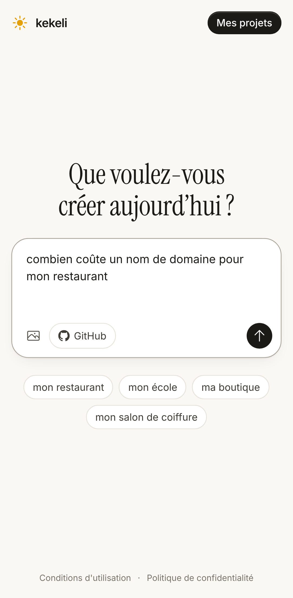 | 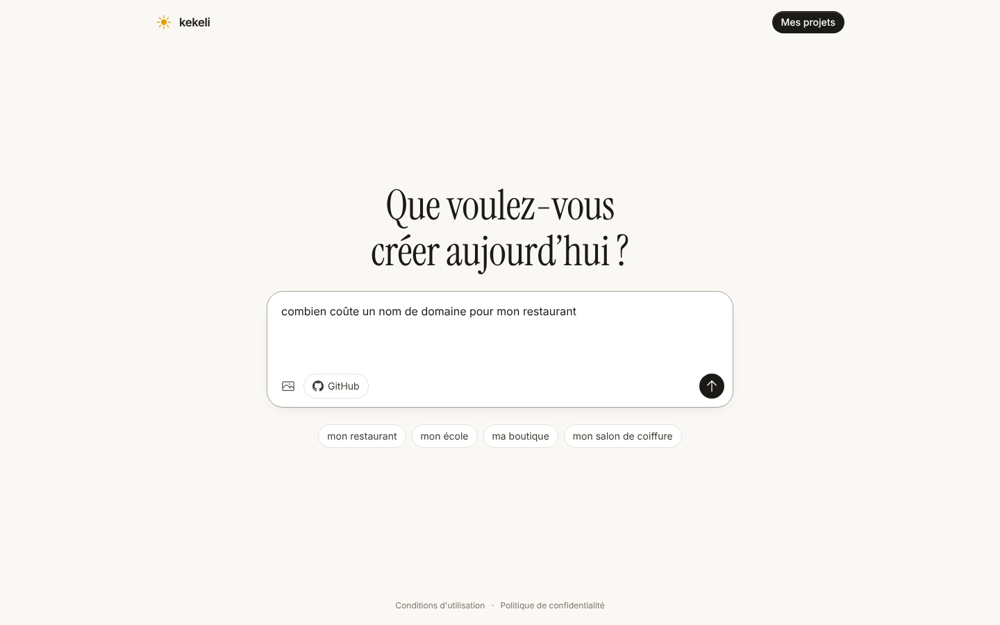 |
| 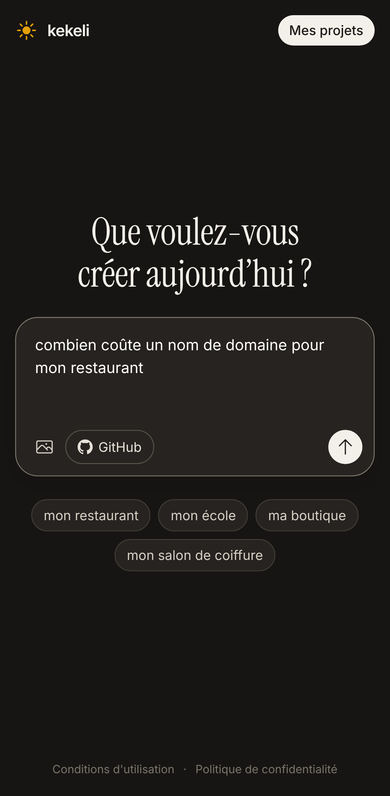 | 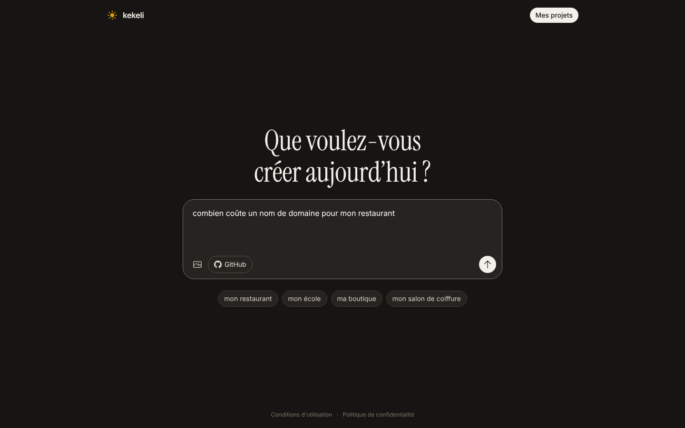 |

## 2. La discussion ouverte par cette question

Titre court donné automatiquement (modifiable avec « Renommer »), état « Discussion », réponse en paragraphes, seulement la discussion et la zone de saisie.

| Téléphone | Ordinateur |
|---|---|
| 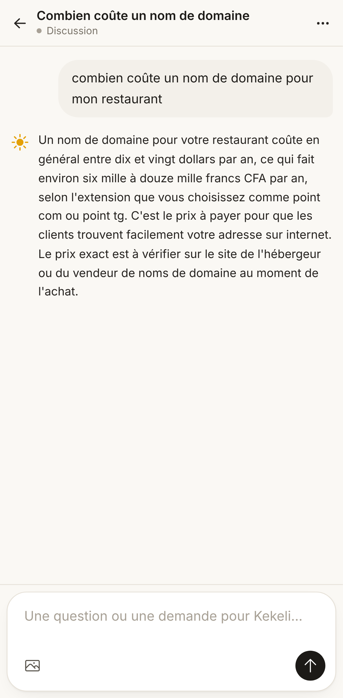 | 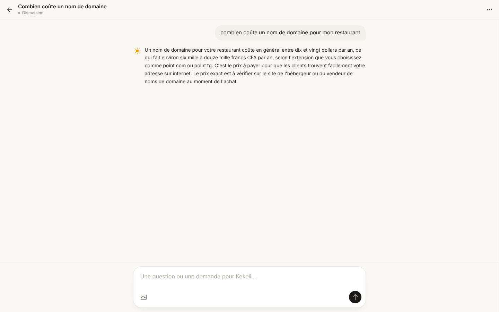 |
| 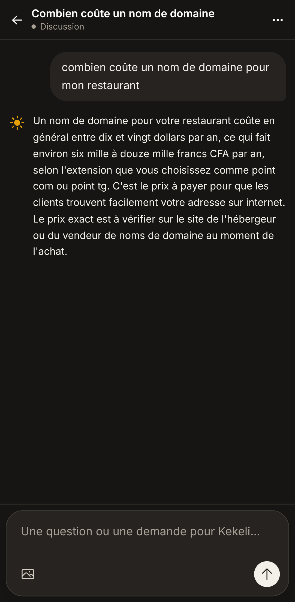 | 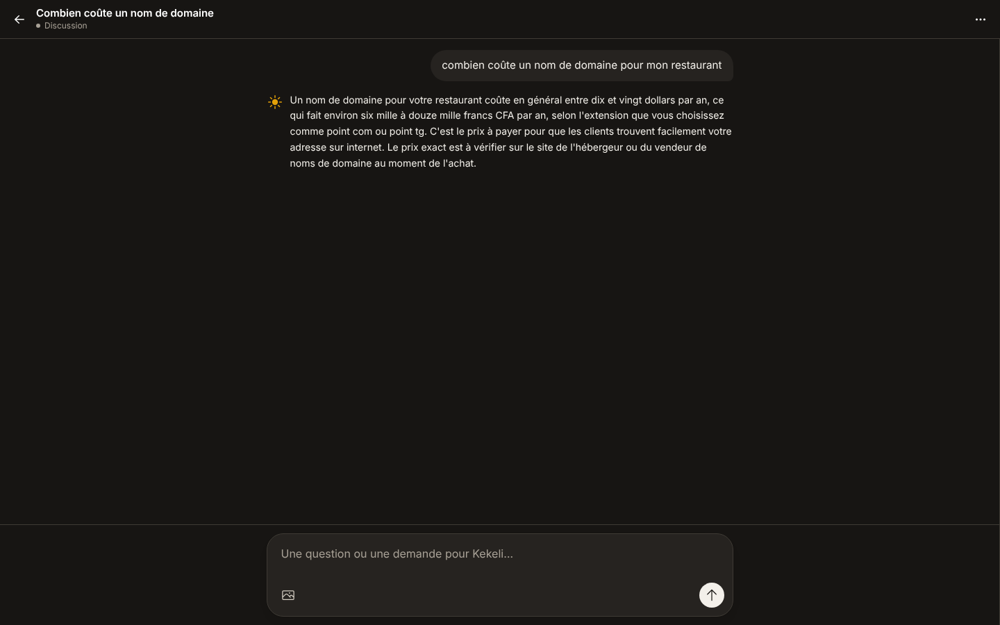 |

## 3. La discussion dans « Mes projets »

Une bulle pour une discussion, une fenêtre pour un site.

| Téléphone | Ordinateur |
|---|---|
| 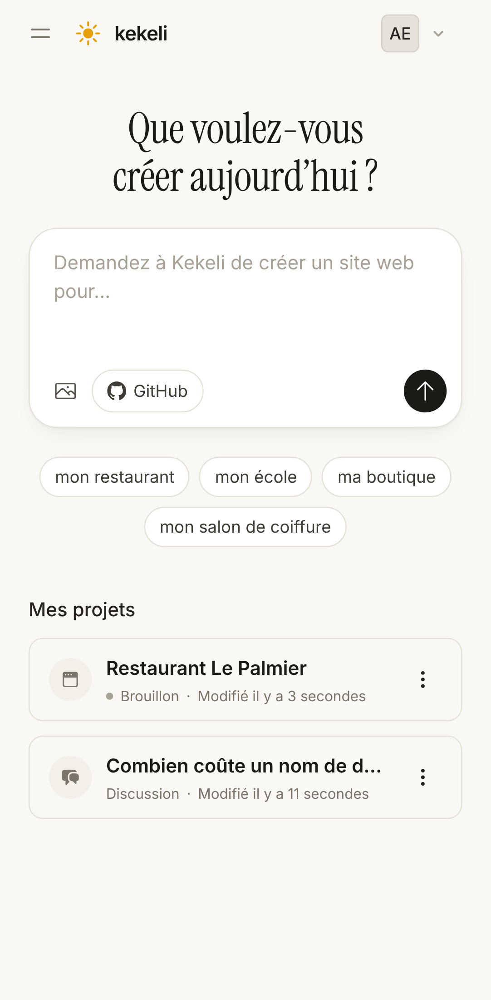 | 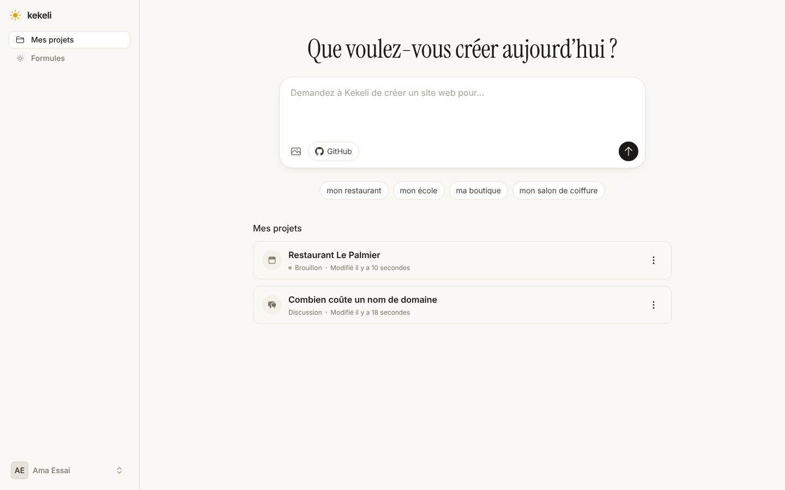 |
| 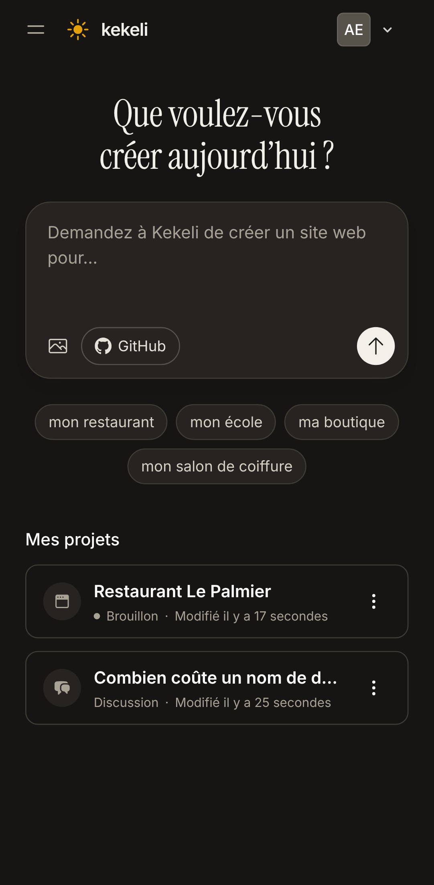 | 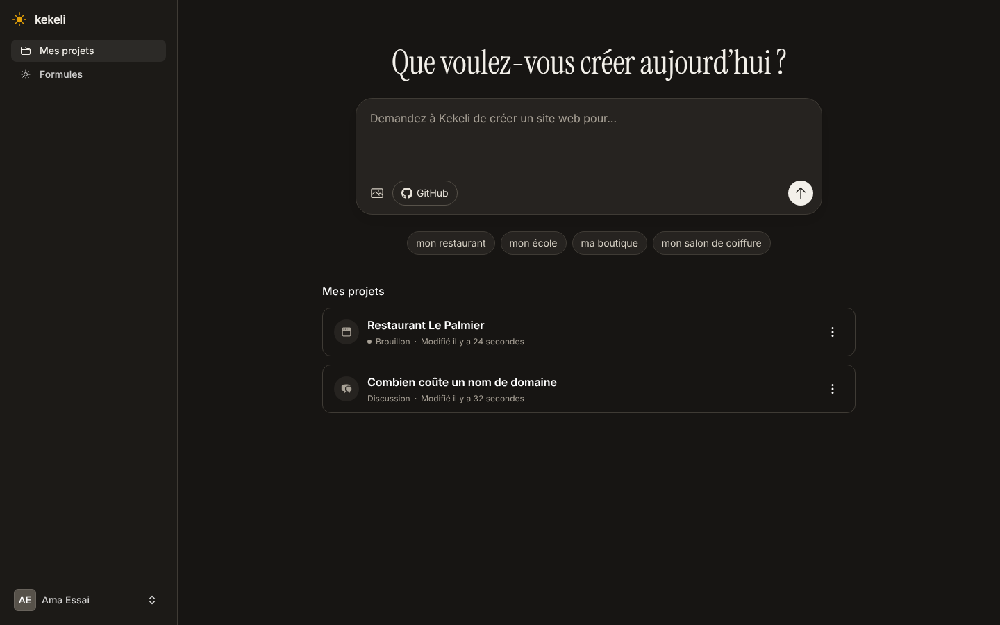 |

## 4. Une question dans un projet de site

« Où héberger mon site ? » : réponse directe, avec une vraie liste à puces, sans toucher au site.

| Téléphone | Ordinateur |
|---|---|
|  | 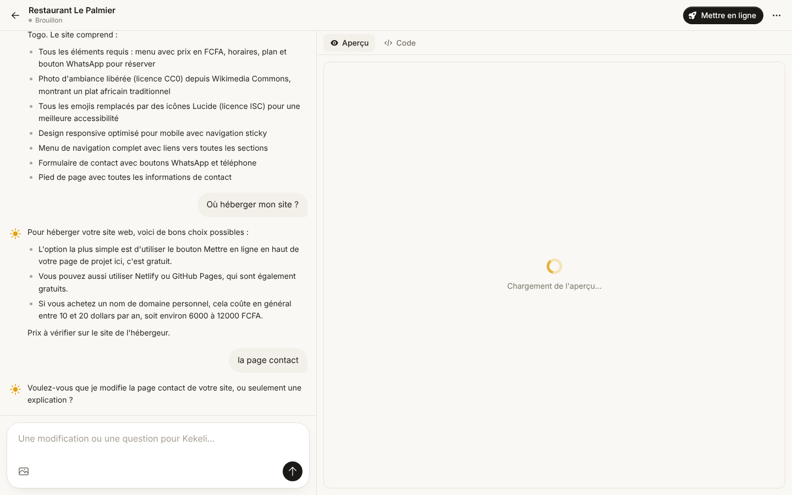 |
|  | 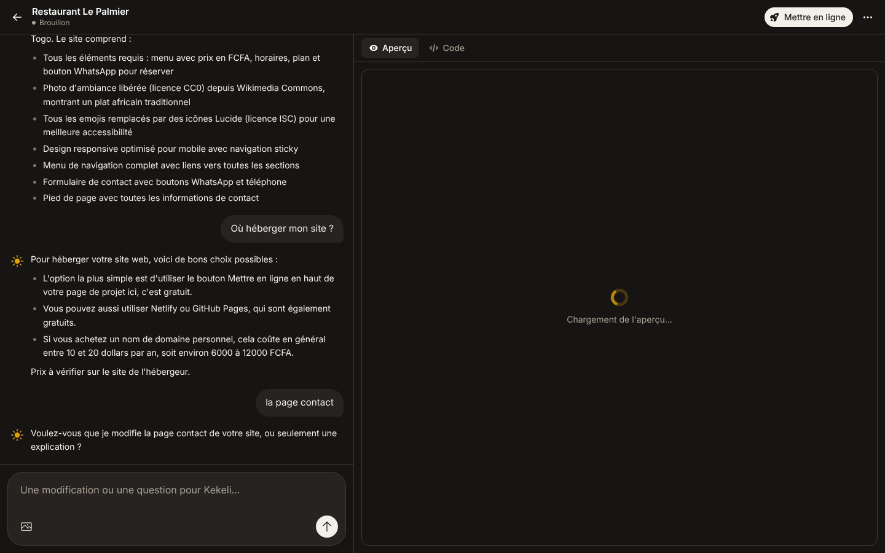 |

## 5. La question courte en cas de doute

« la page contact » ne dit pas quoi changer : Kekeli pose une seule question au lieu de lancer un travail qui coûterait de l'énergie.

| Téléphone | Ordinateur |
|---|---|
| 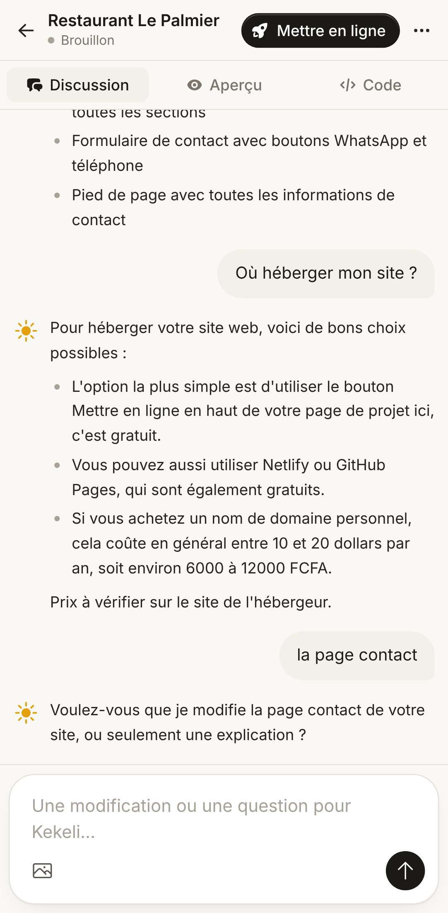 | 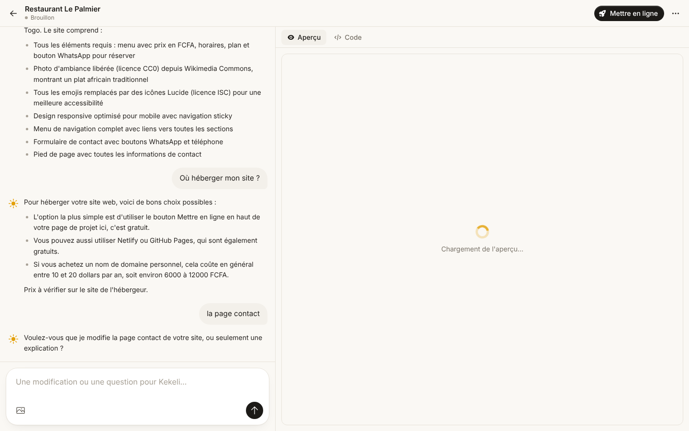 |
| 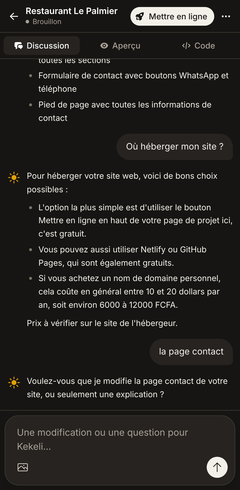 | 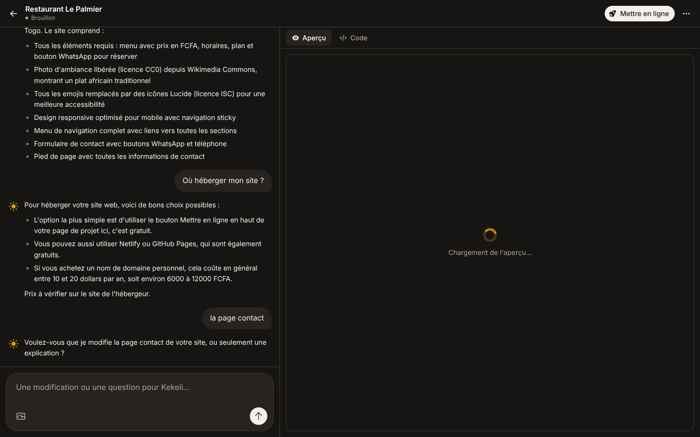 |
