# Vitesse : aussi rapide et fluide que Claude (15 novembre 2026)

Mesures prises sur un téléphone simulé (Pixel 7, Chrome, en français) contre un site local réglé comme en production : file d'attente `queue:work database --sleep=3`, vrai Runner avec les vraies clés de l'environnement (jamais affichées), modèles choisis par le routeur de Kekeli. Compte et messages inventés. Script : `scripts/mesurer-vitesse.js` ; résultats bruts : `docs/captures/vitesse/avant.json` et `docs/captures/vitesse/apres.json`.

**Limite de la mesure, à dire clairement** : en local, le site et le Runner ne dorment pas et sont sur la même machine. Sur Laravel Cloud, le premier message après une pause ajoute le réveil du site, de la base et du Runner, et le réseau du téléphone ajoute son propre délai.

## Avant (en secondes depuis le toucher sur « Envoyer »)

| Demande | Message affiché | Premier mot | Réponse finie |
|---|---|---|---|
| « Salut » (3 essais) | 0,2 · 0,2 · 0,2 | 4,3 · 8,3 · 2,3 | 4,3 · 8,3 · 2,3 |
| Question courte (3 essais) | 0,2 · 0,2 · 0,3 | 8,3 · 6,3 · 6,4 | 8,3 · 6,3 · 6,4 |
| Demande de site | 0,3 | travail affiché à 4,4 | première étape à 30,4 |

Où passe le temps (étapes notées par le site, en secondes depuis la réception du message) :

| Demande | Tâche reçue (file d'attente) | Appel au modèle → réponse entière | Réponse enregistrée |
|---|---|---|---|
| « Salut » | 2,3 · 2,0 · 0,3 | 1,6 · 4,3 · 1,3 | 4,0 · 6,3 · 1,6 |
| Question courte | 1,6 · 0,2 · 0,7 | 4,6 · 4,5 · 3,8 | 6,2 · 4,7 · 4,6 |
| Demande de site | 0,4 | 2,0 | 2,5 ; travail envoyé au Runner aussitôt, première étape 27,8 s plus tard (création de l'ordinateur virtuel) |

Trois causes : la tâche attend la file d'attente (jusqu'à 3 secondes, `--sleep=3`) ; le Runner attend la réponse entière du modèle avant de la rendre (aucun mot avant la fin) ; la page ne regarde s'il y a du nouveau que toutes les 2 secondes.

## Après (en secondes depuis le toucher sur « Envoyer »)

Mêmes conditions que la mesure « avant » (même machine, même file d'attente, même modèle choisi par le routeur : GPT-6.1 Terra chez Coarena).

| Demande | Message affiché | Premier mot | Réponse finie |
|---|---|---|---|
| « Salut » (3 essais) | 0,1 · 0,1 · 0,1 | 1,6 · 1,3 · 2,8 | 1,9 · 1,6 · 3,1 |
| Question courte (3 essais) | 0,1 · 0,1 · 0,1 | 3,2 · 9,4 · 3,1 | 4,5 · 11,8 · 4,2 |
| Demande de site | 0,1 | travail affiché à 2,6 | première étape à 20,6 |

Où passe le temps (étapes notées par le site, en secondes depuis la réception du message) :

| Demande | Tâche reçue | Appel au Runner | Premier mot (dont le modèle) | Réponse enregistrée |
|---|---|---|---|---|
| « Salut » | 0,2 · 0,2 · 0,3 | 0,2 · 0,2 · 0,3 | 1,5 (1,1) · 1,2 (1,0) · 2,7 (2,3) | 1,7 · 1,4 · 3,0 |
| Question courte | 0,3 · 0,2 · 0,2 | 0,3 · 0,3 · 0,2 | 3,1 (2,7) · 9,3 (9,0) · 2,9 (2,6) | 4,3 · 11,6 · 4,0 |
| Demande de site | 0,3 | 0,3 | outil choisi à 2,3 | travail envoyé 2,9 s après sa création ; première étape 13,9 s plus tard (création de l'ordinateur virtuel) |

**Ce qui a changé** : le site ne perd plus de temps (0,2 à 0,3 seconde entre le message et l'appel au modèle, contre jusqu'à 2,3 secondes) ; le premier mot s'affiche dès que le modèle l'écrit ; le reste du temps est celui du modèle lui-même. L'essai à 9,4 secondes vient du modèle (9,0 secondes chez Coarena avant son premier mot), pas du site.

## Le modèle le plus rapide pour les réponses courtes (mesuré, pas supposé)

Script `runner/scripts/mesurer-premier-mot.mjs`, 4 messages courts, 2 essais chacun, vrai premier répondant en mode « mot par mot ». Résultats : `runner/mesures/premier-mot.json`.

| Modèle | Réussis | Premier mot (médiane) | Réponse finie (médiane) |
|---|---|---|---|
| GPT-6.1 Terra (Coarena) | 8 sur 8 | 1,2 s | 1,8 s |
| GPT-6 Luna (OpenAI, clé payante) | 8 sur 8 | 1,3 s | 1,6 s |
| GPT-6 Luna (Coarena) | 8 sur 8 | 2,3 s | 2,5 s |
| Gemini 3.8 Flash (Coarena) | 8 sur 8 | 3,4 s | 3,5 s |
| Gemini 3.5 Flash-Lite (offre gratuite de Google) | 8 sur 8 | 10,2 s | 10,4 s |
| GLM 5.3 Flash (Coarena) | 0 sur 8 | — | — |

GPT-6.1 Terra chez Coarena, déjà le premier modèle des réponses courtes, est aussi le plus rapide : **la route ne change pas**. GLM 5.3 Flash échoue chez Coarena le 15 novembre 2026, avec ou sans le mode « mot par mot » (le modèle suivant prend le relais) : à surveiller dans Administration → Modèles.

## Poids et Lighthouse

| Mesure | Avant | Après |
|---|---|---|
| JavaScript (compressé) | 1,9 Ko | 4,2 Ko (+2,2 Ko : envoi instantané, réponse mot par mot, dictée) |
| CSS (compressé) | 41,4 Ko | 41,4 Ko |
| Lighthouse téléphone, performance (médiane de 3, deux séries) | Accueil 59 · 59 ; Discussion 68 · 63 | Accueil 59 · 59 ; Discussion 66 · 67 |
| Accessibilité | 100 | 100 |

Script : `scripts/lighthouse-vitesse.js`. Les écarts de la discussion (63 à 68) sont ceux de la mesure elle-même, des deux côtés.

## Captures (téléphone et ordinateur, clair et sombre)

Script : `scripts/captures-vitesse.js` (compte et messages inventés). Les états très courts sont tenus à l'écran en retardant les réponses du site dans le navigateur seulement.

| État | Téléphone, clair | Téléphone, sombre | Ordinateur, clair | Ordinateur, sombre |
|---|---|---|---|---|
| 1. Message affiché tout de suite, bouton « Arrêter » | 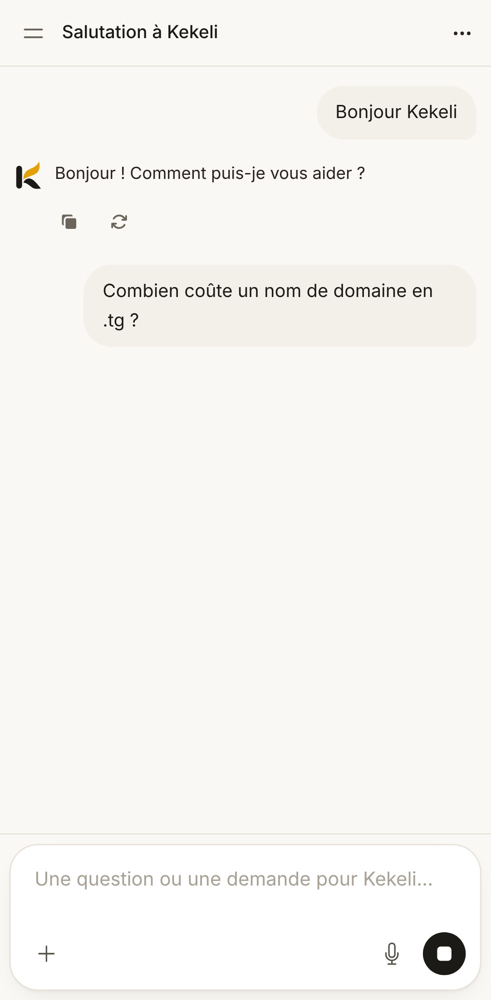 |  | 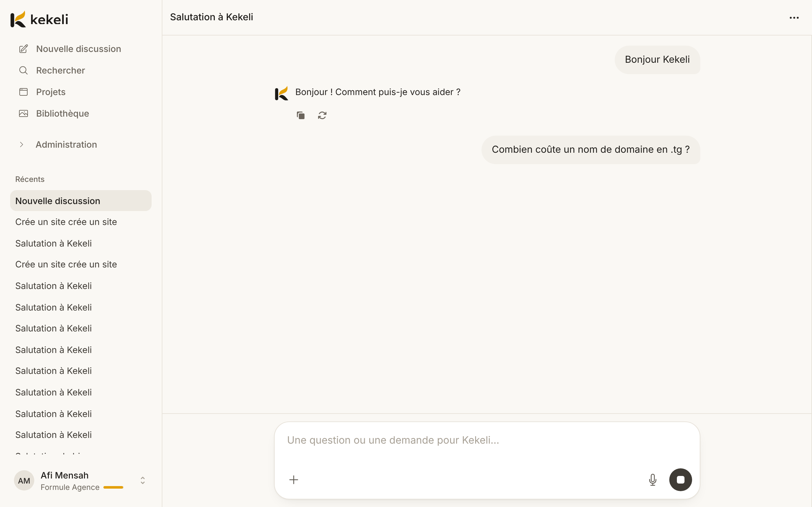 | 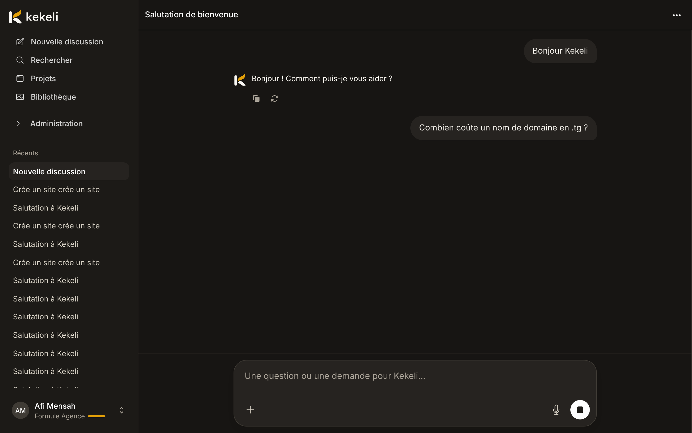 |
| 2. Le site se réveille : « Kekeli se réveille… » |  | 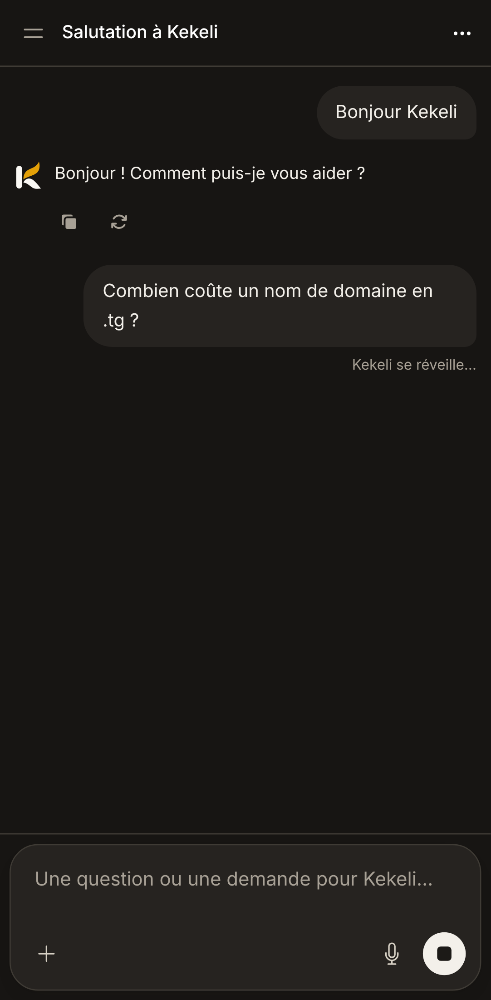 | 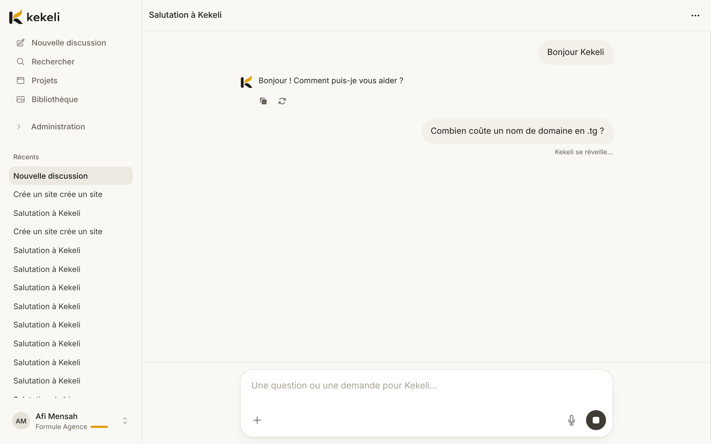 | 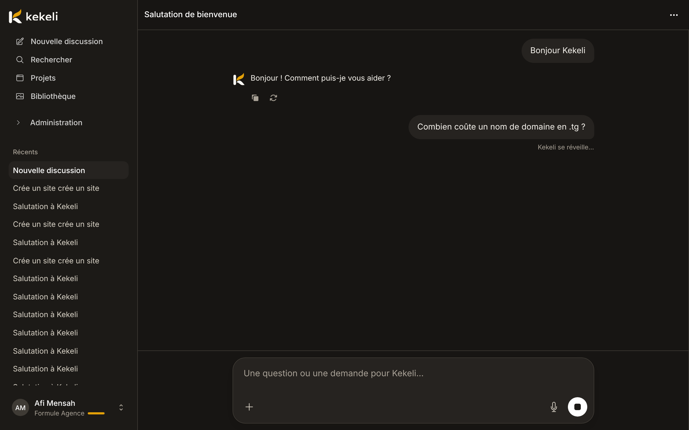 |
| 3. La réponse s'écrit mot par mot |  |  | 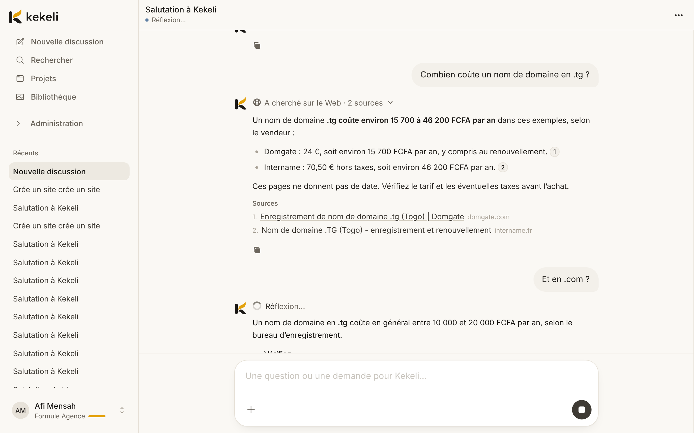 | 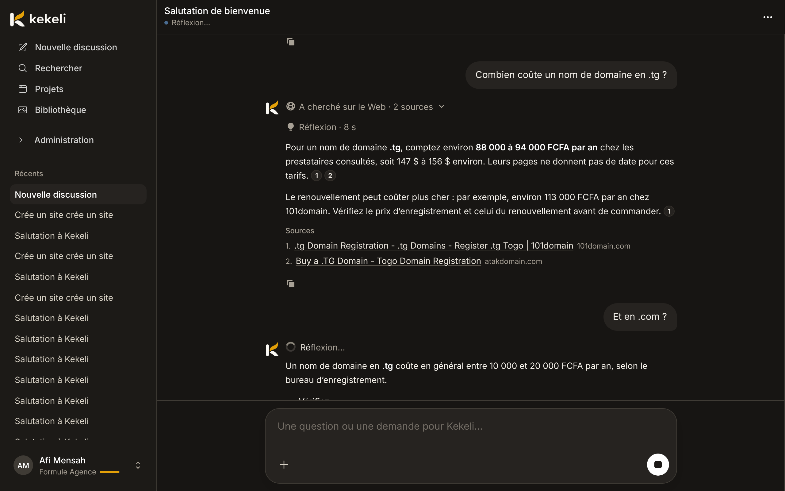 |
| 4. Réseau coupé : le message reste, avec « Réessayer » |  |  | 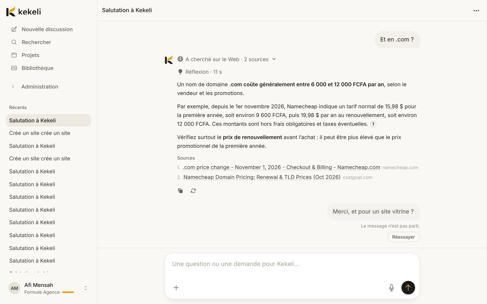 | 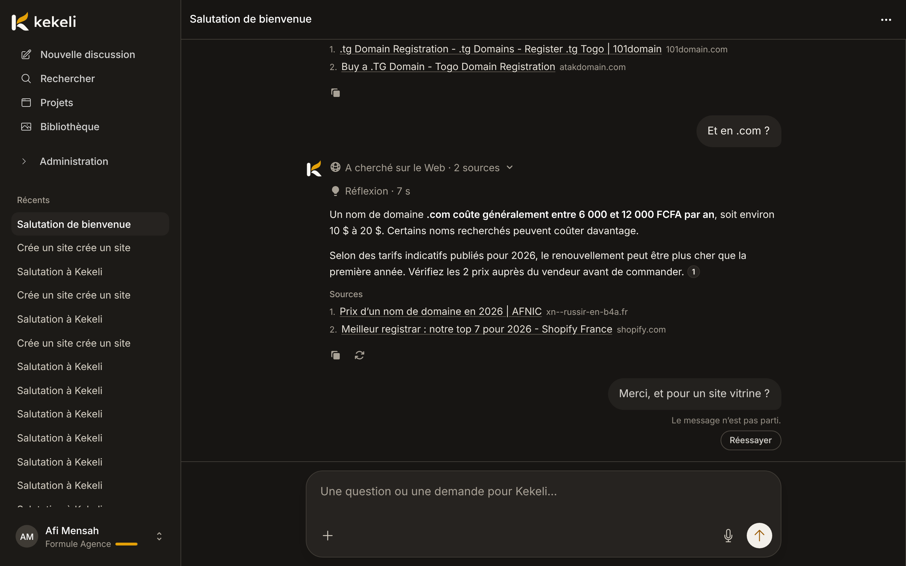 |
| 5. Demande dictée qui se répète : une question et « Oui, créer le site » | 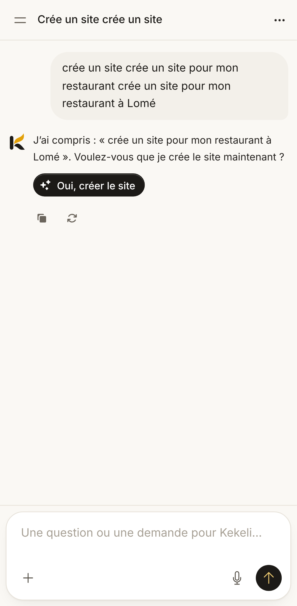 | 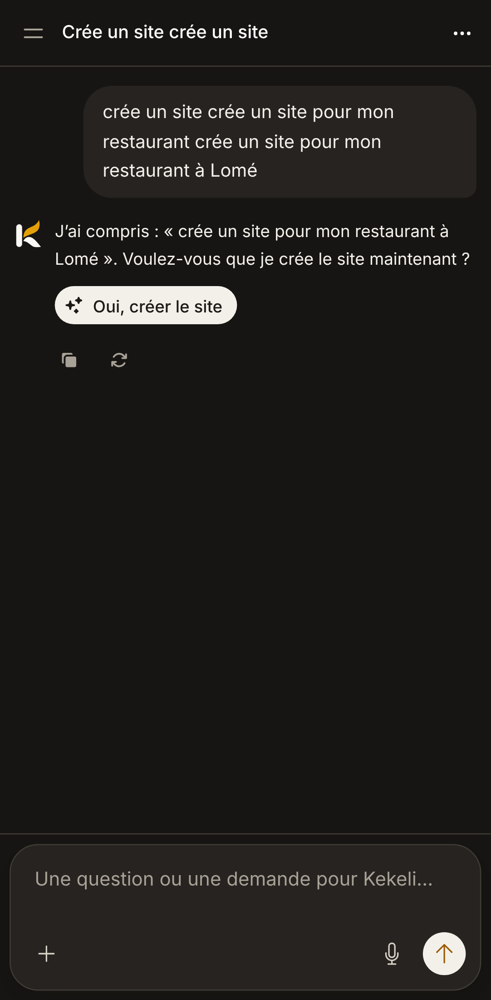 | 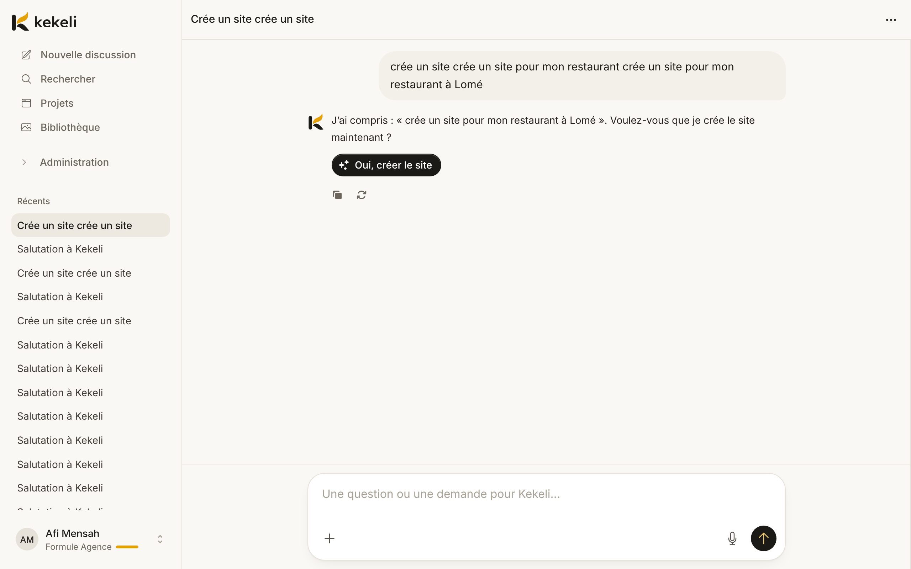 | 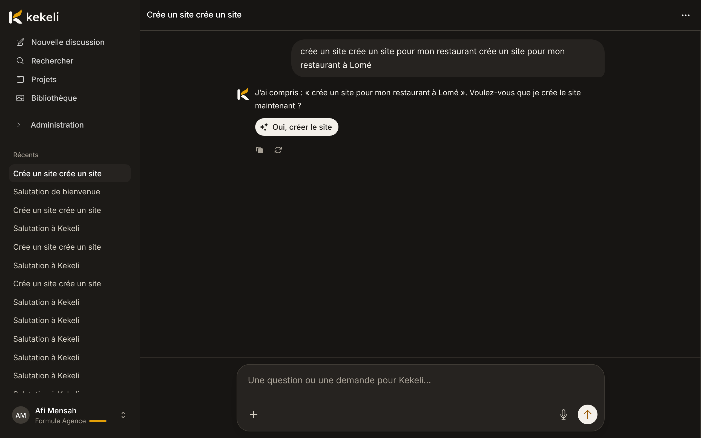 |
| 6. Administration → Consommation : « Vitesse des réponses » | 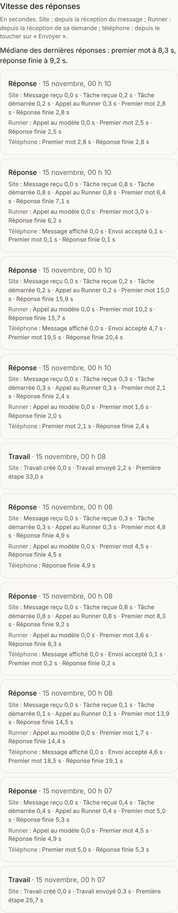 | 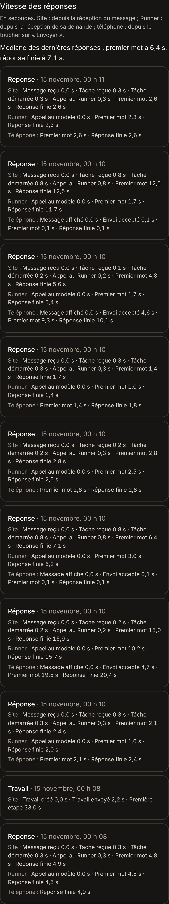 | 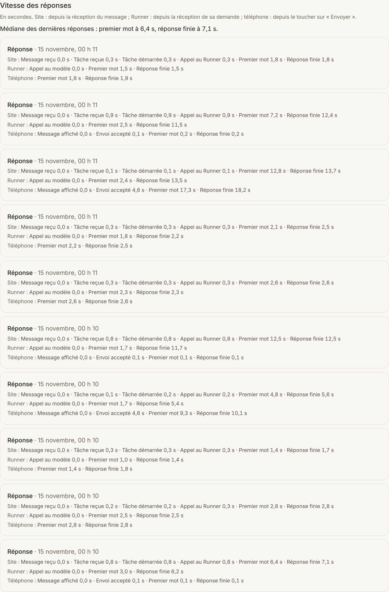 | 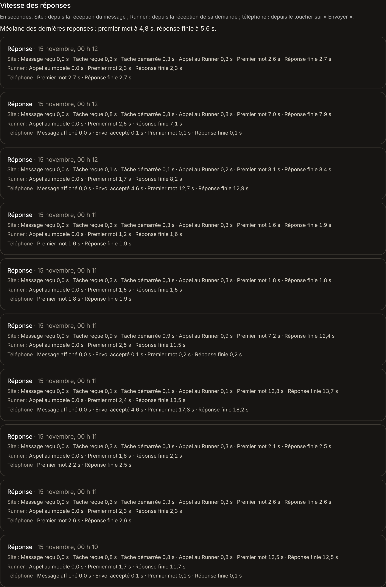 |

## Dictée sur Chrome Android

Essai `scripts/essai-dictee.js` : une fausse reconnaissance vocale rejoue la suite de résultats de chaque navigateur (Android répète le début de chaque morceau). Résultat : « bonjour je veux un site pour mon restaurant », sans mot répété, sur Android comme sur ordinateur (avant : « bonjour je veux bonjour je veux un site pour mon restaurant » sur Android).

## Décisions du premier répondant (mesure de toujours, 55 phrases)

`node runner/scripts/mesurer-repondant.mjs` (offre gratuite de Gemini, comme toujours pour cette mesure), avec 3 phrases ajoutées pour la partie 5 : la dictée répétée, « fais moi un site stp » et un message brouillé. Résultat : **37 bonnes décisions sur 39** (`runner/mesures/resultats-repondant.json` ; dernière mesure : 36 sur 36 le 12 novembre 2026, avec moins de phrases). Les 3 nouvelles phrases sont bonnes (aucune création lancée). Les 2 écarts ne passent pas par la nouvelle garde (qui ne retient que des créations) :

- « mets les prix en fcfa » (dans un projet de site) : rejouée 3 fois, 3 bonnes décisions (« modifier_site ») : un écart passager du modèle gratuit.
- « mon frère a un garage il lui faut quelque chose sur internet » : rejouée 3 fois, le modèle pose chaque fois une question (« un site qui présente le garage, ou une application ? »), ce qui est le bon comportement ; le script ne reconnaît comme « question » que certaines tournures.
