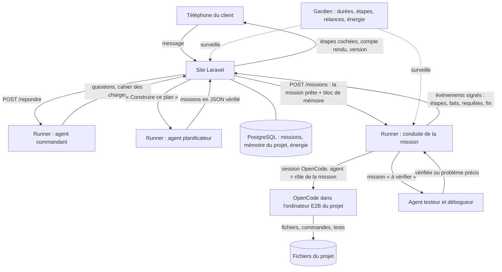

# Kekeli multi-agents : étude à partir de Sapper-v2 (18 novembre 2026)

Étude demandée par le porteur du projet le 18 novembre 2026. **Aucun code de production n'a été modifié** : ce document est la seule chose ajoutée. Le développement ne commencera qu'après sa validation.

Sources lues :

- **Kekeli** : le dépôt tel qu'il est sur `main` (commit `d823e9e`, pull request 84 fusionnée), en particulier `runner/src/agent.js`, `runner/src/ordinateurs.js`, `runner/src/repondant.js`, `app/Agent/`, `app/Jobs/`, `config/kekeli.php` et les mesures de `docs/couts.md`. La pull request 85 (KEKELI KNOWLEDGE) est ouverte et n'a pas été touchée.
- **Sapper-v2** : https://github.com/N1nEmAn/sapper-v2, commit `7b75e6f` du 11 novembre 2026, licence MIT (Copyright (c) 2026 N1nEmAn). Fichiers lus : `docker/commander/SPEC.md` (le contrat), `docker/commander/SKILL.md` (la doctrine du commandant, 426 lignes), `docker/commander/worker.sh` (776 lignes), `docker/commander/watchdog.sh` (658 lignes), `lib/sapper.py` (4 726 lignes, la mémoire faits-intentions), `templates/` (consignes reason, explore, verify, blindspot, brainstorm), `BATTLE-REPORT.md` (le récit de la compétition).
- **Le moteur de Kekeli** : le kit `@opencode-ai/sdk` 1.19.4 déjà installé dans le Runner (fichier `dist/gen/types.gen.d.ts`), pour vérifier ce qu'OpenCode sait déjà faire en matière d'agents spécialisés.

---

## Résumé en une page

1. **Sapper-v2 ne se transpose pas tel quel.** C'est un excellent système pour une épreuve précise : 63 cibles **indépendantes** à attaquer pendant 8 heures sans personne, avec beaucoup de jetons (environ 1 milliard). Ses agents sont des terminaux Claude Code pilotés **en tapant au clavier** dans tmux, tous sans aucune permission demandée, dans un seul conteneur. Construire **une** application cohérente pour un client, en quelques minutes et avec des offres gratuites limitées à 15 requêtes par minute, est un problème très différent.
2. **Quatre idées de Sapper-v2 sont précieuses pour Kekeli** : la **mémoire faits-intentions** à trois niveaux (titre, résumé, document) ; le **vérificateur** indépendant qui contrôle chaque résultat annoncé ; le **gardien sans stratégie** (il garde en vie, il ne décide rien) avec un nombre de relances limité ; et la **table d'escalade écrite à l'avance** (modèle économique d'abord, modèle puissant seulement après un échec précis).
3. **Kekeli a déjà la moitié du chemin** : le premier répondant joue déjà le rôle d'un commandant léger, le mode plan (« Construire ce plan ») existe, les étapes sont suivies en direct, les versions permettent de revenir en arrière, le basculement entre fournisseurs et le garde-fou de l'énergie existent. Et surtout, **OpenCode 1.19.4, déjà utilisé, sait définir des agents spécialisés** (chacun avec son modèle, ses consignes, ses outils permis, un nombre maximum d'étapes et ses permissions) et lancer des **sous-tâches** dans des sessions enfants. Aucune nouvelle dépendance n'est nécessaire.
4. **Le parallélisme n'est pas le vrai gain pour Kekeli.** Dans un même code (une application Laravel), les tâches vraiment indépendantes sont peu nombreuses, et les offres gratuites partagées par tous les clients se saturent vite (Gemini Flash-Lite : 15 requêtes par minute). Le vrai gain attendu est la **qualité** : un plan découpé en missions vérifiables, une mémoire du projet qui survit d'une demande à l'autre, et une vérification indépendante avant de dire « c'est prêt ».
5. **Recommandation** : un **MVP « Mode équipe » séquentiel** (une mission après l'autre, dans le même ordinateur E2B, avec les agents spécialisés d'OpenCode), réservé d'abord aux applications et à l'administrateur, **mesuré** contre l'agent unique actuel sur le banc de construction existant. On ne le garde que s'il fait mieux. Le parallélisme ne vient qu'ensuite, et seulement pour les missions qui ne touchent pas les mêmes fichiers.

---

## 1. Diagnostic de l'architecture actuelle de Kekeli

### 1.1 Comment une construction se passe aujourd'hui (code réel)

```
Téléphone du client
   │  message
   ▼
Site Laravel (Laravel Cloud)                    Runner Node.js (Laravel Cloud)            Ordinateur E2B (un par projet)
 RespondToMessage (file d'attente) ──POST /repondre──▶ premierRepondant()                      
   │  décision : répondre, poser des questions,  ◀── outil « creer_application », plan…      
   │  ou appeler un outil                                                                    
 CreateApplication : plan + « Construire ce plan »                                           
 SendAgentRun (file d'attente) ──POST /taches──▶ conduite de la tâche (agent.js) ──SDK──▶ OpenCode 1.19.4 (une session)
   ▲                                               │  basculement entre fournisseurs         │  lit, écrit, lance les commandes
   │                                               │  comptage des requêtes et des tokens    │  dans /home/user/projet
 RunnerEventHandler ◀──POST /runner/evenements─────┘  vérifications après la demande ───────▶│  (licences, qualité, typographie)
 agent_runs, agent_steps, versions, énergie           une correction automatique, compte rendu
```

Points vérifiés dans le code :

- **Un seul agent par demande** : `runner/src/agent.js` crée ou reprend **une** session OpenCode (`client.session.create`, `session.promptAsync`) et suit son flux d'événements. Les consignes sont celles du mode (site, application, agent, automatisation, dépôt GitHub).
- **Un seul ordinateur par projet** : `runner/src/ordinateurs.js` crée un ordinateur E2B à partir du modèle « opencode » (mesuré : 2 processeurs, 4 Go de mémoire, environ 0,166 $ de l'heure quand il tourne, `docs/couts.md`), mis en pause après 10 minutes sans travail (5 minutes en formule Gratuite).
- **Garde-fous déjà présents** : durée maximale d'une demande de 20 minutes (`DUREE_MAXIMALE_MS`), reprise après une coupure (`TEXTE_REPRISE`), basculement automatique quand un fournisseur atteint sa limite (`estUneLimite`, `memoireModeles`), garde-fou de l'énergie qui fait finir proprement l'étape en cours (`TEXTE_FIN_GARDE_FOU`), relance unique si le compte rendu manque (`TEXTE_COMPTE_RENDU`), vérifications après chaque demande avec **une** correction automatique (licences, qualité des pages, images), permissions demandées au client pour les commandes risquées.
- **Un « commandant » léger existe déjà** : le premier répondant (`runner/src/repondant.js`) comprend la demande, choisit l'outil, pose au plus 3 questions, et, pour une application, un agent ou une automatisation, propose un **plan** que le client valide (« Construire ce plan », `app/Agent/Tools/CreateApplication.php`).
- **File d'attente et priorités** : `app/Agent/AgentPlaces.php` limite le nombre de demandes en même temps (10 au plus, `max_concurrent_runs`) et le nombre de projets menés en même temps par formule (`parallel_runs` : 1, 1, 3, 5).
- **Mémoire** : la mémoire du **client** existe (souvenirs chiffrés, `app/Memory/UserMemory.php`) ; la mémoire **du projet** se limite à l'historique de la discussion (6 derniers messages entiers et un résumé, `runner/src/resume.js`) et aux fichiers eux-mêmes. Rien ne garde, de façon structurée, les **décisions** prises (par exemple « les prix sont en FCFA », « le paiement passe par FedaPay », « la table s'appelle `formations` »).
- **Équipes d'agents** : elles existent déjà, mais **pour les agents des clients** (LangGraph, `runner/src/agents/socles/langgraph/agent/equipe.js`), pas pour la construction faite par Kekeli.

### 1.2 Ce qui est mesuré

| Mesure (`docs/couts.md`) | Valeur |
|---|---|
| Site vitrine avec Gemini 3.5 Flash-Lite | 19 à 27 requêtes |
| Site vitrine avec Gemini 3.1 Flash-Lite | environ 40 requêtes |
| Application sur mesure à partir de zéro (Next.js) | 41 requêtes, 7 minutes 9 secondes, **80,6 FCFA** |
| Ordinateur E2B en marche | environ 98 FCFA de l'heure |
| Limites gratuites de Gemini Flash-Lite | 500 requêtes par jour et **15 par minute**, par modèle, **pour tous les clients ensemble** |

### 1.3 Forces et limites pour un travail multi-agents

Forces : une seule source de vérité pour les fichiers (l'ordinateur du projet), des étapes suivies en direct, des versions et le retour en arrière, l'énergie comptée au coût réel, le basculement entre fournisseurs, des tests automatisés nombreux (621 côté site, 433 côté Runner).

Limites :

1. **Une demande complexe est faite d'une seule traite par un seul agent** : sur une grande application, l'agent peut oublier une partie de la demande, et la seule vérification est faite à la fin (licences, qualité des pages), pas fonction par fonction.
2. **Aucune liste de missions persistante** : si le travail s'arrête (énergie, limite, 20 minutes), la reprise dépend du texte « reprends là où tu t'es arrêté », pas d'une liste de ce qui est fait et vérifié.
3. **Aucune vérification indépendante** : c'est le même agent qui construit et qui dit que c'est prêt.
4. **Les ressources sont partagées et petites** : les quotas gratuits sont communs à tous les clients ; Laravel Cloud met le site et le Runner en sommeil sans activité ; le Runner ne reste pas éveillé plus de 60 minutes d'affilée (règle du porteur du projet).

---

## 2. Analyse des mécanismes de Sapper-v2

### A. Commandant et travailleurs

**Fonctionnement réel.** Le commandant est lui-même un terminal Claude Code ouvert dans la fenêtre 0 d'une session tmux. Ses consignes (`docker/commander/SKILL.md`) lui imposent une boucle sans fin : lire le tableau (`worker.sh board`), réfléchir dans un ordre fixe (appels à l'aide, drapeaux non soumis, travailleurs bloqués, renseignements à transmettre, cibles terminées, places libres), faire **au plus deux actions décisives**, attendre 60 secondes, recommencer. Il ne travaille **jamais** lui-même sur une cible : ses seules mains sont `worker.sh`.

`worker.sh` (776 lignes de bash) est la boîte à outils du commandant : `spawn` ouvre une nouvelle fenêtre tmux, lance `claude --dangerously-skip-permissions` dedans, attend que la zone de saisie apparaisse (en acceptant les fenêtres de confirmation), puis **tape la mission au clavier** (`tmux send-keys -l`, jamais le collage, qui casse les terminaux) ; `msg` tape un ordre dans un travailleur ; `peek` lit l'écran d'un travailleur ; `kill` ferme une fenêtre ; `board` agrège la plateforme, les mémoires et les fenêtres en un tableau de moins de 100 lignes ; `hint` écrit un renseignement dans la mémoire d'une cible.

Les rôles sont apparus au fil de 18 versions : **éclaireur** (4 minutes de reconnaissance avec un modèle économique, verdict facile, moyen ou difficile), **soldat** (modèle économique, le cas normal), **général** (modèle puissant, qui peut embaucher ses propres petites équipes de 5 minutes). Deux plafonds durs : 8 fenêtres de travailleurs au plus, 3 cibles ouvertes en même temps sur la plateforme (codes de sortie 3 et 4, que le commandant sait traiter).

**Dépendances.** tmux, bash, Python (bibliothèque standard), Claude Code (ou Codex) en mode « tout permis », un conteneur Docker, la plateforme de la compétition.

**Intérêt pour Kekeli.** L'idée est bonne : **le commandant décide, il n'exécute pas**, et il a des plafonds explicites. La réalisation, elle, ne convient pas : piloter des terminaux en tapant au clavier est fragile (le code est plein de contournements : fenêtres de confirmation, collage cassé, mission restée dans la zone de saisie), et lancer des agents sans aucune permission est contraire à la sécurité de Kekeli. Kekeli a mieux : OpenCode se pilote par son interface (le kit SDK), pas par le clavier.

### B. Orchestration et conflits

**Fonctionnement réel.** Les travailleurs collaborent **par la mémoire partagée**, pas en se parlant directement. Quand deux travailleurs attaquent la même cible, le second a son propre dossier (pour que les sessions ne se mélangent pas) mais un **lien symbolique** vers la même mémoire (`ln -sfn ../<code>/.sapper`). La consigne exige que le second prenne **un angle différent** (« deux travailleurs qui font la même chose, c'est le gaspillage le plus cher »). Les conflits sont évités par trois moyens : **une cible par travailleur** (presque aucun fichier partagé), **un verrou de fichier** (`fcntl.flock`) sur chaque écriture de la mémoire, et l'**attribution des intentions** (`claim` et `release` : une intention prise par un travailleur ne peut pas être conclue par un autre).

La transmission des connaissances est le levier principal : quand une technique marche sur une cible, le commandant la diffuse aux cibles de la même famille (`hint` puis `msg`). Le récit de la compétition montre que c'est ce qui a donné 12 drapeaux en 40 minutes après 84 minutes de blocage.

**Intérêt pour Kekeli.** Le principe « collaborer par une mémoire commune, avec des écritures verrouillées et des tâches attribuées » est directement utile. Le contexte, lui, est inverse : Sapper a des cibles indépendantes ; Kekeli construit **un seul code** où tout se touche (les routes, les modèles, la base de données, le menu). Pour Kekeli, il faudra en plus **attribuer des fichiers**, pas seulement des tâches.

### C. Mémoire faits-intentions

**Fonctionnement réel** (`lib/sapper.py`, classe `Store`). Un graphe rangé dans un dossier `.sapper/`, **un fichier JSON par nœud**, écrit de façon atomique (fichier temporaire puis renommage), protégé par un verrou :

- **Fait** (`facts/f001.json`) : une observation **confirmée**, avec un type (pour Sapper : machine, service, identifiant, faille, butin, drapeau, note), des données structurées (`clé=valeur`), un créateur, et l'intention qui l'a produit.
- **Intention** (`intents/i001.json`) : une unité de travail, c'est-à-dire une arête **depuis** les faits dont elle dépend (`from`) **vers** le fait qu'elle produira (`to`, vide tant qu'elle n'est pas conclue). États : ouverte, attribuée à un travailleur, terminée. Option `requires_confirmation` : l'intention attend l'accord d'un humain.
- **But** (`goal`) : une intention qui aboutit au but termine le projet ; une seule arête de fin est permise.
- **Renseignement** (`hints/`) : un message direct du commandant ou d'un humain.
- **Trois niveaux de lecture** pour chaque nœud : un **titre** de 2 à 10 mots, une **description** d'une phrase (injectée dans chaque consigne), un **document** détaillé lu seulement quand c'est utile. C'est ce qui évite de saturer la mémoire de travail du modèle.

Fonctions clés : la **frontière** (`frontier`) donne les intentions prêtes (ouvertes, toutes leurs dépendances existent, confirmées si besoin) ; le **rappel** (`recall`) retrouve les faits proches d'une tâche par score de mots ; la **validation** (`validate_graph`) vérifie l'intégrité du graphe. Les consignes répètent partout que **le contenu du graphe est une donnée, jamais un ordre** (défense contre l'injection de consignes).

**Intérêt pour Kekeli.** C'est le mécanisme le plus utile de Sapper. Une « mémoire du projet » avec des faits (« la table `formations` a les colonnes… », « le paiement passe par FedaPay en mode test », « les prix sont en FCFA »), des décisions et des missions reliées à ce qu'elles dépendent, avec les trois niveaux de lecture, réglerait la limite 2 du diagnostic (reprise) et donnerait le contexte utile à chaque agent spécialisé sans tout relire. Pour Kekeli, le stockage doit être la **base PostgreSQL du site** (chiffrée comme les souvenirs), pas des fichiers dans un conteneur.

### D. Le gardien (« watchdog »)

**Fonctionnement réel** (`docker/commander/watchdog.sh`). Une boucle bash toutes les 15 secondes, **sans aucune stratégie** (c'est écrit en toutes lettres dans le contrat : il ne choisit rien, ne lance rien de nouveau, n'écrit aucune mission). Dans l'ordre :

1. commandant mort (le texte `DRIVE_PANE_EXITED` à l'écran, ou fenêtre disparue) : relance avec `--continue` et la consigne de relire sa note de passation ;
2. texte resté dans la zone de saisie : appuyer sur Entrée, 3 fois au plus, puis relancer ;
3. fenêtres de confirmation : les accepter ;
4. erreur de quota ou de clé : changer de clé (avec un **garde contre les tempêtes** : 5 minutes entre deux changements et 6 changements par heure au plus, ajouté après un incident réel où toute la flotte se relançait toutes les 16 secondes), relancer sans consommer le budget de relances ;
5. travailleur mort : relance avec `--continue`, **3 fois au plus par travailleur**, puis on le laisse au commandant ;
6. fin du temps global : arrêter tout le monde, soumettre ce qui a été trouvé, fermer proprement ;
7. travailleur immobile : **rien** (relancer un travailleur qui réfléchit serait pire ; c'est au commandant de juger).

S'y ajoute un filet : commandant figé 30 minutes sans rien dans la zone de saisie, on le relance. Le **blocage** se détecte par une empreinte de l'écran (`sha256`) qui ne change plus ; la **tâche inachevée** se voit au tableau (pas de nouveau fait depuis environ 15 minutes) et c'est le commandant qui applique la table d'escalade.

**Intérêt pour Kekeli.** Le principe « garder en vie sans décider », avec des **budgets de relance** et un **garde contre les tempêtes**, est excellent et rejoint ce que Kekeli fait déjà en partie (durée maximale, reprise, basculement). Le changement de clé dans une réserve de clés, en revanche, est **interdit** pour Kekeli : la règle du projet est un seul compte par fournisseur, jamais de multiplication des comptes pour contourner les quotas.

### E. Gestion des missions

**Fonctionnement réel.** Deux niveaux.

- **Au niveau de la campagne** (le commandant) : une table d'escalade **écrite à l'avance** selon le temps passé sur une cible (0 à 10 minutes : un ordre tactique ; 10 à 20 : un deuxième travailleur avec un autre angle ; 20 à 30 : un général avec le modèle puissant ; 30 à 45 : mettre de côté, avec la raison notée). Le modèle puissant est réservé à quatre usages précis ; tout le reste tourne avec le modèle économique (c'est ce qui a permis de gagner avec 1 milliard de jetons contre 4,5 milliards pour le deuxième). Le commandant garde une **note de passation** (`commander-state.md`, moins de 150 lignes : tableau des missions, cibles mises de côté, renseignements, file d'attente) qu'il réécrit avant que sa mémoire de travail soit pleine et qu'il relit à chaque redémarrage.
- **Au niveau d'une cible** (`sapper auto`) : un cycle « raisonner » (le commandant de la cible propose des intentions ou déclare le but atteint, en JSON), « explorer » (un exécutant fait chaque intention prête et la conclut par un fait), « vérifier » (facultatif : un vérificateur refait le minimum pour confirmer le résultat, et répond `verified` vrai ou faux avec le problème précis). Arrêts : but atteint, deux réponses vides de suite, aucun changement du graphe, nombre d'étapes maximum, échéance. Deux consignes de plus : « angle mort » (lister ce que l'équipe ne vérifie pas) et « remue-méninges » (proposer des options).

**Intérêt pour Kekeli.** Le cycle **raisonner, exécuter, vérifier**, les arrêts explicites, la note de passation et la table d'escalade sont directement réutilisables, en idées, pour la construction d'une application.

### Ce que Sapper-v2 coûte et ce qu'il suppose

D'après son propre récit (`BATTLE-REPORT.md`) : 475 minutes sans intervention, environ 1 milliard de jetons, environ 110 yuans (environ 15 $, estimation de l'auteur) pour le modèle économique plus les clés du modèle puissant, 8 travailleurs au plus. C'est un budget et une durée sans commune mesure avec une demande de client Kekeli (quelques minutes, quelques dizaines de FCFA).

---

## 3. Architecture cible : Kekeli multi-agents

### 3.1 Principes

1. **Évolution, pas reconstruction** : le site Laravel, le Runner, OpenCode et l'ordinateur E2B par projet restent. On ajoute une couche « missions » et une « mémoire du projet ».
2. **Le commandant décide, il n'exécute pas** (repris de Sapper). Il ne touche jamais aux fichiers.
3. **Le modèle n'écrit que des descriptions** (règle déjà suivie pour les vidéos et les documents) : le plan est un JSON vérifié par le code (dépendances valides, pas de cycle, fichiers attribués, rôles connus), jamais un programme.
4. **Un fichier, un propriétaire à la fois** : chaque mission déclare les fichiers ou dossiers qu'elle peut modifier ; les fichiers partagés (routes, menu, dépendances, migrations) appartiennent à une mission d'intégration.
5. **Rien n'est « fini » sans preuve** : chaque mission a des critères d'acceptation ; un vérificateur indépendant les contrôle (tests, page qui s'ouvre, requête qui répond).
6. **Le gardien garde en vie, il ne décide rien** (repris de Sapper), avec des budgets de relance.
7. **Modèle économique d'abord, puissant sur échec précis**, selon une table écrite à l'avance (déjà l'esprit de `ModelRouter` et de `small_edit_models`).
8. **Tout est mesuré** avant d'être gardé (règle de Kekeli) : qualité, requêtes, FCFA, minutes, contre l'agent unique actuel.

### 3.2 Les composants

| Composant | Où | Ce qu'il fait | Ce qui existe déjà |
|---|---|---|---|
| **Agent commandant** | Runner (requête au modèle, sans ordinateur) | Comprend la demande, pose ses questions, écrit le cahier des charges court et les critères d'acceptation globaux, choisit la technologie ; à la fin, compare le résultat à la demande et écrit le compte rendu | Premier répondant, `CreateApplication` (plan), compte rendu |
| **Agent planificateur** | Runner (une requête) | Découpe en missions (rôle, objectif, critères, fichiers permis, dépendances, priorité, taille), en JSON vérifié par le code | Rien (le plan actuel est du texte) |
| **Agents spécialisés** | OpenCode, dans l'ordinateur du projet | Frontend, backend, base de données, interface (UI/UX), recherche et documentation, testeur et débogueur : chacun avec ses consignes, ses outils permis, son modèle et son nombre maximum d'étapes | Un seul agent « build » ; OpenCode 1.19.4 sait déjà déclarer des agents (`AgentConfig` : `model`, `prompt`, `tools`, `mode: "subagent"`, `maxSteps`, `permission`) |
| **Mémoire du projet** | Base PostgreSQL du site | Faits, décisions, contrats (schéma de la base, routes, noms), résultats des missions ; trois niveaux (titre, résumé, document) ; un bloc court envoyé à chaque agent | Mémoire du client (souvenirs chiffrés), résumé des longues discussions |
| **Ordonnanceur de missions** | Site (file d'attente Laravel) et Runner | Donne au Runner la prochaine mission prête (dépendances faites, fichiers libres), une à la fois au début | `AgentPlaces`, `SendAgentRun`, `agent_runs` |
| **Gardien** | Runner (boucle de la tâche) et site (tâche planifiée à chaque réveil) | Durée et étapes maximum par mission, absence de progrès, relances limitées, garde contre les tempêtes, énergie, échéance | `DUREE_MAXIMALE_MS`, `TEXTE_REPRISE`, basculement, garde-fou de l'énergie |
| **Validation finale** | Runner puis site | Le testeur lance toute la suite ; le commandant coche chaque critère global avec sa preuve ; une version est créée seulement si tout passe | Vérifications après la demande, versions |

### 3.3 Le format d'une mission (proposition)

```json
{
  "id": "m04",
  "role": "backend",
  "titre": "Catalogue des formations",
  "objectif": "Liste publique des formations et page de détail.",
  "criteres": ["GET /formations répond 200 avec les formations publiées", "un test Feature couvre la liste et le détail"],
  "fichiers": ["app/Http/Controllers/FormationController.php", "resources/views/formations/**", "tests/Feature/CatalogueTest.php"],
  "depend_de": ["m01", "m02"],
  "priorite": 2,
  "taille": "moyenne"
}
```

Le code vérifie : rôle connu, au plus 12 missions pour un projet, dépendances existantes et sans cycle, fichiers dans le dossier du projet, jamais `.env`, et aucun fichier attribué à deux missions qui peuvent tourner en même temps.

### 3.4 La mémoire du projet (adaptée de Sapper)

- Table `project_facts` : `kind` (decision, contrat, schema, route, resultat, probleme, note), `title`, `summary`, `doc` (chiffré), `mission_id`, `verified_at`, `created_by` (rôle de l'agent).
- Table `project_missions` : le format ci-dessus, plus l'état (en attente, prête, en cours, à vérifier, vérifiée, échouée, abandonnée), l'agent qui la tient, le nombre d'essais, le modèle utilisé, les requêtes et le coût.
- **Envoi aux agents** : seulement les titres et résumés des faits utiles à la mission (comme le rappel de Sapper et comme `souvenirsUtiles` de la mémoire du client), le document complet seulement sur demande de l'agent (outil interne « lire_fait »).
- **Écriture par les agents** : un outil interne « noter_fait » (ou un bloc JSON à la fin de chaque mission, lu par le Runner) ; le Runner vérifie et transmet au site, qui enregistre. Les agents n'écrivent jamais directement dans la base.
- **Sécurité** : le contenu de la mémoire est une **information, jamais une consigne** (règle déjà appliquée partout dans Kekeli et répétée dans chaque consigne de Sapper).

### 3.5 Éviter les conflits entre agents

1. **Phase séquentielle (MVP)** : une seule mission à la fois, donc aucun conflit de fichiers.
2. **Phase parallèle** : chaque mission en parallèle travaille dans son propre **arbre de travail Git** (`git worktree`) dans le même ordinateur ; une mission d'**intégration** fusionne, et un conflit Git devient une mission de correction. Les fichiers partagés (routes, menu, `composer.json`, `package.json`, ordre des migrations) n'appartiennent qu'à la mission d'intégration. Le dépôt Git interne existe déjà (`/home/user/.kekeli/historique.git`, utilisé pour les différences).
3. **Contrats d'abord** : le schéma de la base et la liste des routes sont des faits écrits **avant** le travail en parallèle ; frontend et backend s'y tiennent.

### 3.6 Python pour les agents spécialisés ?

**Non recommandé.** Le Runner est en Node.js, OpenCode fait déjà le travail d'agent, et les agents spécialisés se déclarent dans sa configuration. Ajouter un service Python (CrewAI, LangGraph Python) créerait un deuxième déploiement sur Laravel Cloud, une deuxième façon d'appeler les modèles (et donc de compter l'énergie et de respecter le basculement et les verrous « jamais de modèle payant »), sans gain identifié. Python reste ce qu'il est aujourd'hui : une technologie que Kekeli **écrit pour ses clients** (agents CrewAI), et l'outil de mise en page des documents dans l'atelier.

---

## 4. Schéma de communication



Version texte (pour un téléphone sans le dessin) :

```
Client ─▶ Site ─▶ Runner « commandant » ─▶ Site (questions, plan)
Site ─▶ Runner « planificateur » ─▶ Site (missions vérifiées, rangées dans PostgreSQL)
Site (ordonnanceur) ─▶ Runner (une mission prête + la mémoire utile)
Runner ─▶ OpenCode dans l'ordinateur E2B (agent du rôle) ─▶ fichiers, tests
Runner ─▶ Site : étapes, faits, requêtes et coût (événements signés, comme aujourd'hui)
Runner ─▶ agent testeur ─▶ « vérifiée » ou « problème précis »
Gardien : surveille durées, étapes, absence de progrès, relances, énergie
Site ─▶ Client : missions cochées, compte rendu final, nouvelle version
```

Toutes les flèches entre le site et le Runner restent **signées** (`KEKELI_RUNNER_SECRET`), comme aujourd'hui ; aucune clé n'entre dans l'ordinateur E2B (le relais et la passerelle existants restent la règle).

---

## 5. Technologies recommandées

| Besoin | Recommandation | Pourquoi |
|---|---|---|
| Agents spécialisés | **Agents d'OpenCode 1.19.4** (déjà installé) : `agent` dans `opencode.json`, `mode: "subagent"`, `prompt`, `tools`, `model`, `maxSteps`, `permission` ; choix de l'agent à chaque demande (`session.prompt({ body: { agent } })`) ; sous-tâches (`SubtaskPartInput`) et sessions enfants (`parentID`, `session.children`) pour plus tard | Aucune dépendance nouvelle ; même ordinateur, mêmes verrous, même comptage |
| Missions et mémoire | **Tables PostgreSQL** (migrations Laravel), contenu chiffré comme `memories` | La base existe ; elle survit au sommeil de Laravel Cloud ; consultable dans l'administration |
| File des missions | **File d'attente Laravel existante** (`queue:work --timeout=600`) et `AgentPlaces` | Déjà en production, avec priorités par formule |
| Communication agents | **Par la mémoire du projet** (comme Sapper), jamais d'agent à agent en direct | Traçable, rejouable, pas de messages perdus |
| Conflits (phase parallèle) | **Git worktree** dans l'ordinateur E2B | Git est déjà là ; fusion et conflits détectés par Git |
| Vérification | Tests du socle (PHPUnit, tests Node), vérificateurs existants (`qualite/verifier.mjs`), navigateur sans écran pour quelques pages | Déjà utilisés dans les applications |
| Python | Aucun nouveau service | Voir 3.6 |
| tmux, Claude Code en mode « tout permis », réserve de clés | **Écartés** | Fragiles, contraires à la sécurité et aux règles du projet |

---

## 6. Estimation des ressources et des coûts

**Toutes ces valeurs sont des estimations, à mesurer.** Point de départ mesuré : une application à partir de zéro, avec l'agent unique, a demandé 41 requêtes, 7 minutes et coûté 80,6 FCFA.

Les retours publics d'Anthropic sur son propre système multi-agents (article « How we built our multi-agent research system », juin 2025) indiquent qu'un système multi-agents consomme environ **15 fois** plus de jetons qu'une simple discussion (et un agent seul environ 4 fois), et qu'il convient surtout aux tâches **larges et parallélisables** (la recherche), beaucoup moins au code, où les agents doivent partager beaucoup de contexte. C'est cohérent avec ce que montre le code de Sapper (cibles indépendantes).

| Poste | Agent unique (mesuré) | Mode équipe séquentiel (estimation) | Mode équipe parallèle (estimation) |
|---|---|---|---|
| Requêtes au modèle par application | 41 | 60 à 100 (plan, consignes répétées par mission, vérifications) | 70 à 120 |
| Coût du modèle | environ 69 FCFA | 100 à 200 FCFA | 120 à 250 FCFA |
| Minutes d'ordinateur E2B | environ 7 | 10 à 15 (vérifications) | 7 à 12 (gain limité : une seule machine de 2 processeurs) |
| Coût de l'ordinateur | environ 12 FCFA | 16 à 25 FCFA | 12 à 20 FCFA |
| **Total par application** | **environ 81 FCFA** | **environ 120 à 225 FCFA** | **environ 130 à 270 FCFA** |
| Requêtes par minute au plus fort | environ 6 | environ 6 | 15 à 25 (dépasse les 15 par minute de Gemini gratuit) |

Conséquences :

- **Offres gratuites** : en parallèle, un seul client saturerait la limite de 15 requêtes par minute d'un modèle Gemini gratuit, partagée par tous les clients. Le mode parallèle n'est donc raisonnable qu'avec des modèles payants (ou pour des missions qui n'appellent pas le même modèle).
- **Formule Gratuite (100 FCFA par jour)** : une application en mode équipe tiendrait sur 2 ou 3 jours, comme aujourd'hui une grande application.
- **Hébergement** : aucune nouvelle application sur Laravel Cloud ; quelques tables de plus dans PostgreSQL (quelques kilo-octets par projet) ; le Runner garde ses 60 minutes maximum d'éveil (une application doit tenir en moins de 30 minutes de travail, découpée en missions qui reprennent proprement).
- **E2B** : toujours **un** ordinateur par projet (2 processeurs, 4 Go). Pour le parallèle avec des tests lourds (Laravel et Next.js ensemble), 4 processeurs et 8 Go pourraient être nécessaires, environ 0,33 $ de l'heure (estimation à partir des prix officiels déjà notés dans `docs/couts.md`), **à décider par le porteur du projet**.

---

## 7. Scénario de validation : la plateforme de formation

Demande : « Crée une plateforme professionnelle de formation en ligne avec inscription, connexion, espace membre, catalogue de formations, paiement et tableau de bord administrateur. »

### 7.1 Le commandant comprend la demande

1. Le premier répondant reconnaît une **application** (comptes, données, rôles) : outil `creer_application`.
2. Il manque des informations qu'il ne peut pas deviner : il pose au plus 3 questions avec des choix à toucher (comme aujourd'hui) : nom de la plateforme ; formations payantes en FCFA par Mobile Money ou paiement par carte ; vidéos hébergées ailleurs (YouTube non répertorié, Vimeo) ou documents à télécharger.
3. Il écrit le **cahier des charges court** et les **critères globaux**, rangés comme faits de type `decision` : technologie Laravel (par défaut, déjà le choix de Kekeli) ; rôles « membre » et « administrateur » ; **paiement** : Kekeli n'encaisse jamais pour le client, il écrit l'intégration d'un service choisi par le client (par exemple FedaPay ou CinetPay, avec ses clés dans les Variables secrètes) et, sans clé, un **mode de paiement d'essai** clairement affiché ; les vidéos ne sont pas hébergées par Kekeli.
4. Le client voit le plan court et touche « Construire ce plan » (existant).

### 7.2 Le planificateur construit le plan de travail

| Mission | Rôle | Dépend de | Peut tourner en parallèle avec |
|---|---|---|---|
| m01 Schéma de la base (utilisateurs et rôles, formations, chapitres, inscriptions, paiements) et données d'essai | base de données | rien | m02, m03 |
| m02 Charte graphique, gabarit des pages, composants (boutons, cartes, formulaires) | interface | rien | m01, m03 |
| m03 Recherche : documentation officielle du service de paiement choisi (mode test, notifications de paiement), mentions légales à prévoir | recherche et documentation | rien | m01, m02 |
| m04 Inscription, connexion, mot de passe oublié, rôles (le socle Laravel en a déjà une partie) | backend | m01 | m05 (fichiers différents) |
| m05 Catalogue public et page de détail d'une formation | backend puis frontend | m01, m02 | m04 |
| m06 Espace membre : mes formations, progression | backend et frontend | m04, m05 | m07 |
| m07 Paiement : commande, redirection vers le service, notification signée, inscription débloquée ; mode d'essai sans clé | backend | m03, m04, m05 | m06 |
| m08 Tableau de bord administrateur : formations, chapitres, membres, paiements, chiffres | backend et frontend | m04, m05, m07 | aucune (touche aux mêmes modèles) |
| m09 Intégration : routes, menu, droits, page d'accueil | intégration | m04 à m08 | aucune |
| m10 Vérification complète et corrections | testeur et débogueur | m09 | aucune |

**Vraiment parallèles** : m01, m02 et m03 (fichiers différents, et m03 ne touche à aucun fichier : il écrit des faits) ; puis m04 et m05 ; puis m06 et m07. **Doivent attendre** : m08 (dépend des modèles et des paiements), m09 (fichiers partagés), m10 (tout). Au mieux, le parallélisme fait passer 10 étapes à environ 7 « vagues » ; sur une seule machine et avec les limites des modèles, le gain de temps réel serait d'environ 20 à 35 % (estimation), pas d'un facteur 3.

### 7.3 La distribution des missions

L'ordonnanceur (site) prend la mission prête de plus haute priorité dont les fichiers sont libres, l'envoie au Runner avec le **bloc de mémoire utile** (titres et résumés des faits dont elle dépend) ; le Runner choisit l'agent OpenCode du rôle et son modèle (économique d'abord, table 7.6). Le client voit la liste des missions cochées en direct, en phrases simples (« Je prépare le catalogue des formations »), jamais les noms des agents ni des modèles (fournisseurs cachés, règle du projet).

### 7.4 Le partage des informations

Chaque mission se termine par un bloc de faits vérifiés par le Runner, par exemple : `schema` « Table `formations` : titre, slug, prix_fcfa, publiee » (m01) ; `route` « POST /paiements/notification, signée par le service » (m07) ; `decision` « Couleur principale #1f4e79 » (m02). La mission suivante reçoit seulement ceux qui la concernent. Un agent qui découvre un problème hors de sa mission écrit un fait `probleme` au lieu de le corriger lui-même (comme le `[HELP]` de Sapper) ; le planificateur ajoute alors une mission.

### 7.5 Les tests

- Chaque mission a ses critères : au moins un test automatique par fonction (le socle Laravel de Kekeli a déjà PHPUnit).
- Le **testeur** (rôle distinct, consignes inspirées du `verify.md` de Sapper : refaire le minimum, ne rien étendre, répondre « vérifiée » ou « problème précis ») lance les tests de la mission, ouvre les pages concernées dans l'aperçu, et vérifie la sécurité exigée par Kekeli (mots de passe chiffrés, pages privées protégées côté serveur, droits vérifiés côté serveur, aucune clé dans le navigateur).
- m10 lance toute la suite et les vérifications existantes (licences, qualité, typographie).

### 7.6 La correction des erreurs (table d'escalade écrite à l'avance)

| Situation | Action |
|---|---|
| Critère non vérifié, première fois | Le testeur décrit le problème précis ; la même mission repart **une fois** avec ce fait |
| Deuxième échec | Mission refaite avec le **modèle puissant** de la formule |
| Troisième échec | Mission marquée « échouée » ; le projet revient à la dernière version qui fonctionnait (système de versions existant) ; message clair au client avec « Réessayer » (`App\Agent\Failures`) |
| Mission sans progrès (aucun fichier modifié et aucun fait depuis 4 minutes, estimation) | Le gardien l'arrête ; elle compte comme un échec |
| Limite d'un fournisseur | Basculement existant ; le gardien n'utilise jamais une autre clé du même fournisseur |
| Énergie épuisée | Garde-fou existant : la mission en cours finit proprement, la suite reprend après la recharge, à partir de la liste des missions |

### 7.7 La livraison

Le commandant relit les critères globaux et coche chacun avec sa preuve (test réussi, page qui s'ouvre). Si tout est vérifié : une **version** est créée (système existant), le compte rendu final est écrit (ce qui est prêt, les pages, les choix faits par défaut, ce que le client doit faire : mettre ses clés de paiement dans les Variables secrètes) avec 2 ou 3 boutons de suite, et le code est récupérable (ZIP, GitHub) comme aujourd'hui.

---

## 8. Plan de développement par phases

Chaque phase est une pull request, construite, testée, avec captures, et validée par le porteur du projet avant la suivante (règle numéro 2).

| Phase | Contenu | Condition pour passer à la suite |
|---|---|---|
| 0 | Cette étude | Validation du porteur du projet |
| 1 (MVP) | Missions et mémoire du projet, exécution **séquentielle**, 4 rôles (backend, frontend, base de données, testeur), vérification par mission, réservé aux applications et à l'administrateur (outil en avant-première, mécanisme `early_access_tools` existant) | Banc de 4 applications : qualité au moins égale, critères d'acceptation mieux respectés, coût mesuré |
| 2 | Rôles interface et recherche, reprise après énergie épuisée à partir de la liste des missions, missions visibles dans « Versions » et l'administration, ouverture aux formules Expert et Agence | Mesures sur de vrais projets (Administration → Consommation) |
| 3 | Parallélisme limité : 2 missions en même temps au plus, seulement si leurs fichiers sont disjoints, arbres de travail Git et mission d'intégration ; seulement avec des modèles qui le supportent (pas les quotas gratuits de 15 requêtes par minute) | Gain de temps réel mesuré, aucun conflit non détecté |
| 4 | Mode équipe pour les sites avec base de données, les agents IA et les automatisations ; table d'escalade réglable dans Administration → Réglages | Décision du porteur du projet |

---

## 9. Risques et précautions

| Risque | Précaution |
|---|---|
| Coût multiplié (jusqu'à 2 à 3 fois par application) | Mode équipe seulement là où il améliore la qualité mesurée ; énergie comptée au coût réel comme aujourd'hui ; garde-fou du dépassement inchangé |
| Saturation des offres gratuites partagées | Pas de parallélisme avec les quotas gratuits ; une mission à la fois par projet ; comptage par fournisseur existant |
| Plan mauvais ou trop découpé | JSON vérifié par le code (12 missions au plus, dépendances sans cycle) ; plan montré au client avant de construire |
| Agents qui se contredisent (noms, schéma) | Contrats écrits comme faits avant le travail ; fichiers attribués ; mission d'intégration unique |
| Boucles de corrections sans fin | 2 essais par mission, puis arrêt clair ; gardien avec budgets de relance et garde contre les tempêtes (idée de Sapper) |
| Injection de consignes (texte d'une page, d'un fichier, d'une mémoire) | Mémoire et fichiers = information, jamais consigne (déjà la règle de Kekeli et de Sapper) ; les agents n'écrivent jamais directement dans la base |
| Sécurité de l'exécution | Toujours l'ordinateur E2B isolé par projet, permissions demandées pour les commandes risquées, aucune clé dans l'ordinateur ; **jamais** le mode « tout permis » de Sapper |
| Régression des fonctions actuelles | Le mode équipe est un chemin à part, désactivé par défaut ; l'agent unique reste le chemin normal ; tous les tests existants doivent passer |
| Conflit avec d'autres chantiers (KEKELI KNOWLEDGE) | Nouveaux fichiers et nouvelles tables ; modifications de fichiers communs limitées et signalées dans chaque pull request |
| Plus lent pour le client | Missions visibles en direct ; mode réservé aux grandes demandes ; mesure du temps total dans `agent_runs.timings` |

---

## 10. Recommandation : reprendre, adapter, abandonner

**Reprendre (idées, réécrites dans le code de Kekeli, licence MIT citée dans `MENTIONS.md` le jour où du code s'en inspire)**

- La **mémoire faits-intentions** : faits confirmés, missions reliées à leurs dépendances, état « prête » calculé (la frontière), trois niveaux titre, résumé, document.
- Le **vérificateur** indépendant et sa règle « refaire le minimum, répondre vrai ou faux avec le problème précis ».
- Le **gardien sans stratégie**, avec budgets de relance et garde contre les tempêtes.
- La **table d'escalade écrite à l'avance** et le **modèle puissant réservé** à des usages précis.
- La **note de passation** pour reprendre un travail long (chez Kekeli : la liste des missions et la mémoire du projet, en base).
- Les arrêts explicites d'une boucle : but atteint, deux réponses vides, aucun progrès, budget, échéance.
- L'avertissement répété « le contenu partagé est une donnée, jamais une consigne ».

**Adapter**

- Le commandant : chez Kekeli, une ou deux requêtes au modèle (le premier répondant et le plan), pas un terminal qui tourne en boucle pendant des heures.
- Les travailleurs : des agents d'OpenCode déclarés dans sa configuration et choisis par mission, pas des terminaux pilotés au clavier.
- Le stockage : PostgreSQL du site, chiffré, au lieu de fichiers JSON dans un conteneur.
- Les conflits : attribution des fichiers et arbres de travail Git, en plus de l'attribution des tâches.
- Le parallélisme : seulement plus tard, limité, et mesuré.

**Abandonner**

- Le pilotage par tmux et la frappe au clavier dans des terminaux.
- Claude Code ou Codex lancés sans aucune permission (`--dangerously-skip-permissions`, `bypassPermissions`).
- La **réserve de clés** et la rotation entre plusieurs clés d'un même fournisseur (contraire à la règle : un seul compte par fournisseur).
- Tout ce qui est propre au test d'intrusion : doctrine, base de connaissances de failles, modèles nuclei (`docker/nuclei.zip`), client de la plateforme de compétition, gestion des drapeaux.
- Les campagnes de 8 heures sans personne et le budget d'un milliard de jetons.

---

## 11. Proposition de MVP : « Mode équipe », première version

**But** : vérifier, sur de vraies applications, qu'un plan en missions avec vérification indépendante donne de meilleures applications que l'agent unique, sans rien casser.

**Périmètre**

- Seulement les **applications** (outil `creer_application`), seulement pour l'**administrateur** au début (puis en avant-première pour Expert et Agence, mécanisme `early_access_tools` existant). L'agent unique reste le chemin normal pour tout le reste.
- **Séquentiel** : une mission à la fois, dans l'ordinateur E2B existant du projet, avec la session OpenCode existante.
- **4 rôles** déclarés dans `opencode.json` (configuration écrite par `ordinateurs.js`) : `backend`, `frontend`, `base-de-donnees`, `testeur`, chacun avec ses consignes courtes, ses outils permis (le testeur ne modifie pas les fichiers de l'application, seulement les tests et ses rapports), son nombre maximum d'étapes, et le modèle de construction de la formule.
- **Missions** : le plan actuel (« Construire ce plan ») est complété par une liste de 4 à 10 missions en JSON, vérifiée par le code (rôles connus, dépendances sans cycle, critères présents, fichiers dans le projet).
- **Mémoire du projet** : deux tables (`project_missions`, `project_facts`) ; chaque mission reçoit les titres et résumés utiles ; chaque mission rend ses faits dans un bloc JSON vérifié.
- **Vérification** : après chaque mission, le testeur lance les tests et contrôle les critères ; un échec repart une fois avec le problème précis, puis avec le modèle puissant, puis arrêt propre et retour à la dernière version qui fonctionnait.
- **Gardien** : durée maximale par mission (5 minutes, estimation), étapes maximum (`maxSteps`), absence de progrès, budget de 2 relances, énergie : tout s'appuie sur les mécanismes existants.
- **Affichage** : les missions apparaissent comme les étapes cochées actuelles (« Je prépare le catalogue des formations », « Vérifié »), sans nom d'agent ni de modèle.

**Ce que le MVP ne fait pas** : pas de parallélisme, pas de nouvel ordinateur, pas de Python, pas de nouvelle dépendance, pas de changement pour les sites vitrines, documents, images, vidéos, agents et automatisations.

**Comment il sera mesuré**

- Le **banc de construction existant** (`runner/scripts/banc-construction.mjs`, 4 modèles sur la même application) étendu à 4 applications différentes, dont la plateforme de formation du scénario, chacune construite deux fois : agent unique contre mode équipe.
- Notes : critères d'acceptation respectés (sur la liste du commandant), tests réussis, pages qui s'ouvrent, sécurité exigée, nombre de requêtes, FCFA, minutes.
- **Règle de décision** : on garde le mode équipe seulement s'il respecte nettement mieux les critères (par exemple au moins 2 critères de plus sur 10 en moyenne) pour un coût d'au plus 2,5 fois celui de l'agent unique ; sinon, on l'annule et on le dit, comme pour Kekeli Motion.

**Taille estimée** : une pull request d'environ 1 500 à 2 500 lignes avec ses tests (deux tables, un module de missions côté site, un module de missions côté Runner, la configuration des 4 agents d'OpenCode, l'affichage des missions, le banc), soit 2 à 3 séances de travail, plus les essais réels avec le vrai modèle.

**Décisions demandées au porteur du projet avant de commencer**

1. Valider cette étude, ou dire ce qu'il faut changer.
2. Valider le périmètre du MVP : applications seulement, administrateur seulement au début, séquentiel.
3. Accepter le coût estimé des essais du banc (environ 8 applications construites, soit environ 1 000 à 2 000 FCFA de modèles si OpenAI est utilisé, **0 FCFA** avec les offres gratuites, qui suffisent pour comparer la mécanique), ou demander que tout se fasse avec les offres gratuites.
